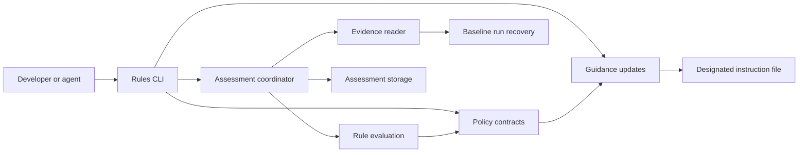
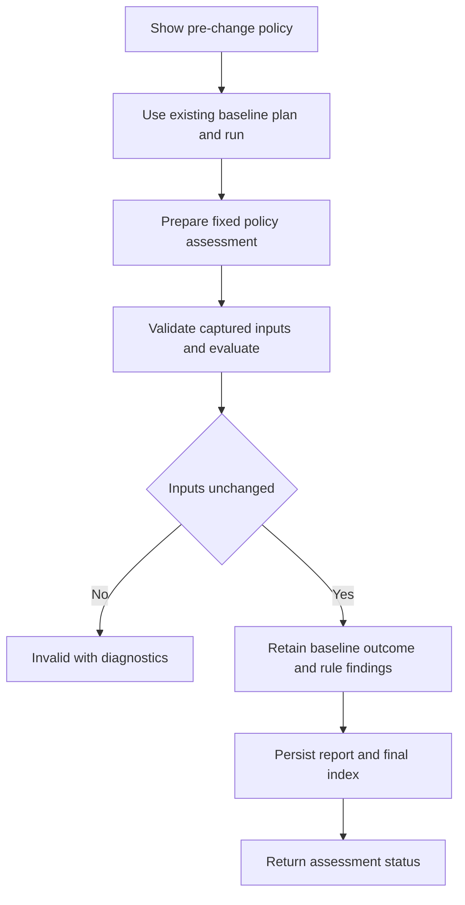

# Design Document: Agent Quality Rules

## Overview

Lesscode adds a local preventive-policy workflow for maintainers and coding agents. The workflow exposes rules before editing, evaluates completed baseline evidence under a fixed policy, and renders the same rules into a designated repository instruction file. Numeric findings and contextual review remain distinct.

This is an additive extension to the installed `lesscode-baseline` CLI. It consumes existing run artifacts; it does not execute analyzers or project workloads. The baseline evaluator retains authority over behavior, integrity and measurement definitions. A policy assessment can impose additional restrictions but cannot upgrade a non-accepted baseline result.

### Goals
- Make configured complexity, size and duplication limits actionable before and after a change.
- Separate inherited debt, regressions and residual debt without hiding individual entities.
- Require source-bound review of convolution, names and idiom when the policy declares it.
- Produce inspectable results and safe, explicit guidance updates with no new runtime dependency.

### Non-Goals
- Source transformations, agent execution, MCP, new analyzers or non-Python evaluation.
- A universal simplicity score, automatic semantic certification or inferred maintenance savings.
- Authenticating a reviewer through a name in a JSON document or protecting files against an actor with equal filesystem privileges.

## Boundary Commitments

### This Spec Owns
- Versioned policy, prepared assessment, entity-treatment, review, findings and guidance-update contracts.
- Selection of explicitly defined quantities from baseline evidence, rule interpretation, ratchets and bounded exceptions.
- Policy assessment storage, CLI commands, agent-facing guidance and examples of policy-conditioned trials.

### Out of Boundary
- Baseline measurement, workload isolation, run storage, behavior decisions and experiment statistics remain upstream.
- The short-file jscpd coverage limitation remains upstream; this feature preserves its incomplete result.
- The later skill owns agent workflow; it consumes this feature's policy and findings without defining another gate.
- External CI ownership, identity authentication and instruction-host precedence remain external controls. No hooks, daemon, automatic AGENTS discovery or source editing are introduced.

### Allowed Dependencies
- Python 3.12.10 and standard-library JSON, dataclasses, pathlib, hashlib, datetime, argparse and filesystem primitives.
- Existing baseline public contracts, `report.recover`, `decision.compare_metrics`, and experiment reconciliation/aggregation. Imports flow from `rules` to baseline, never from measurement or decision modules to `rules`.
- Existing locked Lizard 1.17.31 and jscpd 4.0.5 evidence through the baseline format only. No direct analyzer invocation or vendor-output parsing here.
- Existing build/test/CI infrastructure. Private baseline functions are not new extension points; narrowly scoped local validation or a separately justified upstream public helper is preferable to importing private internals.

### Revalidation Triggers
- Policy/result versions, selectors, debt classification, entity treatment or exit semantics change: revalidate CLI, guidance examples and downstream skill consumers.
- Baseline evidence schemas, definition IDs, scope identities, recovery or decision precedence change: revalidate evidence ingestion and all adverse fixtures.
- Generated guidance marker/rendering changes: revalidate preservation, conflict detection and idempotency.
- New analyzer, language, workload execution, authenticated review provider or cross-run reference support requires a new boundary review; it is not implicit implementation scope.

## Architecture

### Existing Architecture Analysis
The baseline has strict versioned records, immutable prepared plans, source inventories, typed metric payloads, behavior-first decisions and hash-indexed run storage. Its generic thresholds accept scalar metrics; structured complexity and duplication deliberately have no implicit scalar projection. Function records contain locations and analyzer names, not stable cross-revision symbol identities.

The extension therefore interprets policy in a separate `rules` package. Existing baseline CLI commands and version-1 run formats remain unchanged. A complete stored run can contain an incomplete or rejected evaluation; storage completion is never confused with policy acceptance.

### Architecture Pattern & Boundary Map



The pattern is a small functional core with filesystem work at its edges. Typed records are the shared seam; there are no rule plug-in classes, dependency injection framework or general expression language. Import direction is contracts → evidence and evaluation → assessment → CLI; guidance imports contracts, and storage imports contracts. Arrows here describe dependency order, while the diagram shows calls/data flow. Evidence does not import evaluation. Existing baseline modules do not import these modules except CLI dispatch.

### Technology Stack

| Layer | Choice / Version | Role | Change |
|---|---|---|---|
| CLI | Existing argparse CLI, CPython 3.12.10 | Add `rules` subcommands | Existing entry point retained |
| Policy logic | Frozen typed dataclasses and finite tagged unions | Input validation and deterministic decisions | No runtime dependency |
| Storage | UTF-8 JSON and Markdown; SHA-256 identities | Prepared inputs, findings and guidance previews | Separate policy artifacts, schema version 1 |
| Measurement | Existing baseline run schema version 1 | Authoritative observations and outcomes | No analyzer or schema changes |
| Verification | unittest and existing native three-OS CI | Contract, adverse and installed CLI checks | Extend current suites |

## File Structure Plan

### Directory Structure

| New path | Component / responsibility |
|---|---|
| `src/lesscode_baseline/rules/__init__.py` | Package identity; no re-export facade |
| `src/lesscode_baseline/rules/contracts.py` | Policy contracts and strict versioned input/output readers |
| `src/lesscode_baseline/rules/evidence.py` | Evidence reader: recovered run admission, selectors, scopes and entity inventories |
| `src/lesscode_baseline/rules/evaluate.py` | Rule evaluation: numeric rules, debt, reviews, exceptions and verdict |
| `src/lesscode_baseline/rules/assessment.py` | Assessment coordinator: prepare/check lifecycle and input integrity |
| `src/lesscode_baseline/rules/storage.py` | Assessment storage: manifests, result persistence, recovery and Markdown rendering |
| `src/lesscode_baseline/rules/guidance.py` | Guidance updates: applicable pre-change rules, preview and designated managed-block write |
| `src/lesscode_baseline/rules/cli.py` | Rules CLI parser and command dispatch |
| `tests/test_rule_contracts.py` | Schema and invalid-input cases |
| `tests/test_rule_evidence.py` | Run recovery, selectors, compatibility, populations and entity treatment |
| `tests/test_rule_evaluation.py` | Debt, budgets, exceptions, reviews and verdict tables |
| `tests/test_rule_assessment.py` | Frozen inputs, storage failures, replay and original preservation |
| `tests/test_rule_guidance.py` | Preview/apply, conflict, encoding, path and idempotency cases |
| `tests/test_rule_cli.py` | Installed command paths, exits and complete adopter workflows |
| `tests/fixtures/agent-quality-rules/` | Minimal typed run/policy/review/treatment fixtures; each scenario declares expected findings |
| `benchmarks/policies/agent-quality-rules/` | Explicit example policy, supplied trial records and interventions; no universal default policy |
| `docs/agent-quality-rules.md` | Adopter CLI, policy schema, scope/trust limits and AGENTS workflow |
| `docs/examples/agent-quality-rules.md` | Reproducible debt, review and policy-guided trial examples |

### Modified Files
- `src/lesscode_baseline/cli.py`: register and dispatch the nested `rules` parser only; existing commands/exits stay stable.
- `README.md`, `docs/README.md`: index the new workflow and examples with bounded claims.
- `.github/workflows/baseline-platforms.yml`: add installed rules/guidance smoke steps to the existing native matrix; existing full unittest discovery collects new tests.
- `.kiro/steering/product.md`, `.kiro/steering/structure.md`, `.kiro/steering/roadmap.md`: feature status and ownership documentation.

Baseline `contracts.py`, `decision.py`, `metrics.py`, `report.py`, `experiments.py`, dependency locks and package metadata require no format or runtime changes. Tests may import baseline record constructors to build valid evidence. Product source AGENTS.md is a possible explicit example target, not an automatic migration target.

## System Flows



The commands never launch the baseline flow. Users invoke its existing `plan` and `run` commands separately, preserving command disclosure and disposable source copies. Preparing records a completed run and a policy before any policy assessment. Baseline production may precede this step; the report explicitly states when policy was bound and does not claim the agent followed it beforehand.

Guidance has a separate two-step flow: render a preview artifact, then explicitly apply that artifact. A policy change, new baseline reference or changed review requires a new prepared assessment and new output directory. Previously failed reports are never rewritten.

## Components and Interfaces

| Component | Intent | Requirements | Key dependencies | Contracts |
|---|---|---|---|---|
| Policy contracts | Fixed vocabulary and validated records | 1.1, 1.2, 1.3, 1.4, 1.5, 1.7, 7.1 | Baseline records P0 | State |
| Evidence reader | Admit and select identified evidence | 2.1, 2.2, 2.3, 2.4, 2.5, 4.4, 4.5, 4.6 | Baseline recovery P0 | Service |
| Rule evaluation | Interpret policy without IO | 2.6, 2.7, 2.8, 3.1, 3.2, 3.3, 3.4, 3.5, 3.6, 3.7, 4.1, 4.2, 4.3, 4.7, 5.2, 5.3, 5.4, 5.5, 5.8, 7.2, 7.3, 8.9 | Policy contracts P0 | Service |
| Assessment coordinator | Freeze, recheck and orchestrate | 1.3, 3.8, 7.4, 7.5, 8.6, 8.8 | Reader, evaluation, storage P0 | Service / State |
| Guidance updates | Render and safely apply scoped instructions | 1.1, 1.5, 1.6, 5.1, 5.6, 5.7, 6.1, 6.2, 6.3, 6.4, 6.5, 6.6, 6.7 | Policy contracts P0 | Service / State |
| Assessment storage | Preserve complete and partial evidence | 7.6, 8.1, 8.2, 8.3, 8.4, 8.6 | Policy contracts P0 | Service / State |
| Rules CLI | Local workflow and distinct outcomes | 8.5, 8.7, 8.8, 9.1, 9.2 | Components above P0; experiment commands P2 | Batch |

### Policy contracts

Contracts: State. Strict JSON readers reject duplicate keys/IDs, unknown fields, nonfinite numbers, bool-as-number, unsafe paths, unsupported schema versions/selectors and inconsistent combinations. New records use type hints, immutable tuples and frozen dataclasses; mutable dictionaries are detached on input as in baseline contracts. Canonical identity is SHA-256 of validated, canonical JSON using the existing serialization convention. Exact raw input byte hashes are recorded separately for change detection.

Policy fields: `schema_version=1`, `policy_id` (display name), `target_scope` (relative root and POSIX case-sensitive include/exclude globs), `reference` (explicit baseline source hash and frozen profile hash, nullable only when all rules are absolute without change budgets), `rules`, and `exceptions`. All overlapping rules apply, sorted by rule ID; there is no first-match override or implicit threshold. Scope rules use the baseline pattern semantics.

Rule variants share `rule_id`, `scope`, `enforcement` (`blocking|advisory`) and `description`:
- `numeric`: selector, expected evidence definition/producer/version/unit, mode (`absolute|ratchet`), optional absolute maximum, optional change budget (`absolute_increase|percentage_increase`, nonnegative maximum). At least one bound is required; ratchet requires an absolute maximum and reference. Budgets require reference in either mode.
- `check`: exact baseline check ID and expected `passed`; no alternate command or untyped truth value. This can identify declared API/invariant checks without implementing them.
- `review`: criterion ID/text and trust requirement (`producer_record|external_independence`). Mandatory semantic review is a blocking review rule.

Initial selectors are a finite vocabulary: `function_ccn`, `scalar_metric`, `duplication_clone_pairs`, `duplication_duplicated_tokens`, `duplication_total_tokens`, `duplication_pair_span_ratio`. A scalar selector includes the exact metric key; LLOC or nesting can use this only when supplied scalar evidence has the required meaning/scope. No implicit reduction of findings payloads, coverage or architecture data. Architecture/public contracts use named checks; unsupported shapes are disclosed, not projected.

### Evidence reader

Contracts: Service. Outbound dependencies: `report.recover` and baseline typed records (P0); `decision.compare_metrics` for compatibility diagnostics (P0).

```python
def read_evidence(run_directory: Path, policy: Policy) -> EvidenceBundle | RuleFailure: ...
def select_observations(evidence: EvidenceBundle, rule: NumericRule) -> tuple[EntityObservation, ...]: ...
```

Admission requires complete recovery with verified artifact hashes. For this first version, the run must include a hash-indexed `PreparedPlan` in `plan.json`; report-only stores cannot establish the fixed check/profile inventory and are insufficient. Bind the prepared plan hash, report plan hash, both snapshot identities, canonical frozen profile hash and actual indexed artifacts. Verify these relationships, not merely that each JSON file parses. Retain the baseline decision unchanged.

The policy reference selects the baseline side of this one run, not a second independently produced run. Its declared source/profile hashes must match. An intentional reference update creates a different policy identity and prepared assessment. Version 1 does not merge runs or accept an unrelated earlier accepted report as a reference shortcut.

Function CCN reads `ComplexityPayload.functions`, retaining path, long_name, line span, producer definition and the original evidence reference. Locations are evidence addresses, not proof of stable identity. Scalar values retain their own unit/definition. Duplication pair count is `len(clones)`; token selectors retain the upstream pair-span numerator and total-token denominator. Ratios are fractions under the upstream definition, may exceed one, and are not unique-source coverage percentages.

Function-level selection may filter the complete function inventory by declared paths. Aggregate scalar/duplication selection requires the entire supplied population to match the rule scope; it cannot slice a repository aggregate into a directory result. Reject ambiguous empty selections as unavailable for blocking rules, with no vacuous pass. Inventory-confirmed zero functions in a matching, nonempty product scope is a legitimate zero-entity inventory and is disclosed. Scope outside the run or missing inventory is unavailable. Required short-file omissions remain incomplete.

Comparison requires compatible key, definition, producer/version, unit, scope and required population. Changed source content alone is expected; changed scope definitions are not. A baseline `scope_hash` identifies scope rules, not the actual measured population: validate snapshot product-file sets and payload inventories as well. Population changes allowed by the same declared scope remain visible; a rule cannot silently substitute a different subset. For reference-dependent comparisons, existing `compare_metrics` compatibility is necessary, and selector-specific population checks are additional. An absolute-only rule evaluates candidate evidence without requiring a reference metric; the underlying baseline decision still governs overall acceptance. Preserve all noncomparability reasons. Undefined ratios and percentages with reference zero remain unavailable even if the candidate is zero.

### Rule evaluation

Contracts: Service. Outbound dependency: policy contracts (P0). Inputs are validated value objects, not paths.

```python
def evaluate_rules(prepared: PreparedAssessment, evidence: EvidenceBundle,
                   reviews: tuple[ReviewRecord, ...],
                   treatments: tuple[EntityTreatment, ...]) -> PolicyResult: ...
```

Numeric comparisons use inclusive maxima. For a comparable scalar or matched entity, absolute delta is candidate minus reference; percentage increase is 100 times delta divided by reference. Improvements cannot offset another entity's violation. Findings retain both sides even when unchanged or worsening.

#### Reference treatment and debt
Automatic function matching is allowed only for the same product path with identical file bytes and identical inventory location/name. For changed files, analyzer names are suggestions only. A source-bound treatment record explicitly establishes `matched`, `new`, `removed` or `unresolved` for exact baseline/candidate inventory IDs. Matched treatment is one-to-one; duplicates, absent IDs and contradictory treatments are invalid. Split/merge cases are unresolved unless explicitly treated as removals/new entities, whose candidate limits are assessed without inherited allowance. Treatment records carry producer identity and rationale and are disclosed as claims, not semantic proof.

A missing treatment never grants grandfathering. An unmatched candidate already over the limit is reported with a potential violation and insufficient reference treatment; if it can be rejected under every possible treatment, rejection is safe. A blocking comparison that could pass only with a match stays insufficient. New entities face the absolute limit. A delta-only budget on a declared new entity has no reference value and is unavailable; users can use an absolute bound for new code. Removed entities remain visible; their absence does not prove API preservation.

For a matched entity with reference `b`, candidate `c`, maximum `L`:
- Absolute mode violates when `c > L`.
- Ratchet mode reports new debt when `b <= L < c`, worsened debt when `L < b < c`, inherited debt when `L < b == c`, improved residual debt when `L < c < b`, and resolved debt when `c <= L < b`.
- An explicit budget is an additional conjunct, including below-limit changes. Worsened above-limit debt remains a ratchet violation even if a permissive budget would allow the numerical increase. To allow a specific exception, declare it visibly.
- Above-limit new entities violate; at-limit entities pass. Comparisons below the limit are still reported as improved/unchanged/worsened observations.

#### Semantic review and exceptions
Each review binds criterion/rule ID, reviewed scope, candidate source hash, policy hash, reviewer/producer ID, outcome (`satisfied|concern|unresolved`), nonempty rationale and code spans. Validate span paths against the candidate inventory, positive ordered line numbers and covered scope against the applicable criterion. Exact prose-to-code relevance remains a producer claim; inventory membership does not establish semantic accuracy. Required review with wrong identities, missing records or unresolved outcomes is insufficient. Conflicting or duplicate records for one criterion/scope are invalid rather than last-writer-wins. `concern` is a rule violation; `satisfied` only fulfills a rule whose trust condition is supported.

Version 1 can accept a disclosed `producer_record` under a policy explicitly allowing it. `external_independence` stays unverified: a local record or a field claiming independence is not authentication, and this version has no external identity provider. Guidance says this before the check, so users do not mistake an unsupported trust requirement for an enforceable local capability.

A check rule selects exactly one candidate `CheckEvidence` by the declared ID, validates source/plan binding and reports passed, failed or insufficient evidence. A missing or unavailable check is insufficient, never satisfied. Its baseline counterpart and all other declared behavior checks remain governed by the original baseline outcome; rule selection cannot narrow away upstream failures.

Exceptions apply only to known numeric violations, never check rules, review requirements, evidence availability or baseline outcomes. Each exception has an ID, exact rule ID, scope/entity targets, justification, inclusive UTC `valid_from`, exclusive UTC `valid_until`, and optionally a candidate source hash. The explicit assessment `as_of` instant determines active/expired/inapplicable state. All matching exception IDs are retained with the original violation. No wildcard waiver of missing evidence is supported. Changing exception validity requires a new policy identity.

#### Overall result
Keep two independent fields: `baseline_decision` (original upstream outcome) and `policy_verdict` (`satisfied|violations|insufficient|invalid`). Precedence is invalid integrity/input; then established blocking violations; then insufficient blocking evidence; then satisfied. Underlying rejected maps to violations, invalid to invalid, incomplete/baseline-ineligible to insufficient unless an independent stronger failure exists. Every baseline reason remains visible. `policy_accepted` is true only when the upstream decision is accepted and policy verdict is satisfied. Advisory findings do not independently block.

### Assessment coordinator

Contracts: Service / State. Outbound dependencies: evidence reader, evaluation and storage (P0).

```python
def prepare_assessment(request: AssessmentRequest, output: Path) -> PreparedAssessment | RuleFailure: ...
def check_assessment(prepared_path: Path, output: Path) -> PolicyResult | RuleFailure: ...
```

Preparation validates policy and the run, captures exact inputs and inventories, and writes a new prepared JSON artifact. Inputs include policy bytes, run artifact index and all indexed bytes, plan/profile/check inventory, review and treatment records, and explicit `as_of`. It records original absolute paths plus hashes and embeds validated values for reproducibility. Outputs cannot overlap source roots, evaluator code, inputs or run directories. Preparation is read-only with respect to these inputs.

Checking rereads and verifies captured resources before evaluation and immediately before finalization. It operates on the captured validated values. A changed or missing original input invalidates the assessment; it does not silently use a newer file. Policy scope/exclusions, check inventory, reference, review and exception changes are included. Artifacts are locally checked for consistency, not cryptographically authenticated against a hostile owner. Replay uses identical captured values and time context; only timestamps/output paths may differ. New policy assessments always use fresh output directories.

### Guidance updates

Contracts: Service / State. Outbound dependency: policy contracts (P0). This is a renderer for the same policy, not a second policy source.

```python
def render_guidance(policy: Policy, scope: str) -> GuidanceDocument: ...
def preview_guidance(document: GuidanceDocument, root: Path,
                     target: Path, output: Path) -> GuidanceUpdate | RuleFailure: ...
def apply_guidance(update_path: Path) -> GuidanceApplyResult | RuleFailure: ...
```

Generated guidance states policy identity, target scope, reference conditions, enforcement levels, unavailable selectors/trust modes and that it is pre-change guidance. It includes role-revealing names, idiomatic constructs, coherent responsibilities, repeated policy, unnecessary indirection, speculative abstractions, simpler alternatives and conceptual/change burden. It preserves behavior, public fields and APIs and prefers deletion/reuse before adding structure. A readability recommendation is not rename authorization.

Users provide one explicit repository root and instruction-file target. Resolve containment and reject symlinks/reparse points in target/parents, outside-root paths and ambiguous case aliases. Support UTF-8 with optional BOM and preserve original newline style and all bytes outside one marked block. Unsupported encoding, repeated/nested/unbalanced markers or existing user content inside a purported managed block without a matching recorded base cause conflict rather than replacement.

Managed markers use a fixed schema marker and block ID, with rendered policy hash inside and a body digest recorded in the closing marker. Verify the existing body against that recorded digest before preparing an update; edits to the body require user reconciliation, not automatic adoption. This is local edit detection, not authentication of the block author. Preview records target identity, original full-file hash or absence, original managed-block hash, proposed full-file bytes/hash, policy hash and diff. For first installation append a new block without adopting existing prose. The preview is displayed and persisted; `guidance-apply --preview ...` is the explicit write request. The caller does not need another interactive prompt after that request.

Application validates the preview and current policy bytes, uses an exclusive cooperating-writer lock, rechecks full target bytes, writes a sibling temporary file and atomically replaces the designated regular file. First creation must fail if a file appeared meanwhile. Preserve file permissions; retain original bytes in the preview for recovery. A changed full file, including changes outside the managed block, produces a conservative conflict with no target write. Equal proposed/current bytes is a no-op with no content or timestamp rewrite. Refuse a missing original file that previously existed. Cleanup removes only files created by this operation.

The lock coordinates this CLI, not arbitrary editors. Document the residual last-instant external-writer race and require a quiescent target during apply; do not claim portable compare-and-swap or adversarial filesystem protection. Existing instruction precedence remains host-defined; generated text states scope and asks for explicit resolution of conflicts instead of overriding unrelated instructions.

### Assessment storage

Contracts: Service / State. Outbound dependency: policy contracts (P0). Preserve the baseline's index-last pattern without making policy reports pretend to be baseline `RunReport` values.

```python
def persist_policy_result(result: PolicyResult, prepared: PreparedAssessment,
                          target: Path) -> PolicyArtifactIndex: ...
def recover_policy_result(target: Path) -> PolicyRecovery: ...
```

A fresh directory contains `manifest.json`, `prepared.json`, captured policy/review/treatment inputs, `result.json`, `summary.md`, diagnostics and `artifacts.json` written last. The manifest distinguishes prepared/running/finalized storage state from the verdict. Evidence references include run/artifact hash and JSON record address; referenced baseline runs remain external and are reverified when recovering an assessment for trusted use. A moved/missing baseline run leaves standalone findings readable but their external evidence unverified; it never becomes a verified complete assessment.

Result findings include rule ID, scope, entity identity, reference/candidate values, unit/definition/producer, bounds, basis, disposition, enforcement, locations, evidence references, reason and exception IDs. Summary groups inherited debt, regressions, improvements, exceptions and unavailable evidence. It includes every requested observation, unfavorable counters, trust limitations and original baseline outcome. Markdown escapes supplied names and rationale; JSON is canonical, versioned and control characters are escaped.

On persistence failure preserve written files and available diagnostics, return failure, and leave no final index suggesting completion. If the output itself is unwritable, emit a versioned partial diagnostic to stderr without claiming durable storage. Recovery validates the complete required file set and every indexed hash. A report-production success is not an assessment success.

### Rules CLI

Contracts: Batch. Inbound dependency: existing CLI dispatch (P0); outbound: the components above (P0).

```text
lesscode-baseline rules show --policy POLICY --scope PATH
lesscode-baseline rules prepare --policy POLICY --run RUN --as-of UTC --out PREPARED
    [--reviews FILE ...] [--treatments FILE ...]
lesscode-baseline rules check --prepared PREPARED --out NEW_DIRECTORY
lesscode-baseline rules guidance-preview --policy POLICY --scope PATH
    --root REPOSITORY --target AGENTS.md --out PREVIEW
lesscode-baseline rules guidance-apply --preview PREVIEW
```

All file inputs and scope arguments are explicit. `show` lists supported selectors and reports whether optional evidence or trust requirements need additional inputs; it cannot predict post-change satisfaction. Scope is repository-relative, never the process working directory by implication. Existing startup stays analyzer-free.

`check` exits: 0 policy accepted, 1 blocking violations, 2 invalid input/integrity, 3 insufficient evidence, 4 internal/persistence failure. Other commands return 0 only for the requested preparation/guidance operation, 2 for invalid input/conflict and 4 for IO/internal failure, with an explicit `operation` and no fabricated assessment verdict. No subcommand runs project workloads, installs tools or contacts a service. Existing baseline commands remain the only execution path, retaining their disclosure/limits and source preservation.

## Data Models

### Domain Model
The aggregate is a prepared assessment over one baseline run and one policy. Immutable reference and candidate observations belong to baseline; policy owns interpretation. Guidance is a derived view identified by policy hash, renderer version, scope and resulting text hash. No generated prose feeds back into rule evaluation.

### Logical Data Model

| Record | Identity and relationships | Required content |
|---|---|---|
| Policy | Canonical hash; unique rule/exception IDs | Version, scope, reference, typed rules, exceptions |
| EntityObservation | Source hash + metric identity + exact location or aggregate scope | Values, definitions, inventory/evidence addresses |
| EntityTreatment | Policy hash + both source hashes + inventory IDs | Matched/new/removed/unresolved, producer and rationale |
| ReviewRecord | Policy hash + candidate source + rule/scope | Outcome, producer, rationale, spans, provenance |
| PreparedAssessment | Canonical hash and original resource byte identities | Policy, run/plan identities, review/treatment hashes, as_of |
| PolicyFinding | Stable rule/entity/basis tuple | Evidence, bounds, disposition, blocking/advisory, exception effects |
| PolicyResult | Prepared hash, schema version 1 | Original baseline outcome, verdict, accepted flag, all findings/diagnostics |
| GuidanceUpdate | Preview hash, policy hash, target identity | Before/proposed bytes and hashes, renderer version, diff |
| PolicyArtifactIndex | Assessment identity and file hashes | Complete required artifact inventory |

All reference integrity is validated at the boundary. Explicit `null` means unavailable/not applicable only where declared; it does not mean zero. Finding order is rule ID, scope, entity address and comparison basis, independent of file discovery order. Exceptions use the recorded UTC instant, never an implicit current clock during replay.

### Data Contracts & Integration
Schema version 1 is independent of baseline schema version 1. Strict readers fail closed for future versions. Existing scalar optional evidence can be imported through the baseline's `OptionalEvidenceArtifact` workflow, preserving its source/plan binding and producer-supplied designation. This feature does not import an unbound Radon report directly.

Trial comparison reuses `TrialConditions.interventions`, `Arm.interventions`, `ExperimentManifest.allowed_interventions` and the existing `summarize` command. Examples declare `policy_hash`, `guidance_hash`, `guidance_renderer_version` and `enforcement_mode` as intervention fields, using explicit null values for the unguided arm. Controlled model/settings/task/source/prompt/budget differences remain visible through existing reconciliation. Trial records retain their producer-claim limitation. No second statistics engine is added.

Static metrics do not become telemetry. Existing observed token/cost/elapsed evidence remains separate. The example can record observed review/task durations as explicitly defined supporting evidence, but unsupported maintenance effort and savings stay labelled unmeasured. Fixtures establish command behavior, not general effectiveness.

## Error Handling

| Condition | Response | Recovery |
|---|---|---|
| Invalid policy/version/duplicate input or hash drift | Invalid, precise field/resource diagnostic | Correct inputs and prepare new assessment |
| Missing run completion/plan or required measurement/review | Insufficient with original baseline status | Obtain matching evidence; no fabricated zeros |
| Baseline failed behavior/integrity | Original status retained, acceptance prohibited | Resolve upstream under a new evaluation |
| Established blocking rule failure | Violations, all entity findings retained | Change candidate or explicitly identify a new policy |
| Uncertain entity/reference treatment | Insufficient where pass depends on it | Supply source-bound treatment, or assess under absolute policy |
| Guidance target conflict | No target modification; conflict diagnostic | Inspect changed file and prepare a new preview |
| Interrupted/failed output | Partial files/diagnostics, no final completion index | Fresh output directory; recovery reports incomplete |

No retries silently mutate inputs or replace a prior report. Diagnostics identify the responsible rule and evidence address without dumping unrelated environment variables or file content.

## Requirements Traceability

| Requirement | Summary | Components | Interfaces | Flows |
|---|---|---|---|---|
| 1.1, 1.2, 1.4, 1.5, 1.7 | Explicit validated rules without hidden defaults | Policy contracts, Guidance updates | Policy, show | Pre-change |
| 1.3 | Bind policy before assessment | Assessment coordinator | prepare_assessment | Prepare/check |
| 1.6 | Pre-change label | Guidance updates | GuidanceDocument | Show/preview |
| 2.1, 2.2, 2.3, 2.4, 2.5 | Named quantities and supplied checks | Evidence reader | select_observations | Evidence selection |
| 2.6, 2.7, 2.8 | Inclusive limits, undefined comparisons, entity findings | Rule evaluation | evaluate_rules | Assessment |
| 3.1, 3.2, 3.3, 3.4, 3.5, 3.6, 3.7 | Reference, debt modes and uncertain entities | Evidence reader, Rule evaluation | EntityTreatment | Assessment |
| 3.8 | Explicit reference replacement | Assessment coordinator | PreparedAssessment | New preparation |
| 4.1, 4.2, 4.3, 4.7 | Behavior and evidence cannot be waived | Rule evaluation | PolicyResult | Verdict |
| 4.4, 4.5, 4.6 | Compatible definitions/populations and coverage | Evidence reader | EvidenceBundle | Admission/selection |
| 5.1, 5.6, 5.7 | Contextual criteria and API-safe advice | Guidance updates | render_guidance | Pre-change |
| 5.2, 5.3, 5.4, 5.5, 5.8 | Source-bound review and disclosed trust | Rule evaluation | ReviewRecord | Assessment |
| 6.1, 6.2, 6.3, 6.4, 6.5, 6.6, 6.7 | Scoped safe instruction updates | Guidance updates | preview_guidance, apply_guidance | Preview/apply |
| 7.1, 7.2, 7.3 | Bounded exceptions retain violations | Policy contracts, Rule evaluation | Exception, PolicyFinding | Assessment |
| 7.4, 7.5 | Drift invalidates; deliberate changes get new identities | Assessment coordinator | prepare_assessment, check_assessment | Prepare/check |
| 7.6 | Local integrity versus external authority | Assessment storage, Guidance updates | Summary, GuidanceDocument | Results |
| 8.1, 8.2, 8.3, 8.4 | Versioned actionable and balanced output | Assessment storage | PolicyResult, summary.md | Persist |
| 8.5, 8.7 | Distinct local command outcomes on three OSes | Rules CLI | Batch commands/exits | CLI |
| 8.6 | Partial work remains incomplete | Assessment coordinator, Assessment storage | RuleFailure, PolicyRecovery | Failure |
| 8.8 | No new workload execution; preserve upstream path | Rules CLI | Existing plan/run | Baseline then rules |
| 8.9 | Deterministic identified replay | Rule evaluation, Assessment coordinator | PreparedAssessment | Replay |
| 9.1, 9.2 | Reproducible adverse and semantic examples | Rules CLI, Guidance updates | Example policies/fixtures | Adopter E2E |
| 9.3, 9.4, 9.5 | Versioned trial interventions and bounded claims | Existing experiment reconciliation, documentation | TrialConditions.interventions, summarize | Supplied trial comparison |

## Testing Strategy

### Unit Tests
- Policy contracts: duplicate IDs/keys, unknown selectors/version, bool/nonfinite/negative bounds, overlapping rules, explicit units and no defaults (1.2, 1.4, 1.5, 1.7).
- Evidence reader: function CCN locations; physical lines versus LLOC/NLOC; duplicate pair-span denominator including ratio above one; wrong producer/version/scope; aggregate narrowing; actual short-file incomplete report; zero denominators (2.1, 2.2, 2.3, 2.4, 2.5, 2.7, 4.4, 4.5, 4.6).
- Rule evaluation: reference 56, limit 10 with candidates 56/54/57 gives inherited/improved-residual/worsened; reference 4 to 11 gives new violation; equality 10 passes; absolute 56 fails; below-limit budget regression, new delta-only unavailable, removed and ambiguous split/rename cases; one improvement never cancels another regression (2.6, 2.8, 3.1, 3.2, 3.3, 3.4, 3.5, 3.6, 3.7).
- Review and exceptions: lower CCN with missing review stays insufficient; wrong source/policy, concern, unresolved, duplicate review and claimed independence; exception time boundaries, wrong scope, expired and attempts to waive behavior/missing evidence (4.1, 4.2, 4.3, 4.7, 5.2, 5.3, 5.4, 5.5, 5.8, 7.1, 7.2, 7.3, 9.2).
- Guidance: whole-file bytes outside block preserved, BOM/CRLF/LF, first install and exact repeat, changed managed or unrelated content, missing/duplicate markers, changed policy, path escape/link/reparse cases and competing writer conflict (6.1, 6.2, 6.3, 6.4, 6.5, 6.6, 6.7).

### Integration Tests
- Recover a real complete baseline run, bind profile/plan/source, prepare policy, check and recover output; accepted upstream plus satisfied rules is the only accepted path (1.3, 4.1, 8.1, 8.2).
- Mutate policy, exclusions, plan/check inventory, run artifact, review or treatment after prepare and during checking; verify invalidation and unchanged prior artifacts (3.8, 7.4, 7.5).
- Interrupt/fail writes before and after report creation; absent/mismatched final index never passes recovery; stderr documents unwritable output (8.6).
- Replay identical captured inputs with fixed as_of; compare canonical findings/verdict, retaining unfavorable counters and advisory unavailability (7.6, 8.3, 8.4, 8.9).

### Installed CLI and Adopter E2E
- On native Windows, Linux and macOS, use the built wheel outside the checkout: show policy, prepare/check a baseline-backed fixture, verify each exit category and JSON operation kind, preview/apply to a temporary AGENTS.md, repeat unchanged and verify no rewrite (1.1, 1.6, 8.5, 8.7, 9.1).
- Follow documented commands from a real baseline plan/run to policy assessment; record that rules commands launch no child workloads and original source/test/instruction files remain unchanged except the requested target (8.8).
- Inspect generated semantic guidance for all six criteria, simpler-alternative burden and preservation of public fields/signatures; verify a required unreviewed criterion prevents acceptance (5.1, 5.6, 5.7, 9.2).
- Supply guided/unguided TrialRecords to existing summarize, preserving policy/guidance identities, an intentionally confounded control and missing telemetry. Verify both favorable/unfavorable observations and explicit unmeasured maintenance effort, without effectiveness claims (9.3, 9.4, 9.5).

Use small independent expected-outcome fixtures, not snapshots that merely repeat evaluator output. Run the baseline regression suite unchanged in addition to focused tests. No performance threshold is invented: monitor artifact-read cost and keep evaluation bounded by rule/entity count; do not add caches or parallel execution without measured need.

## Security Considerations
Policy hashes and protected external CI serve different purposes. Local hashing detects inconsistency; an actor controlling policy, prepared files, evidence and evaluator can fabricate internally consistent records. Reports disclose that limit. CI adoption pins evaluator/policy/checks outside the agent-writable candidate workspace and controls review provenance externally. This feature does not claim to configure those permissions.

Guidance is the only repository write. Explicit target, path checks, preview, preservation, cooperating-writer lock and conflict handling constrain that write. Rule input contains no executable expressions, shell commands or network endpoints. Imported review prose is data, escaped for display, never instructions to the evaluator.

## Migration Strategy
This feature is opt-in. Existing plan/run/summarize users and report schemas retain their behavior. Implementation proceeds through contracts, evidence/evaluation, storage/orchestration, guidance/CLI and then examples/native validation. No existing policy or AGENTS file is automatically installed, adopted or rewritten. Release notes describe the new nested commands and independent versioned formats. The downstream skill is designed only after this feature's contract is approved.
