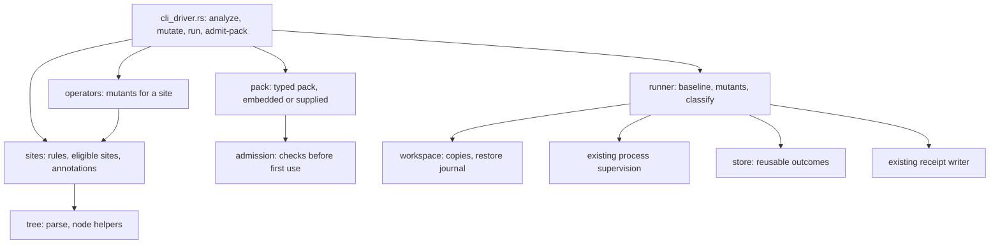

# Design: agnostic driver in `lesscode-core`

Generated 2026-11-10. **Approved by the owner on 2026-11-10** ("approved"), which also approves the two grammar features. The fixture question at the end was not answered and stays open.
Basis: [requirements](requirements.md) (approved 2026-11-10), the [prototype gate](prototype-gate.md)
(`proceed`), the sizing spike [R65](../../../docs/research/2026-11-10/11-annotation-driver-rust-sizing-spike.md)
and the [feasibility report](../../../docs/reports/agnostic-driver-feasibility.md).

## Overview

The driver finds the places in a source file where behaviour is decided, plants small faults there, and runs
the project's own tests to see which faults they catch. All knowledge about a language is a data pack. The
driver is one module tree inside the `lesscode-core` binary; nothing else has to be installed.

It replaces six adapter files that match text (three analyzers, three sets of substring operators) and gives
Python what it never had. What was demonstrated in the Python prototype is ported as it stands; what was not
demonstrated natively, the batch runner, is designed here from the prototype's harness and the crate's
existing process supervision.

### Goals

- One engine for Rust, Python, TypeScript and Java, driven by admitted packs (Requirements 1 to 3).
- A mutation run against the project's tests that cannot damage the examined code (Requirements 4 and 5).
- Validation of sites selected elsewhere, with no model in the binary (Requirement 6).
- Deletion of every specimen-bound rule (Requirement 7), in one binary within the per-file budgets
  (Requirement 8), held to the prototype's results (Requirement 9).

### Non-Goals

- Calling a model, writing packs, optimising prompts. Pack authoring stays a maintainer step outside the
  binary; drift hardening is Slice B.
- New operator ideas beyond the prototype's (fewer non-compiling mutants in typed languages, non-literal
  failure returns). They are listed as follow-ups, not designed here.
- Faster Rust scopes. Per-mutant rebuilds stay; the design only makes sure they are not misclassified.
- Regeneration, equivalence, density, the pre-push hook.

## Boundary Commitments

### This Spec Owns

- `native/src/driver/` and `native/packs/`.
- The behaviour of `deconvolute analyze` and `deconvolute mutate`, and a new `deconvolute run`.
- Removal of `native/src/adapters/{rust,java,typescript}/{analysis,mutation}.rs` and the tests that pin their
  specimen-specific behaviour.

### Out of Boundary

- `prepare`, `compare`, `admission`, `surface`, `regenerate`, `density`, `budgets`, the hook: unchanged.
- The metrics modules of the adapters and the specimen trace runners: unchanged.
- The apparatus cap's counted set (R41): unchanged; the driver is outside it by owner decision of 2026-11-10
  and is registered file by file in `native/complexity-budgets.json`.

### Allowed Dependencies

- Already in the crate: `ast-grep-core`, `ast-grep-language` 0.51.0, `serde`, `serde_json`, `sha2`, `clap`.
- New, both part of the pinned `ast-grep-language` and both MIT: the features `tree-sitter-rust` and
  `tree-sitter-java` (crates `tree-sitter-rust` 0.24.2, `tree-sitter-java` 0.23.5). This is the dependency
  decision the technology steering asks for; approving this design approves it.
- Nothing else. Threads, hashing and atomic file replacement use the standard library and what is listed.

### Revalidation Triggers

- A change of the pinned parser crates or of a grammar version: re-admit every shipped pack and rerun the
  parity tests (Requirement 8.4).
- A change to a pack, an operator or a site rule: rerun the parity tests; an intended difference from the
  retained receipts needs a dated research entry.
- A change to how commands are run or classified: rerun the runner tests and one full batch per language.

## Architecture

### Existing Architecture Analysis

- The analyzers walk `source.lines()` and match text; the generators replace fixed substrings. Neither
  parses. They implement the carrier traits `StateFrameAnalyzer` and `AdverseMutantGenerator` in
  `adapter_traits.rs`, bundled per language in `adapters/<lang>/mod.rs`.
- `specimen_runner.rs` already starts a process with a deadline and captures its output
  (`NativeSpecimenRunner`), and `recording.rs` has a tree kill for Windows. `receipt.rs` writes a JSON receipt
  with a SHA-256 sidecar.
- `cli_deconvolute.rs` holds the handlers for `analyze` and `mutate` and stands at 399 of 400 lines.
- The existing mutation model has six kinds named after specimen faults (`MissingFailureState`,
  `InvertedCondition`, `InvertedErrorOrder`, `SilentNone`, `BoundaryOffByOne`, `TruncatedStream`) and already
  distinguishes `InfrastructureFailure` from `Killed`, `Survived`, `Invalid` and `Timeout`.

### Architecture Pattern & Boundary Map



The engine (`tree`, `sites`, `operators`) never touches the file system beyond reading what it is given and
never starts a process. Only `workspace` writes source files, and only inside a copy. Only `runner` starts
processes, through the existing supervision.

### Technology Stack

Rust 1.98.1, the crate's pinned dependencies, two more grammar features. Packs are JSON files embedded with
`include_str!` and optionally read from a directory the caller names.

## File Structure Plan

### Directory Structure

Sizes for the first five files are measured in the spike; the others are estimates. Every file stays within
400 physical lines and 80 lines per function.

| File | Responsibility | Lines |
| --- | --- | --- |
| `native/packs/{rust,python,typescript,java}.json` | The admitted packs of the gate (version 1) | 115 in total |
| `driver/mod.rs` | Module wiring, shared types (`Site`, `Mutant`, `Kind`) | about 60 |
| `driver/pack.rs` | Typed pack, loading, embedded packs | 133, measured |
| `driver/tree.rs` | Parsing, wrapper chains, child and token helpers | 104, measured |
| `driver/sites.rs` | Site rules, eligible sites, annotation validation | about 320, measured as `validator.rs` |
| `driver/operators.rs` | Operators, de-duplication, mutant classification | about 330, measured as `engine.rs` |
| `driver/source.rs` | Reading scope files with their line endings, test-path rule | 153, measured |
| `driver/admission.rs` | Pack admission on the typed pack; control replay | about 180 |
| `driver/config.rs` | Run configuration (commands, limits, patterns, workers) | about 120 |
| `driver/workspace.rs` | Copies, restore journal, refusal rules | about 220 |
| `driver/runner.rs` | Batch protocol, classification, worker pool | about 330 |
| `driver/store.rs` | Reusable outcomes | about 90 |
| `cli_driver.rs` | Handlers for `analyze`, `mutate`, `run`, `admit-pack` | about 280 |

### Modified Files

- `cli_deconvolute.rs`: the `analyze` and `mutate` handlers move to `cli_driver.rs`; the file shrinks and keeps
  `density` and the hook entry points.
- `adapters/<lang>/mod.rs`: `analyzer` and `mutant_gen` are implemented by the driver for every language;
  a Python adapter module is added with the same shape.
- `mutant_generator.rs`, `adapter_traits.rs`: the six specimen kinds are mapped onto driver operators (see
  Migration Strategy); `TruncatedStream` has no driver operator.
- `Cargo.toml`, `Cargo.lock`, `LICENSES.md`, `THIRD_PARTY_NOTICES.txt`: two grammar crates.
- `complexity-budgets.json`: the driver files added, the six adapter files removed.
- Deleted: `adapters/{rust,java,typescript}/{analysis,mutation}.rs` (869 lines).

## System Flows

### Analyze and mutate (no process is started)

1. Load the pack for the language (embedded, or from the directory given) and admit it; a pack that fails
   admission stops the command (Requirement 1.5, 1.6).
2. Parse the file; a parse failure is reported with its position and no sites are listed (2.5).
3. `analyze`: list eligible sites; write the receipt with write sites, function boundaries and declared gaps;
   apply a frame specification if given (2.3, 2.4).
4. `mutate`: produce every mutant of every site, drop invalid and duplicate ones, write the mutant files and
   the receipt; exit with the finding code when there is none (3.1 to 3.6).

### Run

```mermaid
sequenceDiagram
    participant C as caller
    participant R as runner
    participant W as workspace
    participant P as process supervision
    C->>R: run(config, source root, work dir, workers)
    R->>W: refuse if work dir is in the source root; recover journals; create copies; run setup
    loop each worker
        R->>P: build and test, unmutated
        P-->>R: baseline time, must pass
        loop mutants from the shared queue
            R->>W: journal, write mutant
            R->>P: build and test with the scaled limit
            P-->>R: exit code, output
            R->>W: restore original, verify hash, clear journal
            R->>R: classify, store outcome
        end
        R->>P: build and test, unmutated, must pass
    end
    R-->>C: receipt (classes, counts, limits, identities, incomplete or void)
```

## Requirements Traceability

| Requirement | Realised by |
| --- | --- |
| 1.1, 1.2, 1.7 | `pack.rs`, `native/packs/`; engine files contain no language or project name (checked by a test that scans them) |
| 1.3 to 1.5 | `admission.rs`: size, typed shape, node kinds against the grammar, template placeholders, control replay |
| 1.6 | `pack.rs` returns "language not supported"; `cli_driver.rs` exits 3 and writes nothing |
| 2.1 to 2.6 | `sites.rs`, `tree.rs`, `source.rs`; `cli_driver.rs` for the receipt and exit codes |
| 3.1 to 3.7 | `operators.rs`; seeded selection with a small generator defined in the code |
| 4.1 to 4.9 | `runner.rs`, `config.rs`, `store.rs`, existing process supervision and receipt writer |
| 5.1 to 5.7 | `workspace.rs` and the runner's protocol |
| 6.1 to 6.5 | `sites.rs` (validation), `cli_driver.rs` (`run --annotations`); no network code is linked for it |
| 7.1 to 7.5 | Deletions and the Migration Strategy below |
| 8.1 to 8.6 | Single crate; budgets file; R65 as the measurement; grammar re-admission test; existing CI matrix |
| 9.1 to 9.3 | Parity tests against the retained receipts and controls (Testing Strategy) |
| 9.4, 9.5 | Research entries per task group; a parity test that cannot find its reference reports "not run" |
| 9.6 | Section "Slice B next step" below, to be dated at approval |

## Components and Interfaces

### Packs and admission

- `Pack`: the typed form of the version 1 format frozen in gate Amendment 10a, including
  `statement_terminator`, `call_statements`, `returned`, `token_swaps`, `returned_literal_swaps`. One addition
  from the spike: the attribute marker of the test-region rule moves from code into the pack
  (`test_attribute_kinds`), so no grammar convention is left in the engine.
- `Pack::embedded(language) -> Result<&Pack, NotSupported>`; `Pack::from_dir(dir, language)`.
- `admit(pack_text, language, controls?) -> Admission`: size (40 lines, 2,500 characters), typed
  deserialisation (the shape check), every node kind accepted by the grammar, placeholders limited to
  `{text}`, `{noop}`, `{child0}`; with controls: each control behaves as recorded and each control site with an
  operator yields a parseable change. A pack is admitted once per process and cached by its hash.
- Embedded packs are admitted by a unit test at build time, and again on first use.

### Engine

- `eligible_sites(pack, file, text) -> Vec<Site>`: the rules as ported in the spike, same order and
  de-duplication.
- `validate(pack, scope, annotations) -> Vec<Decision>`: the five rules of the gate as made precise in
  Amendments 2c, 10a and 12, with the reasons `ok`, `malformed`, `test_file`, `outside_scope`,
  `anchor_mismatch`, `anchor_ambiguous`, `in_comment_or_string`, `test_region`, `kind_mismatch`, `duplicate`.
- `mutants(pack, text, site) -> Vec<Mutant>`: operators in a fixed order; a swap of the site's own equality
  operator is dropped when the negation is present (Requirement 3.4).
- `classify_text(pack, original, mutated) -> Changed | NoOp | ParseError`.

### Runner

- `RunConfig`: source root, files, optional build command, test command, environment, time limit floor,
  ceiling and factor, exit codes that mean "tests could not be loaded", output patterns for "did not compile",
  for "resource failure" and for "the test runner ran", worker setup commands, copy exclusions, workers.
  Read from a JSON file, so that commands are never re-parsed from a shell string.
- Classes: `killed`, `survived`, `invalid`, `timeout`, `error`. They map onto the existing `MutantOutcome`
  (`error` is `InfrastructureFailure`).
- Processes are started through the existing supervision with a deadline and a tree kill. A command is an
  argument vector; nothing is passed through a shell.
- Workers are threads, one copy each, pulling from one queue. A worker whose baseline fails stops and returns
  its mutants to the queue. The run is void if a mutant could not be run by any worker or a closing baseline
  fails.
- Limits: `max(floor, factor x slowest unmutated step)`, capped by the ceiling, measured per worker.

### Workspace and safety

- The work directory must not be the source root or inside it, and the source root must not be inside the
  work directory; the driver refuses otherwise (Requirement 5.2).
- A copy is a recursive copy of the source root without version-control metadata and without the configured
  exclusions, followed by the configured setup commands.
- Before a mutant is written, the original bytes are saved beside the copy and a journal entry names the
  file and its hash. After the run of that mutant the original is written back, the hash verified and the
  entry removed. On start, every copy is checked for a journal entry; a found entry is restored and reported
  (Requirement 5.4). If verification fails the run stops with a failure code (5.5).
- No code path writes to the source root. A test asserts this by running against a read-only source tree.
- On every exit path the runner kills the process trees it started (5.7).

### Outcome store

Keyed by the hash of the original file, the hash of the mutated text and the configuration's commands,
environment, limits and patterns. Written by temporary file and rename. Errors and outcomes of void runs are
not stored. A reused outcome is marked in the receipt with the run that produced it. `--no-reuse` disables it.

### Command line

| Command | Behaviour |
| --- | --- |
| `deconvolute analyze --lang L --source F [--frame-spec S] [--out R]` | As today, through the driver, for four languages. Exit 0, 1 on a violation or gap, 3 on bad input or unsupported language |
| `deconvolute mutate --lang L --source F --out-dir D [--out R] [--limit N --seed S]` | As today, through the driver. Exit 0 with mutants, 1 with none, 3 on bad input |
| `deconvolute run --config C --work W [--workers N] [--annotations A] [--no-reuse] --out R` | New. Exit 0 complete, 2 incomplete (errors remain), 3 void or bad input |
| `deconvolute admit-pack --pack P --lang L [--controls K --source-root S]` | New. Exit 0 admitted, 1 rejected, 3 bad input |

## Data Models

- Pack: gate Amendment 10a plus `test_attribute_kinds`. The shipped packs are the hand-written version 1
  packs whose mutants the model-written packs reproduced.
- Analysis receipt `deconvolution-analysis-v2`: language, source, pack hash, sites by kind with positions,
  declared gaps, violations, `passed`.
- Mutation receipt `deconvolution-mutation-v2`: per mutant its site, operator and text hash; sites without an
  operator; counts.
- Run receipt `deconvolution-run-v1`: per mutant class, reason, exit code, seconds, worker, reused or not;
  counts by class and kind; baselines and limits per worker; identities of source files, pack, configuration
  and driver; `incomplete`, `void`.
- Annotation list: the contract of the gate (file, start and end line, kind, anchor, reason).

## Error Handling

| Situation | Response |
| --- | --- |
| Unsupported language, unreadable file, bad configuration | Exit 3, one line on stderr, no receipt |
| Source does not parse | Exit 3, position reported, no sites |
| Pack rejected | Exit 3 (or 1 from `admit-pack`), failed checks named |
| Unmutated tests fail before the run | Void, exit 3, nothing mutated |
| Command cannot start, resource failure pattern, failing exit without runner evidence | `error`, one retry, never stored; run incomplete, exit 2 |
| Time limit reached | `timeout`; the process tree is killed |
| Restoration not verified | Stop, exit 3, file named |
| Journal found at start | Restore, report, continue |

## Testing Strategy

- Parity tests (Requirement 9.1 to 9.3): integration tests read the retained prototype receipts of attempt 2
  and the controls, run the driver on fixture copies of the five scope files, and require identical sites,
  identical mutants by text hash and identical control outcomes. The five source files are added as fixtures
  with their licences; where a licence does not allow it, the test reads the file from a path given by an
  environment variable and reports "not run" when it is absent (9.5). No Python is needed to run them.
- Admission tests: the four shipped packs and the two model-written packs are admitted; four wrong packs are
  rejected for the recorded reasons; every embedded pack is admitted against the crate's grammars.
- Engine unit tests: one per operator and per site rule on small snippets in each language; positions with
  non-ASCII text and CRLF.
- Runner tests with a toy project per language family that needs no network (a script that passes or fails
  according to a file's content): classification of each class, the scaled limit, a command that cannot
  start, a resource-failure pattern, a void baseline, parallel equal to serial, reuse.
- Safety tests: refusal when the work directory is inside the source root; source tree left byte-identical;
  a run killed in the middle is recovered on the next start; no child process left.
- A test scans the engine sources and the packs for language names, repository names and the scope file
  names of the gate.
- The existing checks (formatting, lints, the test suite, doctests, budgets) on the five CI targets.

## Performance & Scalability

Measured in the prototype with six workers: about 90 seconds for 199 Python mutants, 70 to 94 seconds for the
TypeScript files, under 12 minutes for 189 Java mutants; a Rust scope ran serially at 12 to 21 seconds per
mutant because concurrent builds of that crate exhausted memory (R62, R64). The design keeps the worker count
a configuration value with a default of one for a configuration that declares `serial_only`, and classifies
out-of-memory builds as errors. It does not make Rust faster.

## Migration Strategy

1. Add the driver beside the adapters; nothing is removed until the parity tests pass.
2. Switch `analyze`, then `mutate`, to the driver.
3. Map the specimen kinds: `InvertedCondition` to negation, `BoundaryOffByOne` to a token swap,
   `InvertedErrorOrder` to the swap of adjacent checks, `MissingFailureState` to the removal of a failure
   signal, `SilentNone` to a dropped write or a literal swap. `TruncatedStream` appended a marker comment and
   has no pack-driven counterpart; that loss is recorded as Requirement 7.5 asks.
4. Re-run the specimen experiments that cited "four of four adverse controls killed" (R49 to R53) through the
   driver and record the new figures beside the old ones (7.4). Those earlier figures came from operators
   written for the specimens.
5. Delete the six adapter files and the tests that pin their substrings; keep the specimens as fixtures.
6. Update the README, the native README and the deconvolute skill: the statement that the tool never runs
   project checks stays true for `prepare` and `compare` and no longer holds for `deconvolute run`.

## Slice B next step (Requirement 9.6)

Dated 2026-11-10 at approval and copied into the roadmap and into constraint-guided-compression. The preregistration is task 2.4 of this spec, due with the handover of task group 2:

- First step: a preregistered drift baseline for pack authoring. Have the model write the pack for each of
  the four languages five times with the frozen pack guide, on the current endpoint and then on the Mistral
  endpoint; record the admission rate, the number of repair attempts and whether the admitted packs yield the
  same mutants. This uses `admit-pack` and needs the driver's first task group only.
- It is the smallest experiment that exercises the repair path, which the gate never did, and that compares
  two models, which is the owner's stated plan.

## Supporting References

R55 to R65 in `docs/research/2026-11-10/`; the prototype and the spike under
`docs/experiments/annotation-driver/`.

## Amendments

### Amendment 1, 2026-11-10 (task group 1): module location

The driver lives at `native/src/adapters/driver/`, not `native/src/driver/`. Reason: `lib.rs` stands exactly at
its measured ceiling for syntax units (196 of 196), so registering a new top-level module there would need a
ceiling amendment for a file that belongs to the capped set. `adapters/mod.rs` registers it instead, beside
the language adapters it replaces. For the same reason the command handlers of task 2.3 and group 4 go to
`adapters/driver/cli.rs` instead of a top-level `cli_driver.rs`. A sixth small file, `registry.rs`, holds the
list of shipped packs so that no other driver file names a language. Packs carry their grammar name in a
`language` key, as the prototype's packs already did.

## Contradictions and disposition

| # | Contradiction | Source authority | Disposition |
| --- | --- | --- | --- |
| C1 | "Checks are supplied, never executed" (CLI help, native README) against a command that runs tests | Requirement 4, approved | The statement is narrowed to `prepare` and `compare`; `deconvolute run` is the one command that executes a project's commands, only in copies. Documentation updated in the same change |
| C2 | New parser crates need a repository-level decision and a prototype (technology steering) | Gate `proceed`, spike R65 | Decided by approving this design: two grammar features of an already pinned crate |
| C3 | Apparatus cap of 7,173 lines against a driver of about 2,400 lines | Owner decision 2026-11-10 | Driver outside the counted set, governed by per-file budgets; cap unchanged |
| C4 | Specimen results cite adverse controls from operators this design deletes | R55, Requirement 7.4 | Re-run through the driver, both figures kept |
| C5 | Six specimen-named mutation kinds against five generic site kinds | `adapter_traits.rs` | Mapped; one kind has no counterpart and is recorded as lost |
| C6 | Parity evidence was produced with a Python script; the product has one runtime | Requirement 8.1 | The product needs no Python; parity is re-expressed as Rust integration tests over retained receipts |
| C7 | `cli_deconvolute.rs` at 399 of 400 lines | Budgets | Handlers move to `cli_driver.rs` first |
| C8 | Sizes of the runner, workspace, store and CLI are estimates | R65 measured the engine only | Each task group reports measured lines against this table; a file over budget is split, not exempted |

Decided by the owner on 2026-11-10 ("3.4 - yes"): the five scope files are added to the repository as test fixtures, so CI runs the parity tests. The question was: whether the five scope files may be added to the repository as test fixtures
(two are the owner's own repositories without a licence file, one is Beer-ware, one MIT, one Apache-2.0).
