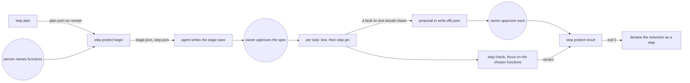

# Design: the brownfield test stage

Written 2026-11-24, about 11:30 Europe/Berlin, from the approved [requirements](requirements.md)
and the [research log](research.md); revised at 13:15 around what the
[prototype gate](prototype-gate.md) showed (`proceed`, R184). **Approved by the owner on 2026-11-24**
("approved, push and write the tasks"). The revisions are listed under "What the prototype changed".

## Overview

The stage is a step that adds tests and changes no code. Everything that runs a planted fault
exists: `step plan` finds the unnoticed faults, `step pin` shows one test failing on one fault and
passing on the unchanged code, and `step check` with a declaration's `focus` runs the faults of the
chosen functions again and says before and now per function.

Three things are built:

1. `step protect begin`: from a plan and the functions a person names to the start of a stage: a
   declaration the existing commands accept, and a file that lists what is to be protected.
2. `step protect result`: from the verdict of `step check` and the approved write-offs to
   "protected enough", by exit code.
3. A skill, `protect-before-reduce`, with the form of the stage spec. An agent following it writes
   the spec and the tests. The tool holds no model.



Round nodes are a person. Nothing after `step plan` runs a fault except `step pin` and
`step check`.

## What the prototype changed

1. **The base runs once, first, and is announced.** The first `step pin` of a stage ran the
   faults of the chosen functions on the base: 17 min 50 s on the renderer, where later pins took
   about two minutes. `step protect begin` says how long that run will take, from the seconds
   of the plan, and the skill runs it as a step of its own (a `step pin` for the first fault)
   before any other.
2. **One review.** Phases 5 and 8 of the skill are one: the owner of the code reviews the stage
   spec, the tests and the proposals together, after the check. Until then nothing counts as
   approved and `step protect result` ends with 1.
3. **Rust needs a joining line before the plan.** Where tests live inside the file of the code,
   the stage needs a test file of its own under a test path and one line that joins it
   (`#[cfg(test)] mod protect;`), committed before the plan so that it is part of the base. The
   skill says so and asks the person; `step protect begin` refuses a run configuration whose
   test paths hold no file. Tests under the crate's test directory do not reach private modules.
4. **Fault numbers are the verdict's, not a count of unnoticed faults.** `step pin --fault`
   takes the number the base's run gave a fault; a fault that did not build keeps its number (7 of
   10 here). `stage.json` carries that number beside the id once the base has run; the skill takes
   the numbers from the list `step pin` prints.
5. **Disk.** Eight working copies of the crate, for the plan, the base, the pins and the step, took
   34.5 GiB. The skill removes the plan's copies before the pins and all copies at the end, and
   `step protect begin` says how much one copy took in the plan.
6. **A test that contradicts the code costs one more run**, since a copy tries its first run again
   (R183). That is accepted.

## Boundary Commitments

**This spec owns**

- the two commands `step protect begin` and `step protect result` and their receipts;
- the files `stage.json`, `write-offs.json` and `protection.json` in a stage spec, and their shape;
- the skill `protect-before-reduce` and its two templates;
- the section of the guide on the path in three parts, and the lines in the skills
  `untangle-state` and `refactor-in-steps` that name the stage.

**This spec does not own**

- planting, running or classing faults; `step plan`, `step pin`, `step check`, `step record`,
  `step guard` and the declaration keep their behaviour, exit codes and receipts;
- the run page (it refers to the stage since task 8.1 of run-dashboard; no new view);
- the reduction, and cutting code that cannot be tested as it stands;
- Kiro. The stage spec has Kiro's form; no Kiro command is called and none is installed.

**Allowed dependencies**: `step/declaration.rs`, `step/revisions.rs`, `step/verdict.rs` (to read a
verdict), the run receipt of a plan, `adapters/driver/config.rs`. The new code calls no fault
runner.

**Revalidate downstream when**: the shape of a verdict's `functions` or `unnoticed_after` changes;
the shape of a plan's run receipt changes; `focus` or `max_token_growth` change their meaning.

## Components

| Component | Kind | Responsibility |
| --- | --- | --- |
| `step protect begin` | command | checks the plan and the named functions; writes `step.json` and `stage.json`; prints what is chosen, what is left alone, and what running the faults again will cost |
| `step protect result` | command | reads the verdict, `stage.json` and `write-offs.json`; says per function before, now, written off, waiting; exit code; writes `protection.json` |
| `protect-before-reduce` | skill | the walk for an agent: plan, choose (the person), begin, write the stage spec, stop for approval, test first with `step pin`, propose write-offs, stop for approval, `step check`, result |
| stage spec templates | two Markdown files in the skill | the form of `requirements.md` (one requirement per chosen function) and `tasks.md` (one task per protection test) |

### `step protect begin`

```sh
lesscode-core step protect begin --plan plan.json --config run.json \
    --function <file>:<name> [--function ...] --spec <name> \
    [--branch <name>] [--specs-dir .kiro/specs] [--repo .]
```

Reads the plan, its run receipt and the run configuration. Refuses, exit 3, with what is wrong:

| Refusal | Requirement |
| --- | --- |
| a named function is not in the plan; the functions of the plan are listed | 1.3 |
| the plan is incomplete or its run was void | 1.4 |
| a file of a chosen function differs from the hash the run receipt holds for it | 1.5 |
| the stage spec's directory exists and holds a `stage.json` | 2.1 |

A chosen function whose faults all lie in code not built here is left out and said so (1.6).

Writes into `<repo>/<specs-dir>/<name>/` and nowhere else (2.8):

- `step.json`, a declaration: `scope` the files of the chosen functions, `focus` the chosen
  functions, `max_token_growth` 0, `base` the commit at `HEAD`, `branch` as named or
  `protect/<name>`, the commands, test paths and run settings of the run configuration, outputs
  beside it.
- `stage.json`:

```json
{ "receipt": "step-stage-v1", "spec": "<name>", "base": "<commit>",
  "plan": {"file": "plan.json", "sha256": "…"}, "test": ["…"],
  "chosen": [
    { "file": "src/a.rs", "function": "decide", "noticed": 0, "unnoticed": 3,
      "reaches_out": {"calls": ["…"], "state_writes": ["…"]},
      "faults": [ {"id": "negate@68:11", "line": 68, "column": 11, "operator": "negate",
                   "text": "cfg!(target_os = \"linux\")", "seconds": 38.7} ] } ],
  "left_alone": [ {"file": "src/a.rs", "function": "collect"} ],
  "left_out": [ {"file": "…", "function": "…", "why": "not built on this system"} ],
  "to_run_again": {"faults": 9, "seconds": 350} }
```

A fault's `id` is `<operator>@<line>:<column>` within its file. It is the part of the verdict's
`#N line L operator@L:C` that does not depend on the run.

Prints the chosen functions with their faults (1.1, 1.7), the unprotected functions left alone
(1.2), and how many faults will be run again and about how long, from the seconds of the plan (5.9).

### `step protect result`

```sh
lesscode-core step protect result --declaration <specs-dir>/<name>/step.json [--repo .] [--out <file>]
```

| Exit | Meaning |
| --- | --- |
| 0 | every chosen function is protected enough |
| 1 | at least one is not; each waiting fault is named |
| 2 | not judged: no verdict, a verdict for other content than the branch has, or a verdict that is not accepted for a reason other than faults |
| 3 | bad input |

Rules, in this order:

1. The verdict must be the one for the committed content, by the hashes `step guard` compares.
   Otherwise exit 2 (7.4).
2. If a scope file differs between the base and the branch, the result does not hold for the
   functions of that file; exit 2 and said (5.7, point 1 of the requirements).
3. Per chosen function, from the verdict: `before.noticed`, `after.noticed`, and `unnoticed_after`.
4. A fault of `unnoticed_after` is *written off* when `write-offs.json` has an entry for its file
   and id with one of the two kinds, a reason, `approved_by` and `approved_at`. An entry without
   approval makes the fault *waiting* (4.3, 4.4). An entry whose fault is not in `unnoticed_after`
   any more is shown as noticed (4.6).
5. A function is protected enough when nothing of it is waiting (5.4, 5.5). If the verdict refused
   because unnoticed faults rose, the function is not protected enough and that is said (5.6).
6. The output says that the stage advises (5.8) and, on exit 0, names the next step: declare the
   reduction of the function as a step (6.4).

`write-offs.json`, written by the agent and completed by the owner of the code:

```json
{ "schema": 1, "base": "<commit>",
  "write_offs": [
    { "file": "src/a.rs", "function": "decide", "fault": "negate@68:11",
      "kind": "not_testable_as_it_stands",
      "reason": "The condition is fixed at build time; on one system the other branch is not built.",
      "proposed_by": "agent", "approved_by": null, "approved_at": null } ] }
```

`kind` is `nothing_a_caller_sees` or `not_testable_as_it_stands` (4.2). For the second kind the
result repeats what the function reaches out to and says that the reduction has to keep the
behaviour there by other means (4.7).

`protection.json` (`step-protection-v1`) holds per function the four numbers, each written-off
fault with its reason and approver, each waiting fault, the base, the revision and the hash of the
verdict. It is committed with the stage spec and is what a later reader finds (4.5, 6.5).

**What the tool cannot know.** That a person wrote `approved_by`. The result prints every
write-off with its approver and date, and the skill forbids an agent to fill those two fields. The
merge of the branch is the person's (7.3), and it is the last place where a false approval is seen.

### The skill `protect-before-reduce`

Phases, each gated on an exit code or on the person:

| Phase | Who | What | Gate |
| --- | --- | --- | --- |
| 1 | agent | `step plan`, with `--open` when a person is at the screen | exit 0 |
| 2 | person | names the functions to be reduced (7.1) | the person |
| 3 | agent | `step protect begin` | exit 0 |
| 4 | agent | writes `requirements.md`, `tasks.md` and `spec.json` of the stage spec from `stage.json`, in Kiro's form and the project's spec language (2.2 to 2.4, 2.6, 2.7) | none |
| 5 | agent | runs the base once: `step pin` for the first fault, after saying how long it takes | exit 0 or 1 |
| 6 | agent | per task: writes the test, commits it alone, runs `step pin` for each fault the task names, keeps the receipt beside the task (3.1 to 3.5, 3.7) | exit 0 per pin |
| 7 | agent | proposes write-offs for faults no test is to notice, or that a task had to give up on (3.6, 4.1) | none |
| 8 | agent | `step check` on the branch, with `--page` | exit 0 |
| 9 | owner of the code | one review: the stage spec, the tests with the sentence of each, and the proposals; approves a write-off by filling its two fields (2.5, 4.3, 7.3) | the person |
| 10 | agent | `step protect result`; reports its output and nothing of its own reading (7.5) | exit code |
| 11 | owner of the code | merges the tests (7.3) | the person |

How Kiro's test-first protocol is reused: its implementer shows a failing run before the
implementation and a passing run after. In the stage the planted fault stands where the missing
implementation stands. `step pin` runs both and its receipt is kept as the task's evidence: exit 1
"the tests with the pin pass on the fault" is a test that is not red; exit 1 "fail on the unchanged
code" is a test that is not green (3.3, 3.4).

The task template carries, per test: the function, the faults by id, the one sentence that says
which behaviour the test fixes (3.9), the boundary (test files only), and the place of the pin
receipts. No command checks the sentence; the owner of the code reads it at approval and at merge.

Where the project has Kiro's spec directory and steering, the skill uses them and the project's
own approval habit. Where it has none, the skill writes the three files into a directory the
person names and installs nothing (2.6, point 3).

## Requirements traceability

| Requirement | Met by |
| --- | --- |
| 1.1, 1.2, 1.7 | output of `step protect begin`; `stage.json` (`chosen`, `left_alone`, `reaches_out`) |
| 1.3, 1.4, 1.5 | refusals of `step protect begin` |
| 1.6 | `left_out` in `stage.json` |
| 2.1, 2.8 | `step protect begin` writes into the stage spec's directory only |
| 2.2, 2.3, 2.6, 2.7 | the skill, phase 4, and the two templates |
| 2.4 | `stage.json` (`plan`, `base`, `test`); the requirements template repeats them |
| 2.5 | the skill, phase 9; `step protect result` counts nothing as written off before it |
| 3.1 to 3.4 | `step pin`, kept receipt per task |
| 3.5 | `step pin` runs the configured tests with the new test on the unchanged code; `step check` runs them on the branch |
| 3.6 | the skill, phase 7; `step protect result` rule 2 catches a changed code file |
| 3.7 | `step check`, check "pins apart from the change" |
| 3.8 | nothing in the new code names a language; the declaration carries the language of the plan |
| 3.9 | the task template; read by a person |
| 4.1 to 4.7 | `write-offs.json`; `step protect result` rules 4 and 5; `protection.json` |
| 5.1, 5.2 | `step check` with `focus` on the chosen functions |
| 5.3 to 5.8 | `step protect result` |
| 5.9 | output of `step protect begin` (`to_run_again`) |
| 6.1 | done (run-dashboard task 8.1) |
| 6.2, 6.3 | the guide |
| 6.4, 6.5 | output of `step protect result`; `protection.json` |
| 7.1 to 7.3, 7.5 | the skill's phases and gates |
| 7.4 | exit 2 of `step protect result` |

Requirements 2.5 and 7.1 to 7.3 rest on the skill and on a person. That is said in the guide.

## Contradictions and disposition

| # | Conflict | Authority | Disposition | Affects |
| --- | --- | --- | --- | --- |
| 1 | Point 1 of the requirements: no file of the code to be reduced is changed. Rust keeps unit tests inside that file, and `step pin` carries only files under `test_paths` into its copy. | requirements (approved); `pin.rs`, `trees.rs` | **Closed by the prototype (R184): candidate (a) holds.** One joining line, approved by the owner and committed before the plan, is part of the base; the stage itself changes no code file. (b) cannot reach private modules. (c) is not needed. As first written: Three candidates: (a) tests in a file of their own, joined by one line `#[cfg(test)] mod …;` that is committed, with the owner's approval, before the plan, so that it is part of the base; (b) tests under the crate's test path against what is public; (c) the tool learns to treat a test module inside a scope file as test. The prototype tries (a) and (b) on the renderer. (c) changes `step pin` and is outside this spec's boundary; if neither (a) nor (b) holds, the gate says `revise`. | requirement 3.6, 3.7; the declaration's `max_token_growth` |
| 2 | The brief said a test counts "when `step pin` admits it"; requirement 5.1 says the outcome of the run after the tasks counts, not the tasks. | requirements (later, approved) | Both hold: `step pin` is the evidence of a task, `step check` is the judgement of the stage. | none |
| 3 | The brief of lesscode-metrics wants "a command that writes tests for unnoticed faults". | owner's decision of 2026-11-23: no model in the tool | Superseded there; an agent writes the tests. | lesscode-metrics brief |
| 4 | Requirement 2.5 as first approved: no test before approval. The owner chose one review at the end. | the owner, 2026-11-24 | Requirements 2.5, 4.3, 4.4 and 7.3 amended; the skill has one review. | 7.3 |
| 5 | "Kiro's form is copied": the Kiro skills in this repository are untracked and their licence is not recorded here. | point 3 of the requirements | The form (file names, numbered requirements, tasks with boundary) is used; no text of Kiro's skills is copied into lesscode's skill. | the skill |

## File Structure Plan

| File | New or changed | Responsibility |
| --- | --- | --- |
| `native/src/step/protect.rs` | new | the arguments of the two commands and their dispatch |
| `native/src/step/protect_begin.rs` | new | checks of plan and functions; `step.json` and `stage.json` |
| `native/src/step/protect_result.rs` | new | verdict, stage and write-offs to the four numbers per function; exit code; `protection.json` |
| `native/src/step/mod.rs` | changed | the subcommand `protect` |
| `native/complexity-budgets.json` | changed | entries for the three new files |
| `native/tests/step_protect.rs` | new | the commands on the toy repository of `step_support` |
| `.agents/skills/protect-before-reduce/SKILL.md` | new | the walk |
| `.agents/skills/protect-before-reduce/templates/requirements.md` | new | form of the stage spec's requirements |
| `.agents/skills/protect-before-reduce/templates/tasks.md` | new | form of the stage spec's tasks |
| `docs/steps.md` | changed | a section for the two commands; the path in three parts |
| `docs/state-refactoring.md` | changed | where the stage comes in the walk of the guide |
| `.agents/skills/untangle-state/SKILL.md`, `.agents/skills/refactor-in-steps/SKILL.md` | changed | one paragraph each that names the stage |
| `docs/releases/2.2.0.md` or the notes of the release after it | changed | the entry |

`runner.rs` and `page_log.rs` are not touched. No file under `adapters/driver` changes.

**Amended 2026-11-24, 14:00, with group 1 ([R185](../../../docs/research/2026-11-24/06-step-protect-begin.md)).**
`protect_begin.rs` alone went over the size budget of a file, so three files were added, each with
its entry in the budgets:

| File | New or changed | Responsibility |
| --- | --- | --- |
| `native/src/step/protect_stage.rs` | new | the shape of `stage.json`, the faults of a plan's run per function, the id of a fault |
| `native/src/step/protect_write.rs` | new | `step.json` and `stage.json` from what the checks left; the writing |
| `native/src/step/protect_says.rs` | new | what `step protect begin` prints |

`protect_begin.rs` keeps the arguments and the checks. Beside the allowed dependencies named above
the new code reads `step/functions.rs` (which function a fault belongs to) and
`adapters/driver/sites.rs` (the code not built on this system), as `step plan` does.

Open for task 2.1: the verdict's label of a fault is `#N line L <operator>`, without a column for
plain operators, so the id `<operator>@<line>:<column>` cannot be read from the verdict alone
(finding 1 of R185). Decided by the owner on 2026-11-24: the result matches such a fault by file,
line and operator, from committed files only, and says so when two faults cannot be told apart.

**Amended 2026-11-24, with tasks 2.1 and 2.2.** `protect_result.rs` would have gone over the size
budget with the numbers in it, so one file was added, with its entry in the budgets and its own
tests in `native/tests/step_protect_numbers.rs`:

| File | New or changed | Responsibility |
| --- | --- | --- |
| `native/src/step/protect_numbers.rs` | new | `write-offs.json`; the four numbers per function; a fault matched by file, line and operator |
| `native/src/step/guard.rs` | changed | the comparison of the hashes split out of `stale` as `moved`, for `step protect result` to reuse; the guard behaves as before |

With task 2.3 the output and `protection.json` went into a file of their own for the same reason,
and the tests of the result into theirs, with the toy plan they share in the support module:

| File | New or changed | Responsibility |
| --- | --- | --- |
| `native/src/step/protect_receipt.rs` | new | what `step protect result` says; `protection.json` |
| `native/tests/step_protect_result.rs` | new | `step protect result` on the toy repository |
| `native/tests/step_support/planned.rs` | new | a toy repository with a real plan, shared by the two test files |

`protection.json` is written on exit 0 and on exit 1, beside the declaration or where `--out`
names, and not on exit 2 or 3. It holds `result` (`protected_enough` or `not_protected_enough`)
and `unnoticed_rose` beside what the design lists.

`protect_result.rs` keeps the arguments, the verdict it may use and the exit code.
Two faults of a function with the same line and operator wait together or are written off
together: a write-off for one of them does not say that it is the unnoticed one. A fault the
verdict calls unnoticed that the stage did not begin with waits and cannot be written off. A
write-off for a fault the stage does not have is bad input (exit 3), like a wrong kind.

Open, for the owner: the verdict, `stage.json` and `write-offs.json` are the files that are
committed with the stage spec, and the command reads the copy in the working tree where there is
one, else the committed one (as `step record` does for a verdict). In a pipeline the two are the
same. Under a person an approval that is written but not committed already counts.

## Testing Strategy

On the toy repository of `native/tests/step_support` (Python, tests in a file of their own):

| Test | Shows | Requirement |
| --- | --- | --- |
| begin refuses a function the plan does not have, and lists the ones it has | the refusal and its text | 1.3 |
| begin refuses a plan whose run was void | exit 3 | 1.4 |
| begin refuses when a chosen file changed after the plan | exit 3, the file named | 1.5 |
| begin writes a declaration that `step check` accepts on a branch with no change | the declaration is valid as it is written | 2.1, 5.1 |
| begin lists unprotected functions that were not chosen as left alone | `left_alone` | 1.2 |
| begin writes nothing outside the stage spec's directory | the repository's state before and after | 2.8 |
| result: a test that notices every fault gives exit 0 and the next step | 0 of n before, n of n now | 5.3, 5.4, 6.4 |
| result: one fault left and no write-off gives exit 1 and names it | waiting | 5.5 |
| result: the same fault with an unapproved proposal is still waiting | exit 1 | 4.4 |
| result: with an approved write-off the function is protected enough and the fault is shown as written off with its reason | exit 0 | 4.3, 4.5 |
| result: a write-off of a kind that is not one of the two is bad input | exit 3 | 4.2 |
| result: a fault that is written off and noticed is shown as noticed | | 4.6 |
| result: a code file changed on the branch gives exit 2 and says the result does not hold | | 5.7 |
| result: a verdict for other content gives exit 2 | | 7.4 |
| result: nothing is written when it is not judged | no `protection.json` | 7.4 |

End to end, on real code: the prototype gate, then one run of the whole skill on the renderer of
drift-rdp recorded in the research log. The skill itself is text; what it says is checked by that
run and by a person reading it.

Not tested by a command: that an approval was a person's; the sentence of requirement 3.9.
