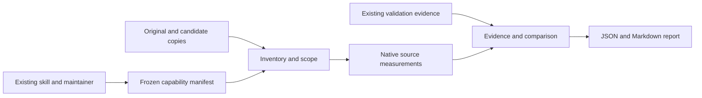

# Technical Design: capability-compression-core

## Overview
Deliver one native comparison workflow for maintainers and coding agents: supply
a complete capability and candidate, measure both under fixed definitions, and
review behavioral evidence before accepting compression. The existing discovery
skill supplies repository knowledge and the replacement hypothesis.

The implementation is a separate Rust package and executable. It does not replace
the Python CLI or alter its contracts. Existing experiments provide reference
cases; new results use their own versioned definitions and provenance.

### Goals
- Count the complete maintained replacement, including displaced support.
- Separate successful compression, rejected candidates and missing evidence.
- Exercise the workflow on Lesscode after external fixtures pass.

### Non-Goals
No automatic candidate synthesis, dead-code proof, general policy engine,
transaction engine, MCP, plugin hooks, solver integration, Rust source analysis,
Java support, hardware checks or performance benchmarks.

## Boundary Commitments

### This Spec Owns
- Frozen capability/check manifests, source inventories, native measurements,
  evidence admission, deterministic comparison and reports.
- A small CLI for preparing manifests and comparing supplied versions.
- A reproducible self-application record, including justified rejection.

### Out of Boundary
The skill/maintainer owns semantic scope review, dependency knowledge, proposed
edits and the decision to adopt a patch. Project tools own tests and type checks.
The core never executes repository commands or mutates source. External command
logs are evidence from the declared runner, not authenticated proof of execution.
The core detects identity inconsistencies; it is not a hostile-agent sandbox.

### Allowed Dependencies
One Cargo package; ast-grep core/language for syntax, Serde/serde_json for typed
records, sha2 for SHA-256 and clap for arguments. Standard library for filesystem,
collections and output. No runtime Python or Node dependency for native analysis;
target-project validation retains its own runtimes. No dependency on the unfinished
Python rule engine. Reuse evidence fixtures, not its package structure.

### Revalidation Triggers
Changes to schema, scope rules, metric definitions, grammars, evidence meanings,
decision precedence or parser versions require golden/adverse fixture replay and
skill documentation review. Snapshot/check changes invalidate associated results.
A new source language requires its own fixtures and real capability trial.

## Architecture

### Existing Architecture Analysis
The Python evaluator already distinguishes invalid, rejected and incomplete
evidence, binds checks to source identities and keeps metric definitions explicit.
These behaviors inform this design, but existing result JSON is not silently
accepted as a native result. ATS/NPU collectors have different formats; trial-only
conversion retains their original artifacts and reports missing provenance.

### Architecture Pattern & Boundary Map
A synchronous library with plain typed records and functions; no service container,
adapter registry or backend trait hierarchy.



Import direction: model is shared data; scope and metrics depend on model;
compare depends on model; lib orchestrates scope, metrics and compare; main
depends on lib/model. Analysis does not import the CLI or invoke project tools.
Reporting stays with comparison rather than becoming a separate platform.

### Technology Stack

| Layer | Choice | Role |
| --- | --- | --- |
| Implementation | Rust 2021 edition; local toolchain 1.98.1 verified | One library and CLI |
| Syntax | ast-grep-core and ast-grep-language 0.51.0 release line | Python, TypeScript and TSX parsing |
| Records | serde 1.x, serde_json 1.x | Closed typed JSON schema, unknown fields rejected |
| Identity | sha2 0.11.x | Content fingerprints |
| CLI | clap 4.6.x | Commands/help without custom argument parsing |
| Storage | Explicit JSON files and Markdown | No database or artifact service |

These are dependency selections, not a tested integration claim. The first build
pins actual resolved versions in Cargo.lock and rust-toolchain.toml, verifies
licenses and parser grammar selection, and checks compilation on Windows/Linux.
Disable unused language features where supported; do not invent unverified feature
names. Grammar build prerequisites are development dependencies, not runtime
requirements. If the selected versions do not integrate, record the compatible
pin correction and replay fixtures before continuing. No benchmark is required.

## File Structure Plan

| Path | Action and responsibility |
| --- | --- |
| native/Cargo.toml, native/Cargo.lock, native/rust-toolchain.toml | Create single package, dependency and toolchain pins |
| native/src/model.rs | Create closed manifest/result types and validation of record invariants |
| native/src/scope.rs | Create snapshot identity and scope accounting |
| native/src/metrics.rs | Create Python/TS syntax measurements and unresolved relationship reporting |
| native/src/compare.rs | Create evidence admission, decision and JSON/Markdown rendering |
| native/src/lib.rs | Create prepare/compare orchestration functions |
| native/src/main.rs | Create thin CLI |
| native/tests/workflow.rs | Create external-fixture and CLI integration tests |
| native/tests/fixtures/ | Create hand-reviewed semantic metric cases and adverse records |
| native/README.md | Create commands, metric definitions, provenance limits and tool prerequisites |
| docs/experiments/native-replay/ | Create trial manifests, narrow conversion scripts and new replay records |
| docs/experiments/native-self-apply/ | Create self-trial plan, patch, checks and maturity record after bootstrap |
| .agents/skills/lesscode-discovery/SKILL.md | Add the verified command recipe and scope-review step; retain existing workflow |
| README.md, docs/README.md | Link working native workflow and maturity evidence after implementation |
| .github/workflows/native-core.yml | Add native correctness checks on Windows/Linux/macOS; no hardware benchmark |

Module-local tests cover pure functions. No changes to Python product modules or
their tests are needed to introduce the core. Self-trial source edits, if useful,
must be isolated and named in its own recorded plan before adoption.

## Components and Interfaces

| Component | Responsibility | Requirements | Dependencies | Contract |
| --- | --- | --- | --- | --- |
| Model | Validate manifest and evidence shapes | 1.1, 2.7, 3.1, 4.1 | Serde P0 | Data |
| Scope | Inventory and fixed-boundary accounting | 1.1–1.4, 2.1, 4.4, 4.5 | Filesystem, SHA-256 P0 | Batch |
| Metrics | Versioned structural facts | 2.2–2.6 | Grammar APIs P0 | Function |
| Compare | Admit evidence, decide, report | 2.7, 2.8, 3.1–3.6, 4.1–4.3, 4.6 | Model P0 | Function |
| CLI/library | Prepare and compare supplied inputs | 1.1, 4.2, 4.4 | Above modules P0 | CLI |
| Self-trial | Recorded maturity review | 5.1–5.8 | Working CLI and independent checks P0 | Review procedure |

### CLI/library contract
Proposed commands:

```text
lesscode-core prepare --manifest trial.json --baseline PATH --out frozen.json
lesscode-core compare --frozen frozen.json --baseline PATH --candidate PATH --evidence checks.json --out REPORT_DIR
```

Prepare freezes baseline inventory and manifest; it does not certify semantic
completeness or require a candidate. Compare writes result.json and report.md
to a new output directory outside both source roots. Existing output is rejected
rather than overwritten. No source files are copied, edited or deleted.

Library boundaries:
```rust
fn prepare(manifest: Manifest, baseline: &Path, artifact_roots: &[PathBuf])
           -> Result<FrozenTrial, InputError>;
fn compare(trial: &FrozenTrial, baseline: &Path, candidate: &Path,
           evidence: &EvidenceBundle, artifact_roots: &[PathBuf])
           -> Result<Comparison, InputError>;
```

Integration clarification: artifact roots are explicit input, resolved by the
caller. No implicit current-directory or source-parent search is allowed. The
CLI supplies repeated `--artifact-root PATH` arguments; omitted roots make
artifact-backed checks incomplete. This parameter supplies context already
required by evidence admission and adds no new execution capability.
Prepare uses the same explicit roots to verify an optional supplied repository
capability-inventory artifact; a missing supplied inventory artifact fails input
admission. Roots are unnecessary when no such inventory is supplied.

Successful command completion is distinct from candidate acceptance: exit 0 for
accepted, 1 for rejected/not-demonstrated, 2 for incomplete, 3 for invalid input,
identity mismatch or IO failure. JSON preserves all reasons. Descriptive reporting
without a target is not-demonstrated, not accepted.

### Scope contract
Input is a repository-root pair, not individual function snippets. The frozen
manifest declares baseline entry points and owned files/symbol selectors, wider
accounting directories, file-category rules, explicit exclusions and a reviewed
ownership explanation. Selectors identify complete syntax nodes with qualified
names, occurrence and source digest; zero/multiple resolutions fail admission.
Whole-file selection is supported. Overlapping selectors are counted once.

Inventory both roots recursively, including untracked files, with the same explicit
exclusions. Do not inherit potentially different gitignore rules. Reject escaping
paths, symlinks/reparse points and case-colliding paths in the declared inventory.
Hash normalized relative paths and content with length-delimited records sorted by
path; exclude absolute root names from identity. Recheck identities before reporting.

For the first slice, the skill supplies a candidate ownership map in the evidence
bundle. It may map removed baseline selectors to replacements, but cannot change
baseline scope, exclusions, checks or targets. Add all changed/new production files
outside selected symbols to whole-file accounting on both sides; deleted files
contribute baseline-only. A move is a deletion plus addition, not a saving by itself.
Known generated/tool-state exclusions are frozen and listed separately; they
cannot contain declared owned source. The skill reviews this classification.
Any unclassified changed file or changed excluded maintained-source path is reported and blocks
acceptance until a newly frozen trial makes the classification explicit.

Union all selected and expanded spans before counting; never charge a helper
twice because both its caller and containing file identify it.
Report selected-capability totals and wider-boundary totals separately; do not
attribute unrelated unchanged module code to the capability. Additional changed
callers/helpers outside the initial accounting directories expand the reported
replacement footprint symmetrically and are disclosed. Unrelated edits require
a clean candidate; they are not silently ignored.

Syntax resolves only unambiguous local named functions and directly resolvable
imports between declared files. Other calls are unresolved with source locations.
The skill reviews unresolved relationships and declares included owned targets or
external contracts with rationale. Unreviewed relationships keep scope incomplete.
This is a reviewed ownership boundary, not a complete static reachability proof.

### Metrics contract
Metric identity includes name, definition revision, language and grammar/tool
versions. Do not call native statement counts Radon LLOC or decision counts Lizard
CCN. Report historical metrics separately only with their original identity.

- physical_lines.v1: newline-separated source lines; empty input is zero; a final
  newline does not create an extra line. Count the union of selected line spans.
- logical_statements.v1: count each grammar statement node once, including compound
  headers and their child statements, excluding block/container nodes and comments.
  Declaration wrappers count once rather than again for their wrapped declaration.
  Maintain explicit per-language node-kind tables with hand-reviewed fixtures.
- decisions.v1: one per if/elif or conditional expression, loop, catch/except
  handler, non-default case and short-circuit operator; comprehension generators
  and filters each add one. No implicit +1 per function. Tables explicitly define
  language differences and are shipped with the definition.
- functions.v1: function/method/lambda/arrow definitions once, including nested
  definitions. Types/interfaces are not functions.
- internal_call_layers.v1: longest resolved internal call path, including entry
  vertex as layer 1. Cycles and unresolved calls make the full value unavailable;
  a resolved lower bound and locations may be shown, never a fabricated total.

A syntax-error or missing node invalidates structural metrics for the affected
scope; physical lines remain available. Unsupported syntax/language and non-UTF-8
sources produce explicit unavailable metrics. Configuration/data files contribute
physical lines and categorized file changes even when no structural metric exists.

Metric definitions are versioned before golden fixtures are approved. Python and
TS are measured separately; no cross-language aggregate score. Tables/data remain
counted in physical lines and source structure; fewer statements alone is not
proof of readability. Report structural tradeoffs and require the frozen target's
bounds. A formatting-only reduction cannot succeed: successful compression requires
a strictly positive native logical-statement reduction in production, along with
all additional declared targets. A target may demand a larger minimum reduction.

### Evidence and comparison contract
The evidence bundle contains per-side source identity, frozen-trial digest, check
ID, status (passed/failed/missing/error), check definition digest, raw artifact
paths/hashes and tested-domain/limitation text. Differential results also identify
both snapshots and the frozen oracle. Typed result summaries include mismatch
count and expected/observed case count where applicable; a collector exit code
alone is insufficient. Expected results come from a reviewed fixture or declared
runner; the core validates bindings and consistency, not their truth by fiat.

Required checks are frozen IDs, descriptions, definitions, artifact expectations
and interpretation rules. Duplicate IDs, unknown fields and altered definitions
are invalid. Missing artifacts/checks or incomplete runs are incomplete; a known
behavior failure is rejected even if another check is missing (both are reported).
A failing baseline is baseline-ineligible. Metric savings cannot override behavior.

Precedence: invalid → baseline-ineligible → rejected-behavior → incomplete →
rejected-target → not-demonstrated → accepted. Return all findings, not only the
highest-priority one. Only accepted means the frozen empirical target was met.
No-target reports remain descriptive. Optional supplied checks disclose findings;
any observed behavioral regression prevents acceptance.

Reports preserve selection rationale, replacement hypothesis, complete file lists,
category totals, both metric identities, before/after/delta, check outcomes,
unresolved scope, tradeoffs, dependencies and limitations. Stable ordering and
integer counts give deterministic outcomes; timestamps and runtime metadata are
kept outside the comparable payload. No universal quality or maintenance score.

## Data Models
All records carry schema_version = 1. Use Rust structs, closed enums, Option for
genuinely optional fields and tagged Available/Unavailable metric values. Reject
unknown fields and duplicate identities; counts are unsigned integers and deltas
signed. Use checked arithmetic. No dynamically typed rule expression language.

| Record | Essential content |
| --- | --- |
| Manifest | Trial ID, hypothesis, baseline entry points/ownership, wider boundary, categories/exclusions, scope review, checks, optional target, optional capability-inventory reference |
| FrozenTrial | Manifest, normalized baseline file inventory/digest, evaluator/definition identity, check-definition digests |
| Target | Minimum production statement reduction, named count bounds with integer absolute limits, permitted structural tradeoffs |
| EvidenceBundle | Candidate ownership map/review, paired check records and raw artifacts, candidate dependency disclosure |
| Comparison | Status, ordered reasons, scope/file accounting, metric pairs, check findings, limitations and provenance |
| Self-trial review | Baseline/evaluator revision, candidate patch, evidence links, workflow_complete, compression_outcome, adoption decision and excluded coverage |

No signatures or claimed tamper-proof isolation. Hashes establish consistency with
the recorded inputs. Capability inventory is a snapshot-bound supplied document
with manifest/source references and installed capabilities; the core checks its
binding, while the skill checks its content. Dependency manifest changes are
always disclosed and require a recorded repository-level decision before adoption.

## System Flows
Prepare before edits; run existing checks on isolated baseline/candidate; compare
using the frozen definitions; inspect report; adopt only after review. If checks
change, start a new trial and rerun both versions. Never silently rebaseline.

Self-application starts after ATS/NPU and adverse fixtures pass. Select a complete
supported Lesscode capability, initially eligible Python reference code. Freeze a
known-working evaluator executable/source identity and keep it outside the candidate.
Run unchanged relevant checks and the existing project regression suite on both.
If measurement/decision behavior changes, exercise independent hand-reviewed
expected outputs plus an adverse case. Preserve existing uncommitted work.

The self-trial review may record workflow_complete=true with compression rejected
if evidence is complete and the rejection is justified. Inconclusive/missing
evidence keeps workflow_complete=false. Neither outcome stops development. No
repeated shrinking quota, mandatory Rust parsing or self-certified success.
Maturity claims identify the supported scope and exclude untested native code.

## Requirements Traceability

| Requirement | Design realization | Validation |
| --- | --- | --- |
| 1.1 | Manifest, prepare, source identities | Frozen-manifest replay |
| 1.2 | Scope expansion and whole changed-file accounting | Helper escape fixture |
| 1.3 | Fixed baseline scope and classification admission | Scope narrowing/unclassified file |
| 1.4 | Located unresolved relationships | Dynamic call fixture |
| 2.1 | Categories and dependency disclosure | Production/test/support separation |
| 2.2 | Versioned Metrics contract | Hand-counted Python/TS samples |
| 2.3 | Tagged unavailable and identity comparison | Grammar/version mismatch |
| 2.4 | Functions and partial call-layer context | Nested calls/cycle fixture |
| 2.5 | Whole accounting and positive statement reduction | Move/split negative controls |
| 2.6 | Target schema excludes bytes/performance | Invalid target field |
| 2.7 | Frozen Target and bounds | Target digest alteration |
| 2.8 | No-target not-demonstrated status | Descriptive report |
| 3.1 | Frozen inventory external to candidate | Modified test definition |
| 3.2 | Evidence source/trial/artifact identities | Stale result fixture |
| 3.3 | Failure/incomplete admission | Missing/failed required check |
| 3.4 | Status precedence and full findings | Failure plus missing evidence |
| 3.5 | Explicit required contract checks | Missing API/error/type check |
| 3.6 | Reported empirical domain and limitations | Report wording assertion |
| 4.1 | Manifest hypothesis and complete report | Accepted/rejected trial replay |
| 4.2 | JSON plus Markdown output | CLI output inspection |
| 4.3 | Sorted stable payload and fixed definitions | Repeated comparison |
| 4.4 | Read-only roots and external output | Source hashes before/after |
| 4.5 | Bound inventory and dependency decisions | Stale manifest inventory |
| 4.6 | Evidence-independent metric reporting | Missing evidence report |
| 5.1 | Post-bootstrap self-trial | Maturity review record |
| 5.2 | Self-trial plan and provenance | Review completeness check |
| 5.3 | Frozen external evaluator and isolated candidate | Identity/check audit |
| 5.4 | Independent semantic fixtures/adverse case | Evaluator-change trial |
| 5.5 | Paired regression runs and whole accounting | Adoption checklist evidence |
| 5.6 | Baseline retention on rejection | Recorded rejection path |
| 5.7 | Separate workflow and compression outcomes | Incomplete maturity stays open |
| 5.8 | Supported-scope maturity statement | Explicit Rust coverage exclusion |

## Error Handling
Invalid schema, path escape, source changes or mismatched identities prevent
acceptance with precise file/check diagnostics. Partial measurement is retained
when possible. Unreadable required inputs stop that command; no automatic retries
or fallback to zero. Parser errors and unsupported metrics remain distinguishable
from observed code regressions. Local stderr and result reasons suffice; no
monitoring service or telemetry.

## Testing Strategy
- Unit: hand-counted statements/decisions and Unicode/CRLF spans; overlapping
  selectors; unresolved/cyclic calls; fixed targets; decision precedence.
- Integration: ATS01 candidate and adverse mutant; NPU01 full replacement including
  new helper and paired tests; preserve historical records and explicitly identify
  newly measured counts. Narrow trial conversion may run with uv, never production
  native dependencies. Do not fabricate missing historical digests.
- Adverse: moved helpers, atomic function splitting, out-of-boundary changed file,
  test reclassification, changed exclusions, stale inventory, missing/mutated checks,
  zero baseline, syntax errors, source changes during comparison and no target.
- CLI: prepare/compare with all statuses, output refusal inside sources, deterministic
  reports and unchanged source hashes. Run native tests on Windows/Linux/macOS;
  no model downloads, accelerator access or performance suite.
- Self-application: carry 5.1–5.8 into final validation with a bounded real trial;
  report tool production/test footprint separately from specimen savings.
- TypeScript: grammar fixtures plus a real typed capability trial with unchanged
  native project checks before claiming TS workflow maturity. No Java or Rust
  language adapter is added to satisfy this milestone.

## Integration and Review Status
No migration of old CLI records or removal of Python features. Native records use
a separate schema and command name. Existing source edits remain untouched.
The requirements approval is recorded from the owner's instruction to proceed.
The subsequent explicit task-generation `-y` invocation approved this design and
the implementation plan. Task-graph review passed; implementation has not started.

Full discovery and inline design review used the Kiro design, discovery, synthesis
and review rules. The initial draft was repaired to specify scope-review limits,
evidence trust, physical-versus-structural counts and the self-maturity rejection
path. All 32 criteria map above. Dependency compilation and empirical self-trials
are future validation work, not claims made by this document.

