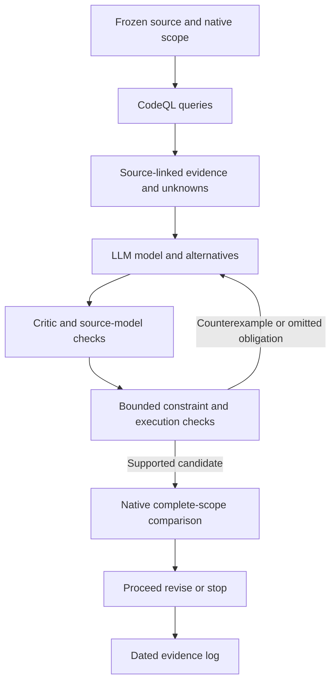

# Provisional design: query-grounded constraint modeling

Date: 2026-11-02. Requirements approved by the owner. This is a research proposal,
not the final `design.md`; real-code feasibility has not passed. No production
task generation is authorized by this document. See [prototype gate](prototype-gate.md)
and [requirements](requirements.md).

G0e amendment, 2026-11-02: [R10](../../../docs/research/2026-11-02/10-source-backed-state-model.md)
demonstrates finite checking of a source-backed state model and rejection of
five deliberate errors. The model author had seen the oracle; this does not
validate independent inference or a general modeling loop. Proceed only with
a bounded real-code research hypothesis, not production task generation. The
full useful-compression and source-model evidence gate remains open.

G0d amendment, 2026-11-02: [R09](../../../docs/research/2026-11-02/09-codeql-dependency-diagnostic.md)
shows that direct receiver spelling recovers the lost flow, while the same
configuration retains input flow after overwrite. Treat graph facts as
configuration-specific evidence: absent edges remain unknown; present edges
do not establish ordered-state semantics. Require explicit source-backed alias,
write-order and effect obligations plus separate validation before accepting
a model or replacement. A general custom heap analyzer is not added to scope.

Evidence amendment, 2026-11-02: [G0c/R08](../../../docs/research/2026-11-02/08-codeql-state-boundary.md)
rejects completeness of the tested state-flow query on a small alias fixture.
Missing relationships must remain unknown, not negative semantic facts. An
essential failed positive control invalidates precision claims from the same
empty result set. Require source/runtime evidence for ordered-state obligations;
whether the proposed modeling loop can discharge them remains untested. This
amendment does not approve production design or substitute tests for proof.

## Overview

Use an existing program-analysis database to give an LLM source-linked evidence
for modeling an entire responsibility. The LLM proposes the relation between
inputs, state, outputs and effects, then a smaller implementation. A critic,
bounded constraint checks and original/candidate execution challenge that model.
The existing native core measures the complete replacement.

The first experiment tests whether this mechanism produces useful deletion on
real code. It is not a project to build a general semantic compiler or agent
platform. Research can stop before those investments if the evidence is negative.

### Goals and non-goals

- Exercise identification, explicit modeling, counterexample interpretation and
  revision on a real responsibility, counting every manual intervention.
- Separate graph fidelity, source-model fidelity and compression evidence.
- Preserve features, public behavior, useful types and names.
- Do not add MCP, a second graph store, a backend abstraction, an automatic
  arbitrary-language translator or new runtime dependencies to the specimen.
- Do not require an autonomous product before running the feasibility spike.

## Boundary Commitments

### Owned boundary

The experiment owns a frozen query pack, a source-linked evidence slice, model
and candidate revision records, bounded checks and a dated decision. Its subject
is a complete selected capability including owned support and changed callers.

### Out of Boundary

CodeQL parsing and dataflow engines, native metric definitions, project runtime
behavior and test assertions remain externally owned. No changes to upstream
specimens or the existing production comparator are needed for the spike.

### Allowed Dependencies

CodeQL CLI 2.26.3 and locked `codeql/python-all` 7.2.3 and
`codeql/javascript-all` 2.9.0 now extract and query both fixtures. Retain their
resolved lockfiles. This updates the earlier missing-pack setup state; it does
not resolve the G0c semantic gap. Do not silently upgrade the CLI or packs.

Reuse the installed native comparator and pinned specimen runtimes. Python
research scripts run through uv with an explicit interpreter. Use the existing
agent harness for initial roles and record model/settings; no DSPy or LangGraph
installation is needed to establish whether the modeling mechanism helps.
Framework automation is a later design decision, with held-out evaluation before
any prompt optimization. Solver version/subset must be frozen for each attempt;
do not add a production solver dependency during this spike.

### Revalidation Triggers

Source, query/pack, dependency, behavioral contract, candidate or evaluator changes
invalidate affected claims. Database-local IDs are not stable cross-snapshot
identities. Refresh affected slices and models, not just a pretty graph view.

## Architecture

Adopt a file-based, inspectable batch experiment. The only program database is
CodeQL's. BQRS plus JSON exports carry selected query results; typed model records
and source patches describe proposals. Logs store research history, not a new
domain database. Hypotheses never become extracted facts through serialization.

The original evaluator stays outside candidate edits. Query results inform the
LLM; they do not directly authorize deletion. Potential dataflow is neither
feasible execution nor behavioral equivalence.

## Components and Interfaces

These are experiment responsibilities, not proposed production services.

| Responsibility | Input -> output | Contract |
| --- | --- | --- |
| Snapshot and scope | source + declared ownership -> frozen inputs and capability inventory | Exact source/hash identities; no hidden scope narrowing |
| Query pack | frozen database + reviewed queries -> BQRS/JSON evidence | Queries for calls, flow, state and control; unresolved facts explicit |
| Modeler/critic | evidence + original source + obligations -> versioned model/review | Source citations and semantic assumptions; roles recorded separately |
| Verification | model + candidate + frozen checks -> results/counterexamples | Model verdict and actual execution verdict kept distinct |
| Native comparison | baseline + candidate + externally recorded checks -> metrics/disposition | Existing prepare/compare interface; no comparator changes |
| Lab record | all receipts -> dated interpretation and next gate | Original results retained; no unearned approval/adoption |

### Query contract

Start with bounded query families: callable/caller inventory, argument-to-return
flow, read/write sites for named state, control/exception structure and unresolved
targets. Each result includes relative source path/span, callable, relationship
kind, endpoint anchors, provenance and applicable assumptions. Use language-native
query predicates; do not pretend Python and TypeScript have identical semantics.

An empty relation is accompanied by extraction diagnostics and query coverage.
The labeled fixture oracle distinguishes a known negative from an unsupported
case. Export only the selected slice and its external boundary for LLM context.
LLM-proposed queries are reviewed before execution and included in the query
budget; their outputs cannot amend the frozen acceptance oracle.

### Model and attempt contract

Use immutable, versioned records with these named fields:

| Record | Required content |
| --- | --- |
| Model | scope/source/evidence IDs; inputs and domains; state locations; outputs; ordered effects; exceptions; contracts; assumptions; unresolved obligations |
| Alternative | predecessor; implementation removed; replacement and support added; library contracts; expected whole-scope counts |
| Attempt | model/candidate hashes; model and critic identity/settings; query references; changed assumptions; budget consumed |
| Check | input identities; command/version; boundary and bounds; exit/result; counterexample; realizability assessment; raw evidence |
| Decision | compression target versus measured result; behavior status; readability/indirection review; unresolved scope; proceed/revise/stop |

Results are discriminated as pass-in-declared-boundary, mismatch, unsupported,
unknown, exhausted or invalid-input; absence of a check is not pass. Source
anchors include snapshot IDs. Native comparison JSON remains in its existing
schema rather than being extended to claim solver truth.

### State and solver boundary

Model a responsibility as a relation over input, state-before, state-after,
return/exception and an observable effect trace. The initial supported model
may use finite tags, booleans, mathematical integers with explicit bounds and
finite transition traces. Exclude floating-point equivalence, arbitrary objects,
unbounded recursion and unmodeled I/O. Add a construct only when the selected
real-code scope requires it and fidelity tests justify its interpretation.

The LLM proposes alternatives and constraints; a bounded solver looks for a
difference or synthesizes finite choices. No general AST-to-SMT compiler is
planned. Test source-to-model observations on original execution before accepting
a model-level result. Abstract counterexamples require realization or refinement.
If the real target cannot fit an honest boundary, revise/stop instead of quietly
changing the target into a synthetic arithmetic example.

### Iteration and recovery

The first role workflow is explicit, operator-driven use of the current harness.
Modeler, critic and candidate-author outputs are separate artifacts; deterministic
checks run independently. Resume only after comparing retained input identities.
One failed hypothesis produces another attempt record, not overwritten files.
No indefinite autonomous loop is justified at this stage.

## File Structure Plan

These are proposed research paths, not a production implementation task list.

| Path | Responsibility |
| --- | --- |
| `docs/experiments/constraint-modeler/plan.md` | Frozen specimen, source/ownership identities, target, budget and oracle |
| `docs/experiments/constraint-modeler/queries/python/qlpack.yml` | Python query dependencies and retained lock |
| `docs/experiments/constraint-modeler/queries/typescript/qlpack.yml` | TypeScript query dependencies and retained lock |
| `docs/experiments/constraint-modeler/queries/<language>/relationships.ql` | Initial bounded relation queries; split only when necessary for query contracts |
| `docs/experiments/constraint-modeler/fixtures/` | Labeled source and expected relationships/adverse controls |
| `docs/experiments/constraint-modeler/run.ps1` | Recorded bounded extraction/query commands; no application rewrite authority |
| `docs/experiments/constraint-modeler/check.py` | Scope-specific source/model/candidate execution comparison through uv |
| `docs/experiments/constraint-modeler/attempts/` | Model, critic, candidate patch, solver query and raw result per attempt |
| `docs/research/YYYY-MM-DD/NN-constraint-modeler.md` | Experiment interpretation and next gate, indexed and spec-linked |
| `.runs/constraint-modeler/<trial>/` | Disposable source copies and CodeQL databases; retain durable receipts elsewhere |

Do not create all these files upfront. Add a file only when the corresponding
bounded probe runs. Production paths and API extensions remain deferred until
feasibility passes, avoiding a speculative implementation architecture.

## Prototype sequence and stop conditions

G0: compile a minimal query against explicitly labeled Python and TypeScript
fixtures, then test calls, flow, shared state and control/exception relationships.
Known required relations must appear; impossible negatives must not be reported
as definite facts; unsupported cases must be visible. Reload and replay exports.
Stop if essential relations silently disappear or require a new semantic engine.

G1: freeze an untried real capability, its checks and usefulness target. Name the
implementation expected to disappear before editing. Execute modeler, critic,
bounded constraints and a replacement, then run paired checks and native accounting.
The candidate must exercise this loop; reusing an old manual patch is calibration,
not proof of the mechanism. No real candidate is yet accepted for this stage.

Initial proposed operational budget: at most three candidate revisions per scope,
two consecutive passes without a new discharged obligation or a changed testable
alternative, and a recorded finite query/solver limit in the preregistration.
Timeouts are research bounds, not application-performance objectives. Final
numeric query/solver limits depend on G0 findings and are fixed before G1.

G2/G3 and held-out efficacy comparisons follow a successful G1. Preserve source-only,
graph-guided and solver-feedback arms with comparable model and total budgets.
Do not build orchestration optimizers merely to reach the first result. Prototype
self-application may count only when it satisfies the unchanged maturity checks;
otherwise a separate supported self-trial remains necessary.

## Testing Strategy

- Extraction: labeled true/false relationships, callback/alias uncertainty,
  exceptions and reload consistency (2.1-2.6, 7.1).
- Fidelity: source/model observations including state and error paths; mutant
  omitting an effect or changing an exception; abstract witness realization
  (3.1-3.3, 5.1-5.4, 5.8).
- Revision: counterexample retained across passes; stale-snapshot refusal;
  budget/no-progress stop and resume identity checks (4.1-4.7).
- End-to-end: candidate with real support overhead, original/candidate checks,
  out-of-scope additions counted, marginal result rejected (5.5-5.7, 6.1-6.7).
- Research integrity: immutable prior attempts, dated amendments, held-out scope
  separation and proof-claim labels (7.2-7.11, 8.1-8.6).

Baseline failures remain visible. A missing mandatory behavioral boundary blocks
the gate; do not substitute a narrower passing suite and keep the original claim.

## Requirements Traceability

Coverage below is intended design responsibility, not implemented/tested status.

| Criteria | Proposal responsibility |
| --- | --- |
| 1.1, 1.2, 1.3, 1.4, 1.5 | Frozen scope, inventory, prerequisites and isolated specimen |
| 2.1, 2.2, 2.3, 2.4, 2.5, 2.6 | Query contract, persisted results, fixture oracle and uncertainty |
| 3.1, 3.2, 3.3, 3.4, 3.5, 3.6 | Model/alternative records and shared capability inventory |
| 4.1, 4.2, 4.3, 4.4, 4.5, 4.6, 4.7 | Attempt records, role workflow, budgets and invalidation |
| 5.1, 5.2, 5.3, 5.4, 5.5, 5.6, 5.7, 5.8 | Fidelity checks, scoped solver, actual execution and adverse controls |
| 6.1, 6.2, 6.3, 6.4, 6.5, 6.6, 6.7 | Native comparison, external checks and explicit adoption review |
| 7.1, 7.2, 7.3, 7.4, 7.5, 7.6, 7.7, 7.8, 7.9, 7.10, 7.11 | Staged prototype protocol, comparison arms and feasibility gate |
| 8.1, 8.2, 8.3, 8.4, 8.5, 8.6 | Dated records, durable artifacts and reciprocal spec links |

## Open feasibility questions

1. Do compatible query libraries resolve and compile with installed CodeQL?
2. Can the queries expose the selected capability's required state/effect boundary
   without substantial custom analyzer development?
3. Is there a defensible untried real target with useful whole-replacement savings?
4. Can the proposed constraints challenge that target's actual semantics, rather
   than just a convenient projection?

Until these are answered and G1 passes, this proposal is not executable as a
production task plan. See [research findings](research.md) and the
[dated design entry](../../../docs/research/2026-11-02/05-provisional-design.md).
