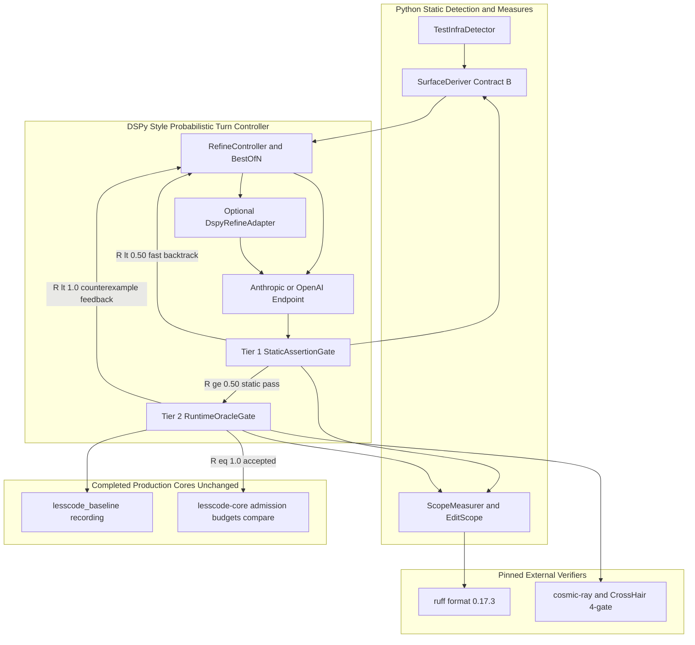
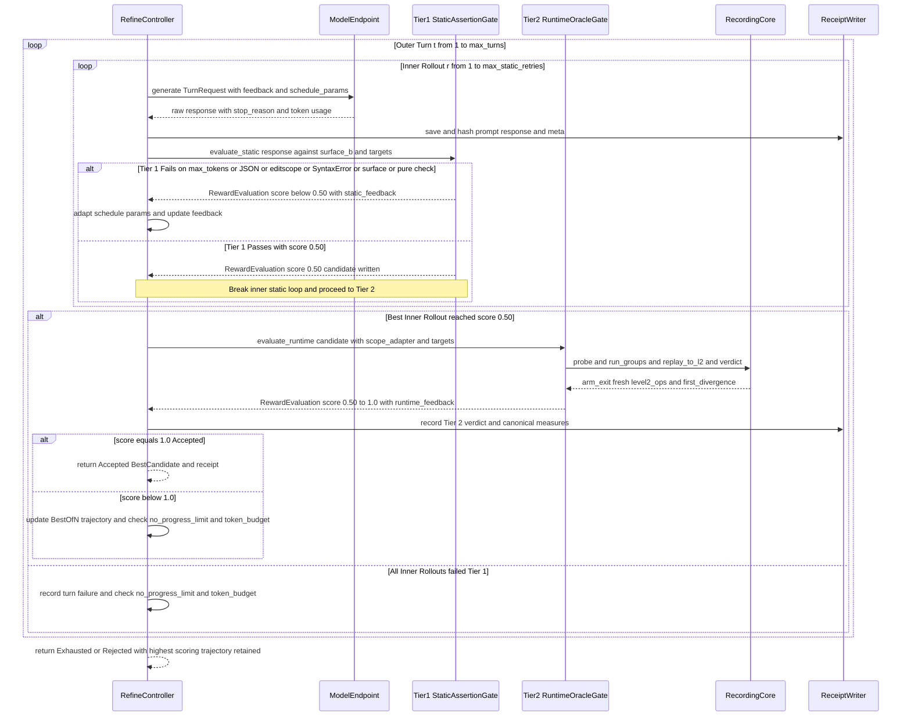

# Technical Design: Constraint-Guided Compression (H8/H9 Deconvolution Apparatus & H10 DSPy-Style Probabilistic Turn Refinement)

**Status**: Generated (`2026-11-07`, `$kiro-spec-design` phase per [R33](../../../docs/research/2026-11-07/07-dspy-probabilistic-turn-refinement-design.md)), pending owner review (`approvals.design.approved = false`).
Per [prototype-first policy](../../steering/prototype-first.md) and [prototype-gate.md](prototype-gate.md), this design partitions responsibilities into two explicit feasibility slices:
- **Slice A — Demonstrated Detection, Measurement & Single-Turn Loop Apparatus (`status: proceed`)**: Consolidates the proven Python detection and measurement modules (`surface.py` Contract B from [R29](../../../docs/research/2026-11-07/03-s9-surface-contracts.md), 3-stratum canonical and separated-form AST/edge/write-site/pure-share `measures.py` from [R25](../../../docs/research/2026-11-04/02-e3-evidence-regeneration.md)–[R27](../../../docs/research/2026-11-07/01-solution-first-native-slice.md), `editscope` + `patchcheck` Tier-1 checks from [R26](../../../docs/research/2026-11-06/01-e4-lifecycle-regeneration.md), `testinfra.py` from [R32](../../../docs/research/2026-11-07/06-rust-specimen-testinfra-detection.md), and the single-turn recorded `TurnRequest`/`Feedback` protocol) into `src/lesscode_baseline/`, wired to the completed [`src/lesscode_baseline/recording.py`](../../../src/lesscode_baseline/recording.py) and [`native/` (`lesscode-core`)](../../../native/src/lib.rs).
- **Slice B — DSPy-Style Probabilistic Multi-Turn Refinement (`H10`, `status: provisional / revise` pending bounded spike `G1-R`)**: Wraps `RegenerateScopeSignature` in a DSPy-style `Refine` / `BestOfN` controller (`RefineController` + optional `DspyRefineAdapter`) governed by a deterministic two-tier programmatic reward function (`StaticAssertionGate` $\to$ `RuntimeOracleGate`) so weaker models or non-deterministic sampling errors recover across bounded additional turns without weakening the frozen acceptance oracle.

---

## Overview

**Purpose**: Deliver a consolidated, fail-closed deconvolution workflow in `src/lesscode_baseline/` that detects scope boundaries and test infrastructure, enforces public-surface and pure-core/effect-shell structural constraints, and drives multi-turn LLM regeneration using DSPy-style probabilistic refinement (`Refine` / `BestOfN`) backed by the completed native AST/admission core (`lesscode-core`) and runtime trace oracle (`lesscode_baseline.recording`).

**Users**: Developers and research agents executing behavior-preserving scope compression across grown codebases (using strong, weaker, or open-weight models), and the project owner auditing whole-replacement reductions and behavioral evidence receipts.

**Impact**: Consolidates nine scattered prototype scripts from `docs/experiments/deconvolution/` into four cohesive modules in `src/lesscode_baseline/` (`surface.py`, `measures.py`, `testinfra.py`, `regenerator.py`), withdraws the falsified 2026-11-02 H7 static-CodeQL/authored-SMT proposal ([R19](../../../docs/research/2026-11-03/01-dynamic-deconvolution-direction.md)), and replaces single-shot turn fragility with a two-tier programmatic reward/assertion loop while leaving [`src/lesscode_baseline/recording.py`](../../../src/lesscode_baseline/recording.py) and [`native/src/`](../../../native/src/lib.rs) untouched.

### Goals
- Consolidate proven static detection and measurement (`SurfaceDeriver`, `ScopeMeasurer`, `TestInfraDetector`) into `src/lesscode_baseline/` with parameterized scope and recorder inputs (eliminating module-global `SET` monkey-patching).
- Recover automatically from weaker-model and non-deterministic generation failures (such as E4 Turn 1's `stop_reason == "max_tokens"` thinking-budget exhaustion and E4 Turn 2's missing Contract-B surface symbol `labeled_reason`) via a **Two-Tier Programmatic Reward & Assertion Loop (`Refine` / `BestOfN`)** that rejects static violations in $< 2\text{ s}$ before invoking the database/pytest oracle.
- Preserve 3-stratum canonical whole-replacement accounting ($B_{\text{app}}, B_{\text{ops}}, B_{\text{seeds}}$ under `U5`), byte-exact receipts (`native/src/receipt.rs`), and immutable per-rollout provenance hashes (`Req 4.1–4.7, 6.1–6.7`).

### Non-Goals
- Re-introducing H7 static dataflow state models or LLM-authored SMT models as equivalence authorities ([R19](../../../docs/research/2026-11-03/01-dynamic-deconvolution-direction.md)).
- Claiming unbounded program equivalence from trace replay, mutation scores, or bounded pure-core solver checks (`Req 5.4, 6.5`).
- Modifying the completed [`deconvolution-native-core`](../deconvolution-native-core/design.md) modules (`native/src/{admission,receipt,budgets}.rs`, `src/lesscode_baseline/recording.py`) or [`capability-compression-core`](../capability-compression-core/design.md) modules (`native/src/{scope,metrics,compare,model}.rs`).
- Automatic repository-wide scope selection without human or preregistered admission (`H8(b)` edge census selector rejected in [R21](../../../docs/research/2026-11-03/03-e2-facdrone-edge-census.md)).

---

## Boundary Commitments

### This Spec Owns
- `src/lesscode_baseline/surface.py` (`SurfaceDeriver`): static Python AST public-surface derivation implementing Contract B (tree imports + attribute reads + `setattr`/`mock.patch` targets + recorder/oracle imports per [R29](../../../docs/research/2026-11-07/03-s9-surface-contracts.md)) and Tier-1 static `patched`-global local-rebinding verification.
- `src/lesscode_baseline/measures.py` (`ScopeMeasurer`): unified static AST and canonical scope measurer combining as-written counts (`lines`, `stmts`, `funcs`, `qualnames`, `writes`, intra-scope `edges`, `module_hops`), `pure`/`shell` structure verification, `pureshare` statement/function ratios, `ruff==0.17.3` canonical formatting counts (`measures2`), separated-form statement rule v1 (`measures3`), and SHA-256 `editscope` tree/mention verification.
- `src/lesscode_baseline/testinfra.py` (`TestInfraDetector`): static Python repository test-infrastructure, `conftest`/plugin fixture, marker-expression, external-store fact, host-hazard, and scope-seed/deselection detector ([R32](../../../docs/research/2026-11-07/06-rust-specimen-testinfra-detection.md)).
- `src/lesscode_baseline/regenerator.py` (`ProbabilisticRegenerator` / `RefineController` / `DspyRefineAdapter`): typed `TurnRequest` $\to$ `TurnResult` execution with the four [R26](../../../docs/research/2026-11-06/01-e4-lifecycle-regeneration.md) protocol amendments, dual `anthropic` and `openai`-compatible endpoint support, the two-tier programmatic reward evaluator (`StaticAssertionGate` $\to$ `RuntimeOracleGate`), DSPy-style `Refine` and `BestOfN` rollout control, and optional lazy-loaded `dspy` integration.
- Unit and integration test suites (`tests/test_surface.py`, `tests/test_measures_scope.py`, `tests/test_testinfra_unit.py`, `tests/test_regenerator.py`) and the bounded prototype spike `G1-R` in `docs/experiments/deconvolution/probabilistic-refine/`.

### Out of Boundary
- Shared runtime trace recording, replay, L1/L2 divergence detection, and subprocess deadline kills: owned by [`src/lesscode_baseline/recording.py`](../../../src/lesscode_baseline/recording.py) under [`deconvolution-native-core`](../deconvolution-native-core/design.md) and consumed without modification.
- Native artifact byte admission, order-preserving Python-parity receipt emission, `rust-syntax-units-v1` AST complexity budgets, and multi-language baseline comparison: owned by `lesscode-core` (`native/src/{admission,receipt,budgets,compare,scope,metrics,model}.rs`) and consumed via CLI/library contracts.
- Specimen test authoring and upstream specimen repository commits: owned by the target project's TDD workflow (`deconvolution-loop` out-of-boundary rule).
- Mutation engine execution (`cosmic-ray`, `cargo-mutants`) and pure-core symbolic differential execution (`CrossHair` behind the 4 verifier gates in [`docs/symbolic-execution-tooling.md`](../../../docs/symbolic-execution-tooling.md)): invoked as external tools producing JSON artifacts consumed by `ProbabilisticRegenerator` feedback (`accepted_scored` round) and `verdict()`.

### Allowed Dependencies
- **Python product modules (`src/lesscode_baseline/{surface,measures,testinfra,regenerator}.py`)**: Top-level imports are restricted to the **CPython 3.12/3.13 standard library** (`ast`, `argparse`, `collections`, `configparser`, `contextlib`, `dataclasses`, `datetime`, `enum`, `fnmatch`, `hashlib`, `json`, `os`, `pathlib`, `re`, `shlex`, `shutil`, `subprocess`, `sys`, `tempfile`, `time`, `tomllib`, `typing`, `urllib.parse`, `urllib.request`).
- **Lazy / external runtime tools (invoked only during live turn generation, canonical formatting, or optional DSPy optimization)**:
  - `ruff == 0.17.3` via `uv.exe tool run --offline --from ruff==0.17.3 ruff format` for canonical line/statement measurement.
  - `anthropic` SDK (lazy-imported inside `Endpoint` when `style == "anthropic"`) or stdlib `urllib.request` (when `style == "openai"`, zero external SDK needed).
  - `dspy` (`dspy-ai >= 2.6`, lazy-imported inside `DspyRefineAdapter` only when `--backend dspy` is explicitly selected in an isolated research environment).
  - Existing `lesscode-core` binary (`admission`, `budgets`, `prepare`, `compare`) and `src/lesscode_baseline/recording.py`.

### Deferred Target Languages (TODO — owner direction 2026-11-07)

This design implements the Python extractor only. Per the owner's dated language-scope disposition (requirements.md, Amendment 2, 2026-11-07), TypeScript extraction evaluation is deferred to a named later stage; other target languages remain explicit TODO items. **Extensibility constraint binding this design and its generated tasks:** every language-specific analysis step — surface symbol derivation, statement measures, canonical formatting, test-infrastructure detection — lives behind a per-language extractor seam. Today that seam is the function set `derive_surface` / `measure_written` / `measure_canonical` / `detect` operating on explicit file sets with the Python `ast` implementation; controllers, the reward ladder, the receipt protocol, and `regenerator.py` are language-agnostic and must stay so. Adding a target language is therefore an additive change (a new sibling extractor module plus its test suite), never a rewrite. The G0-era TypeScript fixtures (prototype-gate.md) are preserved as the first evaluation material for that stage, subject to revalidation under whichever mechanism is chosen then (they predate CodeQL's demotion to optional locator). Traceability row 7.1 reads "Python satisfied; TypeScript deferred" until that stage.

### Revalidation Triggers
- Any change to Contract B surface derivation rules, separated-form statement rules (v1 rules 1–9), or `ruff == 0.17.3` canonical formatting flags.
- Any modification to `RewardEvaluation` tier thresholds ($0.50$ Tier-1 gate, $1.0$ acceptance threshold), the Tier-1 ladder rung values ($0.00$–$0.49$ failure taxonomy), the Tier-2 intra-band scaling formula and its weights (see `RuntimeOracleGate`), or `FEEDBACK_KEYS` schema (`failed` vs. `accepted_scored`).
- Any change to `testinfra.py` detection rules (pytest config discovery, marker classes, store/hazard heuristics) or their recorded versions.
- Any overlap between DSPy prompt-optimization training scopes and held-out evaluation scopes (`Req 7.5` violation voids efficacy claims).
- Any change to frozen golden traces (`92a48f77…`, `0b2e383d…`), `.sha256` sidecars, or `native/complexity-budgets.json`.

---

## Architecture

### Existing Architecture Analysis
- **Completed Native Core (`native/src/`)**: Provides `prepare`, `compare`, `admission`, and `budgets` subcommands under `lesscode-core`. All 8 Rust source files are governed by `native/complexity-budgets.json` (verified exit 0, nextest 123/123).
- **Completed Python Recording Core (`src/lesscode_baseline/recording.py`)**: Relocated verbatim in Task Group 3 (`f82d92f`), providing `record()`, `replay_engine()`, `replay_to_l2()`, `run_groups()`, `probe()`, `call()`, and `verdict()`.
- **Evaluator Package Boundary (`src/lesscode_baseline/`)**: the existing efficiency-baseline evaluator suite stays the product-evaluation layer: `metrics.py` (product-size, duplication, complexity with pinned `lizard`/`jscpd`), `contracts.py` (version-1 record JSON boundaries), `evaluation.py` (frozen local pair runs). The new `measures.py` implements this spec's research trial-scope strata (as-written/canonical/separated statements, pure-share, editscope) for a different population under a different contract. Per `src/lesscode_baseline/AGENTS.md` ("first consider deletion, reuse … avoid duplicate representations"): reuse was considered and does not apply — `metrics.py` measures product evidence with pinned external analyzers, `measures.py` implements the 3-stratum research contract with stdlib `ast`; neither imports the other, and no representation is duplicated. Recorded 2026-11-07 as the package boundary decision.
- **Prototype Debt Addressed by This Design**:
  1. `surface.py`, `surface4.py`, `measures.py`, `measures4.py`, and `pureshare4.py` previously hard-coded E3's 5-file `SET` and mutated `_m.SET = SET` at import time. This design replaces module-global state with explicit `scope_files` and `recorder_files` parameters.
  2. `regen_turn.py` executed a single rigid turn and aborted on `stop_reason == "max_tokens"` (E4 Turn 1) or required a full 90-second PostgreSQL/pytest run to discover a missing surface symbol (`labeled_reason` in E4 Turn 2). This design introduces a two-tier `Refine` / `BestOfN` loop that catches Tier-1 static violations in $< 2\text{ s}$ and iteratively refines candidates across bounded rollouts.

### Architecture Pattern & Boundary Map



**Architecture Integration**:
- **Selected pattern**: Two-Tier Programmatic Reward & Assertion Refinement (`dspy.Refine` / `dspy.BestOfN` pattern over typed `Signature`s) layered cleanly above the existing deterministic evaluator modules (`SurfaceDeriver`, `ScopeMeasurer`, `RecordingCore`, and `lesscode-core`).
- **Domain/feature boundaries**: Static repository/scope inspection (`testinfra.py`, `surface.py`, `measures.py`) is 100% pure static analysis (never imports or executes specimen code); runtime execution stays isolated inside `recording.py` subprocesses; LLM transport and multi-turn rollout state stay inside `regenerator.py`; byte integrity and receipt sidecars are verified by `lesscode-core admission`.
- **Dependency direction**: `testinfra` / `surface` / `measures` $\leftarrow$ `recording` $\leftarrow$ `regenerator` $\leftarrow$ CLI / experiment drivers. No lower layer imports `regenerator` or any model client.
- **Steering compliance**: Preserves all `src/lesscode_baseline/AGENTS.md` evidence rules, requires zero new Rust crates or mandatory Python packages, and enforces prototype-first gating (`Slice A` vs. `Slice B`).

### Technology Stack

| Layer | Choice / Version | Role in Feature | Notes |
|-------|------------------|-----------------|-------|
| Static AST & Config Analysis | CPython 3.12/3.13 `ast`, `tomllib`, `configparser` | `surface.py`, `measures.py`, `testinfra.py` | Stdlib only; never imports specimen code |
| Canonical Formatting | `ruff == 0.17.3` (`--isolated --line-length 100 --target-version py313`) | Canonical physical line and statement measurement | Invoked on isolated temp copies in `measures.py` |
| Probabilistic Turn Control | `src/lesscode_baseline/regenerator.py` + optional `dspy-ai >= 2.6` | `Refine` / `BestOfN` rollout controller with two-tier `reward_fn` | Stdlib default; lazy `dspy.Refine` / `MIPROv2` adapter |
| Model Endpoints | Anthropic Messages Stream API + OpenAI Chat Completions JSON Schema API | Candidate generation across strong, weaker, or local models | API key read from `LESSCODE_MODEL_ENV`, never logged or hashed |
| Runtime Trace Oracle | `src/lesscode_baseline/recording.py` (existing) | Level 1 / Level 2 trace recording, replay, and acceptance verdict | Completed in `deconvolution-native-core` (`f82d92f`) |
| Native Verification & Budgets | `lesscode-core` (`native/src/{admission,receipt,budgets,compare}.rs`) | Byte-exact `.sha256` admission, LF receipts, and Rust size budgets | Completed in `deconvolution-native-core` (`815eade`) |

### Effort Traps & Determination Methodology

To prevent wasted engineering effort and architecture drift, every major component and candidate dependency in this design was filtered through a three-part determination methodology before entering the specification:
1. **Empirical Lab Lineage Audit (`R08`–`R32`)**: Cross-referenced the original `2026-11-02` `design-proposal.md` against 25 dated experiments in [`docs/research/README.md`](../../../docs/research/README.md) (`E1`–`E4` and `S1`–`S10`) to identify mechanisms that failed falsification gates on real specimen code (`Facdrone`, `mmhmem`, and `lesscode` self-trials).
2. **Completed Substrate & Budget Audit**: Audited the active repository state (`native/src/` and `src/lesscode_baseline/recording.py` after Task Group 3 `f82d92f` / `815eade`) and the hard `1,600`-statement Rust budget in [`native/complexity-budgets.json`](../../../native/complexity-budgets.json) to eliminate duplicate infrastructure builds.
3. **Adverse-Control & Failure-Mode Replay**: Inspected retained failure artifacts from multi-turn regenerations ([`R25`](../../../docs/research/2026-11-04/02-e3-evidence-regeneration.md) E3 and [`R26`](../../../docs/research/2026-11-06/01-e4-lifecycle-regeneration.md) E4 turns 1–3) and symbolic solver calibration [`R23`](../../../docs/research/2026-11-04/01-symbolic-execution-tooling-review.md) (`S4`) to pinpoint where wall-clock time, token budget, or false confidence was lost.

| Effort Trap | How Determined (Evidence & Failure Mechanism) | Design Decision / Safeguard |
|-------------|-----------------------------------------------|-----------------------------|
| **1. Building the `2026-11-02` `H7` Static-CodeQL + LLM-Authored SMT Pipeline (`src/lesscode_cgc/`)** | Falsified across `R08`–`R18` and formally withdrawn in [`R19`](../../../docs/research/2026-11-03/01-dynamic-deconvolution-direction.md): static CodeQL missed `5/5` indirect state flows (`R10`), LLM-authored SMT models achieved `0/4` fidelity without defect leakage (`R13`), single-function targets yielded `+6` to `+31` LOC bloat (`R15`, `R16`), and a `2,140`-LOC pipeline produced net `+74` SLOC growth (`R18`). | Withdrawn completely. Replaced by the `H8`/`H9` dynamic runtime trace oracle (`recording.py`) + Contract-B static AST boundary checks (`surface.py`, `measures.py`). |
| **2. Re-implementing Trace Recording, Receipt Sidecars, Admission, or AST Complexity Budgets** | Codebase and handover audit ([`.kiro/task_3_handover.md`](../../task_3_handover.md), commits `f82d92f` and `815eade`) confirmed [`src/lesscode_baseline/recording.py`](../../../src/lesscode_baseline/recording.py) and `native/src/{admission,receipt,budgets,compare,scope,metrics,model}.rs` are already implemented, byte-parity verified against frozen E3/E4 receipts, and passing `123/123` Rust nextest + `19/19` Python tests (`pytest -n 4 --dist loadfile tests/test_recording.py`, 920 s, 2026-11-07 fresh verification per `.kiro/task_3_handover.md` L17; corrected 2026-11-07 — an earlier draft of this row said `36/36`, for which no recorded source exists). | Consumed untouched as frozen out-of-boundary dependencies (`Out of Boundary`). |
| **3. Porting Python AST `surface.py` and `measures.py` to Rust Ahead of Need** | Evaluated in [`R27`](../../../docs/research/2026-11-07/01-solution-first-native-slice.md) against [`native/complexity-budgets.json`](../../../native/complexity-budgets.json). CPython's stdlib `ast` parses Python 3.13 natively in $<0.2\text{ s}$ (~440 LOC combined). Re-implementing Python-specific `monkeypatch` detection and 9-rule separated-form statement unpacking in Rust `tree-sitter-python` would consume $>600$ statements of the `1,600`-statement native cap with zero accuracy or latency gain. | Keep Python AST surface and separated-form measures in `src/lesscode_baseline/{surface,measures}.py` using CPython stdlib `ast`. |
| **4. Adopting `LibCST` or `bowler` for Candidate Code Rewriting** | Evaluated during `E3` (`R25`) and `E4` (`R26`). Regeneration replaces whole 5-file scopes (`{"files": [{"path", "content"}]}`) followed by canonical formatting, not surgical CST node edits. Adding `LibCST` introduces a third-party parser dependency without simplifying whole-scope replacement. | Emit whole-file contents via `write_candidate()` and format isolated copies with pinned `ruff == 0.17.3`. |
| **5. Adopting Off-the-Shelf Line/Complexity Tools (`radon`, `xenon`, `lizard`) as Primary Compression Judges** | Determined in `R25` (`measures2.py`, `measures3.py`) and `S6`/`S7` density studies. Standard line/cyclomatic tools can be gamed by horizontal statement packing (`import a, b`, `a, b = 1, 2`, `0 < x < 1`) and cannot enforce `pure`/`shell` SQL write-site confinement. | Use `ScopeMeasurer` (`measures.py`) enforcing Separated-Form Rule v1 (`separated - sum(extra) == written`), `ruff == 0.17.3` canonical formatting, and `pure`/`shell` AST verification alongside `lesscode-core compare`. |
| **6. Paying the 60–120s Database/Pytest Oracle Tax on Static LLM Generation Failures** | Observed directly in `E4` ([`R26`](../../../docs/research/2026-11-06/01-e4-lifecycle-regeneration.md)): Turn 1 failed with `stop_reason == "max_tokens"` (all 32k tokens consumed in thinking, 0 text blocks), and Turn 2 omitted a recorder-imported helper (`labeled_reason`), which was only caught after launching the full PostgreSQL + pytest harness. | Two-Tier Programmatic Reward (`StaticAssertionGate` $\to$ `RuntimeOracleGate`) rejects `max_tokens`, JSON schema, `editscope`, `SyntaxError`, Contract-B surface ([`R29`](../../../docs/research/2026-11-07/03-s9-surface-contracts.md)), `patched`-global local rebinding, and `pure`/`shell` violations in $< 2\text{ s}$ with **zero** runtime/DB invocations. |
| **7. Hard-Depending on `dspy-ai` Transitive Packages (`litellm`, `optuna`, `datasets`, `pydantic`) in Core CLI or Specimen Environments** | Dependency isolation analysis against [`src/lesscode_baseline/AGENTS.md`](../../../src/lesscode_baseline/AGENTS.md) and [`tech.md`](../../steering/tech.md). Installing `dspy-ai` into specimen virtualenvs risks transitive version conflicts (`pydantic`, `sqlalchemy`, `httpx`), while DSPy v2.6+'s runtime `Refine` / `BestOfN` loop is a ~120-LOC state machine over a scalar `reward_fn`. | Implement the `Refine` / `BestOfN` state machine natively in stdlib `src/lesscode_baseline/regenerator.py` as the zero-dependency default; expose `DspyRefineAdapter` as an optional lazy-imported bridge (`--backend dspy`) for isolated research environments. |
| **8. Treating Uncalibrated Symbolic Solver (`CrossHair`) Zero-Counterexample Runs as Equivalence Proofs** | Determined in [`R23`](../../../docs/research/2026-11-04/01-symbolic-execution-tooling-review.md) (`S4`) and codified in [`docs/symbolic-execution-tooling.md`](../../../docs/symbolic-execution-tooling.md). In `S4`, CrossHair reported `0` counterexamples on 2 planted mutations (`m2_invert_guard`, `m3_drop_raise`) because regex guards exhausted symbolic path budgets and `check_function` silently ignored unrecognized CLI flags. | Externalize solver checks behind the 4 mandatory calibration gates (parser check, planted-mutation kill check, path-exhaustion check, concrete replay) and never promote bounded solver checks to equivalence proofs (`Req 5.1–5.4`). |
| **9. Automatic Repository-Wide Edge-Census Scope Selection (`H8(b)`)** | Falsified in [`R21`](../../../docs/research/2026-11-03/03-e2-facdrone-edge-census.md) (`E2`), where top-ranked high-fan-in utility hubs were cross-cutting glue rather than compressible domain responsibilities (`0/5` actionable candidates). | Explicitly excluded (`Non-Goals`). Scope admission requires preregistered `scope_files` plus static `TestInfraDetector` seed discovery ([`R32`](../../../docs/research/2026-11-07/06-rust-specimen-testinfra-detection.md)). |

---

## File Structure Plan

### Directory Structure
```
src/lesscode_baseline/
├── surface.py               # NEW (Slice A): Contract A/B public surface derivation + Tier-1 patched-global rebinding check
├── measures.py              # NEW (Slice A): Unified as-written, canonical (ruff), separated-form v1, pure-share & editscope measurer
├── testinfra.py             # NEW (Slice A): Relocated static pytest/fixture/marker/store/hazard/seed detector
├── regenerator.py           # NEW (Slice A+B): TurnRequest/TurnResult + Two-Tier Refine/BestOfN controller + optional DSPy adapter
└── recording.py             # EXISTING (unchanged): Shared L1/L2 trace recording, replay & acceptance verdict
tests/
├── test_surface.py          # NEW: Contract A vs B (recorder imports), patched-global local rebinding & missing-symbol checks
├── test_measures_scope.py   # NEW: As-written, separated-form v1 (rules 1-9), pure/shell write check, pure-share & editscope tests
├── test_testinfra_unit.py   # NEW: Relocated and extended unit tests from test_testinfra.py
└── test_regenerator.py      # NEW: Prompt/feedback hashes, Tier-1 static gate controls (0 DB calls), Refine/BestOfN loop & budget stops
docs/experiments/deconvolution/probabilistic-refine/
└── g1r_spike.py             # NEW (Slice B prototype gate): Bounded G1-R verification driver over frozen E3/E4 turn artifacts
```

### Modified Files
- `.kiro/specs/constraint-guided-compression/{brief.md,requirements.md,prototype-gate.md,research.md,design-review.md,spec.json}` — Updated to record the H8/H9 + H10 design reconciliation and `G1-R` gate criteria.
- `docs/research/2026-11-07/07-dspy-probabilistic-turn-refinement-design.md` & `docs/research/README.md` — Dated research entry `R33` and index update.
- `src/lesscode_baseline/__init__.py` — export registration for the four new modules only (no behavior change); `regenerator.py` CLI runs as `python -m lesscode_baseline.regenerator` with the preserved exit codes `0/2/3/4/5/6`; `cli.py` is unchanged (its subcommands and exits are an evidence contract, per `src/lesscode_baseline/AGENTS.md`).
- **Untouched files**: `src/lesscode_baseline/recording.py`, `native/src/*.rs`, `native/complexity-budgets.json`, and all frozen experiment drivers under `docs/experiments/deconvolution/{e1b-*,e3-*,e4-*,native-prototype}/` remain 100% untouched so historical receipts stay byte-reproducible.

---

## System Flows

### Flow 1: Two-Tier Probabilistic `Refine` / `BestOfN` Regeneration Loop



**Flow Gating Decisions**:
- **Fast Static Short-Circuit (Tier 1)**: No subprocess in `RecordingCore` (`pytest` or embedded PostgreSQL) is ever launched unless `Tier1 StaticAssertionGate` returns `score >= 0.50`.
- **Automatic Parameter Recovery (`schedule_params`)**:
  - When `stop_reason == "max_tokens"` occurs with 0 text blocks (the E4 Turn 1 failure mode), the next rollout automatically caps thinking budget / switches `effort` from `"high"` to `"medium"` and prepends a conciseness constraint to the prompt.
  - When a static syntax, schema, `editscope`, or missing Contract-B surface symbol occurs (the E4 Turn 2 `labeled_reason` failure mode), the next rollout increments `rollout_id` (applying bounded temperature jitter $\Delta T \in [0.0, 0.3]$ for non-deterministic recovery) and injects the exact missing symbols or line numbers into `feedback.first_divergence`.
- **No-Progress & Budget Stop (`Req 4.5, 4.6`)**: If `no_progress_turns` reaches `no_progress_limit` (default `2` consecutive outer turns without strict improvement in $\max(R)$ and without discharging a previously failing obligation) or cumulative tokens exceed `max_total_tokens`, the controller halts immediately and marks the outcome `exhausted`.
- **Rollout/Retry Nesting (Req 4.1)**: The loops nest as follows — the outer `Refine` loop advances turns $t = 1 \dots max\_turns$; within each turn, `BestOfN` runs `n_rollouts_per_turn` independent rollouts (`rollout_id`); each rollout is an inner `Refine` chain of at most `max_static_retries` Tier-1 repair attempts. A rollout's score is its best attempt's `RewardEvaluation`; a turn's score is the `BestOfN` maximum; the turn's `FeedbackPayload` comes from the best-scoring (or least-failing) trajectory. `no_progress_limit` counts outer turns only; `n_rollouts_per_turn = 1` collapses `BestOfN` to the single-rollout default.

---

## Requirements Traceability

All 56 numeric acceptance criteria (`1.1`–`8.6`) from [requirements.md](requirements.md) are mapped below:

| Requirement | Summary | Components | Interfaces | Flows |
|-------------|---------|------------|------------|-------|
| 1.1 | Record trial hypothesis, predecessor, snapshot identity, license, language, entry points, owned scope, callers, exclusions | TestInfraDetector, SurfaceDeriver, RefineController | `detect()`, `derive_surface()`, `TurnRequest` | Flow 1 |
| 1.2 | Record behavioral invariants, frozen evaluator/checks, absolute/relative targets, structural constraints, budgets before generation | RefineController, ScopeMeasurer | `TurnRequest`, `RefineBudget`, `StructureContract` | Flow 1 |
| 1.3 | Classify production, tests, fixtures, dependencies, and experiment apparatus separately | TestInfraDetector, ScopeMeasurer | `detect()` (`test_files`, `support_files`, `production_files`), 3-stratum `U5` | Flow 1 |
| 1.4 | Prevent dependent analysis when provenance or source-use eligibility is unresolved | RefineController, NativeAdmission | `prepare_candidate()`, `lesscode-core admission` | Flow 1 |
| 1.5 | Preserve original checkout and produce candidates only in an isolated trial scope | RefineController, ScopeMeasurer | `prepare_candidate()`, `check_edit_scope()` | Flow 1 |
| 2.1 | Retain reloadable representation with source identity, extractor/analysis versions, config, diagnostics | SurfaceDeriver, TestInfraDetector | `SurfaceReport`, `TestInfraReport` | Flow 1 |
| 2.2 | Query callable/caller boundaries, flow, control, shared-state reads/writes, effects, and report unsupported kinds | SurfaceDeriver, ScopeMeasurer, TestInfraDetector | `derive_surface()`, `measure_scope()`, `detect()` | Flow 1 |
| 2.3 | Retain query identity, source anchors, result, and analysis assumptions | SurfaceDeriver, ScopeMeasurer | `SurfaceReport`, `MeasuresReport` (`RULE`) | Flow 1 |
| 2.4 | Distinguish extracted facts, inferred relationships, observed executions, and LLM-proposed relationships | SurfaceDeriver, RecordingCore, RefineController | `SurfaceReport` (static) vs `GoldenTrace` (observed) vs `TurnResult` (LLM) | Flow 1 |
| 2.5 | Expose unresolved calls/aliases/callbacks/exceptions/state effects; never treat missing edges as safe deletion | SurfaceDeriver, TestInfraDetector | `SurfaceReport.unresolved`, `TestInfraReport.scope_references.unresolved` | Flow 1 |
| 2.6 | Compare normalized query results on reload and report discrepancies | ScopeMeasurer, SurfaceDeriver | `measure_all()` (reload + three readings + gaps), `verify_candidate_surface()`, `compute_measure_gaps()` | Flow 1 |
| 3.1 | Record cluster evidence, intended responsibility, callers, shared state, boundary obligations; similarity != interchangeability | SurfaceDeriver, ScopeMeasurer | `SurfaceReport`, `MeasuresReport.write_sites` | Flow 1 |
| 3.2 | Record input/output domains, state transitions, effect ordering, exceptions, numeric assumptions, unresolved obligations | RecordingCore, RefineController | `GoldenTrace` (L1/L2), `TurnRequest.definitions`, `TurnRequest.contract` | Flow 1 |
| 3.3 | Link modeled obligations to source/execution evidence or label as unverified assumption | SurfaceDeriver, RecordingCore, RefineController | `SurfaceReport.modules`, `TurnResult.structure` | Flow 1 |
| 3.4 | Identify removed implementation, preserved variant differences, and all added support | ScopeMeasurer, RefineController | `TurnResult.change_log`, `MeasuresReport`, 3-stratum `U5` | Flow 1 |
| 3.5 | Establish shared snapshot-bound inventory of repository and framework capabilities | TestInfraDetector | `TestInfraReport` (`runner`, `plugins`, `external_store`, `import_roots`) | Flow 1 |
| 3.6 | Record any dependency change as a repository-level decision; never silently modify frozen trial dependencies | ScopeMeasurer, RefineController | `check_edit_scope()`, `TurnRequest.scope_files` | Flow 1 |
| 4.1 | Retain separately identifiable modeler, critic, candidate-author, and evaluator outputs with model identity/settings | RefineController, DspyRefineAdapter | `TurnMeta` (`hash_set`, `endpoint.public()`), `RolloutRecord` | Flow 1 |
| 4.2 | Identify the unresolved obligation or counterexample motivating each revision pass | RefineController, StaticAssertionGate, RuntimeOracleGate | `FeedbackPayload` (`first_divergence`, `measure_gaps`, `surviving_faults`, `counterexamples`) | Flow 1 |
| 4.3 | Retain predecessor, changed assumptions, supporting evidence, and revision reason without overwriting prior attempts | RefineController | `results/turns/<label>-t<turn>-r<rollout>/` append-only directory & receipt | Flow 1 |
| 4.4 | Invalidate affected evidence and dependent claims when source, dependencies, or shared contracts change | RefineController, NativeAdmission | `prepare_candidate()` hash check, `lesscode-core admission` | Flow 1 |
| 4.5 | Stop search when pass, query, solver, or inference budget is exhausted and report exhaustion separately | RefineController | `RefineBudget`, `RefineOutcome.status == "exhausted"` | Flow 1 |
| 4.6 | Stop loop when declared no-progress condition is met and retain unresolved obligations | RefineController | `RefineBudget.no_progress_limit`, `RefineOutcome.unresolved_obligations` | Flow 1 |
| 4.7 | Verify retained input identities before resuming an interrupted trial | RefineController, NativeAdmission | Append-only receipt labels + `preregistered_params` identity + `prepare_candidate()` hash re-check (`R26` resume protocol), `lesscode-core admission` | Flow 1 |
| 5.1 | Declare modeled semantics, supported operations, abstraction assumptions, and source-model fidelity evidence for solver claims | RuntimeOracleGate (external solver tools located, not implemented) | 4-gate solver verifier contract (`symbolic-execution-tooling.md`) | Flow 1 |
| 5.2 | Seek behavioral difference within supported model and retain query, solver version, bounds, result, counterexample | RuntimeOracleGate (external tools `cosmic-ray`/`CrossHair` as located evidence) | `FeedbackPayload.counterexamples` (external-tool JSON parsed by the feedback builder in `regenerator.py`; corrected 2026-11-07 — no `DifferentialReport` type exists) | Flow 1 |
| 5.3 | Distinguish realizable source mismatch from abstraction artifact before attributing source defect | RecordingCore, RuntimeOracleGate | Concrete replay gate (Gate 4 of solver verifier) | Flow 1 |
| 5.4 | Report solver unknown, timeout, or bounded domain honestly without promoting to unbounded equivalence | RuntimeOracleGate, RefineController | `RefineOutcome` protection-level & residue reporting, `FeedbackPayload` | Flow 1 |
| 5.5 | Compare executable candidate against frozen original using project checks and differential/property checks | RuntimeOracleGate, RecordingCore | `RecordingCore.run_groups()`, `replay_to_l2()`, `verdict()` | Flow 1 |
| 5.6 | Preserve baseline failures or missing required observations and refuse to report a passing behavioral gate | TestInfraDetector, RecordingCore, RuntimeOracleGate | `TestInfraReport.deselections`, `RecordingCore.verdict()` (`exit 1`/`2`) | Flow 1 |
| 5.7 | Preserve frozen checks and invariants across candidate revisions; amendments create separate trials | RefineController, NativeAdmission | Frozen `TurnRequest` / golden hashes verified per rollout | Flow 1 |
| 5.8 | Record whether evaluator rejects planted adverse behavioral mutations and withhold adequacy claims if not | RuntimeOracleGate, StaticAssertionGate | Owned 5 Tier-1 adverse controls (`test_regenerator.py`); runtime side: prior evidence — frozen `s10_controls2.py` 9/9 fail-closed (`R31`) + G1-R replay; no owned runtime-control suite by design | Flow 1 |
| 6.1 | Count complete owned implementation, added helpers, wrappers, tables, config, integration, and changed callers | ScopeMeasurer, NativeBudgets | `measure_all()`, `check_edit_scope()`, 3-stratum `U5`, `lesscode-core compare` | Flow 1 |
| 6.2 | Report physical-line and logical/statement measures separately, plus decisions, callable distribution, and call layers | ScopeMeasurer, NativeCompare | `MeasuresReport` (`as_written`, `canonical`, `separated`, `edges`, `module_hops`), `lesscode-core` | Flow 1 |
| 6.3 | Report unavailable metrics as unavailable (`None`/`null`), never zero | ScopeMeasurer, TestInfraDetector | `MeasuresReport`, `TestInfraReport` | Flow 1 |
| 6.4 | Label candidates missing preregistered usefulness targets as marginal or rejected | StaticAssertionGate, RuntimeOracleGate, RefineController | `compute_measure_gaps()`, `RefineOutcome.status` | Flow 1 |
| 6.5 | Reject or leave inconclusive any candidate failing behavior or required evidence regardless of size reduction | StaticAssertionGate, RuntimeOracleGate | `RewardEvaluation` ($R < 1.0$ whenever `verdict != 0` or `structure.pass == False`) | Flow 1 |
| 6.6 | Retain review of role-revealing names, useful types, explicit invariants, and added indirection before adoption | RefineController | `TurnResult.change_log`; independent review step recorded under the research log (`Req 8`; E3's `review-step2.md` is prior evidence, not this design's artifact) | Flow 1 |
| 6.7 | Report candidate validity, measured compression, and actual adoption as separate outcomes without summing overlaps | RefineController, NativeAdmission | `RefineOutcome` (`validity`, `compression_met`, `adopted: False`) | Flow 1 |
| 7.1 | Evaluate extraction on labeled cases with cross-function flow, shared state, callbacks, aliases, and negative controls | SurfaceDeriver, ScopeMeasurer, TestInfraDetector | `test_surface.py`, `test_measures_scope.py`, `test_testinfra_unit.py` — Python satisfied; TypeScript deferred (Amendment 2, 2026-11-07; language extractor seam, see "Deferred Target Languages") | Flow 1 |
| 7.2 | Record previous gate's evidence and continue/revise/stop decision when moving across stages | PrototypeGate, RefineController | `prototype-gate.md`, `docs/research/README.md` | — |
| 7.3 | Compare arms under recorded comparable source, evaluator, model, and resource budgets | RefineController, DspyRefineAdapter | `TurnRequest`, `RefineBudget`, `TurnMeta` | Flow 1 |
| 7.4 | Retain per-pass obligations, counterexamples, candidate results, and cumulative research cost across passes | RefineController | `RolloutRecord`, `RefineOutcome.rollout_history`, token/elapsed totals | Flow 1 |
| 7.5 | Record repeated runs and keep held-out scopes strictly separated from DSPy prompt/program optimization inputs | DspyRefineAdapter, RefineController | `verify_holdout_disjoint(train_scopes, eval_scopes)` | Flow 1 |
| 7.6 | Report selection method, covered population, unsupported population, and per-scope outcomes without extrapolation | TestInfraDetector, SurfaceDeriver | `TestInfraReport`, `SurfaceReport` | — |
| 7.7 | Perform supported-scope Lesscode self-trial with frozen evaluator checks and regressions before claiming self-maturity | ScopeMeasurer, RecordingCore | Retained self-trial & `tests/test_recording.py` / `tests/test_*.py` | — |
| 7.8 | Retain negative results without weakening targets or expanding infrastructure merely to continue | RefineController, PrototypeGate | `RefineOutcome`, `prototype-gate.md` | Flow 1 |
| 7.9 | Require linked real-code prototype result demonstrating mechanism, preserved behavior, and net reduction before final design approval | PrototypeGate | Slice A (`R25`–`R32` `proceed`) vs Slice B (`G1-R` `revise`) | — |
| 7.10 | Withhold dependent production task generation/execution when feasibility gate is not-run, revise, or stop | PrototypeGate, SpecMetadata | `spec.json` (`Slice B` locked behind `G1-R`) | — |
| 7.11 | Invalidate affected claims and require revalidation when material assumptions change | Revalidation Triggers, NativeAdmission | `lesscode-core admission`, `check_edit_scope()` | Flow 1 |
| 8.1 | Create or amend dated entry under `docs/research` and update index on trial, failure, or hypothesis decision | ResearchLog | [R33](../../../docs/research/2026-11-07/07-dspy-probabilistic-turn-refinement-design.md), [README.md](../../../docs/research/README.md) | — |
| 8.2 | Record discussion date, execution interval, retrospective status, hypothesis, method, links, limits, decision, next gate | ResearchLog | `R33` COBESY entry sections | — |
| 8.3 | Link dated record to relevant spec and add reciprocal spec link without silently changing phase approvals | SpecMetadata, ResearchLog | `brief.md`, `requirements.md`, `design.md`, `spec.json` (`approved: false`) | — |
| 8.4 | Append dated corrections preserving prior results and identifying superseded interpretations | ResearchLog, SpecDocuments | `2026-11-07` amendments across spec files | — |
| 8.5 | Retain durable replayable evidence with confidential credentials excluded from published artifacts | RefineController, ReceiptWriter | `Endpoint` key redaction (`<redacted>`), `.sha256` sidecars | Flow 1 |
| 8.6 | Distinguish planned work, setup, completed execution, and measured outcomes; charts only from retained measurements | ResearchLog, SpecMetadata | `R33` (`status: planned`), `prototype-gate.md` | — |

---

## Components and Interfaces

| Component | Domain/Layer | Slice | Intent | Req Coverage | Key Dependencies | Contracts |
|-----------|--------------|-------|--------|--------------|------------------|-----------|
| `SurfaceDeriver` (`surface.py`) | Static AST detection | Slice A (`proceed`) | Derive Contract A/B public surface + verify `patched` globals are not locally rebound | 1.1, 2.1–2.6, 3.1, 3.3, 7.1, 7.6 | Python `ast` (P0) | Service, Batch |
| `ScopeMeasurer` (`measures.py`) | Static & canonical metrics | Slice A (`proceed`) | Measure as-written, canonical (`ruff`), separated-form v1, `pure`/`shell` structure, `pureshare`, and `editscope` | 1.2, 1.5, 2.2, 2.6, 3.1, 3.4, 3.6, 6.1–6.5, 7.1, 7.7 | Python `ast` (P0), `ruff 0.17.3` (P1) | Service, Batch |
| `TestInfraDetector` (`testinfra.py`) | Repository discovery | Slice A (`proceed`) | Detect pytest configs, fixtures, plugins, store facts, host hazards, scope seeds, and deselections | 1.1, 1.3, 2.1, 2.2, 2.5, 3.5, 5.6, 6.3, 7.1, 7.6 | Python `ast`, `tomllib`, `configparser` (P0) | Service, Batch |
| `ProbabilisticRegenerator` (`regenerator.py`) | Turn & `Refine`/`BestOfN` control | Slice A (`TurnRequest`/`Endpoint`) + Slice B (`Refine`/`BestOfN` `G1-R`) | Execute single-turn and DSPy-style multi-turn probabilistic regeneration with two-tier `reward_fn` and full receipt hashing | 1.1, 1.2, 1.4, 1.5, 2.4, 3.2–3.4, 3.6, 4.1–4.7, 5.1–5.8, 6.4–6.7, 7.3–7.5, 7.8, 8.5 | `SurfaceDeriver` (P0), `ScopeMeasurer` (P0), `RecordingCore` (P0), `dspy` (P2 optional) | Service, Batch, State |

---

### Static AST Detection & Measurement Layer (`Slice A — proceed`)

#### 1. `SurfaceDeriver` (`src/lesscode_baseline/surface.py`)

| Field | Detail |
|-------|--------|
| Intent | Derive the public surface of a multi-file Python scope under Contract A (repository tree) or Contract B (repository tree + recorder/oracle files) and check Candidate surface & patch preservation |
| Requirements | 1.1, 2.1, 2.2, 2.3, 2.4, 2.5, 2.6, 3.1, 3.3, 7.1, 7.6 |

**Responsibilities & Constraints**
- Scans `scan_dirs` (default `("src", "packages", "tests")`) plus explicit `recorder_files` (Contract B, ratified in [R29](../../../docs/research/2026-11-07/03-s9-surface-contracts.md)) for `import`, `module`, `attribute`, and `patched` (`setattr`, `delattr`, `mock.patch`, `patch.object`) references to `scope_files`.
- Distinguishes `prod`, `test`, and `recorder` importer tags, records `intra_set` references separately from external importers, and records references to missing attributes under `unresolved` (`Req 2.4, 2.5`).
- Implements `verify_candidate_surface(cand_root, surface_report, patched_tier1)`:
  1. Verifies every symbol in `surface_report["modules"][mod]["names"]` (with `kind != "missing"`) remains defined at module top level in `cand_root` with a compatible kind (`function`, `class`, `constant`, `reexport`).
  2. Verifies Tier-1 patchability (`patchcheck.py` `rebound()` rule): for every symbol with `"patched"` in `via` (or listed in `patched_tier1`), confirms no function/method/lambda body inside its defining module locally re-binds, re-imports, takes as a parameter, or defaults that name (`Req 6.5`, `deconvolution-loop` req 6.6).

**Dependencies**
- Inbound: `ProbabilisticRegenerator` (`Tier1 StaticAssertionGate`), CLI users (P0).
- Outbound: Python stdlib `ast`, `json`, `pathlib` (P0).

**Contracts**: Service [x] / Batch [x]

##### Service Interface
```python
from dataclasses import dataclass
from pathlib import Path
from typing import Sequence

@dataclass(frozen=True)
class SurfaceVerification:
    passed: bool
    missing_symbols: list[str]          # ["module::name (expected kind, got None)", ...]
    kind_mismatches: list[str]          # ["module::name (expected function, got constant)", ...]
    local_rebindings: dict[str, list[str]]  # {"module::name": ["line 42", ...]}

def derive_surface(
    root: Path,
    scope_files: Sequence[str],
    recorder_files: Sequence[Path] = (),
    scan_dirs: Sequence[str] = ("src", "packages", "tests"),
    out_path: Path | None = None,
) -> dict: ...

def verify_candidate_surface(
    cand_root: Path,
    surface_report: dict,
    extra_patched: dict[str, Sequence[str]] | None = None,
) -> SurfaceVerification: ...
```
- **Preconditions**: `root` and `cand_root` are existing directory paths; all `scope_files` exist under `root`.
- **Postconditions**: Returns deterministic JSON-serializable `SurfaceReport` matching the frozen `surface.py` + `s9_surface_contracts.py` schema; `verify_candidate_surface` never imports or executes candidate code (pure `ast.parse`).
- **Invariants**: Missing or dynamically constructed targets remain in `unresolved` and never authorize deletion (`Req 2.5`).

---

#### 2. `ScopeMeasurer` (`src/lesscode_baseline/measures.py`)

| Field | Detail |
|-------|--------|
| Intent | Compute as-written, canonical (`ruff 0.17.3`), and separated-form (v1) size/edge/write measures, verify `pure`/`shell` structural separation, and enforce `editscope` tree confinement |
| Requirements | 1.2, 1.5, 2.2, 2.6, 3.1, 3.4, 3.6, 6.1, 6.2, 6.3, 6.4, 6.5, 7.1, 7.7 |

**Responsibilities & Constraints**
- Parameterizes `scope_files: Sequence[str]` across five proven measurement operations without global `SET` mutation:
  1. `measure_written(root, scope_files, structure=None)`: counts per-file and total `lines`, `stmts` (`ast.stmt`), `funcs`, `qualnames`, `writes` (matching `WRITE` regex), intra-scope call `edges`, `module_hops`, and (when `structure` is provided) validates that every `pure` function has zero forbidden parameter names (`BAD`: `engine|conn|connection|session|bind`) and zero SQL attribute calls (`SQL`), and every write site resides inside a declared `shell` function.
  2. `measure_pure_share(root, scope_files, structure)`: attributes every `ast.stmt` to its innermost enclosing `def` (`pure`, `shell`, `undeclared`, `outside_defs`) per `pureshare.py`.
  3. `measure_separated(root, scope_files)`: computes separated-form statement counts under Rule v1 (rules 1–9 from `measures3.py`, unpacking multi-name imports, paired tuple/list assignments, multi-target assignments, chained comparisons, `del`, `global`/`nonlocal`, and multi-item `with`).
  4. `measure_canonical(root, scope_files, fmt_dir)`: formats isolated copies of `scope_files` in `fmt_dir` using pinned `ruff == 0.17.3` (`--isolated --line-length 100 --target-version py313`) and returns canonical `lines` and `stmts` (`measures2.py`).
  5. `check_edit_scope(original_root, candidate_root, scope_files, dirs=("src", "tests", "packages"), mentions_files=())`: verifies SHA-256 byte identity of all files outside `scope_files` (`editscope.py`).
- Computes `compute_measure_gaps(measured, targets)` returning a dictionary of unmet target deltas (empty dict `{}` iff all preregistered targets pass).

**Dependencies**
- Inbound: `ProbabilisticRegenerator` (`Tier1` and `Tier2`), CLI users (P0).
- Outbound: Python stdlib `ast`, `hashlib`, `re`, `shutil`, `subprocess` (P0); `ruff == 0.17.3` via `uv.exe tool run` for `measure_canonical` (P1 — if unavailable in offline unit tests, `measure_canonical` reports unavailable rather than `0` per `Req 6.3`).

**Contracts**: Service [x] / Batch [x]

##### Service Interface
```python
from pathlib import Path
from typing import Sequence

def measure_written(root: Path, scope_files: Sequence[str], structure: dict | None = None) -> dict: ...
def measure_pure_share(root: Path, scope_files: Sequence[str], structure: dict) -> dict: ...
def measure_separated(root: Path, scope_files: Sequence[str]) -> dict: ...
def measure_canonical(root: Path, scope_files: Sequence[str], fmt_dir: Path) -> dict | None: ...
def check_edit_scope(
    original: Path,
    candidate: Path,
    scope_files: Sequence[str],
    dirs: Sequence[str] = ("src", "tests", "packages"),
    mentions_files: Sequence[Path] = (),
) -> dict: ...
def compute_measure_gaps(written: dict, canonical: dict | None, separated: dict, targets: dict) -> dict[str, dict]: ...
def measure_all(root: Path, scope_files: Sequence[str], fmt_dir: Path | None = None) -> dict: ...
```
- `measure_all` is the composition entry point (Req 6.1, 2.6 reload): one call returning `MeasureReport` with `as_written`, `separated`, `canonical` (`None` when `ruff` is unavailable, per `Req 6.3`), and `gaps` against the declared targets.
- **Preconditions**: `scope_files` are POSIX-normalized relative paths under `root`.
- **Postconditions**: Output dictionaries preserve byte-compatible field names with `measures.py`, `measures2.py`, `measures3.py`, `pureshare.py`, and `editscope.py`; `separated["files"][f]["stmts"] - sum(extra) == written["files"][f]["stmts"]` invariant asserted on every run.

---

#### 3. `TestInfraDetector` (`src/lesscode_baseline/testinfra.py`)

| Field | Detail |
|-------|--------|
| Intent | Statically detect repository test runner, configs, fixtures, external store facts, host hazards, scope seed sets, and applicable baseline deselections |
| Requirements | 1.1, 1.3, 2.1, 2.2, 2.5, 3.5, 5.6, 6.3, 7.1, 7.6 |

**Responsibilities & Constraints**
- Relocated verbatim from `docs/experiments/deconvolution/testinfra/testinfra.py` (validated on Facdrone in task 2.2 and on Rust `mmhmem` in task 2.3 / [R32](../../../docs/research/2026-11-07/06-rust-specimen-testinfra-detection.md)).
- Pure static analysis (`ast`, `tomllib`, `configparser`); never imports or executes specimen code; returns `runner.name = "unknown"` and `0` seeds cleanly on non-Python repositories (`R32`).

**Contracts**: Service [x] / Batch [x]

##### Service Interface
```python
from pathlib import Path

def detect(
    root: Path,
    scope_files: list[str],
    fails: dict | None = None,
    seeds_file: list[str] | None = None,
    site: Path | None = None,
) -> dict: ...
def render(report: dict) -> str: ...
def main(argv: list[str] | None = None) -> int: ...
```

---

### Probabilistic Regeneration & Turn Control Layer (`Slice A` base + `Slice B` `Refine`/`BestOfN`)

#### 4. `ProbabilisticRegenerator` (`src/lesscode_baseline/regenerator.py`)

| Field | Detail |
|-------|--------|
| Intent | Execute single-turn (`Slice A`) and DSPy-style multi-turn probabilistic `Refine`/`BestOfN` regeneration (`Slice B`) with a two-tier programmatic reward function and content-hashed receipts |
| Requirements | 1.1, 1.2, 1.4, 1.5, 2.4, 3.2, 3.3, 3.4, 3.6, 4.1–4.7, 5.1–5.8, 6.4–6.7, 7.3–7.5, 7.8, 8.5 |

**Responsibilities & Constraints**
- Preserves all contracts of `regen_turn.py` (`TurnRequest`, `TurnResult`, `Endpoint`, `build_prompt`, `prepare_candidate`, `write_candidate`, `hash_set`, exit codes `0, 2, 3, 4, 5, 6`) plus the four [R26](../../../docs/research/2026-11-06/01-e4-lifecycle-regeneration.md) amendments:
  1. Surface Contract B (`public-surface.json` includes recorder imports).
  2. Preregistered turn parameters (`max_tokens`, `effort`, `temperature`, `thinking_display`, `rollout_id`, `seed`).
  3. Content hashes computed over exact UTF-8 LF bytes as stored on disk (`_save` writes `newline="\n"` and `.sha256` sidecars).
  4. Case-distinct receipt labels (`<label>-t<turn>-r<rollout>`, validated case-insensitively unique before execution).
- Extends `Endpoint` to support both `"anthropic"` (streaming Messages API) and `"openai"` (OpenAI-compatible `v1/chat/completions` JSON-schema HTTP endpoint via stdlib `urllib.request`, enabling weaker, local, or open-weight models without extra SDK dependencies).
- Implements the **DSPy v2.6+ `Refine` / `BestOfN` Probabilistic Iteration Contract**:
  - **Typed Signature (`RegenerateScopeSignature`)**:
    - Inputs: `scope_files_source`, `public_surface_json`, `definitions`, `measure_targets_json`, `structural_contract`, `acceptance_command`, `feedback_markdown`.
    - Outputs: `files` (`list[{path, content}]`), `structure` (`{pure: list[str], shell: list[str]}`), `change_log` (`str`).
  - **Two-Tier Programmatic Reward Function (`evaluate_candidate_reward`)**:
    - **Tier 1 (`StaticAssertionGate`, score $\in [0.0, 0.49]$)**:
      - $0.00$: API/transport error or `stop_reason != "end_turn"` (e.g., `max_tokens` thinking exhaustion).
      - $0.10$: Response completed (`end_turn`), but JSON schema parse failed.
      - $0.20$: JSON valid, but `write_candidate` / `check_edit_scope` rejected an out-of-scope path (`ScopeError`).
      - $0.30$: Scope paths valid, but `ast.parse` failed (`SyntaxError` in one or more returned files).
      - $0.40$: Syntax valid, but `verify_candidate_surface` failed (missing Contract-B symbol or locally rebound `patched` global).
      - $0.45$: Surface valid, but `measure_written` `structure.pass == False` (write site outside `shell`, forbidden DB param/call in `pure`, or undeclared function).
      - $0.49$: Structure valid, but static measure targets (`edges_max`, `funcs_max`, `stmts_max`) missed before runtime.
      - $0.50$: All Tier-1 static checks pass! Candidate is admitted to Tier 2.
    - **Tier 2 (`RuntimeOracleGate`, score $\in [0.50, 1.0]$)**:
      - Invokes the supplied `runtime_evaluator` callback (wrapping `lesscode_baseline.recording` `probe`, `run_groups`, `replay_to_l2`, `verdict`, plus `measure_canonical` and `measure_separated`).
      - $0.50$: Runtime infrastructure timeout (`exit 124`) or invalid arm (`exit 2`).
      - $0.60 \dots 0.85$: Runtime arm failed (`verdict == 1`, seed test failure or Level 1 / unapproved Level 2 trace divergence); reward is the pinned formula $R = 0.60 + 0.25 \cdot (0.5\,g + 0.5\,s)$, where $g$ is the fraction of passing seed groups and $s$ the fraction of replayed sequences with no divergence prior to `first_divergence` (both $\in [0, 1]$, returned by `runtime_evaluator` in its result dict under keys `seed_group_pass_fraction` and `sequence_pass_fraction`; $R$ rounded half-up to two decimals; a missing key counts as $0$, never as pass — fail-closed). The formula, its weights, and both keys are Revalidation Triggers.
      - $0.90 \dots 0.99$: Runtime arm accepted (`verdict == 0`), but canonical line/statement targets (`compute_measure_gaps`) or scored mutation/differential checks have remaining gaps.
      - $1.00$: Full acceptance (`verdict == 0`, `structure.pass == True`, `measure_gaps == {}`, and no failing scored fault/counterexample).
  - **Adaptive Rollout Schedule (`next_rollout_params`)**:
    - On `stop_reason == "max_tokens"` (score $0.00$): switches `effort` from `"high"` to `"medium"` (or caps thinking tokens) and appends a static feedback directive to emit the JSON object directly without extended internal monologue.
    - On Tier-1 static failure ($0.10 \le R \le 0.49$): increments `rollout_id`, steps `temperature` along a bounded schedule (e.g., `0.0 -> 0.2 -> 0.4`), and populates `feedback = {"kind": "failed", "first_divergence": "<Tier-1 static violation details>", "measure_gaps": <gaps>}` for immediate inner retry without consuming a runtime oracle turn.
  - **Feedback Content Boundary**: feedback payloads carry only divergence identities, violation details, and measure gaps — never held-out sequence names, inventories, or contents (`Req 7.5` separation; audited by `ctrl_feedback_leak`, added by dated amendment 2026-11-07).
  - **Optional `DspyRefineAdapter`**:
    - Lazy-imports `dspy` when `backend == "dspy"`. Wraps `dspy.ChainOfThought(RegenerateScopeSignature)` inside `dspy.Refine(module, N=budget.max_static_retries, reward_fn=..., threshold=1.0, fail_count=budget.max_static_retries)` and enforces `verify_holdout_disjoint(train_scopes, eval_scopes)` before any prompt compilation (`Req 7.5`).

**Dependencies**
- Inbound: CLI (`regenerator.py prompt | run | refine`), experiment runners (P0).
- Outbound: `SurfaceDeriver` (P0), `ScopeMeasurer` (P0), `RecordingCore` (P0 for Tier 2), `lesscode-core admission` (P1 for receipt verification).
- External: Model endpoint configured via `LESSCODE_MODEL_ENV` (P0 for live calls); optional `dspy` >= 2.6 (P2).

**Contracts**: Service [x] / Batch [x] / State [x]

##### Service Interface
```python
from dataclasses import dataclass, field
from pathlib import Path
from typing import Callable, Literal

@dataclass(frozen=True)
class RefineBudget:
    max_turns: int = 4                      # Outer runtime-evaluated turns
    max_static_retries: int = 3             # Inner Tier-1 fast static retries per turn
    n_rollouts_per_turn: int = 1            # BestOfN width per turn (set >1 for weaker models)
    max_input_tokens_per_call: int = 120_000
    max_total_tokens: int = 600_000         # Cumulative input + output tokens across loop
    no_progress_limit: int = 2              # Consecutive outer turns without max(score) improvement
    threshold: float = 1.0                  # Stop immediately when score >= threshold

@dataclass(frozen=True)
class RewardEvaluation:
    score: float                            # [0.0, 1.0]
    tier: Literal[1, 2]
    passed_tier1: bool
    accepted: bool                          # True iff score >= 1.0 and tier == 2
    failure_kind: str | None                # e.g. "max_tokens", "missing_surface", "l1_divergence"
    feedback: dict                          # Validated FEEDBACK_KEYS dict for next prompt
    measures_summary: dict = field(default_factory=dict)

@dataclass(frozen=True)
class RolloutRecord:
    label: str                              # Case-distinct "<base>-t<turn>-r<rollout>"
    turn: int
    rollout: int
    params: dict                            # {"effort": ..., "temperature": ..., "rollout_id": ...}
    evaluation: RewardEvaluation
    meta: dict                              # Hashes, token counts, elapsed_s

@dataclass(frozen=True)
class RefineOutcome:
    status: Literal["accepted", "rejected", "exhausted", "invalid_input"]
    best_rollout: RolloutRecord | None
    rollout_history: list[RolloutRecord]
    total_tokens: int
    unresolved_obligations: list[str]
    adopted: bool = False                   # Always False in loop; adoption is a separate owner gate (6.7)

def evaluate_tier1_static(
    req: TurnRequest,
    result: TurnResult | None,
    stop_reason: str | None,
    cand_root: Path,
    frozen_root: Path,
    surface_report: dict,
    fmt_dir: Path | None = None,
) -> RewardEvaluation: ...

def run_refine_loop(
    req: TurnRequest,
    cand_root: Path,
    frozen_root: Path,
    receipt_path: Path,
    base_label: str,
    budget: RefineBudget,
    runtime_evaluator: Callable[[Path, dict], tuple[int, str | None, dict]] | None = None,
    call_fn: Callable | None = None,
) -> RefineOutcome: ...

def verify_holdout_disjoint(train_scopes: set[str], eval_scopes: set[str]) -> None: ...
```
- **`runtime_evaluator` contract**: returns `(exit_code: int, first_divergence: str | None, results: dict)`; `exit_code` is the recording arm's verdict (`0` accepted, `1` kill/divergence, `2` invalid arm, `124` timeout); `results` carries `seed_group_pass_fraction` and `sequence_pass_fraction` (each $\in [0, 1]$, absent ⇒ counts `0`, fail-closed) plus any gap details consumed by `compute_measure_gaps`.
- **Preconditions**: `base_label` is non-empty; `req.scope_files` match `frozen_root` hashes before writing; `train_scopes & eval_scopes == set()` when running optimizer compilation (`Req 7.5`).
- **Postconditions**: Every rollout writes `system.txt`, `user.txt`, `response.json`, `result.json`, and `.sha256` sidecars under `results/turns/<label>/` and appends an atomic entry to `receipt_path`; `cand_root` is restored from `frozen_root` before each candidate write so failed rollouts never pollute subsequent turns.
- **Invariants**: API keys are redacted in `repr()`, `str()`, and all serialized receipts (`Req 8.5`); `score == 1.0` is unreachable unless `tier == 2` and `runtime_evaluator` returns `verdict == 0` with empty `measure_gaps` (`Req 6.5`).

---

## Data Models

### Logical Data Model & Artifact Schemas

1. **Feedback Payload Schema (`FEEDBACK_KEYS`, backward-compatible with `regen_turn.py`)**:
   - `kind == "failed"` (used by both Tier-1 static backtracking and Tier-2 runtime divergence turns):
     ```json
     {
       "kind": "failed",
       "first_divergence": "static:missing_surface:facdrone.shells.lifecycle_projection::labeled_reason",
       "measure_gaps": {"edges": {"actual": 68, "target_max": 65, "delta": 3}}
     }
     ```
   - `kind == "accepted_scored"` (used when a candidate passes runtime replay `verdict == 0` and enters a second turn to kill surviving mutants or pure-core counterexamples):
     ```json
     {
       "kind": "accepted_scored",
       "first_divergence": null,
       "measure_gaps": {},
       "surviving_faults": [{"line": 42, "op": "ReplaceComparisonOperator"}],
       "counterexamples": ["parse_window('') -> ValueError vs None"]
     }
     ```

2. **Rollout Receipt Note (`<label>-t<turn>-r<rollout>`)**:
   - Appended atomically to `receipt.json` using `std::fs::File` / `.lock` sidecar protocol and verified by `lesscode-core admission`:
     - `label` (case-insensitively unique across the receipt, per `R26` amendment 4).
     - `system_sha256`, `user_sha256`, `request_sha256`, `response_sha256`, `result_sha256` (all over raw stored LF bytes, per `R26` amendment 3).
     - `preregistered_params`: `{"max_tokens": int, "effort": str, "temperature": float, "rollout_id": int, "seed": int | None}` (per `R26` amendment 2).
     - `reward`: `{"score": float, "tier": 1 | 2, "passed_tier1": bool, "accepted": bool, "failure_kind": str | null}`.

---

## Error Handling

### Error Strategy
Fail-closed at every boundary while distinguishing **recoverable generation errors** (handled by the inner/outer `Refine` loop within budget) from **terminal environment/integrity errors** (which abort immediately).

### Error Categories and Responses
- **Integrity & Provenance Errors (Terminal — Abort Immediately)**:
  - `CopyMismatch` (exit `4`): Candidate tree's scope files do not match `frozen_root` hashes prior to candidate application, or files outside `scope_files` were modified (`Req 1.4, 1.5, 4.4`).
  - `HoldoutOverlapError` (exit `2`): DSPy optimizer training scope set intersects the held-out evaluation scope set (`Req 7.5`).
  - `DuplicateReceiptLabelError` (exit `2`): Case-insensitive collision in receipt labels (`R26` amendment 4).
  - `InputTooLarge` (exit `5`): Prompt input tokens exceed `max_input_tokens_per_call` (`120,000`).
  - `FailedTurn` (exit `3`, preserved from `regen_turn.py`): endpoint API error, terminal `stop_reason`, or invalid JSON persisting after the inner `max_static_retries` repair attempts — recoverable within budget first, terminal on exhaustion.
  - `OutOfScopeWrite` (exit `6`, preserved from `regen_turn.py`): `write_candidate` refuses any returned path outside `scope_files` before writing anything (recorded as `ScopeError` score $0.20$ for the repair loop when caught in Tier 1).
- **Model Rollout Errors (Recoverable within `RefineBudget` — Recorded in Receipt)**:
  - `stop_reason == "max_tokens"` or invalid JSON (score $0.00 \dots 0.10$): Recorded in receipt; inner `Refine` loop adapts `effort`/`temperature` and retries up to `max_static_retries`.
  - `ScopeError` (returned path outside `scope_files`, score $0.20$): Refuses to write any file to `cand_root`; records violation and feeds exact offending path into next inner rollout.
  - `SyntaxError`, missing Contract-B surface symbol, local rebinding of `patched` global, or `structure` violation (score $0.30 \dots 0.45$): Restores `cand_root` from `frozen_root` and triggers fast Tier-1 retry with exact AST/symbol diagnostics.
- **Runtime Infrastructure Errors (`exit 124` / `exit 2` from `recording.py`)**:
  - Reported separately as `failure_kind = "runtime_infrastructure"` (never misclassified as a mutant kill or behavioral equivalence pass per `Req 5.4, 5.6`; corrected 2026-11-07 — the prior draft cited a nonexistent `Req 3.7`).

---

## Testing Strategy

### Unit Tests (Fast, Offline, Zero Specimen Venv Required)
1. **`tests/test_surface.py`**:
   - Contract A vs. Contract B (`recorder_files` scanning): verify that a symbol imported only by the recorder oracle (modeled on E4's `labeled_reason` and E3's `_canonical`) is included under Contract B (`Req 2.2, 2.4`).
   - `verify_candidate_surface`: verify detection of missing symbols, kind mismatches (`function` $\to$ `constant`), and Tier-1 local rebinding of `patched` module globals (parameter shadowing, local assignment, default-arg capture).
2. **`tests/test_measures_scope.py`**:
   - Verify `measure_written` (`lines`, `stmts`, `funcs`, `writes`, `edges`, `module_hops`, and `structure` `pure`/`shell` validation catching SQL calls or `session` params in `pure` functions).
   - Verify `measure_separated` across all 9 rules of Separated-Form Rule v1 (`import a, b`, paired tuple assignment `[a, (b, c)] = 1, (2, 3)`, multi-target `a = b = v`, chained compare `0 < x < 1`, `del`, `global`, multi-item `with`) and assert the exact base+extra identity.
   - Verify `measure_pure_share` and `check_edit_scope` (detecting modified files outside `scope_files` and out-of-scope `.py` mentions in change logs).
3. **`tests/test_testinfra_unit.py`**:
   - Verify pytest config discovery (`pyproject.toml`, `pytest.ini`, `setup.cfg`), fixture/plugin resolution, marker exclusion rules (`opt-in`, hardware/network/port vs. self-skip), store-fact/POSIX-hazard detection, and clean `runner: unknown` exit 0 on non-Python layouts (`R32`).
4. **`tests/test_regenerator.py`**:
   - Verify `Endpoint` key redaction, `anthropic` and `openai` payload formatting, case-distinct receipt labels, and raw-byte LF `.sha256` sidecars.
   - Verify all 5 frozen Tier-1 adverse controls (`ctrl_max_tokens`, `ctrl_out_of_scope`, `ctrl_syntax_error`, `ctrl_missing_surface_b`, `ctrl_write_in_pure`) return $R < 0.50$ and invoke `runtime_evaluator` **zero times**, plus the amended sixth control `ctrl_feedback_leak` (dated amendment 2026-11-07): a feedback payload containing a held-out sequence name is rejected before dispatch.
   - Verify `run_refine_loop` recovery across simulated multi-turn rollouts: Turn 1 (`max_tokens` $\to$ automatic `effort` adjustment) $\to$ Turn 2 (missing surface symbol caught in Tier 1 $\to$ fast static backtrack) $\to$ Turn 3 (L1 trace divergence caught in Tier 2 $\to$ outer turn feedback) $\to$ Turn 4 ($R = 1.0$ acceptance).
   - Verify `no_progress_limit` and `max_total_tokens` stop conditions return `status == "exhausted"` with `BestOfN` highest-scoring trajectory retained (`Req 4.5, 4.6`).
   - Verify `verify_holdout_disjoint` rejects overlapping training and evaluation scopes (`Req 7.5`).

### Integration & Prototype Gate Verification (`G1-R`)
`g1r_spike.py` is bound to `prototype-gate.md` L18–28 as its **complete** acceptance checklist:
1. The frozen Tier-1 adverse controls (`ctrl_max_tokens`, `ctrl_out_of_scope`, `ctrl_syntax_error`, `ctrl_missing_surface_b`, `ctrl_write_in_pure`) all return $R < 0.50$ with **zero** `runtime_evaluator` invocations, plus the amended sixth control `ctrl_feedback_leak` (dated amendment 2026-11-07, below): a feedback payload containing a held-out sequence name is rejected before dispatch.
2. Deterministic transition replay of the frozen E3 and E4 turn artifacts through `SurfaceDeriver`, `ScopeMeasurer`, and `ProbabilisticRegenerator`: E4 Turn 1 (`max_tokens`) and Turn 2 (missing `labeled_reason` under Contract B) are caught in Tier 1 in $< 2\text{ s}$; Turn 3 passes Tier 1 and Tier 2 ($R = 1.0$).
3. At least one **live non-deterministic or weaker-model run** recovers from a Tier-1 or Tier-2 failure to $R = 1.0$ within `max_turns <= 4` and `max_static_retries <= 3` (gate L26).
4. `k = 2` consecutive no-progress outer turns halt as `exhausted` with the `BestOfN` highest-scoring trajectory retained.
5. U5 apparatus accounting: the consolidated replaceable apparatus stays within the 20% reduction ceiling against the expanded baseline apparatus stratum `B_app` (gate L28).
6. `lesscode-core admission` verifies every emitted turn receipt and `.sha256` sidecar byte-exactly.

If G1-R fails, the standard revise/stop path applies (`prototype-gate.md` L151–153): retain the failed attempt and its evidence; a new bounded proposal may change scope only with dated rationale.
