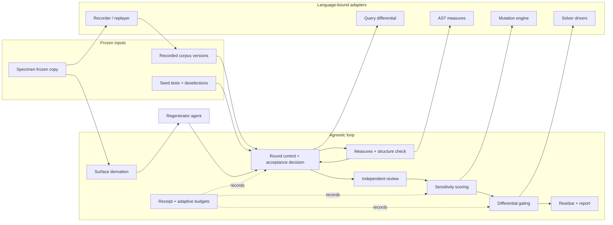

# Design Document: deconvolution-loop (provisional, prototype as built)

**Status**: provisional. This document describes how the research
prototype realises each requirement, so that a later implementation can
copy what was proven and leave out what was not. It is not an approved
production design. Written 2026-11-04 from the E1b, E1c-2 and E3
apparatus and their research entries (R22, R24, R25).

## Overview

**Purpose**: give one declared scope of an existing codebase a smaller,
less entangled rewrite whose behaviour at the public surface is unchanged
on everything recorded, with the protection of that claim measured.

**Users**: the owner and research agents today; later, developers running
the loop on their own AI-generated code.

**Impact**: none on the specimen. Candidates live in isolated copies and
are research results, not patches.

### Goals

- Realise requirements 1 to 12 with artefacts a reader can verify by hash.
- Separate the agnostic parts (decision rules, artefact formats, budgets)
  from the language-bound parts (recorder, measures, mutation engine,
  solver drivers).
- State the prototype gate status per component.

### Non-Goals

- Scope selection (R21 rejected the edge census; no replacement exists).
- Equivalence proof. The solver is a counterexample finder behind gates.
- Any production packaging, CLI or Rust code. Production tasks are not
  generated; `tasks.md` holds bounded apparatus revisions, one prototype
  and one preregistered experiment.

## Boundary Commitments

### This Spec Owns

- The loop's artefacts and their formats: public surface, corpus,
  measures, structure declaration, acceptance result, review, mutant
  sample and outcomes, differential outcomes, receipt, missing-test report.
- The decision rules: acceptance, kill criteria, kill-rate convention,
  verifier gates, residue declaration.
- Budget and provenance discipline: preregistration, adaptive deadlines,
  memory guard, hash verification.

### Out of Boundary

- Writing or changing tests (TDD workflow).
- Choosing scopes (future E2b or another spec).
- Measures outside the scope (capability-compression-core).
- Prevention at generation time (agent-quality-rules lineage).

### Allowed Dependencies

- The specimen's own runtime, test suite and external-store setup.
- A mutation engine, a coverage tool and a solver-backed differential
  tool for the specimen's language; versions pinned per run.
- `docs/experiments/deconvolution/adaptive.py` for budgets.
- The symbolic-execution tooling note for the verifier rules.

### Revalidation Triggers

- A change to the corpus alphabet (new operation): new corpus identity,
  re-record, re-validate on the original.
- A change to measure definitions: re-measure baseline and candidate.
- A change to the acceptance arm or deselections: rerun round 0 on the
  identical copy.
- A new specimen language: every language-bound component is unproven
  again.

## Architecture

### Boundary Map



**Architecture integration**: the prototype has no framework. Each box is
a small script with one entry point and a JSON artefact; the agnostic
boxes read and write JSON and never import the specimen. The bound boxes
import the specimen under a root check that fails closed if the scope
resolves outside the tree under test.

### Technology Stack (prototype)

| Layer | Choice / Version | Role | Notes |
| --- | --- | --- | --- |
| Runtime | CPython 3.13.16 in the frozen copy's own venv (uv) | runs specimen, recorder, apparatus | `python` not on PATH; `uv.exe run --no-project --python 3.13` or the venv interpreter |
| External store | Specimen's embedded PostgreSQL with two Windows shim fixes (`e2_winshim.py`) | Level 1 table dumps, Level 2 query capture | unquoted `listen_addresses`, detached pipes on start |
| Recorder | `e1b_oracle.py` (SQLAlchemy event hooks, declared normalisation) | record / replay corpus | 51 + 2 + 11 sequences in three corpus versions |
| Acceptance arm | `run_arm.py` (E1b), `run_e3.py`, `test_e3_replay.py` | seeds + R16 harness + replay | three pytest groups, serial |
| Measures | `measures.py` (Python `ast`) | lines, stmts, funcs, writes, edges, hops, structure check | regex write-site rule, known false positive on `set.add` |
| Surface | `surface.py` (Python `ast` over 1,754 files) | derived surface JSON | kinds: import, attribute, patch |
| Mutation | cosmic-ray 8.7.0 via `uv tool run`, `t4_arm.py` | sample, apply, classify | seeded sample from sorted spec keys |
| Differential | CrossHair 0.0.112 + z3, `t5_drivers.py`, E1c-2 launcher | `diffbehavior` behind four gates | audit wall needs the `python -c` launcher |
| Query differential | `qdiff.py` | perturbed states with boundary row | controls (i) and (ii) recorded |
| Budgets | `adaptive.py`, `step3.py`, `receipt3.py` | probe, scale, wait, receipt | reference bench 0.212 s (2026-11-04 09:15) |
| Agents | opus regenerator, sonnet reviewer, opus apparatus | steps 1 to 3 | fresh context per role |

## Components and Interfaces

| Component | Layer | Intent | Req | Prototype file(s) | Status |
| --- | --- | --- | --- | --- | --- |
| SurfaceDeriver | agnostic (needs a parser) | derive public surface | 1 | `e3-evidence-regeneration/surface.py` | proven |
| Recorder | bound | record corpus from original | 2 | `e1b-facdrone-evidence-publication/e1b_oracle.py`, `scope.py` | proven |
| Replayer | bound | replay corpus against a tree, split levels | 2, 3 | `e1b_oracle.py replay`, `test_e3_replay.py` | proven |
| AcceptanceArm | agnostic shell over bound runner | seeds + harness + replay, fail closed | 3 | `run_arm.py`, `run_e3.py` | proven |
| QueryDifferential | bound | judge Level 2 divergences | 3.2 | `qdiff.py` | built, controlled, not exercised on a real case |
| Measurer | bound | size, edges, writes, structure check | 4, 5 | `measures.py`, `candidate-structure.json` | proven; canonical-format figure missing |
| RoundController | agnostic | rounds, edit-scope rule, hash check, turn feedback (6.7) | 6 | regenerator brief + `regeneration-log.md`, hash scripts | proven for one round; turn feedback unexercised |
| Regenerator | agent today, endpoint program later | produce a candidate tree, structure declaration and change log from the recorded brief | 6.1, 6.7, 6.8 | the step-1 brief in E3 (interactive opus agent, one turn); no program exists | proven as an interactive agent for one turn; program unproven |
| Reviewer | agent | hypotheses, probes, packing | 7 | `review-step2.md` | proven |
| Sensitivity | bound engine, agnostic classification | mutant sample, arm, classify, restore | 8 | `t4_arm.py`, `cosmic-ray-t4.toml`, `t4-m3-port.patch` | proven; missing-test report not built |
| Differential | bound | pairs, four gates, replay | 9 | `t5_drivers.py`, launcher per E1c-2 Amendment 4 | proven as finder only |
| ResidueReport | agnostic | protection level and residue | 10 | research entry sections | proven (manual) |
| Receipt | agnostic | commands, probes, hashes, notes | 11 | `receipt.py`, `receipt3.py`, `step3.py`, `adaptive.py` | proven; one read-modify-write race noted |
| HostGuard | agnostic | idle wait, memory floor | 11.5, 12 | scratch `guard.py` (not apparatus) | proven after one kill |
| TestInfraDetector | bound | runner, markers, fixtures, store | 12.4 | manual today (`seeds.md`, deselection lists) | unproven |

### Component contracts worth copying

**Surface entry** (`public-surface.json`): module → name → list of
`{file, kind}`; plus `unresolved` and `intra_set` lists. Kinds observed:
`import`, `attribute`, `patch`. A patched name must remain the global the
module's own functions look up (req 6.6).

**Corpus** (`golden-*.json`): `{meta, sequences[]}`; sequence =
`{name, origin, start, start_tables, ops[], observations}`. Level 1
observations are canonical JSON digests of results, raised errors, table
dumps and files after each op; Level 2 is the list of
`(statement, parameters)` per op. Three corpus versions coexist, each with
a body hash; a new alphabet means a new version, never an edit.

**Acceptance result** (`sql-divergences-round<N>.json` plus the arm's exit):
exit 0 only if the file is fresh, covers every sequence, and all three
test groups passed. The first Level 1 divergence is printed as
`<sequence> op <k> <path>`.

**Measures** (`measures-<label>.json`): per file `{lines, stmts, funcs,
qualnames, writes}`, totals plus `edges` as `(file, caller, file, callee)`
quads and `module_hops`. Structure declaration
`{"pure": ["file::qualname"], "shell": [...]}`; check output lists failed
pure rules, writes outside shell, undeclared defs and the pure share.

**Mutant sample** (`t4-mutant-sample.json`): seed, population, module hash,
seed files, and per mutant the operator, position and exact hunks. Outcome
per mutant: `killed | survived | incompetent`, with the first failing
reason. Kill rate = killed / (killed + survived).

**Differential run**: per pair the driver names, domain bounds (three-letter
alphabet, length at most 8, lists at most 3, enumerations as indexes,
values decoded through JSON so they are never interned literals), gate
results, verdict, counterexample text, and a concrete replay record
`{args, original, candidate, differ}`.

**Receipt** (`results/receipt.json`): `commands[]` with label, cmd, cwd, env,
start/end, seconds, exit and the adaptive probe; `facts[]` with hashes and
step summaries; `notes[]` with guard probes and decisions. Entries are
appended only.

## System Flows

### One regeneration round

```mermaid
sequenceDiagram
  participant RC as RoundController
  participant G as Regenerator
  participant M as Measurer
  participant A as AcceptanceArm
  participant R as Replayer
  RC->>G: scope files, surface, definitions, targets, contract, command
  G-->>RC: candidate tree + structure declaration + change log
  RC->>RC: hash every file outside scope against frozen copy (void if any differs)
  RC->>M: measure candidate, run structure check
  RC->>A: run seeds (3 groups, deselections) + harness + replay
  A->>R: replay corpus, write fresh result file
  R-->>A: Level 1 first divergence or none; Level 2 pairs
  A-->>RC: exit 0 only if fresh, complete, all pass
  alt Level 2 pairs non-empty
    RC->>RC: qdiff over perturbed states (boundary row)
  end
  RC-->>RC: record round; stop if accepted or rounds exhausted
```

Gating decisions: a void candidate ends the experiment, not the round;
the arm fails closed on a missing or stale result file; a Level 1
divergence on the identical copy (round 0) stops everything as an
apparatus defect.

### Sensitivity and differential (after acceptance and review)

For each sampled mutant: guard, apply in the isolated copy, run the arm
with a deadline of five times the unmutated arm time scaled by the host
factor, classify, restore by copy and verify by hash. Then the inherited
hand-written mutants as full acceptance runs. Then, per pair: smoke
(entries per side), corpus agreement (300 generated inputs, seeded),
planted-mutant and renaming controls, solver run at 300 s base scaled,
concrete replay of every counterexample, and, where the alphabet allows,
replay through the oracle as a new sequence.

## Requirements Traceability

| Requirement | Components | Evidence |
| --- | --- | --- |
| 1 | SurfaceDeriver | R25 README "Public surface" |
| 2 | Recorder, Replayer | R22 Q5, R20 |
| 3 | AcceptanceArm, Replayer, QueryDifferential | R25 T1, README validation table |
| 4 | Measurer | R25 T2, review step 2 |
| 5 | Measurer (structure check) | R25 T3 |
| 6 | RoundController, Regenerator | R25 regeneration log |
| 7 | Reviewer | R25 review step 2 |
| 8 | Sensitivity | R22 arms, R25 T4 |
| 9 | Differential | R24 verifier, R25 T5 |
| 10 | ResidueReport | R24, R25 |
| 11 | Receipt, HostGuard, adaptive | E1c-2 and E3 receipts |
| 12 | HostGuard, TestInfraDetector | handover environment facts |

## What a native implementation would replace

Copy as is (agnostic): artefact formats above, the acceptance rule, kill
criteria, the kill-rate convention, the four verifier gates, residue
declaration, receipt and adaptive budget logic, the round controller's
edit-scope and hash rules.

Rebuild per language (bound): surface derivation (parser), recorder and
replayer (effect capture for the language's store drivers), measures
(AST), mutation engine and sample application, solver drivers or an
equivalent counterexample finder, query differential against the store.
For Rust the oracle exists (R20, in-process recorder with cargo-mutants
and nextest); nothing else does.

Do not build yet: scope selection; a generic rewrite engine; MCP or plugin
surfaces (removed from active delivery, steering tech.md).

Prototype work permitted before the gate, per steering prototype-first:
the regenerator as a fixed-signature program against a model endpoint
(req 6.8) and the turn feedback rule (req 6.7). Neither has evidence yet;
multi-round behaviour has never been observed. Their first evidence is the
next preregistered scope (E4), and nothing about them may be claimed
before it.

## Risks and known defects

- Statement packing inflates reductions; the canonical-format measure
  (req 4.2) is unbuilt.
- Sensitivity on one module missed 0.70; survivors concentrate on
  malformed inputs. The missing-test report (req 8.7) is unbuilt.
- The differential found nothing the reviewer and 300 random inputs had
  not; two of three pairs were inconclusive. Treat it as the last gate,
  not the first.
- The oracle alphabet decides what is visible; adding an operation means
  a new corpus version and a re-validated round 0.
- The receipt writer had a read-modify-write race during long runs; a
  native implementation should append atomically.
- Host memory pressure killed one job; the guard is a scratch script.
- Tests that import or patch private names constrain the candidate; the
  TDD workflow should prefer surface-level tests.

## Prototype gate

See [prototype-gate.md](prototype-gate.md): `proceed` for the loop on one
Python scope as a measured research instrument; `revise` for the
sensitivity target and the size claim under canonical formatting;
`not-run` for scope selection and other languages. Design approval and
task generation wait on the owner.
