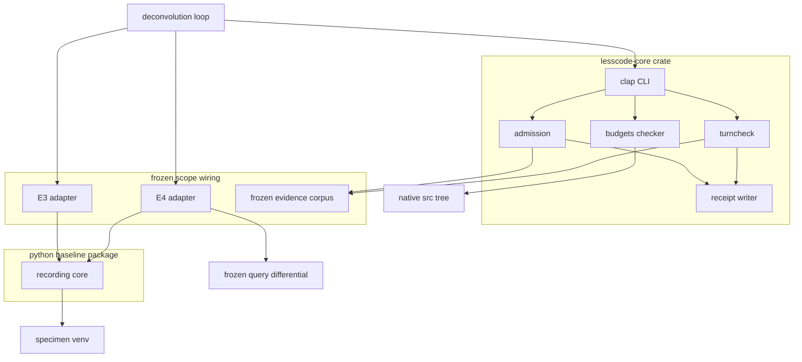
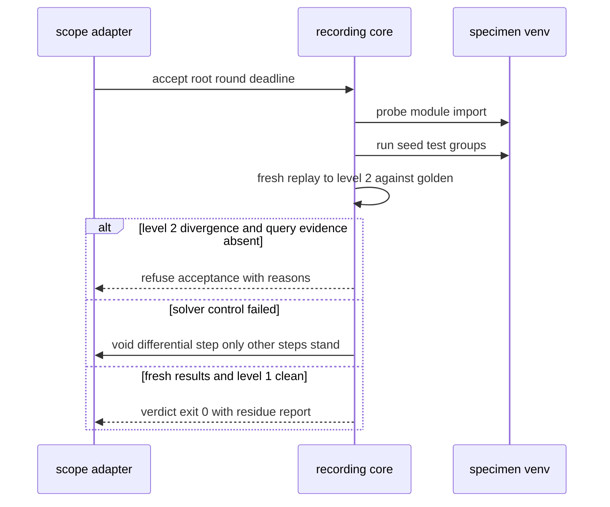
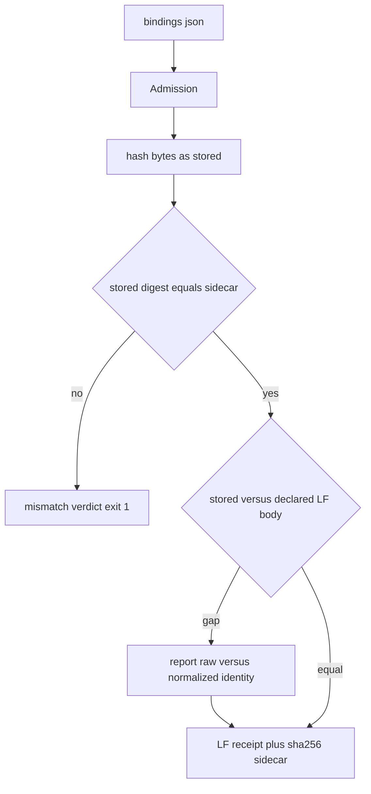
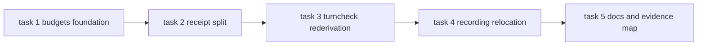

# Design: production slice — reusable recording and acceptance

Generated 2026-11-07 (design phase, foreground per owner rule 2026-11-07).
Requirements approved by owner 2026-11-07 (opencode chat, "Approve & proceed").
This design is generated, not approved: owner review is the next gate. It covers
only the demonstrated slice: `solution_unlock.status = proceed`,
`evidence_review = approved`, U1–U7 passed on frozen attempt 2
(`results/s10-u5-measurement-2.json`, C_app 1,193 ≤ 1,364).

## Overview

**Purpose**: promote the demonstrated prototype slice into maintained production
code with unchanged behavior: Rust artifact admission with Python-parity
receipts, the Rust pure turn-input verification re-derived from the attempt-1
tree, a Python shared recording/replay/acceptance core relocated into the
baseline package, the two frozen E3/E4 scope adapters as maintained wiring, and
a native size-checker foundation with explicit budgets and oversized-file
dispositions.

**Users**: the upstream deconvolution-loop workflow (consumes receipts and
verdicts), repository maintainers running the native CLI and the Python
recording core, and the owner as phase reviewer.

**Impact**: prototype apparatus moves to product locations; the native CLI
gains two additive subcommands (`turncheck`, `budgets`); receipt writing is
split into its own Rust module; `proto_core.py` is relocated (not duplicated)
into `src/lesscode_baseline/`; frozen evidence, receipts, recordings and
attempt drivers are consumed read-only and never modified.

### Goals

- Every part of the demonstrated replacement C (admission, receipt writer,
  turn-input verification, recording core, E3/E4 adapters) lives in a product
  location with product tests.
- Byte-exact receipt, digest and canonicalization rules preserved (2.4); CLI
  executable names, arguments, serialized contracts and exit behavior
  preserved (5.1, 5.2).
- Size governance in place before execution: validated checker, budgets
  configuration, ownership patterns, release-specific allocation and explicit
  disposition of pre-existing oversized files (6.3).
- Honest accounting: relocation is not deletion; frozen attempt evidence and
  failed-attempt history are retained (2.5, 4.1).

### Non-Goals

- Unseen-scope generalization, additional languages or stores, proxies,
  indexers, new mutation/solver engines, model transport, twelve-command
  packaging, five-target expansion (out of boundary below).
- Re-measuring attempt 2, editing frozen drivers/receipts, automatic
  candidate selection or adoption, test weakening, equivalence claims.

## Boundary Commitments

### This Spec Owns

- `native/src/admission.rs` (artifact admission and verification),
  `native/src/receipt.rs` (Python-parity receipt writer, split out),
  `native/src/turncheck.rs` (pure turn-input verification, re-derived from
  `f6bb6e2`), `native/src/budgets.rs` (size checker) and their CLI subcommand
  arms, plus `native/tests/{turncheck,budgets}.rs` and the budgets
  configuration `native/complexity-budgets.json`.
- `src/lesscode_baseline/recording.py` (shared recording/replay/acceptance
  core) and `tests/test_recording.py`.
- Adapter wiring for the two frozen scopes:
  `docs/experiments/deconvolution/native-prototype/scope_e3.py`,
  `scope_e4.py`, `proto_replay_test.py`, and one-line import updates in
  `s10_controls.py` / `s10_controls2.py` (see Migration).
- The unlock-ledger state and evidence map records of this spec
  (`spec.json.solution_unlock`, design §Supporting References).

### Out of Boundary

- Upstream loop behavior contracts: the `deconvolution-loop` spec owns the
  semantics of query-differential evidence (loop 3.2), turn inputs (loop 6.7),
  sensitivity comparability (loop 8.7), solver-control voiding (loop 9.5) and
  protection-level reporting (loop 10.2). This slice invokes and faithfully
  reports them; it must not redefine them.
- The frozen evidence corpus: attempt drivers (`s10_measure.py`,
  `s10_measure2.py`), receipts, `.sha256` sidecars, recordings
  (`.runs/native-prototype/`), goldens and turn protocol examples are consumed
  read-only.
- Digest parity for arbitrary JSON beyond the frozen receipt, golden and
  descriptor schemas.
- Candidate selection/adoption decisions, test or threshold weakening, and
  any equivalence claim.

### Allowed Dependencies

- Rust: existing `Cargo.lock` pins `ast-grep-core = 0.51.0`, `serde = 1.0.229`,
  `serde_json = 1.0.154`, `sha2 = 0.11.0`, `clap = 4.6.0`; promote the
  already-locked transitive `syn` (`visit`) and `proc-macro2`
  (`span-locations`) to direct dependencies at their locked versions. No new
  external crates. Toolchain stays `rust-version = "1.98.1"`, `--locked`.
- Python: standard library only for the product module; specimen-side
  `sqlalchemy` / `hypothesis` / `pytest` only inside adapters through the
  pinned specimen venv (`.runs/e2-facdrone/venv`).
- Filesystem: repository tree plus `.runs/` artifact roots reached only via
  explicit `--artifact-root` / recorded bindings.

### Revalidation Triggers

- Byte or identity change to any frozen artifact: goldens (`92a48f77…`,
  `0b2e383d…`), receipts, sidecars, recordings, turn examples.
- `Cargo.lock` pin changes, toolchain change, or promotion of new crates.
- Specimen venv package changes (the `python` / `hypothesis` / `sqlalchemy`
  identities recorded in golden meta).
- Upstream loop contract changes (loop 3.2, 6.7, 8.7, 9.5, 10.2 semantics).
- Receipt / golden / descriptor schema changes; budgets loosening; a file in
  `native/src/` exceeding its disposition; `lib.rs` / `main.rs` edits beyond
  the registration arms listed here.
- Any new scope, language or store: requires a dated scope amendment (6.6).

## Architecture

### Existing Architecture Analysis

- Native crate `lesscode-core`: `Prepare`, `Compare` and `Admission`
  subcommands dispatch in `main.rs` (L50–51, L216–220); modules `scope`,
  `metrics`, `model`, `compare`, `admission`. `lib.rs` (621 lines) is
  pre-existing and shared with `capability-compression-core`; the
  registration-only policy of prototype-gate U7 rule 2 continues. `main.rs`
  is 225 lines; `admission.rs` is 415 canonical lines and self-contained
  since the descope (local Python-`json.dumps(indent=1)` receipt writer,
  `serde_json` bindings parse, `sha2` direct hashing).
- Python baseline package `src/lesscode_baseline/`: flat typed-contracts
  package (cli, contracts, snapshot, evaluation, …) governed by its package
  `AGENTS.md` (evidence contract stability, role-revealing names, no
  unnecessary structure).
- Demonstrated prototype: `proto_core.py` (251 lines), `scope_e3.py` (107),
  `scope_e4.py` (116), `proto_replay_test.py` under
  `docs/experiments/deconvolution/native-prototype/`; all U1–U7 evidence in
  `results/` plus `.runs/native-prototype/` recordings. Attempt-1
  `turncheck.rs` (207 lines + 72-line test) is re-derivable at `f6bb6e2`.
- Integration points that must keep working: `lesscode-core` executable name,
  existing subcommand arguments, serialized contracts and exit codes (5.1);
  the Python baseline CLI; the `admission` subcommand exactly as demonstrated.

### Architecture Pattern & Boundary Map



**Architecture Integration**:

- Selected pattern: descriptor-driven verification commands (JSON descriptor
  in → checks → LF receipt + `.sha256` sidecar → exit code) shared by
  `admission` and `turncheck` as a contract shape, not a shared framework;
  library core plus thin per-scope adapters on the Python side. This is
  exactly the demonstrated shape; generalizing it into a framework would add
  unmeasured structure.
- Domain boundaries: native crate owns byte verification and receipts; the
  Python product module owns record/replay/acceptance orchestration;
  specimen-bound wiring stays in the experiments tree next to its frozen
  scopes; the loop spec owns behavior semantics.
- Existing patterns preserved: clap derive subcommands, atomic receipt writes
  with lock sidecars, typed contracts in the baseline package.
- New components rationale: `receipt.rs` (single owner for byte-exact
  formatting used by two commands), `turncheck.rs` (demonstrated attempt-1
  capability returning to production), `budgets.rs` (6.3 requires a validated
  checker before execution), `recording.py` (product home for the shared
  core).
- Steering compliance: no new external dependencies; relocation counted, not
  claimed as deletion; tests are behavioral evidence, not a reduction target.

### Technology Stack

| Layer | Choice / Version | Role in Feature | Notes |
|-------|------------------|-----------------|-------|
| Native CLI | Rust 1.98.1, edition 2021, clap 4.6.0 derive | `admission` (existing), `turncheck`, `budgets` subcommands | additive arms only |
| Receipts | serde_json 1.0.154 + custom Formatter | Python-parity receipt bytes | indent=1, ensure_ascii, DEL and surrogate-pair rules; ~40-line Formatter |
| Hashing | sha2 0.11.0 | digests over bytes as stored | raw byte identity vs declared normalization distinguished |
| Size checking | syn + proc-macro2 at locked versions | `rust-syntax-units-v1` budgets checker | promote transitive to direct; ≤300 logical units/file, ≤80 lines/fn |
| Python core | CPython standard library | recording/replay/acceptance runner in baseline package | no new Python dependencies |
| Specimen runtime | pinned `.runs/e2-facdrone/venv` | adapters only (SQLAlchemy hook, hypothesis seeds, pytest groups) | identities recorded in golden meta |
| Accounting | ruff 0.17.3 format line-length 100 (frozen drivers) | canonical three-strata line counts | frozen measurement method, unchanged definitions |

## File Structure Plan

### Directory Structure

```
native/src/
├── admission.rs        # artifact admission: verify bindings, CLI arm (existing; split writer out)
├── receipt.rs          # new: Python-parity JSON receipt writer + Formatter (single owner of byte rules)
├── turncheck.rs        # new: pure turn-input verification, re-derived from f6bb6e2
├── budgets.rs          # new: rust-syntax-units-v1 size checker + CLI arm
├── lib.rs              # modified: +3 registration lines only (pub mod receipt/turncheck/budgets)
└── main.rs             # modified: +2 additive subcommand arms (Turncheck, Budgets)
native/tests/
├── admission.rs        # existing: extended with receipt-module parity cases
├── turncheck.rs        # new (re-derived): classify, feedback, failed-turn retention, protocol examples
├── budgets.rs          # new: synthetic fixtures + self-run with dispositions
└── cli.rs              # existing: extended with turncheck/budgets CLI regression
native/
└── complexity-budgets.json  # new: budgets config with per-file dispositions
src/lesscode_baseline/
└── recording.py        # new: relocated proto_core.py (product module; net-zero new logic)
tests/
└── test_recording.py   # new: verdict truth tables, Norm/first_diff units, host-independent cases
docs/experiments/deconvolution/native-prototype/
├── scope_e3.py         # modified: import product recording module (+path binding)
├── scope_e4.py         # modified: import product recording module (+path binding)
├── proto_replay_test.py# modified: import product recording module if it references the core
├── s10_controls.py     # modified: one-line import update only (semantics unchanged)
├── s10_controls2.py    # modified: one-line import update only (semantics unchanged)
├── proto_core.py       # deleted after relocation (retained at attempt commits; no duplication, no shim)
├── s10_measure.py      # untouched: frozen attempt-1 driver
└── s10_measure2.py     # untouched: frozen attempt-2 driver
```

### Modified Files

- `native/src/lib.rs` — registration lines only (`pub mod receipt; pub mod
  turncheck; pub mod budgets;`); no domain logic; U7 rule 2 charging applies.
- `native/src/main.rs` — two additive clap arms; existing `Prepare`,
  `Compare`, `Admission` arms byte-identical in behavior.
- `native/src/admission.rs` — receipt writing moves to `receipt.rs`; verify
  logic and CLI contract unchanged; file lands under the 400-line disposition
  after the split.
- `scope_e3.py`, `scope_e4.py`, `s10_controls.py`, `s10_controls2.py`,
  `proto_replay_test.py` — import `lesscode_baseline.recording` instead of
  `proto_core`; no logic changes; adapters add the repository `src/` path
  binding.

## System Flows

### Acceptance flow (E4 shape; E3 analogous without query evidence)



- Gating decisions: `verdict()` requires fresh complete results (written after
  arm start, expected sequence count) and zero Level 1 divergence before any
  acceptance judgment (3.2, 3.3); a Level 2 difference without the frozen
  query-differential evidence refuses acceptance (3.4); a failed solver
  control voids only the differential step (5.4, loop 9.5); an interrupted or
  infrastructure-failed arm is reported separately and never counted as a
  mutation kill (3.7).

### Admission verification flow



- Missing artifact bytes or a disagreeing sidecar is incomplete/invalid
  evidence and refuses acceptance (2.2); raw byte identity and declared
  semantic normalization are reported separately (2.3).

## Requirements Traceability

| Requirement | Summary | Components | Interfaces | Flows |
|-------------|---------|------------|------------|-------|
| 1.1 | Block production while unlock evidence absent/stale/unsuccessful | UnlockLedger | Ledger state | — |
| 1.2 | Owner-approved frozen plan before bounded execution | UnlockLedger | Ledger evidence pointers | — |
| 1.3 | U1–U7 pass on one frozen attempt plus approved evidence review | UnlockLedger, EvidenceMap | Ledger evidence list | — |
| 1.4 | Failed/unavailable criterion keeps lock, records revise/stop/not-run | UnlockLedger | Ledger statuses | — |
| 1.5 | Only demonstrated slice seeks normal phase approvals | Boundary Commitments | — | — |
| 1.6 | Material input/contract/dependency/evaluator/budget change invalidates affected evidence | Revalidation Triggers | — | — |
| 2.1 | Evidence bound to source, scope, protocol, corpus, apparatus, dependencies, evaluator identities | Admission, RecordingCore | AdmissionReceipt, GoldenMeta | Admission flow |
| 2.2 | Missing bytes or digest disagreement refuses acceptance | Admission | Admission CLI exit semantics | Admission flow |
| 2.3 | Hash bytes as stored; distinguish raw vs declared normalization | Admission | AdmissionReceipt fields | Admission flow |
| 2.4 | Canonical digests/receipts byte-for-byte per prototype rules | Receipt, RecordingCore | write_receipt, write_golden | Admission flow |
| 2.5 | Distinguish replay, live execution, real-scope usefulness; preserve history | RecordingCore, EvidenceMap | accept report fields | Acceptance flow |
| 3.1 | Double recording byte-identical after frozen normalization or refuse | RecordingCore, ScopeAdapterE3/E4 | record(), Norm | Acceptance flow |
| 3.2 | Original replay zero L1/L2 divergence before judging candidates | RecordingCore | replay_engine, replay_to_l2 | Acceptance flow |
| 3.3 | Candidate acceptance: fresh complete results, zero L1, unchanged deselections, seeds pass | ScopeAdapterE3/E4, RecordingCore | accept(), verdict(), build_groups | Acceptance flow |
| 3.4 | L2 difference requires query-differential evidence (loop 3.2) else refuse | RecordingCore | verdict() query gate | Acceptance flow |
| 3.5 | Protected files/tests/corpora/apparatus change voids candidate | RecordingCore, ScopeAdapterE3/E4 | GoldenMeta scope hashes, arm env | Acceptance flow |
| 3.6 | Acceptance report: observations, counts, sensitivity, residue, no equivalence claim | ScopeAdapterE3/E4, RecordingCore | accept report | Acceptance flow |
| 3.7 | Interrupted/infrastructure failure reported separately, not a kill | RecordingCore | verdict() arm-exit handling | Acceptance flow |
| 4.1 | Shared implementation counted once; all retained support accounted | EvidenceMap, File Structure Plan | accounting contract | — |
| 4.2 | Frozen canonical formatting; three strata; physical and separated-form reported | EvidenceMap | measurement record schema | — |
| 4.3 | Specimen behavior via explicit bounded adapter, not hidden config | ScopeAdapterE3/E4 | ScopeAdapter interface | — |
| 4.4 | Second-scope onboarding freezes shared implementation; records whether scope support suffices | RecordingCore, ScopeAdapterE3/E4 | adapter freeze record (U4) | — |
| 4.5 | Predeclared relative and absolute reduction on app stratum plus net whole-replacement reduction | EvidenceMap | U5 targets, re-report trigger | — |
| 4.6 | Reject weaker observations, removed behavior, packing, relocated uncounted logic | Revalidation Triggers, accounting contract | — | — |
| 5.1 | Existing prepare/compare commands keep executable, arguments, contracts, exits | CLI (native), cli.rs regression | CLI arms | — |
| 5.2 | Command completion distinguished from candidate acceptance | Admission, RecordingCore | exit-code semantics | Admission flow, Acceptance flow |
| 5.3 | Turn inputs follow upstream protocol; failed attempts preserved | Turncheck | TurnSpec, check_turn | — |
| 5.4 | Solver control failure voids only the differential step | RecordingCore | verdict() void rule | Acceptance flow |
| 5.5 | Adaptive deadlines, load probes, upstream retry rules preserved | RecordingCore | call(), probe() | Acceptance flow |
| 6.1 | Slice maps applicable criteria to checks/evidence or explicit deferrals | EvidenceMap | evidence map table | — |
| 6.2 | Deferred capability needed for acceptance refuses rather than bypasses | RecordingCore, Boundary | L2 refuse rule | Acceptance flow |
| 6.3 | Capped production work: ownership patterns, allocation, oversized-file disposition, validated checker before execution | Budgets, §Production Size Governance | budgets CLI, complexity-budgets.json | — |
| 6.4 | Maintained-support accounting across owned languages/directories; tests, fixtures, generated output, frozen evidence reported separately | Budgets, EvidenceMap | budgets report scope | — |
| 6.5 | U7 effort-charging rules recorded and applied | EvidenceMap, Budgets | budgets baselines | — |
| 6.6 | Expansion requires dated scope amendment with unmet need, hypothesis, evidence plan, budget | Revalidation Triggers | — | — |

## Components and Interfaces

| Component | Domain/Layer | Intent | Req Coverage | Key Dependencies | Contracts |
|-----------|--------------|--------|--------------|------------------|-----------|
| Admission | Native verification | Verify artifact bytes vs sidecars; write receipt | 2.1, 2.2, 2.3, 5.2 | Receipt (P0) | Service, Batch |
| Receipt | Native formatting | Python-parity receipt bytes, single owner | 2.4 | serde_json (P0) | Service |
| Turncheck | Native verification | Pure turn-input checks per upstream protocol | 5.3, 2.5 | Receipt (P1), frozen turn examples (P0) | Service, Batch |
| Budgets | Native governance | rust-syntax-units-v1 size checks with dispositions | 6.3, 6.4, 6.5 | syn, proc-macro2 (P0) | Service, Batch |
| RecordingCore | Python orchestration | Record/replay/accept runner with honest verdicts | 3.1–3.7, 5.4, 5.5, 2.1, 2.5 | specimen venv (P0) | Service, State |
| ScopeAdapterE3 | Experiment wiring | Frozen E3 bindings (oracle strata, seeds, packages) | 3.1–3.3, 4.3, 4.4 | RecordingCore (P0) | Service |
| ScopeAdapterE4 | Experiment wiring | Frozen E4 bindings plus query-evidence gate | 3.1–3.6, 4.3, 4.4 | RecordingCore (P0), query differential (P0) | Service |
| UnlockLedger | Spec state | spec.json solution_unlock evidence pointer and lock statuses | 1.1–1.4 | — | State |
| EvidenceMap | Spec record | Criteria-to-evidence mapping with deferrals | 6.1, 4.1, 4.2, 4.5 | — | State |

### Native verification layer

#### Admission

| Field | Detail |
|-------|--------|
| Intent | Verify declared artifact bindings against stored bytes and sidecars, emit verdict receipt |
| Requirements | 2.1, 2.2, 2.3, 5.2 |

**Responsibilities & Constraints**

- Verifies per binding: artifact presence, SHA-256 of bytes as stored, sidecar
  presence, sidecar `stored` and `declared_lf_body` digests, binding match.
- Verdict categories and counts preserved exactly as demonstrated (verified /
  mismatch / missing / unbound; R28 smoke: 21/11/5/1/4, exit 1 fail-closed).
- Domain boundary: byte verification only; no candidate judgment (5.2).

**Dependencies**

- Outbound: Receipt — write verdict receipt (P0).
- External: serde_json 1.0.154, sha2 0.11.0 (P0).

**Contracts**: Service [x] / Batch [x]

##### Service Interface
```rust
pub fn verify(root: &Path, bindings: &Bindings) -> AdmissionReport;
```
- Preconditions: bindings JSON parses; `root` exists.
- Postconditions: report counts every binding; no partial silence.
- Invariants: digests computed over bytes as stored (2.3).

##### Batch Contract (CLI, preserved)
- Trigger: `lesscode-core admission --root <dir> --bindings <file> --out <file>`.
- Input/output: bindings descriptor in; LF receipt + `.sha256` sidecar out.
- Exit: 0 only when zero mismatch and zero missing; 1 otherwise; receipt
  written in both outcomes (command completion ≠ acceptance, 5.2).

#### Receipt

| Field | Detail |
|-------|--------|
| Intent | Single owner of Python-parity JSON receipt bytes for all native commands |
| Requirements | 2.4 |

**Responsibilities & Constraints**

- Serializes receipts byte-identically to Python
  `json.dumps(..., indent=1, ensure_ascii=True)` including DEL and
  surrogate-pair handling; writes LF endings and a `.sha256` sidecar
  atomically (lock sidecar via std fs).
- One formatter; no per-command copies.

**Contracts**: Service [x]

##### Service Interface
```rust
pub fn write_receipt(out: &Path, receipt: &serde_json::Value) -> std::io::Result<()>;
```
- Preconditions: receipt is a JSON object.
- Postconditions: file bytes LF; sidecar digest matches file bytes.
- Invariants: byte rules frozen by parity fixtures; changing them is a
  revalidation trigger.

#### Turncheck

| Field | Detail |
|-------|--------|
| Intent | Evaluate recorded turn inputs against the upstream protocol, preserving failed attempts |
| Requirements | 5.3, 2.5 |

**Responsibilities & Constraints**

- Re-derived from the attempt-1 implementation (`f6bb6e2`, 207 lines + tests);
  its evidence is attempt-1 with attempt-2 compatibility proven separately
  (residual risk recorded in `s10-evidence-review-2.json`).
- Classification retained verbatim: `thinking-only` (stop_reason max_tokens,
  no non-thinking content), `produced-candidate` (end_turn with tool use),
  otherwise the raw stop reason — failed attempts stay recorded inputs, never
  dropped (5.3).

**Dependencies**

- Inbound: CLI arm (P0).
- External: frozen turn protocol examples under
  `docs/experiments/deconvolution/regenerator/results/turns/` (P0).

**Contracts**: Service [x] / Batch [x]

##### Service Interface
```rust
pub struct TurnSpec { pub dir: PathBuf, pub expected: String,
                      pub request: PathBuf, pub feedback_required: bool }
pub fn check_turn(root: &Path, spec: &TurnSpec) -> Vec<(String, bool, String)>;
pub fn classify(response: &serde_json::Value) -> String;
```
- Preconditions: descriptor lists turn dirs with expected outcomes.
- Postconditions: every listed turn yields exactly one check line with a
  reason; feedback-required turns must contain the permitted feedback text.
- Invariants: outputs are judgments about recorded inputs; no mutation of the
  recorded turn bytes.

##### Batch Contract (CLI, additive)
- Trigger: `lesscode-core turncheck --descriptor <file> --out <file>`.
- Input: `{"turns_root": "...", "turns": [{"dir", "expected", "request",
  "feedback_required"}]}`.
- Output: verdict receipt (via Receipt) + `.sha256` sidecar.
- Exit: 0 only if every check passes.

### Native governance layer

#### Budgets

| Field | Detail |
|-------|--------|
| Intent | Validate size budgets and dispositions for `native/src/` before and during production execution |
| Requirements | 6.3, 6.4, 6.5 |

**Responsibilities & Constraints**

- Implements `rust-syntax-units-v1`: at most 300 logical units per file, at
  most 80 lines per function, over a committed config
  (`native/complexity-budgets.json`) that carries per-file entries: budget,
  owning spec, allocation, and explicit disposition for pre-existing
  oversized files (6.3).
- Fail-closed: a file over budget without a recorded disposition fails; a
  disposition may not be loosened without a dated amendment (revalidation
  trigger).
- Scope of accounting (6.4): Rust under `native/src/`; Python product under
  `src/lesscode_baseline/` and adapter wiring under
  `docs/experiments/deconvolution/native-prototype/` are reported by the
  frozen ruff-canonical measurement method; tests, fixtures, generated
  output and frozen evidence are reported separately, never merged.

**Dependencies**

- External: syn (`visit`), proc-macro2 (`span-locations`) at locked versions
  (P0); no filesystem indexers.

**Contracts**: Service [x] / Batch [x]

##### Service Interface
```rust
pub fn check(config: &BudgetsConfig, root: &Path) -> BudgetsReport;
```
- Preconditions: config parses; every `.rs` file under `root` is reachable.
- Postconditions: report lists per-file units, longest function, budget
  state, and disposition status.
- Invariants: pure analysis; never edits sources.

##### Batch Contract (CLI, additive)
- Trigger: `lesscode-core budgets --config <file> --root <dir>`.
- Output: report receipt (via Receipt).
- Exit: 0 only when all files are within budget or carry a valid disposition.

### Python orchestration layer

#### RecordingCore

| Field | Detail |
|-------|--------|
| Intent | Shared record/replay/acceptance runner with honest verdicts, relocated verbatim from the demonstrated core |
| Requirements | 3.1–3.7, 5.4, 5.5, 2.1, 2.5 |

**Responsibilities & Constraints**

- Public surface preserved verbatim from `proto_core.py` (251 lines):
  `Norm`, `run_sequence`, `signatures`, `first_diff`, `attached`, `detach`,
  `embedded_engine`, `write_golden`, `record`, `replay_engine`,
  `replay_to_l2`, `call`, `probe`, `run_groups`, `verdict`, `arm_env`,
  `build_groups`. Relocation changes the module path only; net-zero new
  logic (4.1: relocation is not deletion).
- `verdict(arm_exit, fresh, level2_ops, query_evidence)` is the single
  acceptance judge: fresh-complete gate (3.3), L2-without-evidence refusal
  (3.4), void-differential-only on solver-control failure (5.4), interrupted
  arm never a kill (3.7).
- `call` / `probe` preserve adaptive deadlines and load probes (5.5).
- Double-recording normalization frozen in `Norm`; mismatch refuses (3.1).

**Dependencies**

- Outbound: specimen venv subprocess (P0); SQLAlchemy `before_cursor_execute`
  hook installation via `attached` (P0).
- Constraints: standard library only in this module; specimen packages are
  imported solely inside adapters.

**Contracts**: Service [x] / State [x]

##### Service Interface
```python
def record(env_cls, engine, root, seeds_pairs, generated_seqs, guard,
           meta_of, out: Path) -> dict: ...
def replay_engine(env_cls, engine, root, seeds_pairs, golden: Path,
                  only: set | None = None, listen_all: bool = False) -> str | None: ...
def replay_to_l2(env_cls, engine, root, seeds_pairs, goldens: list,
                 out: Path, listen_all: bool = False) -> dict: ...
def verdict(arm_exit: int, fresh: bool, level2_ops: int,
            query_evidence) -> tuple[int, list[str]]: ...
```
- Preconditions: adapters supply a frozen `Env` class, seeds and meta binding.
- Postconditions: goldens/reports written with LF bytes and recorded digests.
- Invariants: divergence reporting is total — every observed difference is
  reported or the run fails.

##### State Management
- State model: golden files (meta + sequences) and replay/L2 reports are
  append-only evidence; nothing is rewritten in place.
- Persistence: LF JSON with digest sidecars; lock sidecars during writes.

### Experiment wiring layer

#### ScopeAdapterE3 / ScopeAdapterE4

| Field | Detail |
|-------|--------|
| Intent | Maintain the frozen per-scope bindings (oracle strata, seeds, packages, marks, query evidence) as thin, counted adapters |
| Requirements | 3.1–3.6, 4.3, 4.4 |

**Responsibilities & Constraints**

- Documented duck-typed interface (both adapters satisfy it today):
  `seeds()`, `meta_of(seqs)`, `record(out, only=None)`, `replay(golden=None,
  only=None)`, `accept(root, rnd="0", deadline=None) -> int`.
- E4 binds the frozen query differential
  (`e4-lifecycle/results/sql-divergences-e6-cand.json`) that `verdict()`
  consumes for L2 acceptance; E3 binds none (L2 must stay zero).
- Adapters are explicit bounded code, counted in the adapter-wiring stratum
  (4.3); specimen behavior lives in the frozen oracle strata they import,
  never in hidden configuration.
- The E3→E4 freeze record (shared core frozen after E3; only declared E4
  scope support added) is the 4.4 evidence and must survive relocation.

**Dependencies**

- Outbound: RecordingCore (P0); frozen oracle strata `e1b_oracle.py` /
  `e4_oracle.py` (P0); specimen venv (P0); E4: frozen query differential
  (P0).

**Contracts**: Service [x]

**Implementation Notes**

- Integration: add the repository `src/` path binding; import
  `lesscode_baseline.recording` as the shared core.
- Validation: host-independent unit tests always run; specimen-dependent
  double-record/replay smoke runs only when the pinned venv and `.runs`
  goldens are present, and reports skip honestly when absent.
- Risks: adapter modules remain inside the experiments tree by design
  (specimen-bound wiring next to frozen scopes); moving them into the product
  package would couple the product to specimen paths and inflate ownership.

### Spec state layer

#### UnlockLedger

- `spec.json.solution_unlock` remains the single evidence pointer: statuses
  `proceed / revise / stop / not-run`, evidence list, frozen identities.
  Production tasks and code remain blocked unless `status=proceed`,
  `evidence_review=approved` and phase approvals hold (1.1–1.4). It is an
  evidence ledger, not a pass switch; no automated bypass is introduced.

#### EvidenceMap

- The criteria-to-evidence mapping (6.1) is maintained in this design's
  Supporting References section and updated whenever evidence or deferrals
  change; deferrals state consequences (6.2), and a deferred capability
  needed for acceptance refuses rather than bypasses.

## Data Models

### Domain Model

- Frozen evidence (goldens, receipts, recordings, turn examples): immutable,
  digest-bound aggregates; receipts reference them by identity.
- Production code: mutable, budgeted, disposition-governed.
- Invariant: production code verifies evidence; evidence never verifies
  itself.

### Logical Data Model

- **Bindings descriptor** (`s2-bindings.json` shape): `{ "bindings": [
  { "artifact": path, "sidecars": [path, …] } ] }` bound to an artifact root.
- **AdmissionReceipt**: per-binding verdicts with categories
  verified/mismatch/missing/unbound and counts; digests `stored` and
  `declared_lf_body` kept distinct (2.3); written via `receipt.rs`.
- **TurnDescriptor / TurnReceipt**: descriptor as in Turncheck; receipt lists
  one line per turn: dir, expected, ok, reason.
- **Golden**: `{ meta, sequences }`; `meta` carries identity bindings (2.1):
  `hypothesis_seed`, `generated_requested`, `python`, `hypothesis`,
  `sqlalchemy`, `root`, `scope_sha256`, `alphabet`, `sequences`,
  `operations`, `seed_signatures`, `generated_only_signatures`,
  `harness_suspects`.
- **BudgetsConfig**: per-file entries `{ path, max_logical_units,
  max_fn_lines, owner, allocation, disposition? }`; global defaults
  300/80; loosening requires a dated amendment.
- **Measurement record** (frozen schema, e.g. `s10-u5-measurement-2.json`):
  three-strata canonical counts (app/ops/seeds), physical and
  separated-form statements, saved-lines arithmetic, attempt ledger.

### Physical Data Model

- All receipts and reports: LF JSON + `.sha256` sidecars; atomic writes with
  lock sidecars; no database, no network.

### Data Contracts & Integration

- The upstream loop consumes admission/turn receipts and acceptance verdicts
  read-only; serialized field names of existing contracts are frozen (package
  AGENTS.md evidence contract; 5.1).

## Error Handling

### Error Strategy

Fail-closed everywhere: missing or disagreeing evidence refuses acceptance
and is reported; no fallback weakens a check.

| Error category | Behavior | Requirement |
|---------------|----------|-------------|
| Missing artifact bytes / sidecar | mismatch/missing verdict, exit 1, receipt written | 2.2 |
| Stored vs declared digest gap | reported as distinct identities, never normalized away | 2.3 |
| Recording normalization mismatch | refuse double-record | 3.1 |
| Replay L1 divergence | no candidate judgment | 3.2 |
| L2 divergence without query evidence | refuse acceptance with reasons | 3.4 |
| Protected-file change | candidate voided | 3.5 |
| Stale/partial arm results | not fresh → refuse | 3.3 |
| Interrupted arm / infrastructure failure | reported separately, not a kill | 3.7 |
| Solver control failure | void differential step only | 5.4 |
| Turn check failure / missing feedback | failed check line, exit ≠ 0, attempt retained | 5.3 |
| Budget exceeded without disposition | exit 1 with file/function report | 6.3 |

### Monitoring

- Every command's outcome is a receipt artifact; no external telemetry is
  introduced (local-first, no hosted analysis).

## Testing Strategy

### Unit Tests

- Receipt formatter parity table (Rust): `-0.0` vs `0.0`, `ensure_ascii`
  escapes, DEL `0x7f`, surrogate pairs, `indent=1` — against frozen Python
  outputs (2.4).
- Admission verify table (Rust): match, missing artifact, digest mismatch,
  stored-vs-declared gap, unbound entry (2.2, 2.3).
- Turncheck classification (Rust): thinking-only, produced-candidate, raw
  stop reason; feedback-required acceptance and rejection; failed attempts
  retained (5.3).
- Budgets checker (Rust): synthetic fixture files at/over unit and function
  limits; disposition honored and fail-closed (6.3).
- RecordingCore (Python): `verdict()` truth table — fresh/stale ×
  level2_ops 0/>0 × query evidence present/absent × interrupted exit codes
  (3.3, 3.4, 3.7, 5.4); `Norm` normalization cases; `first_diff` paths (3.1).

### Integration Tests

- Frozen `s2-bindings.json` reproduces R28 exactly: 21 verified / 11
  mismatch / 5 missing / 1 unbound / 4 unbound-count, exit 1 (2.2).
- Frozen turn descriptor (regenerator turns): accepted E4 turn and retained
  failed T4 turn verified; exit codes match recorded receipts (5.3).
- Budgets self-run over `native/src/` with the disposition table from §
  Production Size Governance must pass before production edits land (6.3).
- CLI regression (`cli.rs`): existing `prepare` / `compare` / `admission`
  arguments and exits unchanged after the new arms are added (5.1).

### Environment-Dependent Tests (honest skip)

- Adapter double-record and replay against the pinned specimen venv and
  `.runs/` goldens for E3/E4; control scenarios (planted L1, stale, partial,
  protected edit, L2-without-evidence, interrupted) re-exercised through the
  updated import path; skipped with an explicit reason when the specimen or
  recordings are absent — absence stays absent, never zero (3.1–3.7).

## Production Size Governance

Release-specific allocation, frozen at task generation (6.3); ceilings are
added/modified canonical maintained lines, canonical formatting per the
frozen method:

- Rust product additions: `turncheck.rs` ≤ 220 (source: 207 at `f6bb6e2`);
  `budgets.rs` ≤ 260; `receipt.rs` split net 0 (move only); `lib.rs` ≤ +3
  registration lines; `main.rs` ≤ +45 for two arms; Rust tests ≤ 400.
- Python: `recording.py` relocation net 0 (251 moved lines, no new logic);
  adapters +≤ 8 lines each for path binding and import; controls drivers +1
  line each; `tests/test_recording.py` ≤ 350.
- Ownership pattern: one responsibility per file; no `native/src/` file may
  exceed 400 lines after disposition.
- Dispositions (pre-existing oversized files): `lib.rs` 621 — owned by
  `capability-compression-core`, this spec touches registration lines only;
  `main.rs` 225 — under the threshold, additive arms permitted within
  allocation; `admission.rs` 415 — split moves receipt writing to
  `receipt.rs`, target ≤ 400 after split.
- The checker is validated (fixture + self-run) in the first task, before
  any production edit; every subsequent task re-runs it.

## Migration Strategy



1. **Checker first**: `budgets.rs` + `complexity-budgets.json` + tests;
   self-run green with dispositions (nothing else changed yet).
2. **Receipt split**: move the writer from `admission.rs` to `receipt.rs`;
   byte-identical receipts proven by fixture comparison; admission CLI
   contract untouched.
3. **Turncheck re-derivation**: restore from `f6bb6e2`, adapt to `receipt.rs`
   for its receipt, re-add tests; validate against frozen turn examples.
4. **Recording relocation**: create `src/lesscode_baseline/recording.py`
   from `proto_core.py`; update adapter/driver imports; delete
   `proto_core.py`; add `tests/test_recording.py`; run environment-dependent
   smoke where the specimen is present.
5. **Records**: update EvidenceMap, research notes, spec.json phase state;
   owner review of tasks next.

- Rollback: each phase is its own commit on main; `git revert` restores the
  prior state; frozen evidence is never modified, so no data migration
  exists.
- Validation checkpoints: task 1 gates all later tasks; phases 2–4 each
  re-run the full native suite (cargo-nextest + doctests) and Python tests
  (pytest-xdist) before commit.

## Security Considerations

- Digest verification gives tamper-evidence for frozen evidence; checks,
  thresholds and exclusions stay outside candidate control (steering).
- No network access; subprocess execution only against the pinned specimen
  runtime with explicitly declared environment; untrusted repository
  workloads keep timeout and isolation rules (tech.md).

## Supporting References

### Evidence map (criteria → evidence; deferrals explicit)

| Criterion | Evidence | State |
|-----------|----------|-------|
| U1 boundary/inventory/accounting frozen | prototype-plan.md, R30/R31 inventories, digests | pass (attempt 2) |
| U2 double-record + replay both scopes | `.runs/native-prototype/proto2-e{3,4}-{a,b}.json`, `results/s10-attempt2-runs.json` | pass |
| U3 adverse controls fail closed | `results/s10-controls-2.json` (9/9) | pass |
| U4 E4 frozen shared core | R30/R31 diffs and hashes | pass |
| U5 useful whole replacement | `results/s10-u5-measurement-2.json` (C_app 1,193; saved 512) | pass |
| U6 compatibility + truthful protection | admission smoke 21/11/5/1/4; turn evidence attempt-1 at `f6bb6e2` (re-derivable) | pass with recorded caveat |
| U7 bounded effort | attempt ledger: attempt-1 1,808 retained; attempt-2 1,193 ≤ 1,400 | pass |
| Independent evidence review | `results/s10-evidence-review-2.json` (inline, approved) | approved; residual risks recorded |

Deferral: truly independent evidence review remains an owner option
(residual risk recorded); consequence: inline approval is the current basis
for phase approvals, and this design claims nothing stronger.

### Pointers

- Gate and targets: `prototype-gate.md`; frozen plan: `prototype-plan.md` §9;
  research: R28–R31 under `docs/research/2026-11-07/`; receipts:
  `docs/experiments/deconvolution/native-prototype/results/`; upstream
  contracts: `.kiro/specs/deconvolution-loop/` (3.2, 6.7, 8.7, 9.5, 10.2).
