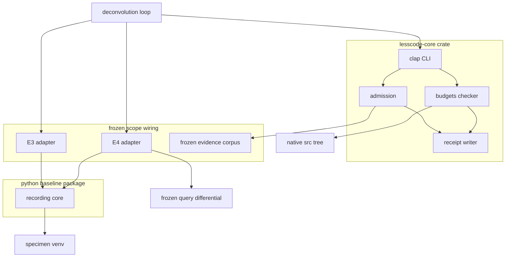
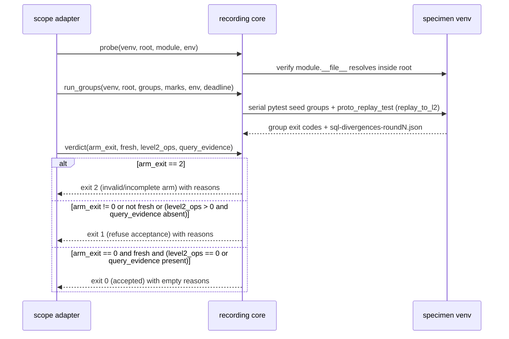
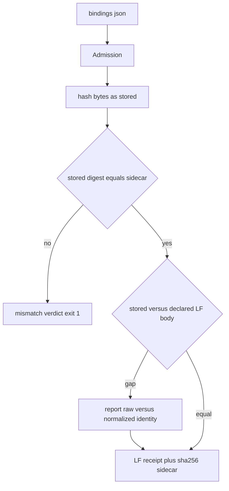
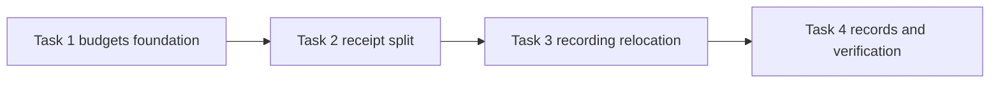

# Design: production slice — reusable recording and acceptance

Generated 2026-11-07 (design phase, foreground per owner rule 2026-11-07);
amended 2026-11-07 after design validation review to resolve Attempt-2 descope
contradictions, `RecordingCore` stdlib/specimen boundary and deferral mappings,
`Receipt` `enum J` contract, and `Budgets` brownfield dispositions + offline
`Cargo.lock` linkage; consistency-repaired 2026-11-07 after grounded fusion
review (receipt.rs public surface is exactly `J`/`sha256_hex`/`write_receipt`
with private `write_json_str`/`write_value`; admission+receipt combined
ceiling corrected 425→430; `render_json` never existed in `admission.rs`).
Requirements approved by owner 2026-11-07 (opencode chat, "Approve & proceed").
This design is generated, not approved: owner review is the next gate. It covers
only the demonstrated Attempt-2 slice: `solution_unlock.status = proceed`,
`evidence_review = approved`, U1–U7 passed on frozen attempt 2
(`results/s10-u5-measurement-2.json`, C_app 1,193 ≤ 1,364).

## Overview

**Purpose**: promote the demonstrated Attempt-2 prototype slice into maintained
production code with unchanged behavior: Rust artifact admission with its
order-preserving Python-parity receipt writer split into a dedicated module, a
Python shared recording/replay/acceptance core relocated into the baseline
package, the two frozen E3/E4 scope adapters as maintained wiring, and a native
size-checker foundation with explicit budgets and brownfield oversized-file
dispositions.

**Users**: the upstream deconvolution-loop workflow (consumes receipts and
verdicts), repository maintainers running the native CLI and the Python
recording core, and the owner as phase reviewer.

**Impact**: prototype apparatus moves to product locations; the native CLI
gains one additive governance subcommand (`budgets`); receipt writing is split
out of `admission.rs` into `receipt.rs` at net-zero logic change;
`proto_core.py` is relocated (not duplicated) into `src/lesscode_baseline/`;
frozen evidence, receipts, recordings and point-in-time attempt measurement
drivers (`s10_measure.py`, `s10_measure2.py`) are consumed read-only and never
modified.

### Goals

- Every part of the demonstrated Attempt-2 replacement C (admission, receipt
  writer, recording core, E3/E4 adapters) lives in a maintained location with
  product tests and preserved 3-stratum compression (`C_app ≤ 1,364`).
- Byte-exact receipt, digest and canonicalization rules preserved (2.4); CLI
  executable names, arguments, serialized contracts and exit behavior
  preserved (5.1, 5.2).
- Size governance in place before production edits: validated `budgets`
  checker, committed budgets configuration covering every file in
  `native/src/`, ownership patterns, release-specific allocation and explicit
  disposition of all pre-existing oversized files (6.3, 6.4).
- Honest accounting and explicit deferrals: relocation is not deletion;
  capabilities excluded by the Attempt-2 descope (`turncheck`, solver controls,
  host load probes) are mapped as explicit deferrals served by unchanged frozen
  baseline files (1.5, 2.5, 4.1, 6.1, 6.2).

### Non-Goals

- Unseen-scope generalization, additional languages or stores, proxies,
  indexers, new mutation/solver engines, model transport, twelve-command
  packaging, five-target expansion (out of boundary below).
- Re-introducing Attempt-1 descoped Rust modules (`pyjson.rs`, `turncheck.rs`)
  without a dated scope and budget amendment under 6.6.
- Editing frozen attempt measurement drivers (`s10_measure.py`,
  `s10_measure2.py`) or receipts, automatic candidate selection or adoption,
  test weakening, equivalence claims.

## Boundary Commitments

### This Spec Owns

- `native/src/admission.rs` (artifact admission and verification, split under
  400 lines), `native/src/receipt.rs` (order-preserving `enum J` Python-parity
  receipt writer, moved from `admission.rs`), `native/src/budgets.rs`
  (`rust-syntax-units-v1` size checker and `budgets` CLI subcommand arm), plus
  `native/tests/budgets.rs` and `native/complexity-budgets.json`.
- `src/lesscode_baseline/recording.py` (shared recording/replay/acceptance
  core relocated verbatim from `proto_core.py`) and `tests/test_recording.py`.
- Adapter and control wiring for the two frozen scopes:
  `docs/experiments/deconvolution/native-prototype/scope_e3.py`,
  `scope_e4.py`, `proto_replay_test.py` (untouched), and one-line import
  updates in `s10_controls.py` / `s10_controls2.py` (see Migration).
- The unlock-ledger state and evidence map records of this spec
  (`spec.json.solution_unlock`, design §Supporting References).

### Out of Boundary and Explicit Deferrals (6.1, 6.2)

- Upstream loop behavior contracts: the `deconvolution-loop` spec owns the
  semantics of query-differential evidence (loop 3.2), turn inputs (loop 6.7),
  sensitivity comparability (loop 8.7), solver-control voiding (loop 9.5) and
  protection-level reporting (loop 10.2). This slice invokes and faithfully
  reports them; it must not redefine them.
- Capabilities excluded in the approved Attempt-2 descope (`prototype-plan.md`
  §9, `s10-u5-measurement-2.json` `excluded_from_replacement`), which remain
  served by unchanged frozen baseline files and are not claimed in `C_app`:
  - **Pure turn-input verification (5.3)**: Rust `turncheck.rs` left the slice
    in Attempt 2 to satisfy `U5`/`U7`; turn-input protocol validation remains
    served by the unchanged frozen baseline (`regen_turn.py` subset, ~240
    canonical lines) with Attempt-1 turn evidence retained at
    `results/s10-turncheck.json` (re-derivable from commit `f6bb6e2`). Promoting
    `turncheck` to Rust requires a dated scope/budget amendment (6.6).
  - **Solver-control execution and voiding (5.4, loop 9.5)**: `e5-*` solver
    controls remain in the unchanged frozen baseline; `RecordingCore.verdict()`
    consumes only the post-control `query_evidence` artifact path and refuses
    any Level 2 divergence when valid query-differential evidence is absent
    (3.4, 6.2).
  - **Host load probes, adaptive deadline calculation, and turn retry rules
    (5.5)**: `adaptive.py`, `guard.py`, `regen_turn.py` HTTP/retry logic, and
    `run_arm.py` census/coverage machinery (~180 canonical lines) stay in the
    unchanged frozen baseline; `RecordingCore.call()` enforces the caller-supplied
    monotonic deadline with process-tree termination (`exit 124`).
- The frozen evidence corpus: point-in-time attempt measurement drivers
  (`s10_measure.py` bound to `f6bb6e2`, `s10_measure2.py` bound to `8537c8e`),
  receipts, `.sha256` sidecars, recordings (`.runs/native-prototype/`), goldens
  and turn protocol examples are consumed read-only.
- Digest parity for arbitrary JSON beyond the frozen receipt, golden and
  descriptor schemas.
- Candidate selection/adoption decisions, test or threshold weakening, and
  any equivalence claim.

### Allowed Dependencies

- Rust: existing `Cargo.lock` pins `ast-grep-core = 0.51.0`, `serde = 1.0.229`,
  `serde_json = 1.0.154`, `sha2 = 0.11.0`, `clap = 4.6.0`; promote the
  already-locked transitive crates `syn = { version = "=2.0.119", features =
  ["full", "visit"] }` and `proc-macro2 = { version = "=1.0.107", features =
  ["span-locations"] }` to direct dependencies in `native/Cargo.toml`, updating
  only the `lesscode-core` root package dependency linkage in `native/Cargo.lock`
  via `--offline` (zero new external crates, zero crate version or checksum
  changes). Toolchain stays `rust-version = "1.98.1"`, `--locked`.
- Python: top-level module imports in `src/lesscode_baseline/recording.py` are
  CPython standard library only (so host-independent functions import and run
  under the baseline Python environment without specimen packages); lazy
  function-local imports inside `attached()`, `detach()`, and
  `embedded_engine()` (`sqlalchemy`, `facdrone_testing`, `facdrone_data`,
  `e2_winshim`) and the default Facdrone pytest/package conventions in
  `run_groups()` / `build_groups()` execute only under the pinned specimen venv
  (`.runs/e2-facdrone/venv`) for the two demonstrated scopes (E3, E4).
- Filesystem: repository tree plus `.runs/` artifact roots reached only via
  explicit `--artifact-root` / recorded bindings.

### Revalidation Triggers

- Byte or identity change to any frozen artifact: goldens (`92a48f77…`,
  `0b2e383d…`), receipts, sidecars, recordings, turn examples.
- `Cargo.lock` crate version or checksum changes, toolchain change, or addition
  of any new external crate (updating `lesscode-core`'s root dependency linkage
  in `Cargo.lock` under `--offline` for the already-locked `syn 2.0.119` and
  `proc-macro2 1.0.107` crates is part of Task 1).
- Specimen venv package changes (the `python` / `hypothesis` / `sqlalchemy`
  identities recorded in golden meta).
- Upstream loop contract changes (loop 3.2, 6.7, 8.7, 9.5, 10.2 semantics).
- Receipt / golden / descriptor schema changes; budgets loosening; a file in
  `native/src/` exceeding its disposition; `lib.rs` / `main.rs` edits beyond
  the registration arms listed here.
- Any new scope, language, store, or re-introduction of descoped Rust modules
  (`turncheck`, `pyjson`): requires a dated scope amendment (6.6).

## Architecture

### Existing Architecture Analysis

- Native crate `lesscode-core`: `Prepare`, `Compare` and `Admission`
  subcommands dispatch in `main.rs` (239 lines, L50–58, L216–220); existing
  modules in `native/src/` are `compare.rs` (1,667 total physical lines),
  `scope.rs` (1,598), `metrics.rs` (1,530; two inline `#[cfg(test)]` modules),
  `lib.rs` (619), `model.rs` (511), each carrying inline `#[cfg(test)]` code
  whose production/test split, logical units and longest functions are not
  yet measured (they are measured by the Task 1 checker, see §Production Size
  Governance), and `admission.rs` (415 lines, self-contained since commit
  `abb71c3` with order-preserving `enum J`, `json.dumps(indent=1)` receipt
  writer, `serde_json` bindings parse, `sha2` direct hashing). The five
  pre-existing `capability-compression-core` modules (`lib.rs`, `compare.rs`,
  `scope.rs`, `metrics.rs`, `model.rs`) are governed by explicit brownfield
  dispositions; the registration-only policy of prototype-gate U7 rule 2
  continues for `lib.rs` and `main.rs`.
- Python baseline package `src/lesscode_baseline/`: flat typed-contracts
  package (cli, contracts, snapshot, evaluation, …) governed by its package
  `AGENTS.md` (evidence contract stability, role-revealing names, no
  unnecessary structure).
- Demonstrated Attempt-2 prototype: `proto_core.py` (251 written / 372
  canonical lines), `scope_e3.py` (107 written / 164 canonical), `scope_e4.py`
  (116 written / 207 canonical), `proto_replay_test.py` (13 written / 19
  canonical) under `docs/experiments/deconvolution/native-prototype/`; all
  U1–U7 evidence in `results/` plus `.runs/native-prototype/` recordings.
- Integration points that must keep working: `lesscode-core` executable name,
  existing `prepare`, `compare`, and `admission` subcommand arguments,
  serialized contracts and exit codes (5.1); the Python baseline CLI.

### Architecture Pattern & Boundary Map



**Architecture Integration**:

- Selected pattern: descriptor-driven verification commands (JSON descriptor/config
  in → checks → LF receipt + `.sha256` sidecar via `receipt.rs` → exit code)
  shared by `admission` and `budgets` as a contract shape, not a generic
  framework; library core plus thin per-scope adapters on the Python side. This
  preserves the demonstrated Attempt-2 shape without unmeasured abstraction.
- Domain boundaries: native crate owns byte admission verification, receipt
  emission, and Rust syntax-unit size checking; the Python product module owns
  record/replay/acceptance orchestration; specimen-bound scope wiring stays in
  the experiments tree next to its frozen scopes; the loop spec owns behavior
  semantics.
- Existing patterns preserved: clap derive subcommands, order-preserving `enum J`
  LF receipt emission with `.sha256` sidecars, flat module layout in the
  baseline package.
- New components rationale: `receipt.rs` (splits the 140-line receipt writer out
  of `admission.rs` so `admission.rs` lands under 400 lines and `admission` +
  `budgets` share a single receipt emitter at net-zero replacement lines),
  `budgets.rs` (6.3 requires a validated size checker before production edits),
  `recording.py` (product home for the demonstrated shared recording core).
- Steering compliance: no new external dependencies; relocation counted in full,
  never claimed as deletion; governance checker accounted separately from
  replacement apparatus `C_app`; tests reported separately from production code.

### Technology Stack

| Layer | Choice / Version | Role in Feature | Notes |
|-------|------------------|-----------------|-------|
| Native CLI | Rust 1.98.1, edition 2021, clap 4.6.0 derive | `prepare`, `compare`, `admission` (existing), `budgets` (additive) | existing arms untouched |
| Receipts | Order-preserving `receipt::J` + Python `json.dumps(indent=1)` writer | Byte-exact receipt + `.sha256` sidecar emission | moved verbatim from `admission.rs`; `indent=1`, `ensure_ascii`, DEL `0x7f`, surrogate pairs, insertion order; no floats in receipt schemas |
| Input JSON parsing | serde_json 1.0.154 + serde 1.0.229 | Parse `bindings.json` and `complexity-budgets.json` | input deserialization only |
| Hashing | sha2 0.11.0 | SHA-256 digests over bytes as stored | raw byte identity vs declared LF normalization distinguished |
| Size checking | `syn = "=2.0.119"` (`full`, `visit`) + `proc-macro2 = "=1.0.107"` (`span-locations`) | `rust-syntax-units-v1` budgets checker | promote locked transitive crates via offline `Cargo.lock` root linkage; ≤400 lines/file, ≤300 logical units/file, ≤80 lines/fn (non-test) |
| Python core | CPython standard library top-level imports | `src/lesscode_baseline/recording.py` | host-independent functions testable without specimen venv |
| Specimen runtime | pinned `.runs/e2-facdrone/venv` | E3/E4 live record/replay/accept hooks (`sqlalchemy`, `hypothesis`, `pytest`, `facdrone_*`) | lazy function-local imports executed only inside specimen runs |
| Accounting | ruff 0.17.3 format line-length 100 + rustfmt | canonical three-strata line counts | frozen measurement method, unchanged definitions |

## File Structure Plan

### Directory Structure

```
native/src/
├── admission.rs        # artifact admission: verify bindings, CLI arm (receipt writer split out; ≤400 lines)
├── receipt.rs          # new (split from admission.rs): order-preserving J + Python indent=1 writer + sha256 sidecar
├── budgets.rs          # new: rust-syntax-units-v1 size checker + CLI arm
├── lib.rs              # modified: +2 registration lines only (pub mod budgets; pub mod receipt;)
└── main.rs             # modified: +1 additive subcommand arm (Budgets)
native/tests/
├── admission.rs        # existing: extended with receipt-module parity cases (escapes, DEL, surrogate pairs, order)
├── budgets.rs          # new: synthetic fixtures + self-run over native/src/ with dispositions
└── cli.rs              # existing: extended with budgets CLI regression and preserved prepare/compare/admission exits
native/
├── Cargo.toml          # modified: +2 lines promoting syn (=2.0.119) and proc-macro2 (=1.0.107)
├── Cargo.lock          # modified: offline root-package dependency linkage only (zero version/checksum changes)
└── complexity-budgets.json  # new: per-file budgets and explicit brownfield dispositions for all native/src/*.rs
src/lesscode_baseline/
└── recording.py        # new: relocated proto_core.py (verbatim logic; 251 written / 372 canonical lines)
tests/
└── test_recording.py   # new: verdict truth tables, call timeout 124, Norm/first_diff units, 3-stratum C_app check
docs/experiments/deconvolution/native-prototype/
├── scope_e3.py         # modified: add LESSCODE/"src" to sys.path, import lesscode_baseline.recording as P
├── scope_e4.py         # modified: add LESSCODE/"src" to sys.path, import lesscode_baseline.recording as P
├── proto_replay_test.py# untouched: imports scope_e3/scope_e4 dynamically, never imports proto_core directly
├── s10_controls.py     # modified: import lesscode_baseline.recording as P (+src path binding)
├── s10_controls2.py    # modified: import lesscode_baseline.recording as P (+src path binding)
├── proto_core.py       # deleted after relocation (retained at attempt commits; no duplication, no shim)
├── s10_measure.py      # untouched: frozen attempt-1 driver (bound to commit f6bb6e2)
└── s10_measure2.py     # untouched: frozen attempt-2 driver (bound to commit 8537c8e)
```

### Modified Files

- `native/src/lib.rs` — registration lines only (`pub mod budgets; pub mod
  receipt;`); no domain logic; U7 rule 2 diff-only charging applies.
- `native/src/main.rs` — one additive `Budgets` clap arm; existing `Prepare`,
  `Compare`, `Admission` arms byte-identical in behavior.
- `native/src/admission.rs` — `enum J`, `sha256_hex`, `write_json_str`,
  `write_value`, and `write_receipt` move to `receipt.rs` and are re-exported
  (`pub use crate::receipt::{sha256_hex, write_receipt, J};`) so existing
  callers and tests stay source-compatible; `admission.rs` drops from 415 to
  ~275 lines (well under the 400-line ceiling).
- `scope_e3.py`, `scope_e4.py`, `s10_controls.py`, `s10_controls2.py` — bind
  `LESSCODE / "src"` on `sys.path` and import `from lesscode_baseline import
  recording as P` instead of `import proto_core as P`; zero logic changes.

## System Flows

### Acceptance flow (E4 shape; E3 analogous with R16 check and `QUERY_EVIDENCE = None`)



- Gating decisions: `probe()` aborts (`SystemExit`) if the target module does
  not resolve inside `root` (3.5); `verdict()` requires `arm_exit == 0` and
  `fresh == True` (report written after `t0` with expected sequence count: 64
  for E3, `meta["sequences"]` for E4) and zero Level 1 divergence (enforced by
  `replay_to_l2` assertions inside `proto_replay_test.py`) before any
  acceptance judgment (3.2, 3.3); a Level 2 difference (`level2_ops > 0`)
  without an existing `query_evidence` file refuses acceptance with exit `1`
  (3.4, 6.2); `call()` kills timed-out subprocess trees via `taskkill /F /T`
  and returns `124` with an explicit infrastructure message so timeouts are
  distinguishable from test assertions (3.7, 5.5).

### Admission verification flow



- Missing artifact bytes or a disagreeing sidecar is incomplete/invalid
  evidence and refuses acceptance with exit `1` while still writing the receipt
  (2.2, 5.2); raw byte identity (`sha256_stored` / `expected_stored`) and
  declared semantic normalization (`declared_lf_body`) are recorded in separate
  fields (2.3).

## Requirements Traceability

| Requirement | Summary | Components | Interfaces | Flows |
|-------------|---------|------------|------------|-------|
| 1.1 | Block production while unlock evidence absent/stale/unsuccessful | UnlockLedger | Ledger state | — |
| 1.2 | Owner-approved frozen plan before bounded execution | UnlockLedger | Ledger evidence pointers | — |
| 1.3 | U1–U7 pass on one frozen attempt plus approved evidence review | UnlockLedger, EvidenceMap | Ledger evidence list | — |
| 1.4 | Failed/unavailable criterion keeps lock, records revise/stop/not-run | UnlockLedger | Ledger statuses | — |
| 1.5 | Only demonstrated slice seeks normal phase approvals | Boundary Commitments, EvidenceMap | — | — |
| 1.6 | Material input/contract/dependency/evaluator/budget change invalidates affected evidence | Revalidation Triggers | — | — |
| 2.1 | Evidence bound to source, scope, protocol, corpus, apparatus, dependencies, evaluator identities | Admission, RecordingCore | BindingReport, GoldenMeta | Admission flow |
| 2.2 | Missing bytes or digest disagreement refuses acceptance | Admission | Admission CLI exit semantics | Admission flow |
| 2.3 | Hash bytes as stored; distinguish raw vs declared normalization | Admission | SidecarCheck fields | Admission flow |
| 2.4 | Canonical digests/receipts byte-for-byte per prototype rules | Receipt, RecordingCore | write_receipt, write_golden | Admission flow |
| 2.5 | Distinguish replay, live execution, real-scope usefulness; preserve history | RecordingCore, EvidenceMap | accept report fields, R30/R31 retention | Acceptance flow |
| 3.1 | Double recording byte-identical after frozen normalization or refuse | RecordingCore, ScopeAdapterE3/E4 | record(), Norm | Acceptance flow |
| 3.2 | Original replay zero L1/L2 divergence before judging candidates | RecordingCore | replay_engine, replay_to_l2 | Acceptance flow |
| 3.3 | Candidate acceptance: fresh complete results, zero L1, unchanged deselections, seeds pass | ScopeAdapterE3/E4, RecordingCore | accept(), verdict(), build_groups | Acceptance flow |
| 3.4 | L2 difference requires query-differential evidence (loop 3.2) else refuse | RecordingCore | verdict() query gate | Acceptance flow |
| 3.5 | Protected files/tests/corpora/apparatus change voids candidate | RecordingCore, ScopeAdapterE3/E4 | guard(), probe(), GoldenMeta scope hashes | Acceptance flow |
| 3.6 | Acceptance report: observations, counts, sensitivity, residue, no equivalence claim | ScopeAdapterE3/E4, RecordingCore | accept stdout/L2 report, frozen R25/R26 records | Acceptance flow |
| 3.7 | Interrupted/infrastructure failure reported separately, not a kill | RecordingCore | call() exit 124, verdict() exit 2 | Acceptance flow |
| 4.1 | Shared implementation counted once; all retained support accounted | EvidenceMap, File Structure Plan | 3-stratum accounting check | — |
| 4.2 | Frozen canonical formatting; three strata; physical and separated-form reported | EvidenceMap | s10-u5-measurement-2.json + post-relocation check | — |
| 4.3 | Specimen behavior via explicit bounded adapter, not hidden config | ScopeAdapterE3/E4 | ScopeAdapter interface | — |
| 4.4 | Second-scope onboarding freezes shared implementation; records whether scope support suffices | RecordingCore, ScopeAdapterE3/E4 | adapter freeze record (U4) | — |
| 4.5 | Predeclared relative and absolute reduction on app stratum plus net whole-replacement reduction | EvidenceMap | U5 targets, post-relocation check | — |
| 4.6 | Reject weaker observations, removed behavior, packing, relocated uncounted logic | Revalidation Triggers, accounting contract | — | — |
| 5.1 | Existing prepare/compare commands keep executable, arguments, contracts, exits | CLI (native), cli.rs regression | CLI arms | — |
| 5.2 | Command completion distinguished from candidate acceptance | Admission, Budgets, RecordingCore | exit-code & receipt semantics | Admission flow, Acceptance flow |
| 5.3 | Turn inputs follow upstream protocol; failed attempts preserved | Explicit Deferral (EvidenceMap) | Unchanged frozen `regen_turn.py` + Attempt-1 receipt `s10-turncheck.json` | — |
| 5.4 | Solver control failure voids only the differential step | Explicit Deferral (EvidenceMap), RecordingCore | Unchanged frozen `e5-*` controls; `verdict()` query_evidence gate | Acceptance flow |
| 5.5 | Adaptive deadlines, load probes, upstream retry rules preserved | RecordingCore + Explicit Deferral (EvidenceMap) | `call()` deadline/tree-kill; unchanged frozen `adaptive.py`/`guard.py`/`regen_turn.py` | Acceptance flow |
| 6.1 | Slice maps applicable criteria to checks/evidence or explicit deferrals | EvidenceMap | evidence map table | — |
| 6.2 | Deferred capability needed for acceptance refuses rather than bypasses | RecordingCore, Boundary | `verdict()` L2 refuse rule | Acceptance flow |
| 6.3 | Capped production work: ownership patterns, allocation, oversized-file disposition, validated checker before execution | Budgets, §Production Size Governance | budgets CLI, complexity-budgets.json | — |
| 6.4 | Maintained-support accounting across owned languages/directories; tests, fixtures, generated output, frozen evidence reported separately | Budgets, EvidenceMap | budgets report (`#[cfg(test)]` separated), 3-stratum check | — |
| 6.5 | U7 effort-charging rules recorded and applied | EvidenceMap, Budgets | budgets baselines & diff rules | — |
| 6.6 | Expansion requires dated scope amendment with unmet need, hypothesis, evidence plan, budget | Revalidation Triggers | — | — |

## Components and Interfaces

| Component | Domain/Layer | Intent | Req Coverage | Key Dependencies | Contracts |
|-----------|--------------|--------|--------------|------------------|-----------|
| Admission | Native verification | Verify artifact bytes vs sidecars; emit verdict receipt | 2.1, 2.2, 2.3, 5.2 | Receipt (P0) | Service, Batch |
| Receipt | Native formatting | Order-preserving `enum J` Python-parity receipt writer + `.sha256` sidecar | 2.4 | sha2 (P0) | Service |
| Budgets | Native governance | `rust-syntax-units-v1` size checks with brownfield dispositions | 6.3, 6.4, 6.5 | syn, proc-macro2, Receipt (P0) | Service, Batch |
| RecordingCore | Python orchestration | Record/replay/accept runner relocated verbatim from `proto_core.py` | 3.1–3.7, 5.5, 2.1, 2.5 | specimen venv (P0 for live runs) | Service, State |
| ScopeAdapterE3 | Experiment wiring | Frozen E3 bindings (oracle strata, R16 check, seeds, packages) | 3.1–3.6, 4.3, 4.4 | RecordingCore (P0) | Service |
| ScopeAdapterE4 | Experiment wiring | Frozen E4 bindings plus query-evidence gate | 3.1–3.6, 4.3, 4.4 | RecordingCore (P0), query differential (P0) | Service |
| UnlockLedger | Spec state | `spec.json.solution_unlock` evidence pointer and lock statuses | 1.1–1.4 | — | State |
| EvidenceMap | Spec record | Criteria-to-evidence mapping with explicit deferrals | 6.1, 6.2, 4.1, 4.2, 4.5, 5.3, 5.4, 5.5 | — | State |

### Native verification layer

#### Admission

| Field | Detail |
|-------|--------|
| Intent | Verify declared artifact bindings against stored bytes and sidecars, emit verdict receipt |
| Requirements | 2.1, 2.2, 2.3, 5.2 |

**Responsibilities & Constraints**

- Verifies per binding: artifact presence, SHA-256 of bytes as stored, sidecar
  presence, sidecar `stored` and `declared_lf_body` digests (`parse_sidecar`),
  and binding match (`Status::{Verified, Mismatch, Missing, NoBoundSidecar}`).
- Verdict categories and summary counts preserved byte-identically as
  demonstrated (`total: 21, verified: 11, mismatch: 5, missing: 1,
  no_bound_sidecar: 4`, exit 1 fail-closed on R28 `s2-bindings.json`).
- Re-exports `pub use crate::receipt::{sha256_hex, write_receipt, J};` so
  existing callers and `native/tests/admission.rs` remain source-compatible.
- Domain boundary: byte verification only; no candidate judgment (5.2).

**Dependencies**

- Outbound: Receipt — build and write `J` receipt + `.sha256` sidecar (P0).
- External: serde_json 1.0.154 (bindings input parsing), sha2 0.11.0 (P0).

**Contracts**: Service [x] / Batch [x]

##### Service Interface
```rust
pub fn parse_sidecar(text: &str) -> Sidecar;
pub fn verify(root: &Path, artifact: &str, sidecars: &[String]) -> BindingReport;
pub fn receipt(command: &str, reports: &[BindingReport]) -> J;
pub fn cli_run(root: &Path, bindings: &Path, out: &Path) -> Result<u8, String>;
```
- Preconditions: `bindings` JSON file contains a `"bindings"` array of
  `{"artifact": "...", "sidecars": [...]}` entries.
- Postconditions: `BindingReport` emitted for every binding; summary counts
  `total`, `verified`, `mismatch`, `missing`, `no_bound_sidecar`.
- Invariants: digests computed over bytes as stored; `declared_lf_body`
  recorded separately (2.3).

##### Batch Contract (CLI, preserved)
- Trigger: `lesscode-core admission --root <dir> --bindings <file> --out <file>`.
- Input/output: bindings descriptor in; LF JSON receipt + `<stem>.json.sha256`
  sidecar out.
- Exit: `0` only when zero `Mismatch` and zero `Missing`; `1` otherwise; `3` on
  unreadable/invalid descriptor or IO failure; receipt written in both `0` and
  `1` outcomes (command completion ≠ acceptance, 5.2).

#### Receipt

| Field | Detail |
|-------|--------|
| Intent | Single owner of order-preserving Python `json.dumps(indent=1)` receipt emission and `.sha256` sidecar writing for native commands |
| Requirements | 2.4 |

**Responsibilities & Constraints**

- Moved verbatim from `native/src/admission.rs` (lines 21–144, 348–363; net-zero
  logic change): owns the minimal insertion-ordered JSON value `enum J`
  (`Null`, `Bool`, `Int(i64)`, `Str(String)`, `Arr(Vec<J>)`,
  `Obj(Vec<(String, J)>)`), lowercase hex SHA-256 (`sha256_hex`), Python
  `json.dumps(..., indent=1, ensure_ascii=True)` string escaping (short escapes
  for `"`, `\`, `\b`, `\t`, `\n`, `\f`, `\r`; `\u00xx` for other control chars
  and DEL `0x7f`; surrogate-pair `\uxxxx\uxxxx` above BMP), and LF receipt +
  `.sha256` sidecar file writing.
- Avoids `serde_json::Value` for receipt serialization because `serde_json`
  without `preserve_order` uses `BTreeMap` and sorts object keys alphabetically,
  which would break the insertion-ordered field layout of frozen receipts.
  Native receipts contain no floating-point numbers by construction (float
  canonicalization for golden traces lives in `recording.write_golden`).

**Contracts**: Service [x]

##### Service Interface
```rust
#[derive(Debug, Clone, PartialEq, Eq)]
pub enum J {
    Null,
    Bool(bool),
    Int(i64),
    Str(String),
    Arr(Vec<J>),
    Obj(Vec<(String, J)>),
}
pub fn sha256_hex(bytes: &[u8]) -> String;
pub fn write_receipt(path: &Path, value: &J) -> std::io::Result<()>;
// private helpers moved verbatim from admission.rs, never re-exported:
//   fn write_json_str(s: &str, out: &mut String)  — string escaper
//   fn write_value(value: &J, depth: usize, out: &mut String)  — J renderer
```
- Preconditions: `value` is a constructed `J` tree; `path` has a `.json`
  filename.
- Postconditions: `path` written with LF (`\n`) endings; `<stem>.json.sha256`
  sidecar written in `sha256sum` format (`<hex>  <filename>\n`) matching the
  stored receipt bytes.
- Invariants: byte rules frozen by parity tests; changing them is a
  revalidation trigger.

### Native governance layer

#### Budgets

| Field | Detail |
|-------|--------|
| Intent | Validate size budgets and brownfield dispositions for all `.rs` files under `native/src/` before and during production execution |
| Requirements | 6.3, 6.4, 6.5 |

**Responsibilities & Constraints**

- Implements `rust-syntax-units-v1` over `native/complexity-budgets.json` using
  `syn` (`full`, `visit`) and `proc-macro2` (`span-locations`):
  - Parses each `.rs` file under `--root` (`native/src`) with `syn::parse_file`.
  - Separates production syntax items from `#[cfg(test)]` items/modules so test
    code is reported separately and never merged with production counts (6.4).
  - For non-test code in each file, measures:
    1. `production_lines` (and `total_lines` / `test_lines` reported separately)
       against `max_physical_lines` (default `400`).
    2. `logical_units` (count of non-test item declarations `ItemFn`,
       `ImplItemFn`, `TraitItemFn`, `ItemStruct`, `ItemEnum`, `ItemType`,
       `ItemConst`, `ItemStatic`, `ItemTrait`, `ItemImpl`, `ItemMod`,
       `ItemUse`, `ItemMacro` plus `syn::Stmt` statements inside non-test
       functions/methods) against `max_logical_units` (default `300`).
    3. `max_fn_lines` (maximum `span.end().line - span.start().line + 1` across
       non-test `ItemFn` / `ImplItemFn` / `TraitItemFn`) against `max_fn_lines`
       (default `80`).
- Fail-closed:
  - Every `.rs` file discovered under `--root` must have a matching entry in
    `complexity-budgets.json`; an unlisted `.rs` file fails the check.
  - Any file exceeding `max_physical_lines`, `max_logical_units`, or
    `max_fn_lines` fails unless its entry in `complexity-budgets.json` carries a
    non-empty `disposition` rationale and its measurements stay within the
    disposition's frozen ceiling values.
  - Loosening any budget or disposition ceiling is a revalidation trigger
    requiring a dated amendment (6.6).
- Scope of accounting (6.4): `budgets` governs Rust sources under `native/src/`
  and reports `production_lines` vs `test_lines` (`#[cfg(test)]`) separately.
  `budgets.rs` itself is production size-governance infrastructure (6.3),
  accounted in its own governance category rather than the E3/E4 replacement
  apparatus stratum `C_app`.

**Dependencies**

- Outbound: Receipt — emit LF JSON receipt + `.sha256` sidecar (P0).
- External: `syn = "=2.0.119"` (`full`, `visit`), `proc-macro2 = "=1.0.107"`
  (`span-locations`), `serde` / `serde_json` for config parsing (P0).

**Contracts**: Service [x] / Batch [x]

##### Service Interface
```rust
pub fn check(config: &BudgetsConfig, root: &Path) -> Result<BudgetsReport, String>;
pub fn cli_run(config: &Path, root: &Path, out: &Path) -> Result<u8, String>;
```
- Preconditions: `config` JSON parses as `BudgetsConfig` (`deny_unknown_fields`);
  `root` is an existing directory.
- Postconditions: `BudgetsReport` lists per-file `total_lines`,
  `production_lines`, `test_lines`, `logical_units`, `longest_fn_lines`,
  `longest_fn_name`, `owner`, `allocation`, `disposition`, and `status`
  (`within_budget` / `disposed` / `exceeded` / `unlisted` / `missing`).
- Invariants: pure read-only static analysis of `--root`; never edits sources.

##### Batch Contract (CLI, additive)
- Trigger: `lesscode-core budgets --config <file> --root <dir> --out <file>`.
- Output: LF JSON receipt + `<stem>.json.sha256` sidecar (via `receipt::write_receipt`).
- Exit: `0` only when every `.rs` file under `--root` is listed and within
  default budgets or within its recorded disposition ceilings; `1` when any file
  exceeds its ceiling or is unlisted/missing; `3` on unreadable/invalid config
  or IO error.

### Python orchestration layer

#### RecordingCore

| Field | Detail |
|-------|--------|
| Intent | Shared record/replay/acceptance runner with honest verdicts, relocated verbatim from `proto_core.py` |
| Requirements | 3.1–3.7, 5.5, 2.1, 2.5 |

**Responsibilities & Constraints**

- Public surface preserved verbatim from `proto_core.py` (251 written / 372
  canonical lines): `canon`, `Norm`, `run_sequence`, `signatures`, `first_diff`,
  `attached`, `detach`, `embedded_engine`, `write_golden`, `record`,
  `replay_engine`, `replay_to_l2`, `call`, `probe`, `run_groups`, `verdict`,
  `arm_env`, `build_groups`. Relocation changes the module path only
  (`src/lesscode_baseline/recording.py`); net-zero new logic (4.1: relocation
  is not deletion, and preserving the frozen core verbatim maintains U4).
- `verdict(arm_exit, fresh, level2_ops, query_evidence)` is the acceptance
  judge: requires `arm_exit == 0` and `fresh == True` (3.3), refuses
  `level2_ops > 0` when `query_evidence` is absent or not a file on disk (3.4,
  6.2), preserves `arm_exit == 2` as exit `2` (invalid/incomplete arm) and
  returns exit `1` otherwise with explicit reasons (3.7, 5.2).
- `call(cmd, deadline, **kw)` enforces caller-supplied monotonic deadlines and
  kills timed-out process trees on Windows via `taskkill /F /T /PID`, returning
  `124` with `"proto: deadline exceeded (infrastructure, not a verdict)"` (3.7,
  5.5).
- `probe(venv, root, module, env)` verifies inside the specimen interpreter that
  `module.__file__` resolves under `root`, aborting with `SystemExit("INVALID
  scope not imported from ...")` if import resolution escapes the candidate root
  (3.5).
- Double-recording normalization is frozen in `Norm`; mismatch refuses (3.1).

**Dependencies**

- Top-level module imports: Python standard library only (`hashlib`, `json`,
  `os`, `subprocess`, `sys`, `tempfile`, `time`, `contextlib`, `datetime`,
  `enum`, `pathlib`, `dataclasses`), enabling host-independent import and unit
  testing in `tests/test_recording.py`.
- Function-local specimen imports (executed only during live specimen
  record/replay under `.runs/e2-facdrone/venv`): `sqlalchemy` (`event`,
  `Engine`, `create_engine`), `facdrone_testing.migrated_schema`,
  `facdrone_data.testing.pg_server`, and `e2_winshim` inside `attached()`,
  `detach()`, and `embedded_engine()`.

**Contracts**: Service [x] / State [x]

##### Service Interface
```python
def record(env_cls, engine, root, seeds_pairs, generated_seqs, guard,
           meta_of, out: Path) -> dict: ...
def replay_engine(env_cls, engine, root, seeds_pairs, golden: Path,
                  only: set | None = None, listen_all: bool = False) -> str | None: ...
def replay_to_l2(env_cls, engine, root, seeds_pairs, goldens: list,
                 out: Path, listen_all: bool = False) -> dict: ...
def verdict(arm_exit: int, fresh: bool, level2_ops: int,
            query_evidence) -> tuple[int, list[str]]: ...
```
- Preconditions: adapters supply a frozen `Env` class, seeds and `meta_of`
  binding.
- Postconditions: goldens written via `write_golden` (`sort_keys=True, indent=0,
  allow_nan=True`, LF bytes, `.sha256` sidecar with `# lf-body sha256 ...`); L2
  reports written by `replay_to_l2` (`indent=1`, `written` timestamp,
  `sequences`, `operations`, `level2_ops`, `divergences`).
- Invariants: L1 divergence asserts immediately in `replay_to_l2` or returns the
  first diff path in `replay_engine`; L2 divergences are collected and gated by
  `verdict()`.

##### State Management
- State model: golden files (`meta` + `sequences`) and replay/L2 reports are
  append-only evidence artifacts; nothing is rewritten in place.
- Persistence: LF JSON with `.sha256` sidecars on goldens.

### Experiment wiring layer

#### ScopeAdapterE3 / ScopeAdapterE4

| Field | Detail |
|-------|--------|
| Intent | Maintain the frozen per-scope bindings (oracle strata, seeds, packages, marks, query evidence) as thin, counted adapters |
| Requirements | 3.1–3.6, 4.3, 4.4 |

**Responsibilities & Constraints**

- Documented duck-typed interface satisfied by both adapters:
  `meta_of(seqs)`, `record(out, only=None)`, `replay(golden=None, only=None)`,
  `run_replay_target(pg_engine, rnd=None)`, `accept(root, rnd="0",
  deadline=None) -> int` (plus `guard()` in E3 and `seeds()` in E4).
- Both adapters invoke `P.embedded_engine`, `P.attached`, `P.run_sequence`,
  `P.detach`, and `P.write_golden` in `record()` (`listen_all=False` for E3,
  `listen_all=True` for E4).
- E4 binds the frozen query differential
  (`e4-lifecycle/results/sql-divergences-e6-cand.json`) that `verdict()`
  consumes for L2 acceptance; E3 sets `QUERY_EVIDENCE = None` (any `level2_ops >
  0` on E3 refuses acceptance) and runs the `R16_CHECK` baseline harness before
  `run_groups`.
- Adapters are explicit bounded code, counted in the adapter-wiring stratum
  (4.3); specimen domain operations (`op_*`, fixtures) and corpora (`SEEDS`,
  `generated`) live in the frozen oracle modules (`e1b_oracle.py`,
  `e4_oracle.py`) they import, never in hidden configuration.
- The E3→E4 freeze record (shared core frozen after E3; only declared E4
  scope support added) is the 4.4 evidence and survives relocation unchanged.

**Dependencies**

- Outbound: RecordingCore (`lesscode_baseline.recording as P`, P0); frozen
  oracle strata `e1b_oracle.py` / `e1c2_source.py` / `e4_oracle.py` (P0);
  specimen venv (P0); E4: frozen query differential (P0).

**Contracts**: Service [x]

**Implementation Notes**

- Integration: include `LESSCODE / "src"` in `sys.path[:0]` and replace `import
  proto_core as P` with `from lesscode_baseline import recording as P`.
  `proto_replay_test.py` imports `scope_e3` / `scope_e4` dynamically by
  `PROTO_SCOPE` and requires zero edits.
- Validation: host-independent unit tests always run in `tests/test_recording.py`;
  specimen-dependent double-record/replay and adverse-control checks run when
  the pinned venv and `.runs` artifacts are present, and skip with an explicit
  reason when absent (3.1–3.7).
- Boundary rationale: adapter modules remain inside
  `docs/experiments/deconvolution/native-prototype/` next to the frozen E1b/E3/E4
  experiment directories they bind.

### Spec state layer

#### UnlockLedger

- `spec.json.solution_unlock` remains the single evidence pointer: statuses
  `proceed / revise / stop / not-run`, evidence list, frozen identities.
  Production tasks and code remain blocked unless `status=proceed`,
  `evidence_review=approved` and phase approvals hold (1.1–1.4). It is an
  evidence ledger, not a pass switch; no automated bypass is introduced.

#### EvidenceMap

- The criteria-to-evidence mapping (6.1) is maintained in this design's
  Supporting References section and updated whenever evidence or deferrals
  change; deferrals state consequences (6.2), and a deferred capability
  needed for acceptance refuses rather than bypasses.

## Data Models

### Domain Model

- Frozen evidence (goldens, receipts, recordings, turn examples): immutable,
  digest-bound aggregates; receipts reference them by identity.
- Production code: mutable, budgeted, disposition-governed.
- Invariant: production code verifies evidence; evidence never verifies
  itself.

### Logical Data Model

- **Bindings descriptor** (`s2-bindings.json` shape): `{ "bindings": [
  { "artifact": path, "sidecars": [path, …] } ] }` resolved against `--root`.
- **AdmissionReceipt** (`s2-artifact-admission-rust-1`): insertion-ordered `J`
  object with fields `receipt`, `purpose`, `generated_unix`, `command`,
  `hashing`, `bindings` (per-binding `artifact`, `present`, `bytes`,
  `sha256_stored`, `sidecars` (`sidecar`, `present`, `expected_stored`,
  `declared_lf_body`, `matches_stored`), `status`), and `summary` (`total`,
  `verified`, `mismatch`, `missing`, `no_bound_sidecar`); written via
  `receipt::write_receipt`.
- **Golden**: `{ "meta": ..., "sequences": [...] }`; `meta` carries common
  identity bindings (2.1): `hypothesis_seed`, `generated_requested`, `python`,
  `hypothesis`, `sqlalchemy`, `sequences`, `operations`, `seed_signatures`,
  `generated_only_signatures`, `harness_suspects`, plus scope-specific provenance
  (`scope` record in E3; `root`, `scope_sha256`, `alphabet` in E4).
- **BudgetsConfig** (`native/complexity-budgets.json`):
  `{ "schema": "rust-syntax-units-v1", "defaults": { "max_physical_lines": 400,
  "max_logical_units": 300, "max_fn_lines": 80 }, "files": [ { "path": "...",
  "max_physical_lines": ..., "max_logical_units": ..., "max_fn_lines": ...,
  "owner": "...", "allocation": "...", "disposition": "..." | null } ] }`.
- **BudgetsReceipt** (`rust-syntax-units-v1`): insertion-ordered `J` object
  with `receipt`, `schema`, `root`, `config`, `files` (per-file `path`,
  `present`, `total_lines`, `production_lines`, `test_lines`, `logical_units`,
  `longest_fn_lines`, `longest_fn_name`, `max_physical_lines`,
  `max_logical_units`, `max_fn_lines`, `owner`, `allocation`, `disposition`,
  `status`), `unlisted`, and `summary` (`total`, `within_budget`, `disposed`,
  `exceeded`, `unlisted`, `missing`); written via `receipt::write_receipt`.
- **Measurement record** (frozen schema, `s10-u5-measurement-2.json`):
  three-strata canonical counts (`app`, `ops`, `seeds`), per-scope adapter
  shares, saved-lines arithmetic, like-for-like sensitivity, and U7 attempt
  ledger.

### Physical Data Model

- All native receipts and golden traces: LF JSON + `.sha256` sidecars; no
  database in `lesscode-core`, no network.

### Data Contracts & Integration

- The upstream loop consumes admission receipts and acceptance verdicts
  read-only; serialized field names of existing contracts are frozen (package
  `AGENTS.md` evidence contract; 5.1).

## Error Handling

### Error Strategy

Fail-closed everywhere: missing or disagreeing evidence refuses acceptance
and is reported; no fallback weakens a check.

| Error category | Behavior | Requirement |
|---------------|----------|-------------|
| Missing artifact bytes / sidecar | `missing` / `mismatch` status, exit `1`, receipt + sidecar written | 2.2, 5.2 |
| Stored vs declared digest gap | `sha256_stored` and `declared_lf_body` reported as distinct fields, never normalized away | 2.3 |
| Recording normalization mismatch | double-record digest inequality refuses | 3.1 |
| Replay L1 divergence | assertion failure / diff string returned; no candidate acceptance | 3.2 |
| L2 divergence without query evidence | `verdict()` returns exit `1` with `"<N> L2 differences without query-differential evidence"` | 3.4, 6.2 |
| Protected-file / wrong-root change | `guard()` raises `RuntimeError` on dirty root; `probe()` raises `SystemExit` if import escapes `root` | 3.5 |
| Stale/partial arm results | `fresh == False` → `verdict()` returns exit `1` with `"replay not fresh or short of golden coverage"` | 3.3 |
| Interrupted arm / invalid arm exit | `call()` kills tree on deadline and returns `124` (logged as infrastructure); `verdict(2, ...)` returns exit `2` | 3.7, 5.5 |
| Budget exceeded or unlisted file | `budgets` writes receipt and exits `1` with per-file `exceeded` / `unlisted` report | 6.3, 6.4 |
| Malformed CLI input / unreadable config | `lesscode-core` prints error to `stderr` and exits `3` | 5.1 |

### Monitoring

- Every command's outcome is a receipt artifact; no external telemetry is
  introduced (local-first, no hosted analysis).

## Testing Strategy

### Unit Tests

- Receipt module parity table (`native/tests/admission.rs`): insertion-order
  preservation (`"receipt"` key stays first, not sorted alphabetically),
  `indent=1` formatting, `ensure_ascii` control-character escapes, DEL `0x7f`
  (`\u007f`), BMP and non-BMP surrogate pairs (`\ud83d\ude00`), empty container
  inline rendering (`[]`, `{}`), and `.sha256` sidecar match (2.4).
- Admission verify table (`native/tests/admission.rs`): `Verified`, `Missing`,
  `Mismatch`, `NoBoundSidecar`, and `stored` vs `declared_lf_body` sidecar
  parsing with CRLF tolerance (2.2, 2.3).
- Budgets checker (`native/tests/budgets.rs`): synthetic fixture files testing
  within-budget pass, `max_logical_units` overrun, `max_fn_lines` overrun,
  `max_physical_lines` overrun, unlisted `.rs` file failure, `#[cfg(test)]`
  separation (large inline test module does not inflate `production_lines` or
  `logical_units`), and valid brownfield `disposition` pass (6.3, 6.4).
- RecordingCore (`tests/test_recording.py`):
  - `verdict()` truth table: `(0, True, 0, None) -> 0`, `(0, False, 0, None) ->
    1`, `(0, True, 3, None) -> 1`, `(0, True, 3, existing_file) -> 0`,
    `(2, True, 0, None) -> 2`, `(1, True, 0, None) -> 1` (3.3, 3.4, 3.7, 5.2).
  - `call()` deadline expiry returns `124` cleanly (3.7, 5.5).
  - `Norm` normalization determinism (datetimes → `<t0>`, `<t1>`, dates, enums,
    bytes SHA-256, dataclasses, sets sorted by `canon`, fallback `<TypeName>`
    without memory addresses) and `first_diff` path reporting (3.1, 3.2).
  - Post-relocation 3-stratum canonical line-count check: formats the relocated
    apparatus inventory (`src/lesscode_baseline/recording.py`, `scope_e3.py`,
    `scope_e4.py`, `proto_replay_test.py`) with `ruff==0.17.3 format
    --line-length 100` plus Rust `admission.rs` + `receipt.rs` + registration
    hooks and asserts `C_app <= 1,364`, `B_app - C_app >= 200`, `C_total <=
    3,003`, `e3_with_replay_share < 280`, and `e4_with_replay_share < 358`
    (4.1, 4.2, 4.5).

### Integration Tests

- Frozen `s2-bindings.json` reproduces R28 exactly: `total: 21, verified: 11,
  mismatch: 5, missing: 1, no_bound_sidecar: 4`, exit `1` (2.2).
- Budgets self-run over `native/src/` with `native/complexity-budgets.json`
  passes with exit `0` in Task 1 and in every subsequent task (6.3).
- CLI regression (`native/tests/cli.rs`): existing `prepare`, `compare`, and
  `admission` arguments, outputs and exit codes unchanged after `budgets` is
  added (5.1).

### Environment-Dependent Tests (honest skip)

- Adapter double-record and replay against the pinned specimen venv
  (`.runs/e2-facdrone/venv`) and `.runs/` goldens for E3/E4; adverse controls
  (`s10_controls2.py`) exercised through the relocated
  `lesscode_baseline.recording` import path; skipped with an explicit reason
  when the local `.runs/` specimen or recordings are absent — absence stays
  absent, never zero (3.1–3.7).

## Production Size Governance

### Release-Specific Allocation (frozen before execution, 6.3)

Ceilings are canonical maintained lines under the frozen method (`rustfmt` for
Rust; `ruff==0.17.3 format --line-length 100` for Python):

- **Deconvolution replacement apparatus stratum (`C_app`, ceiling ≤ 1,364)**:
  - `native/src/admission.rs` + `native/src/receipt.rs`: combined ≤ 430
    canonical lines (`admission.rs` ≤ 280, `receipt.rs` ≤ 150; split from the
    415-line Attempt-2 `admission.rs`; 280 + 150 = 430).
  - Registration hooks on `C_app`: `lib.rs` +2 lines (the existing Attempt-2
    `pub mod admission;` plus the new `pub mod receipt;`), `main.rs` +15 lines
    (existing Attempt-2 `Admission` arm, unchanged).
  - `src/lesscode_baseline/recording.py`: 372 canonical lines (251 written
    lines, relocated verbatim from `proto_core.py`, net 0 new logic).
  - `scope_e3.py`: ≤ 168 canonical lines (164 baseline + ≤ 4 lines for `src`
    path binding and import).
  - `scope_e4.py`: ≤ 211 canonical lines (207 baseline + ≤ 4 lines for `src`
    path binding and import).
  - `proto_replay_test.py`: 19 canonical lines (untouched).
  - Total post-relocation `C_app` ≤ 1,212 canonical lines (≤ 1,364 ceiling;
    `B_app - C_app ≥ 493 ≥ 200`; like-for-like against `1,465` saves ≥ 253 ≥
    200).
- **Size-governance checker stratum (6.3 / 6.4, accounted separately from
  `C_app`)**:
  - `native/src/budgets.rs`: ≤ 330 canonical lines (≤ 300 logical units, ≤ 80
    lines/fn). Owner decision 2026-11-07 (opencode chat): the original ≤ 260
    was an unmeasured estimate; the ceiling is set to 330. Measurement note:
    the initially reported "measured floor 324" was a PowerShell non-blank
    line count; the checker (the metric authority) measured 354 total lines,
    and the file was trimmed to exactly 330 in the same task series (commit
    history preserves both values). Per the measured-freeze rule (907ea90
    precedent: unmeasured estimates yield to measured values).
  - `native/src/lib.rs`: +1 registration line (`pub mod budgets;`).
  - `native/src/main.rs`: ≤ +25 lines for the `Budgets` subcommand arm.
  - `native/Cargo.toml`: +2 dependency lines (`syn`, `proc-macro2`).
- **Tests (6.4, reported separately from production code)**:
  - `native/tests/budgets.rs` + `native/tests/admission.rs` + `native/tests/cli.rs`
    additions: ≤ 300 lines.
  - `tests/test_recording.py`: ≤ 350 lines.

### Complete `native/src/` Disposition Table (`native/complexity-budgets.json`)

Default per-file production ceilings: `max_physical_lines = 400`,
`max_logical_units = 300`, `max_fn_lines = 80` (measured on non-`#[cfg(test)]`
code; `#[cfg(test)]` reported separately). Every file in `native/src/` is
explicitly registered.

**Measured-baseline freeze rule (amended 2026-11-07).** Production/test splits,
logical units and longest-function lengths of the pre-existing files are not
recorded in this design because they had not been measured; earlier
estimates were removed. Their brownfield ceilings are established
empirically, once, as follows:

1. The baseline is the `native/src/` tree at the commit that starts Task 1
   (identical to the design-approval commit for these files; recorded by git
   blob hash in the Task 1 receipt).
2. After the checker is implemented and its synthetic fixture tests pass, its
   first run over that unchanged baseline measures `production_lines`,
   `test_lines`, `logical_units` and `longest_fn_lines` for each pre-existing
   file. Those measured values, exactly as reported, become the frozen
   disposition ceilings in `complexity-budgets.json`, with the receipt and
   blob hashes committed beside it as provenance.
3. Measured freezing applies only to files that exist in the baseline and only
   to that first run. Files this spec creates (`budgets.rs`, `receipt.rs`)
   never receive a measured freeze and must meet the defaults. Registration
   edits to `lib.rs` may raise its frozen `production_lines` and
   `logical_units` ceilings only by the allocated registration lines below;
   its `longest_fn_lines` ceiling stays unchanged.
4. A pre-existing file that measures within all defaults gets
   `disposition: null`. Any later loosening of a frozen ceiling is a
   revalidation trigger requiring a dated amendment (6.6).
5. If the checker's measurement disagrees with independent spot checks (for
   example the physical line totals below, or a hand-counted longest function
   in `main.rs`), the freeze is not recorded; the checker is fixed first.

| File | Total physical lines (measured 2026-11-07) | Owner Spec | Allocation in This Spec | Disposition |
|------|-------------------------------------------|------------|-------------------------|-------------|
| `compare.rs` | 1,667 | `capability-compression-core` | 0 lines (untouched) | Brownfield; ceilings = Task 1 measured baseline; zero edits permitted in this spec |
| `scope.rs` | 1,598 | `capability-compression-core` | 0 lines (untouched) | Brownfield; ceilings = Task 1 measured baseline; zero edits permitted in this spec |
| `metrics.rs` | 1,530 (two inline `#[cfg(test)]` modules) | `capability-compression-core` | 0 lines (untouched) | Brownfield; ceilings = Task 1 measured baseline; zero edits permitted in this spec |
| `lib.rs` | 619 | `capability-compression-core` | ≤ +2 registration lines (`pub mod budgets; pub mod receipt;`) | Brownfield entrypoint; ceilings = Task 1 measured baseline plus the allocated registration lines; registration-only diff charging per U7 rule 2 |
| `model.rs` | 511 | `capability-compression-core` | 0 lines (untouched) | Ceilings = Task 1 measured baseline if any default is exceeded, else `disposition: null`; zero edits permitted in this spec |
| `main.rs` | 239 | `capability-compression-core` (shared CLI entrypoint) | ≤ +25 lines (`Budgets` CLI arm) | Expected within defaults (`disposition: null`); if the Task 1 baseline exceeds a default, that measured value is frozen and the `Budgets` arm must not raise `longest_fn_lines` above 80 |
| `admission.rs` | 415 (no `#[cfg(test)]`) | `deconvolution-native-core` | Split writer to `receipt.rs` | Task 1 transitional disposition = Task 1 measured baseline (exceeds the 400-line default); removed in Task 2 so defaults apply with `disposition: null` |
| `receipt.rs` | — (created in Task 2, ≤ 150) | `deconvolution-native-core` | Split from `admission.rs` | None; must meet defaults |
| `budgets.rs` | — (created in Task 1, ≤ 330) | `deconvolution-native-core` | ≤ 330 lines | None; must meet defaults (the checker measures itself) |

## Migration Strategy



1. **Task 1 — Budgets checker foundation**: promote `syn = "=2.0.119"` (`full`,
   `visit`) and `proc-macro2 = "=1.0.107"` (`span-locations`) in
   `native/Cargo.toml` with offline root-package linkage update in
   `native/Cargo.lock`; implement `native/src/budgets.rs` and
   `native/tests/budgets.rs` (synthetic fixtures green first); run the checker
   once over the unchanged pre-existing `native/src/` files and freeze the
   measured brownfield ceilings into `native/complexity-budgets.json` per the
   measured-baseline freeze rule (receipt and blob hashes committed as
   provenance); add the `Budgets` CLI arm in `main.rs` and the `lib.rs`
   registration; verify the self-run over `native/src/` exits `0` before any
   other production edit.
2. **Task 2 — Receipt split**: move `J`, `sha256_hex`, `write_json_str`,
   `write_value`, and `write_receipt` from `native/src/admission.rs` into
   `native/src/receipt.rs` (re-exporting them from `admission.rs`); remove the
   transitional disposition on `admission.rs` in `native/complexity-budgets.json`
   so both `admission.rs` and `receipt.rs` pass under strict `400 / 300 / 80`
   defaults; extend `native/tests/admission.rs` and `native/tests/cli.rs`;
   re-verify R28 `s2-bindings.json` parity (`21/11/5/1/4`, exit 1).
3. **Task 3 — Recording core relocation**: create
   `src/lesscode_baseline/recording.py` verbatim from `proto_core.py`; update
   imports in `scope_e3.py`, `scope_e4.py`, `s10_controls.py`, and
   `s10_controls2.py`; delete `proto_core.py`; add `tests/test_recording.py`
   (including the post-relocation 3-stratum canonical line-count assertion); run
   environment-dependent smoke/controls if `.runs/` specimen is present.
4. **Task 4 — Records and final verification**: update EvidenceMap / research
   notes / `spec.json` state as needed and run full native (`cargo-nextest` +
   doctests + `lesscode-core budgets`) and Python (`pytest-xdist`) verification.

- Rollback: each task lands as its own commit on `main`; `git revert` restores
  the prior state; frozen evidence is never modified, so no data migration
  exists.
- Validation checkpoints: Task 1 gates all later tasks; Tasks 2–4 each re-run
  `lesscode-core budgets`, the full native suite (`cargo-nextest` + doctests),
  and Python tests (`pytest-xdist`) before commit.

## Security Considerations

- Digest verification gives tamper-evidence for frozen evidence; checks,
  thresholds and exclusions stay outside candidate control (steering).
- No network access; subprocess execution only against the pinned specimen
  runtime with explicitly declared environment; untrusted repository
  workloads keep timeout and isolation rules (`tech.md`).

## Supporting References

### Evidence map (criteria → evidence; deferrals explicit per 6.1, 6.2)

| Criterion / Req | Evidence / Check | State & Deferral Consequence |
|-----------------|------------------|------------------------------|
| U1 / 2.1–2.3 boundary, inventories, sidecar admission | `prototype-plan.md`, R28/R30/R31 inventories, `native/src/admission.rs`, `native/tests/admission.rs` | **Pass** (Attempt 2; R28 smoke `21/11/5/1/4`, exit 1 fail-closed) |
| U2 / 3.1–3.4 double-record + replay + candidate acceptance | `.runs/native-prototype/proto2-e{3,4}-{a,b}.json`, `results/s10-attempt2-runs.json`, `src/lesscode_baseline/recording.py`, `tests/test_recording.py` | **Pass** (`92a48f77…` on E3, `0b2e383d…` on E4; E3 `cand` and E4 `cand-turn3` accepted) |
| U3 / 3.1–3.7, 5.2 adverse controls fail closed | `results/s10-controls-2.json` (9/9), `s10_controls2.py`, `tests/test_recording.py` | **Pass** (9/9 fail closed) |
| U4 / 4.3, 4.4 E4 uses frozen shared core | R30/R31 diffs and hashes; `recording.py` relocated verbatim from `proto_core.py` | **Pass** |
| U5 / 4.1, 4.2, 4.5, 4.6 useful whole replacement | `results/s10-u5-measurement-2.json` (`C_app = 1,193 <= 1,364`, saved 512 raw / 272 like-for-like) + post-relocation 3-stratum check in `tests/test_recording.py` | **Pass** |
| U6 / 5.1, 5.2 CLI compatibility & truthful protection | `native/tests/cli.rs`, `native/tests/admission.rs`, `results/s10-attempt2-runs.json` | **Pass** |
| 5.3 pure turn-input verification | `results/s10-turncheck.json` (Attempt-1 receipt at `f6bb6e2`) + unchanged frozen baseline `regen_turn.py` (~240 canonical lines) | **Explicit deferral (Attempt-2 descope, `prototype-plan.md` §9)**: Rust `turncheck` left the slice to preserve U5/U7; consequence: turn validation continues via unchanged `regen_turn.py` (excluded from `C_app`), and any Rust promotion requires a 6.6 amendment |
| 5.4 solver-control failure voids differential only (loop 9.5) | Unchanged frozen `e5-*` solver controls + `RecordingCore.verdict()` `query_evidence` gate | **Explicit deferral (`s10-u5-measurement-2.json` exclusion)**: solver-control execution stays in frozen baseline files; consequence: `verdict()` requires the post-control `query_evidence` file whenever `level2_ops > 0` and refuses acceptance if absent (6.2) |
| 5.5 adaptive deadlines, load probes, retry rules | `RecordingCore.call()` (`deadline` + `taskkill /F /T` returning `124`) + unchanged frozen `adaptive.py`, `guard.py`, `regen_turn.py` | **Split coverage**: subprocess deadline enforcement and `124` reporting live in `recording.py`; host load probing (`adaptive.py`) and turn retries (`regen_turn.py`) remain in unchanged frozen baseline files |
| U7 / 6.5 bounded effort | Attempt ledger in `results/s10-u5-measurement-2.json`: Attempt-1 `1,808` retained; Attempt-2 `1,193 <= 1,400` | **Pass** |
| 6.3, 6.4 production size checker & brownfield dispositions | `native/src/budgets.rs`, `native/complexity-budgets.json`, `native/tests/budgets.rs` | **Enforced in Tasks 1–2** before any uncontrolled growth: frozen ceilings with receipt + blob-hash provenance (`compare.rs` 805/230/253, `scope.rs` 863/300/265, `metrics.rs` 886/286/220, `model.rs` 331/73/24, `lib.rs` 587/180/302 with the +2 registration-only allowance, `main.rs` 251/82/63, `budgets.rs` 330 owner-amended, `admission.rs` 272/72/81 blob `e7ea66c7` after the task-2.1 split, `receipt.rs` 150 under default ceilings); post-split `admission.rs` + `receipt.rs` = 422 <= 430 combined (A1) with `disposition: null`; `#[cfg(test)]` separated from production counts; budgets self-run exit 0 |
| Independent evidence review | `results/s10-evidence-review-2.json` (inline, approved) | **Approved (inline)**; residual risk recorded: truly independent review remains an owner option |

### Pointers

- Gate and targets: `prototype-gate.md`; frozen plan & Attempt-2 descope:
  `prototype-plan.md` §9; research: R28–R31 under `docs/research/2026-11-07/`;
  receipts: `docs/experiments/deconvolution/native-prototype/results/`; upstream
  contracts: `.kiro/specs/deconvolution-loop/` (3.2, 6.7, 8.7, 9.5, 10.2).
