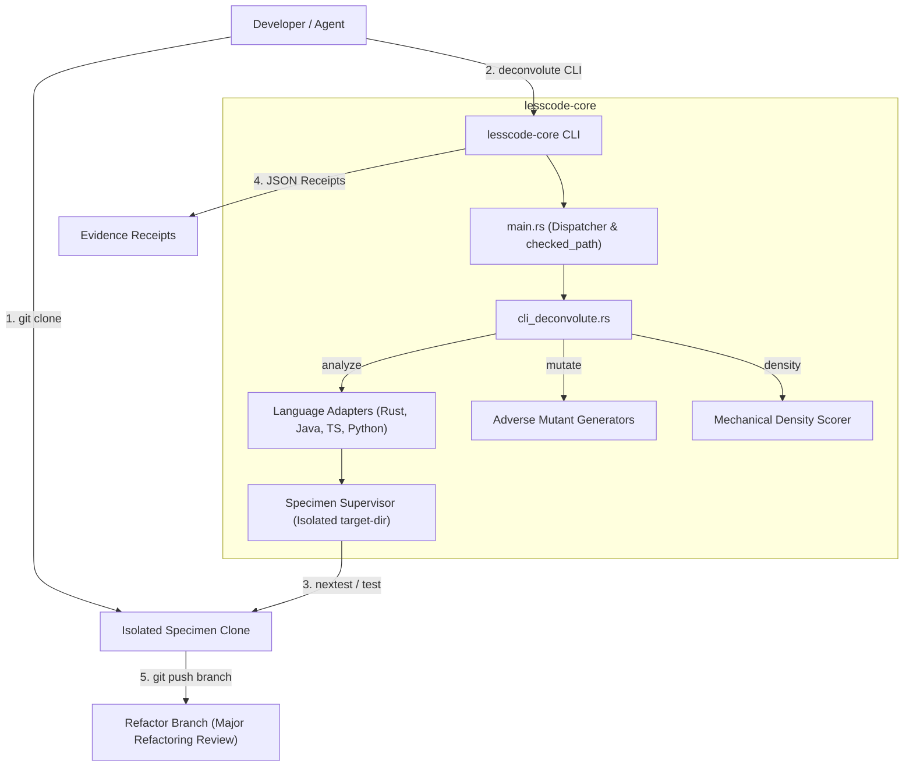
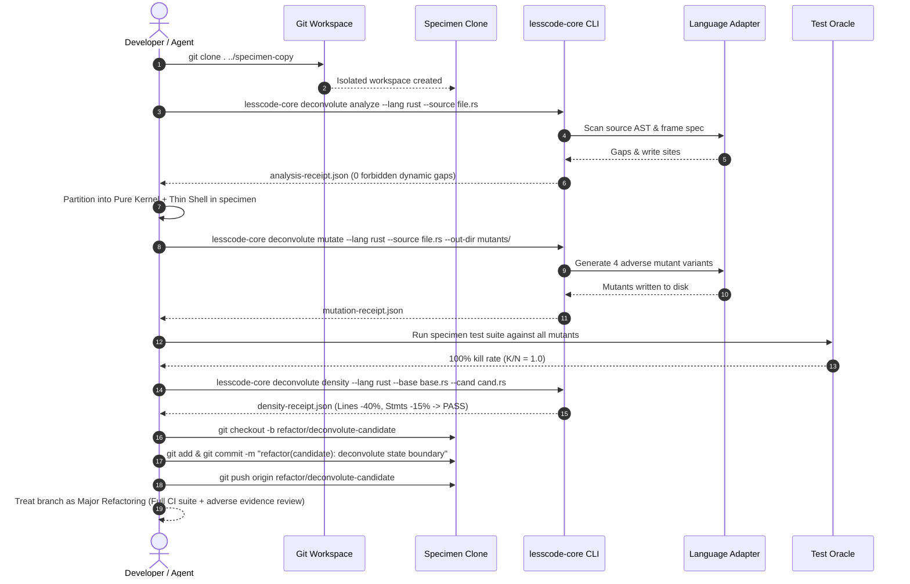

# Design Document: Dogfooding Self-Application and Tooling Corrections

## Overview

**Purpose**: This design formalizes the tooling, CLI, path handling, and workflow corrections discovered during self-application dogfooding on an isolated clone of `lesscode`. It provides unified CLI porcelain for deconvolution, hardens path resolution across workspace clones, guarantees clean-clone test fixture completeness, eliminates build lock contention during specimen runs, and aligns the `deconvolute` agent skill with a clean clone-branch-review lifecycle.

**Users**: Autonomous coding agents, software engineers, and CI pipelines executing deconvolution on real codebases.

**Impact**: Enhances `lesscode-core` with first-class `analyze`, `mutate`, and `density` subcommands, eliminates false-positive path traversal errors on sibling specimen clones, tracks missing test fixtures so all 338 tests pass in clean checkouts, and establishes a standardized branch-based major refactoring workflow.

### Goals
- Provide direct, machine-readable CLI commands in `lesscode-core` for AST effect scanning, adverse mutation generation, and mechanical density gating.
- Enable seamless cross-workspace path handling without spurious `ParentDir` traversal rejections.
- Ensure 100% test reproducibility (338/338 tests pass) on fresh repository checkouts.
- Provide build directory isolation during specimen test runs to prevent `CARGO_TARGET_DIR` lock contention.
- Document and support the developer workflow: run on a clean checkout copy, push a dedicated branch, and evaluate as a major refactoring.

### Non-Goals
- Modifying complexity budget mathematical ceilings ($\le 400$ lines, $\le 300$ units, $\le 80$ lines/fn).
- Weakening adverse mutant kill requirements ($K/N = 1.0$).
- Directly mutating the active development repository during candidate generation.

---

## Boundary Commitments

### This Spec Owns
- CLI porcelain command handlers in `native/src/cli_deconvolute.rs` (`analyze`, `mutate`, `density`).
- Normalized path resolution logic in `native/src/main.rs:checked_path`.
- Isolated target directory configuration in `native/src/adapters/rust/mod.rs`.
- Tracking of missing test fixtures in `docs/experiments/deconvolution/regenerator/results/turns/`.
- Updated workflow and CLI guidance in `.agents/skills/deconvolute/SKILL.md`.

### Out of Boundary
- Internal AST parser implementations (syn, tree-sitter, ast-grep) in existing adapter modules.
- Carrier trait interfaces in `native/src/adapter_traits.rs`.
- Existing verification commands (`prepare`, `compare`, `budgets`, `admission`, `surface`, `regenerate`).

### Allowed Dependencies
- `clap` 4.5 for CLI parsing.
- `serde`, `serde_json` for JSON receipt serialization.
- Existing internal modules: `adapters`, `density`, `measures`.

### Revalidation Triggers
- Any change to CLI argument flags, output schemas, or exit codes.
- Any modification to `checked_path` traversal safety rules.
- Any change to adapter mutation or analysis return types.

---

## Architecture

### Architecture Pattern & Boundary Map



### Technology Stack

| Layer | Choice / Version | Role in Feature | Notes |
|-------|------------------|-----------------|-------|
| CLI Dispatch | `clap` 4.5 (derive) | Command-line argument parsing and subcommands | Modular dispatch via `cli_deconvolute.rs` |
| Serialization | `serde_json` 1.0 | Machine-readable receipt emission | Conforms to `-v1` receipt schemas |
| AST & Metrics | `syn` 2.0 / `ast-grep` | Static analysis and statement counting | Reuses existing adapter implementations |
| Specimen Runner | `std::process::Command` | Subprocess execution with isolated environment | Explicit `CARGO_TARGET_DIR` isolation |

---

## File Structure Plan

### Directory Structure & Responsibilities

```
native/
├── src/
│   ├── main.rs                   # CLI entry point, checked_path normalization, command dispatch
│   ├── cli_deconvolute.rs        # Deconvolution CLI subcommands (analyze, mutate, density, pre-push, install-hook)
│   ├── cli_hook.rs               # NEW: Git pre-push hook logic and hook installer
│   └── adapters/
│       └── rust/
│           └── mod.rs            # Runtime adapter supervisor with isolated target-dir
├── complexity-budgets.json       # Budget registry update for cli_deconvolute.rs & cli_hook.rs
docs/
└── experiments/
    └── deconvolution/
        └── regenerator/
            └── results/
                └── turns/        # TRACKED: 11 missing test fixtures for admission.rs
.agents/
└── skills/
    └── deconvolute/
        └── SKILL.md              # UPDATED: Documents CLI porcelain, pre-push hook, and clone-branch-review flow
```

### Modified Files
1. `native/src/main.rs`:
   - Normalizes parent directory components (`..`) in `checked_path` by popping valid ancestors while preventing traversal escape.
   - Adds `Deconvolute` subcommand variant delegating to `cli_deconvolute::run`.
2. `native/src/cli_deconvolute.rs`:
   - Implements `DeconvoluteCommand` with `Analyze`, `Mutate`, `Density`, `PrePush`, and `InstallHook` subcommands.
   - Encapsulates argument validation, adapter dispatch, and JSON receipt formatting.
3. `native/src/cli_hook.rs` (NEW):
   - Implements `run_pre_push` and `run_install_hook`.
   - Inspects push refs from stdin, detects branch deletions and `LESSCODE_SKIP_HOOK`, verifies complexity budgets, enforces refactor branch state-boundary cleanliness, and writes Git pre-push hook script.
4. `native/src/adapters/rust/mod.rs`:
   - Configures `CARGO_TARGET_DIR` on child processes to prevent lock collisions during specimen testing.
5. `native/complexity-budgets.json`:
   - Registers `cli_deconvolute.rs` and `cli_hook.rs` with standard budget limits ($\le 400$ lines, $\le 300$ units, $\le 80$ lines/fn).
5. `docs/experiments/deconvolution/regenerator/results/turns/**`:
   - Tracks 11 previously uncommitted test fixture files referenced by `native-prototype/s2-bindings.json`.
6. `.agents/skills/deconvolute/SKILL.md`:
   - Documents the new CLI porcelain commands, binary location discovery, and the clean checkout branch workflow.

---

## System Flows

### Developer & Agent Clean-Clone Deconvolution Workflow



---

## Requirements Traceability

| Requirement | Summary | Components | Interfaces | Flows |
|-------------|---------|------------|------------|-------|
| **1: Isolated Specimen Sandbox** | Guard active tree, operate in isolated clone | `main.rs`, `deconvolute/SKILL.md` | Workspace isolation check | Flow steps 1-2 |
| **2: CLI Porcelain Commands** | Direct CLI for analyze, mutate, density | `cli_deconvolute.rs`, `main.rs` | `DeconvoluteCommand::{Analyze, Mutate, Density}` | Flow steps 3, 5, 8 |
| **3: Cross-Workspace Paths** | Normalized path resolution without spurious traversal errors | `main.rs:checked_path` | `checked_path(path: &Path)` | Flow steps 3, 5, 8 |
| **4: Test Fixture Integrity** | Commit missing fixtures so clean clones pass 338/338 tests | `docs/experiments/.../turns/` | Git tracking, `admission.rs` | Flow step 1 |
| **5: Build Concurrency Isolation** | Dedicated specimen `CARGO_TARGET_DIR` | `adapters/rust/mod.rs` | Process environment isolation | Flow step 7 |
| **6: Agent Skill Ergonomics** | Document CLI porcelain & clone-branch-review flow | `deconvolute/SKILL.md` | Skill documentation & JSON receipts | Flow steps 1-10 |
| **7: Pre-Push Hook Size Governance** | Intelligent CLI pre-push hook for refactor branches | `cli_hook.rs`, `cli_deconvolute.rs` | `DeconvoluteCommand::{PrePush, InstallHook}` | Push gate before remote |

---

## Components and Interfaces

### 1. `cli_deconvolute.rs` Interface

```rust
#[derive(clap::Subcommand)]
pub enum DeconvoluteCommand {
    /// Static AST effect scanning and dynamic gap validation.
    Analyze {
        #[arg(long)]
        lang: String,
        #[arg(long)]
        source: PathBuf,
        #[arg(long)]
        frame_spec: Option<PathBuf>,
        #[arg(long)]
        out: Option<PathBuf>,
    },
    /// Generate mandatory adverse mutation variants.
    Mutate {
        #[arg(long)]
        lang: String,
        #[arg(long)]
        source: PathBuf,
        #[arg(long)]
        out_dir: PathBuf,
        #[arg(long)]
        out: Option<PathBuf>,
    },
    /// Evaluate mechanical density reduction thresholds.
    Density {
        #[arg(long)]
        lang: String,
        #[arg(long)]
        baseline: PathBuf,
        #[arg(long)]
        candidate: PathBuf,
        #[arg(long)]
        out: Option<PathBuf>,
    },
}

pub fn run(cmd: DeconvoluteCommand) -> Result<(), String>;
```

### 2. `checked_path` Normalization Logic

```rust
// In main.rs:
fn checked_path(path: &Path) -> Result<PathBuf, String> {
    let absolute = if path.is_absolute() {
        path.to_path_buf()
    } else {
        std::env::current_dir()
            .map_err(|e| e.to_string())?
            .join(path)
    };
    let mut resolved = PathBuf::new();
    for part in absolute.components() {
        match part {
            Component::ParentDir => {
                if !resolved.pop() {
                    return Err(format!("path traversal is not allowed: {}", path.display()));
                }
            }
            Component::Normal(name)
                if name == ".."
                    || name == "."
                    || name.to_str().is_some_and(|s| s.contains('/') || s.contains(char::from(92))) =>
            {
                return Err(format!("nonportable path component: {}", path.display()));
            }
            Component::CurDir => continue,
            Component::Prefix(_) => {
                resolved.push(part.as_os_str());
            }
            _ => resolved.push(part.as_os_str()),
        }
        // Symlink and reparse point checks remain active on canonical ancestor
    }
    Ok(resolved)
}
```

### 3. Specimen Target Directory Isolation

In `adapters/rust/mod.rs`, when spawning `cargo nextest` or `cargo test`:
```rust
let target_dir = specimen_root.join("target").join("isolated-specimen");
cmd.env("CARGO_TARGET_DIR", target_dir);
```
