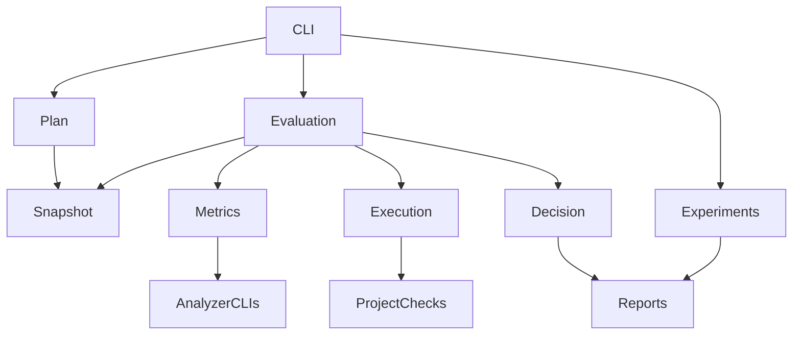
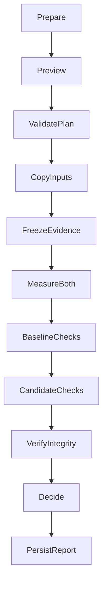

# Technical Design: efficiency-baseline

## Overview
**Purpose:** Give developers reproducible evidence about supplied simplifications of Python projects through a local command-line evaluator. Reports distinguish observed behavior, structural change and execution cost.

**Users:** Developers run baseline/candidate comparisons; researchers import externally produced agent trials. The later Deconvolute skill invokes this CLI as a local tool. MCP is not required for this feature.

### Goals
- Reproduce structural metrics from identifiable inputs and pinned tools.
- Reject observed behavior regressions and invalidate evaluator changes.
- Preserve incomplete and unavailable evidence without turning it into success.
- Supply inspectable reports usable without an LLM account.

### Non-Goals
Generating patches, reverting source, launching LLM trials, implementing the product skill, MCP transport, automatic test inference, complete semantic equivalence and non-Python source evaluation.

## Boundary Commitments
### This Spec Owns
- Evaluation plans, source manifests, evidence normalization, comparison decisions and report schema version 1.
- Local execution of explicitly declared checks against disposable source copies.
- Import and aggregation of trial records supplied by experiment producers.
### Out of Boundary
- Later skills own refactoring policy; later rewrite tools own transactions.
- Project authors supply checks and runtime dependencies; experiment producers supply model telemetry and candidate outputs.
- The evaluator does not provide a sandbox against malicious code or manufacture missing evidence.
### Allowed Dependencies
Python standard library, pinned open-source analyzers, an explicit local interpreter/toolchain and supplied project check commands. No cloud service, MCP or agent SDK imports. Optional evidence is consumed through the same versioned input contract rather than a plugin framework.
### Revalidation Triggers
Changes to scope matching, metric definitions, tool versions, plan fingerprints, decision precedence, check identity, CLI exit codes or report schema require downstream skill/experiment revalidation. Runtime support or external evidence format changes require platform and adapter contract tests.

## Architecture
### Existing Architecture Analysis
Greenfield: only Kiro authoring workflows and discovery/spec documents exist. There is no application to migrate or existing API to preserve.

### Architecture Pattern & Boundary Map
A single Python package with functional modules and small typed boundaries. No service daemon, database, event bus or generic adapter registry.

Import direction: contracts → config/snapshot/process/metrics/decision/report modules → evaluation/experiments → CLI. Peers pass typed values through orchestration rather than importing the orchestrator. Platform process helpers are private to execution. Metrics invokes the shared execution service; decision and report formatting have no tool-execution access.

### Technology Stack
| Layer | Choice / Version | Role | Constraint |
|---|---|---|---|
| Runtime / CLI | CPython 3.12.10, standard-library argparse | Typed local package and commands | Record exact patch; initial support target 3.12 |
| Complexity | Lizard 1.17.31 | Function complexity | Pinned CLI contract; Python only initially |
| Duplication | jscpd 4.0.5 / Node 24.22.1 | Token clone reporting | Pinned tool runtime; no implicit downloads during evaluation |
| Storage | JSON schema version 1 and Markdown | Plans, raw evidence, reports | Strict typed boundary validation; reject unknown major versions |
| Compression | gzip, level 9, mtime 0 | Secondary size metric | Record Python and zlib versions |
| Test execution | Declared project interpreter and argv | Existing and independent checks | No automatic dependency install or shell-string inference |
| Development verification | Standard-library unittest plus analyzer contract fixtures | Package and CLI verification | Three-OS CI matrix |

Analyzer install locks include exact transitive dependencies and integrity hashes. Tool upgrade is an explicit profile change, never an automatic run-time update. Radon, ast-grep and mutation engines are not runtime dependencies of this slice: optional metrics arrive as declared evidence.

## File Structure Plan
### Directory Structure
All product files below are new; this plan does not create implementation scaffolding.

| File | Component / responsibility |
|---|---|
| pyproject.toml | Python package metadata and lesscode-baseline entry point |
| requirements-tools.lock | Exact Python analyzer dependencies and hashes |
| tools/package.json, tools/package-lock.json | Exact duplication tool and transitive dependency installation |
| src/lesscode_baseline/__init__.py | Package version |
| src/lesscode_baseline/__main__.py | Module entry point |
| src/lesscode_baseline/contracts.py | Typed records, enums, JSON validation and serialization |
| src/lesscode_baseline/config.py | Plan preparation and immutable profile checks |
| src/lesscode_baseline/snapshot.py | Scope classification, source identity and disposable copies |
| src/lesscode_baseline/process.py | Bounded command execution and raw log capture |
| src/lesscode_baseline/process_windows.py | Windows process job lifecycle only |
| src/lesscode_baseline/metrics.py | Pinned analyzer normalization, isolated metrics-worker entry and source size measurements |
| src/lesscode_baseline/decision.py | Comparability, delta calculation and acceptance precedence |
| src/lesscode_baseline/report.py | Atomic report persistence and human summaries |
| src/lesscode_baseline/evaluation.py | Pair evaluation lifecycle |
| src/lesscode_baseline/experiments.py | Trial import, pairing and aggregation |
| src/lesscode_baseline/cli.py | Argument handling, command preview and exit mapping |
| tests/test_contracts.py, tests/test_snapshot.py | Boundary validation and scope identity tests |
| tests/test_metrics.py, tests/test_process.py | Analyzer outputs and process timeout tests |
| tests/test_decision.py, tests/test_experiments.py | Acceptance rules and experiment denominators |
| tests/test_cli.py | End-to-end user workflows |
| tests/fixtures/python/ | Paired synthetic and adversarial source examples |
| tests/fixtures/analyzers/ | Versioned raw analyzer success/error outputs |
| benchmarks/corpus.json | Fixture source, revision, license and provenance manifest |
| benchmarks/profiles/python.json | Reproducible pilot profile |
| docs/cli.md | Installation, command review and report interpretation (concrete implemented filename) |
| .github/workflows/baseline-platforms.yml | Windows, Linux and macOS package/contract/CLI checks (concrete implemented filename) |

### Modified Files
- .gitignore (create if absent): ignore local runs and disposable workspaces.
- .kiro/steering/tech.md and structure.md: record selected implementation stack and locations after design approval. Existing source is otherwise untouched.

## System Flows

Preparing a plan does not execute project commands. Executing a plan prints the exact resolved commands and roots before launch. No repeated approval prompt is built into the CLI; invoking run is the user's execution action. Changes to the prepared plan or evaluator files cause validation failure. Source content is copied before analysis; independent checks live outside both copies. Checks execute sequentially for baseline and candidate to avoid resource contention. No automatic retries hide flakiness.

A run records lifecycle states prepared, running and finished. An interrupted running artifact is incomplete when inspected; it is not silently resumed or counted twice. Every rerun gets a new run identifier linked to its prior plan.

## Requirements Traceability
| Requirement | Summary | Components | Interfaces | Flows |
|---|---|---|---|---|
| 1.1 | When a developer requests evaluation of a Python project, the Baseline Evaluator shall provide a command-line workflow for measuring a baseline and a supplied candidate. | CLI and Plan | prepare/evaluate | Plan to run |
| 1.2 | The Baseline Evaluator shall provide its required analysis capabilities using open-source tools without requiring a paid analysis account or proprietary license. | CLI and Plan | prepare/evaluate | Plan to run |
| 1.3 | The Baseline Evaluator shall support evaluation without requiring Codex or another LLM service. | CLI and Plan | prepare/evaluate | Plan to run |
| 1.4 | The Baseline Evaluator shall support the documented evaluation workflow on Windows, Linux and macOS. | CLI and Plan | prepare/evaluate | Plan to run |
| 1.5 | When evaluation runs, the Baseline Evaluator shall keep source analysis and result storage local without requiring source upload. | CLI and Plan | prepare/evaluate | Plan to run |
| 2.1 | When a run starts, the Baseline Evaluator shall record the identity and content fingerprint of each supplied source snapshot, including uncommitted content included in the run. | Snapshot and Decision | capture/compare | Copy inputs |
| 2.2 | When a run starts, the Baseline Evaluator shall record included paths, exclusions and the classification of product source, tests, generated files and vendor files. | Snapshot and Decision | capture/compare | Copy inputs |
| 2.3 | When product-source metrics are calculated, the Baseline Evaluator shall exclude tests, generated files, vendor files and evaluation outputs from product-source totals and report test changes separately. | Snapshot and Decision | capture/compare | Copy inputs |
| 2.4 | If baseline and candidate use different scope rules, metric definitions or analyzer versions, the Baseline Evaluator shall mark affected comparisons as non-comparable and identify the differences. | Snapshot and Decision | capture/compare | Copy inputs |
| 2.5 | When a candidate adds or removes files within the fixed scope rules, the Baseline Evaluator shall include those changes in the comparison. | Snapshot and Decision | capture/compare | Copy inputs |
| 2.6 | If an input cannot be read or identified, the Baseline Evaluator shall report the affected input and prevent a successful evaluation result. | Snapshot and Decision | capture/compare | Copy inputs |
| 3.1 | When supported source is evaluated, the Baseline Evaluator shall report function-level cyclomatic complexity, its distribution and the locations of highest-complexity functions. | Metrics | measure | Measure both |
| 3.2 | When supported source is evaluated, the Baseline Evaluator shall report detected duplicate locations, duplicate token counts and duplication ratio with its denominator. | Metrics | measure | Measure both |
| 3.3 | When source size is measured, the Baseline Evaluator shall report source bytes, line counts with their definitions and compressed source bytes. | Metrics | measure | Measure both |
| 3.4 | When a metric is reported, the Baseline Evaluator shall identify its analyzer, version, definition, unit and measured scope. | Metrics | measure | Measure both |
| 3.5 | When identical content is evaluated with identical structural measurement configuration and tool versions, the Baseline Evaluator shall produce identical structural metric values. | Metrics | measure | Measure both |
| 3.6 | Where nesting or architecture checks are configured, the Baseline Evaluator shall report their findings separately from complexity and duplication. | Metrics | measure | Measure both |
| 3.7 | If a tool is missing, source syntax is unsupported or measurement fails, the Baseline Evaluator shall mark the affected metric unavailable with a reason rather than reporting zero. | Metrics | measure | Measure both |
| 4.1 | When a comparison is evaluated, the Baseline Evaluator shall run the declared baseline and candidate checks and retain their outcomes and diagnostic output. | Execution and Decision | execute/compare | Check both |
| 4.2 | If baseline checks fail or cannot complete, the Baseline Evaluator shall mark the trial ineligible for a behavior-preservation success claim. | Execution and Decision | execute/compare | Check both |
| 4.3 | If a baseline-passing check fails on the candidate, the Baseline Evaluator shall reject the candidate regardless of structural improvements. | Execution and Decision | execute/compare | Check both |
| 4.4 | When independent expected-output, invariant or public-API checks are supplied, the Baseline Evaluator shall evaluate the candidate against them and reject mismatches. | Execution and Decision | execute/compare | Check both |
| 4.5 | If a required behavior check is missing, skipped or cannot complete, the Baseline Evaluator shall report insufficient evidence rather than behavior preservation. | Execution and Decision | execute/compare | Check both |
| 4.6 | Where coverage or mutation evidence is supplied, the Baseline Evaluator shall report comparable before/after values with their scopes and denominators. | Execution and Decision | execute/compare | Check both |
| 4.7 | If coverage or mutation populations differ, the Baseline Evaluator shall disclose the differences and require a recorded explanation before presenting their score change as comparable. | Execution and Decision | execute/compare | Check both |
| 4.8 | When behavior checks pass, the Baseline Evaluator shall describe the result as passing the declared checks and disclose unchecked behavior rather than claim proof of equivalence. | Execution and Decision | execute/compare | Check both |
| 5.1 | When an experiment begins, the Baseline Evaluator shall record the declared checks, required versus optional evidence, thresholds, scope rules and evaluator fingerprints before evaluating candidates. | Plan and Decision | prepare/compare | Freeze and verify |
| 5.2 | When a candidate is evaluated, the Baseline Evaluator shall use the same declared evaluator configuration and independent test inventory as its baseline. | Plan and Decision | prepare/compare | Freeze and verify |
| 5.3 | If evaluator configuration, exclusions or independent tests change during a trial, the Baseline Evaluator shall invalidate the trial and identify the changed evidence. | Plan and Decision | prepare/compare | Freeze and verify |
| 5.4 | When mandatory evidence is complete and all declared acceptance rules pass, the Baseline Evaluator shall identify the candidate as accepted under that recorded evaluation profile. | Plan and Decision | prepare/compare | Freeze and verify |
| 5.5 | If a mandatory check is unavailable, the Baseline Evaluator shall mark the decision incomplete rather than accepted. | Plan and Decision | prepare/compare | Freeze and verify |
| 5.6 | When outcomes are presented, the Baseline Evaluator shall prioritize behavior and invariants, test strength, public API preservation, complexity and duplication, size, then cost without combining them into a compensating universal score. | Plan and Decision | prepare/compare | Freeze and verify |
| 5.7 | When integrity results are reported, the Baseline Evaluator shall disclose whether evaluation protections rely on local change detection or an externally controlled environment. | Plan and Decision | prepare/compare | Freeze and verify |
| 6.1 | When a comparison completes, the Baseline Evaluator shall provide a human-readable summary and a machine-readable report with an identified format version. | Reports and Decision | persist/compare | Decide and persist |
| 6.2 | When comparable numeric metrics exist, the Baseline Evaluator shall report before and after values and the absolute delta calculated as after minus before. | Reports and Decision | persist/compare | Decide and persist |
| 6.3 | When the baseline value is nonzero, the Baseline Evaluator shall report percentage delta as 100 multiplied by the absolute delta divided by the baseline value. | Reports and Decision | persist/compare | Decide and persist |
| 6.4 | If a baseline value is zero or either metric is unavailable, the Baseline Evaluator shall mark the percentage delta unavailable with its reason. | Reports and Decision | persist/compare | Decide and persist |
| 6.5 | When a report is produced, the Baseline Evaluator shall retain raw tool outputs, exit outcomes, commands, source identities, tool versions, configuration, timestamps and environment information sufficient to repeat the declared evaluation. | Reports and Decision | persist/compare | Decide and persist |
| 6.6 | When different analyzers measure a related property, the Baseline Evaluator shall keep their results separately identified. | Reports and Decision | persist/compare | Decide and persist |
| 6.7 | When a run terminates with errors or partial results, the Baseline Evaluator shall expose that outcome to both command-line users and automated callers and retain available diagnostics. | Reports and Decision | persist/compare | Decide and persist |
| 7.1 | When an experiment is recorded, the Baseline Evaluator shall identify its corpus, task, intervention arms, planned repetitions, budgets and declared comparison conditions. | Experiments | aggregate | Import and summarize |
| 7.2 | When trial records are compared, the Baseline Evaluator shall record initial source identity, model and settings, prompt identity, tool permissions, execution order and seeds where supplied. | Experiments | aggregate | Import and summarize |
| 7.3 | If paired trials differ in declared controlled conditions beyond the intended intervention, the Baseline Evaluator shall flag the comparison as confounded and identify those differences. | Experiments | aggregate | Import and summarize |
| 7.4 | When experiment results are summarized, the Baseline Evaluator shall include failed attempts and exhausted budgets alongside successful trials. | Experiments | aggregate | Import and summarize |
| 7.5 | When correctness rate is reported, the Baseline Evaluator shall disclose the eligible-attempt denominator and separately count accepted, rejected, incomplete and baseline-ineligible trials. | Experiments | aggregate | Import and summarize |
| 7.6 | When structural improvement is summarized, the Baseline Evaluator shall distinguish improvements for accepted candidates from outcomes across all attempts. | Experiments | aggregate | Import and summarize |
| 7.7 | When repeated comparable trials are available, the Baseline Evaluator shall report variation across repetitions and identify the method and sample count used for any uncertainty estimate. | Experiments | aggregate | Import and summarize |
| 7.8 | When corpus entries are recorded, the Baseline Evaluator shall retain their source, revision or content identity, license and known generation provenance without inferring AI authorship from style. | Experiments | aggregate | Import and summarize |
| 8.1 | When evaluation executes, the Baseline Evaluator shall record elapsed evaluation time separately from supplied agent execution time. | Execution and Experiments | execute/aggregate | Run and account |
| 8.2 | Where observed token usage or provider cost is supplied, the Baseline Evaluator shall report it with its source and units. | Execution and Experiments | execute/aggregate | Run and account |
| 8.3 | If token usage or cost is not available, the Baseline Evaluator shall label it unavailable rather than infer it from source size. | Execution and Experiments | execute/aggregate | Run and account |
| 8.4 | Where runtime benchmark results are supplied, the Baseline Evaluator shall identify the workload and environment separately from structural and agent-cost results. | Execution and Experiments | execute/aggregate | Run and account |
| 8.5 | When evaluation commands execute, the Baseline Evaluator shall preserve the developer's original source and uncommitted changes. | Execution and Experiments | execute/aggregate | Run and account |
| 8.6 | When an evaluation workload exceeds its configured time budget, the Baseline Evaluator shall stop that workload and report the timeout and incomplete evidence. | Execution and Experiments | execute/aggregate | Run and account |
| 8.7 | When evaluation is requested, the Baseline Evaluator shall expose the project commands to be executed before running them. | Execution and Experiments | execute/aggregate | Run and account |
| 8.8 | When supplied candidate changes fail evaluation, the Baseline Evaluator shall retain the rejection evidence without rewriting or reverting the developer's original source. | Execution and Experiments | execute/aggregate | Run and account |

## Components and Interfaces
All signatures below are contracts, not implementation. Result[T] is a tagged success or Failure record; typed JSON readers reject unknown fields, non-finite numbers, duplicate IDs and invalid paths. Modules use annotations without untyped external dictionaries escaping contracts.py.

| Component | Intent | Requirements | Dependencies | Contracts |
|---|---|---|---|---|
| CLI and Plan | Prepare and expose reproducible commands | 1.1, 1.2, 1.3, 1.4, 1.5, 5.1, 8.7 | Outbound config P0; external interpreter P0 | Service, Batch |
| Snapshot | Fixed scope and original-source preservation | 2.1, 2.2, 2.3, 2.5, 2.6, 8.5, 8.8 | Inbound evaluation P0; external filesystem P0 | Service |
| Metrics | Tool-specific measurements | 3.1, 3.2, 3.3, 3.4, 3.5, 3.6, 3.7 | Outbound execution P0; external analyzers P0 | Service |
| Execution | Run declared checks and retain evidence | 4.1, 4.4, 4.5, 4.6, 4.7, 8.1, 8.6 | External OS P0; supplied check dependencies P0 | Service |
| Decision | Evidence and acceptance semantics | 2.4, 4.2, 4.3, 4.8, 5.2, 5.3, 5.4, 5.5, 5.6, 5.7, 6.2, 6.3, 6.4 | Inbound evaluation P0 | Service |
| Reports | Durable raw and summarized outcomes | 6.1, 6.5, 6.6, 6.7 | External filesystem P0 | Service |
| Experiments | Recorded trials and controlled comparison | 7.1, 7.2, 7.3, 7.4, 7.5, 7.6, 7.7, 7.8, 8.2, 8.3, 8.4 | Outbound reports P0; external producer records P1 | Service, Batch |

### CLI and Plan
Contracts: Service and Batch.
- `config.prepare(config, baseline, candidate, output, *, profile_path=None, tool_paths=None) -> PreparedPlan | Failure` freezes the durable wrapper defined in Data Contracts & Integration. `config` is a profile filename or a validated Profile accompanied by its recorded `profile_path`.
- `evaluation.evaluate(prepared: PreparedPlan, output: Path, ...) -> RunReport` returns a validated durable report; contract and persistence failures propagate to the CLI's documented exit mapping.
- `experiments.aggregate(manifest, trials, *, reports=None, artifact_root=None) -> Aggregation` retains the public `ExperimentReport` and verified run references for rendering. The CLI `summarize` imports explicit trial records and persists this aggregation; it does not infer producer records from run-directory names.

CLI: lesscode-baseline plan --profile FILE --baseline DIR --candidate DIR --out PLAN; lesscode-baseline run --plan PLAN --out RUN_DIR; lesscode-baseline summarize --experiment FILE --runs DIR --out REPORT_DIR.
Plan and output paths cannot be within either source root or the independent evaluator directory. Output directories must be new, not overwrite previous runs. Profile paths resolve relative to profile location; source paths are absolute in the local plan. Report paths use source-relative POSIX paths.

Plan validation requires at least one required behavior check, required complexity/duplication/size measurements, positive finite command timeouts, explicit optional evidence requirements and a declared rule list (which can be empty for structural metrics). It records resolved executable path/version, argv arrays, working directories, tool settings and all fingerprints. Missing tools can be recorded as unavailable and result in an incomplete run; no auto-install occurs.

Fixed version probes use an explicit minimal OS runtime environment. Parent runtime startup settings such as NODE_OPTIONS, NODE_PATH and PYTHONPATH cannot inject undeclared preload code into preparation. Probes do not mutate the caller's environment.

Python tool bindings preserve an absolute lexical interpreter invocation path, including relative tool-metadata paths resolved against that metadata file. Dereferencing a POSIX venv interpreter before invocation loses its environment. Integrity fingerprints separately retain the resolved binary and applicable `pyvenv.cfg` resource identities; retargeted environments remain detectable. Other resource containment and strict path checks still apply. Development and setup use uv/uvx; Windows commands use `uv.exe`/`uvx.exe` directly with an explicit pinned interpreter.

### Snapshot
Contract: Service. capture(root: Path, scope: ScopeRules, destination: Path) -> Result[Snapshot].
Capture includes tracked and untracked selected files, not just a Git commit. Git revision is supplementary metadata. Canonical identity hashes sorted relative paths, byte lengths and SHA-256 contents; mode flags needed by checks are preserved. Before/after copy fingerprints detect concurrent modifications and fail capture.

Explicit workspace exclusions omit .git, tool environments, vendor/generated material and outputs. Preserve supporting configuration/test files needed to run checks but classify them separately from product source. Product Python files use .py extension initially. Scope uses documented case-sensitive POSIX glob semantics consistently on all platforms; class precedence is excluded > generated > vendor > tests > product > support. Case collisions and symlinks/reparse points fail with diagnostics rather than following paths outside the snapshot.

Run each side from a fresh copy. Measurement input is frozen separately from writable check workspaces. The evaluator never resets or edits original source. Ordinary snapshot copying is not a hostile-code sandbox: externally isolated execution is required for untrusted workloads.

### Metrics
Contract: Service. measure(snapshot: Snapshot, tools: ToolSet, limits: Limits) -> tuple[MetricEvidence, ...].
Only the manifest's product paths enter analyzer staging; disable repository auto-config and implicit ignore rules. Validate Python syntax with the selected interpreter before structural measurements; parse errors make affected metrics unavailable. Normalize report paths and sort function/clone records.

Complexity provides function path/start/end/name, CCN, count, min/max, median and nearest-rank p95. Empty valid source has count zero and distribution values null, not fake complexity zero. Duplication normalization preserves the upstream pair-count convention and reports denominator and mode explicitly. Exact command and parser contracts are specified in the analyzer subsection below.

Size measures raw byte count, physical lines (splitlines including a final unterminated line), and gzip size of a sorted, length-delimited sequence of relative UTF-8 paths and original file bytes. Compression explicitly fixes level and timestamp, and records runtime/zlib; byte differences from newline changes are real input changes. Compressed bytes are an information-volume proxy, never a correctness gate by default.

### Analyzer Contracts
Lizard 1.17.31 runs in a bounded Python worker via metrics.py using analyze_file(path), producing one file record even when function_list is empty. Read file nloc and function cyclomatic_complexity, nloc, token_count, name, long_name, start_line and end_line. Validate Python parsing separately; Lizard is not a syntax validator. Record both package license metadata and applicable source notices in the dependency inventory.

jscpd 4.0.5 runs through the exact Node executable and installed package entry path. Arguments select an external config, format python, mode weak, min-lines 5, min-tokens 50, JSON reporter, external output and silent mode. These detection settings are fixed profile inputs, separate from acceptance thresholds. Set max-lines and max-size explicitly above the largest staged input; reject an unsupported bound rather than silently dropping files. Normalize Windows inputs to forward slashes. Require a fresh jscpd-report.json and reconcile scanned source paths with the staged manifest, accounting for zero-token files through an explicit inventory; unresolved omissions make duplication unavailable.

Preparation accepts only the fixed detection options the adapters implement; omitted options use their documented defaults, and unknown or incompatible overrides fail validation. Maximum input bounds are derived losslessly from the selected manifest, recorded with the effective configuration and are not profile override parameters. The example profile must not advertise unused options. Retain actual analyzer invocation records (resolved argv, working directory, status, exit code, timing and environment identity) plus input inventories/effective configuration as indexed raw artifacts. These records are separate from Observation.executions, which represents declared behavior checks for correctness accounting.

Read statistics.total.duplicatedTokens and statistics.total.tokens; calculate their ratio and preserve upstream percentageTokens for diagnostics. Do not sum duplicates[].tokens: this version hardcodes it to zero. Preserve clone locations and aggregate pair-count semantics: jscpd_pair_span_ratio describes the ratio, not unique duplicated-source coverage. Its public MetricEvidence key is duplication, matching the mandatory Profile key; definition_id and producer identify the exact aggregate pair-span convention. Preserve the structured payload rather than projecting it to a scalar. Do not mix inclusive clone line lengths with aggregate duplicatedLines.

Reject source-level analyzer suppression markers (Lizard GENERATED CODE/forgiveness controls, jscpd ignore markers) in the measured scope for this initial profile. Existing markers make affected baseline measurements unavailable; newly introduced markers are reported as candidate evidence suppression and prevent acceptance. Inspect the pinned tool's complete control syntax in adapter tests. This deliberate restriction avoids presenting partially suppressed measurements as whole-scope evidence.

### Execution
Contract: Service. execute(command: CommandSpec, workspace: Path, logs: Path) -> ExecutionResult.
argv is a nonempty string tuple; no shell=True, automatic shell interpolation or inherited project PATH lookup. Use resolved executables. Windows JS tools invoke node plus the pinned package entry file rather than a .cmd wrapper. Environment includes only declared variables and needed OS runtime values; environment identity excludes secret values, reporting whether secrets were supplied.

Use monotonic elapsed time. Redirect stdout/stderr to local files so large logs do not fill memory. Run limits include timeout and maximum captured bytes; log exhaustion terminates the workload and marks it incomplete. POSIX process groups and Windows Job Objects provide child-process termination; Windows starts the child suspended, assigns it to a kill-on-close job, then resumes. Fail before launching if job setup fails. This is lifecycle management, not a security sandbox.

Checks declare kind, required flag, argv, result path and expected IDs. Native test commands must produce normalized check evidence or a supported JUnit XML result. JUnit parsing rejects DTD/entity declarations, duplicate check identities and missing reports; nonzero exit can never override into success. Success requires at least one executed expected check, zero failures and no required skipped/missing IDs. Frozen baseline check IDs must remain present on the candidate. Independent golden/API/invariant checks use the same evidence format and are run from frozen evaluator resources against each side.

Coverage/mutation evidence includes scope fingerprint, population IDs/fingerprint, numerator, denominator and optional population-change explanation. Changed populations remain non-comparable until explanation is recorded; comparable does not mean improved. Optional architecture/nesting and runtime evidence uses the generic metric envelope with its own definition. Generated evidence files are required to be fresh for the current execution and bind to source and plan fingerprints; imported artifacts are labeled producer-supplied rather than independently verified.

### Decision
Metric compatibility is separate from numeric-delta availability. Scalar metrics use the stated delta formula. Structured complexity, population and findings payloads remain intact in observations; no maximum, mean, ratio or percentage is inferred as their scalar projection. A compatible structured measurement can satisfy required measurement availability even when its numeric delta is unavailable. Population identity changes require the recorded explanation before compatibility is established. Explicit scalar companion measurements are compared under their own producer definitions. Percentage-delta thresholds use unit `percent`; absolute and absolute-delta thresholds use the metric's exact unit. A threshold requiring an undefined scalar projection cannot pass silently.

Contract: Service. compare(baseline: Observation, candidate: Observation, profile: FrozenProfile, integrity: IntegrityResult) -> Comparison.
Precedence: integrity mismatch -> invalid; any failed/incomplete declared baseline behavior check -> baseline_ineligible; observed candidate check failure or threshold violation -> rejected; missing required evidence or non-comparable required metric -> incomplete; otherwise accepted. All reasons remain visible even when one determines the primary state. Baseline-ineligible and invalid runs are never claimed as behavior successes.

Baseline eligibility covers every declared behavior check, including checks marked optional: failed, errored, skipped, missing or unfinished baseline checks make the trial ineligible. The required flag does not exempt a baseline behavior check from this rule. Optional metric evidence is distinct and may be unavailable without blocking acceptance unless the profile requires it. This interpretation was confirmed by the user during task planning and implements 4.2 without narrowing it.

A threshold names a metric key and operator (absolute maximum, delta maximum or percentage-delta maximum) with a finite value and unit. No hidden global thresholds. Mandatory behavior/API/invariant mismatches cannot be compensated by other metrics. Optional missing metrics do not block acceptance but remain prominent limitations. Numeric changes use the requirements' formula; zero baseline or unavailable input yields unavailable percentage. Analyzer and definition changes mark affected metrics non-comparable; profile/evaluator changes invalidate the controlled trial.

Integrity compares frozen profile, independent test bytes/inventory and tool/evaluator identities before and after each workload. Original candidate test files are also diffed and disclosed; they cannot replace frozen evaluator checks. Report protection as local_detection or external_isolation_claimed with provider evidence reference; no self-issued proof of adversarial isolation.

### Reports
Contract: Service. persist(report: RunReport, target: Path) -> Result[ArtifactIndex].
Write manifest.json in prepared/running states, raw logs as commands finish, then report.json and summary.md through temporary-file rename. Hash each final artifact and write an index last. Crash recovery reads unfinished manifests as incomplete; rerun uses a new directory. Never serialize Python objects with pickle or execute imported report content.

Exit codes: 0 accepted (or successful plan/report-only action), 1 rejected, 2 input/contract/invalid integrity, 3 incomplete or baseline_ineligible, 4 internal/persistence failure. A summarize result returns 3 if any planned trial is missing/incomplete, otherwise 1 if any valid trial is rejected, otherwise 0; invalid records return 2. Reports retain per-state counts regardless of command exit.

### Experiments
Contracts: Service and Batch. `aggregate(manifest: ExperimentManifest, trials: tuple[TrialRecord, ...], *, reports=None, artifact_root=None) -> Aggregation`. `Aggregation.report` is the unchanged public `ExperimentReport`; `Aggregation.runs` retains typed trial/report/origin entries used for persistence and human evidence. Contract errors propagate rather than being serialized as successful reports.
The manifest lists expected trial IDs, arm, corpus entry, repetition, task/prompt, fixed controls and allowed intervention fields. Trial records reference run artifacts and optional externally observed cost/runtime telemetry. No agent orchestration. Pair by corpus/task/repetition, not arrival order; duplicate IDs fail. Missing scheduled trials become incomplete records. Extra trials are listed separately and excluded from the predeclared denominator.

For an executable corpus entry, content_hash names the canonical scoped Snapshot content identity expected in TrialRecord.starting_source_hash and the evaluation baseline. Raw upstream file hashes remain in corpus provenance; a single file's raw SHA-256 is a different identity and cannot substitute for the snapshot manifest hash. The pilot records its selected source scope and preserves its upstream revision, license and raw-byte provenance separately.

Compare controlled fields including starting source identity, model/settings, prompt, budget and permissions. Declared intervention paths (such as skill instructions or deterministic-tool access) may differ; other differences mark a pairing confounded and exclude it from causal paired summaries without hiding trial outcomes.

Eligible correctness denominator includes planned attempts with verified passing baseline behavior, including rejected and candidate-incomplete attempts; invalid, baseline-ineligible and missing-baseline attempts have separate counts. Numerator is attempts passing all required behavior checks, independently of structural threshold acceptance; report acceptance rate separately. Budget-exhausted candidates count as incomplete unless a complete valid candidate evaluation exists, and retain exhaustion status either way.

Report all-attempt outcomes and accepted-only structural distributions separately. For repeated comparable pairs report n, mean, median, min/max and sample standard deviation (null for n < 2); no inferential confidence interval in version 1. Optional telemetry has value, unit, observed source and timestamp; absent is unavailable. Runtime benchmarks retain workload/environment identity and cannot be inferred from LOC.

Aggregation clarification: structural distributions summarize explicit scalar absolute deltas (candidate minus baseline); paired distributions summarize right-arm deltas minus left-arm deltas. Do not project structured payloads into invented scores. Pool a metric key only when its definition, producer, version and unit match; report incompatible groups as omitted with a limitation. Source identities remain trial-specific and controlled comparisons follow reconciliation. RunReport retains evaluator elapsed time and full metric provenance; TrialRecord retains its run-artifact reference and separately supplied agent telemetry. An internal typed aggregation result may retain verified RunReports alongside ExperimentReport for rendering without changing the public serialized contract or repurposing structural fields for cost/time.

Aggregation must distinguish observed behavioral failure from completion of all required evidence. Passing normalized records cannot override unsuccessful executions. Where a supplied RunReport cannot map an unsuccessful execution to required versus optional checks, conservatively withhold verified correctness/completeness and disclose that limitation; do not infer a mapping from names. An unsuccessful baseline check execution makes the baseline ineligible. Evaluation integration records declared check executions in Observation; analyzer diagnostics remain metric artifacts.

## Data Models
### Domain Model
Plan freezes the proposed experiment and evaluator; Snapshot identifies actual bytes; Observation groups metrics and checks; Comparison captures outcome; TrialRecord connects external generation to evaluation. One plan can have multiple new run IDs but no run is overwritten.

### Logical Data Model
- Profile: schema_version=1, scope rules, tool pins/options, commands/check IDs, required metric keys, threshold rules, limits, evaluator resources.
- Plan: profile, profile_hash, evaluator_hash, source identities, resolved commands, protection declaration.
- MetricEvidence: key, status=available|unavailable|non_comparable, value (number or typed structured payload), unit, definition_id, producer/version, scope_hash, reason, raw_artifact.
- CheckEvidence: check_id, status=passed|failed|skipped|error|missing, kind, required, source_hash, plan_hash, diagnostic artifact.
- Failure: code, message, affected path/check/metric, retryable flag and optional raw artifact.
- RunReport: schema_version=1, run_id, plan_hash, baseline/candidate observations, integrity, primary decision, all reasons, metric deltas, test-file delta, limits, elapsed time and limitations.
- ExperimentManifest: corpus entries (URL or local origin, revision/content hash, SPDX license or recorded license text reference, known/unknown generation provenance), controls, arms, intended interventions and planned trials.
- TrialRecord: trial_id, starting source identity, run reference, model/settings, prompt identity, permissions, budgets, execution order, optional seed, completion state, telemetry.

### Physical Data Model
User-selected local run directory contains plan.json, manifest.json, baseline/ and candidate/ raw artifacts, report.json, summary.md and artifacts.json. Disposable workspaces use separate temporary directories and can be retained by explicit flag for diagnosis; removal is limited to evaluator-owned paths. No database or network storage.

### Data Contracts & Integration
The canonical plan hash used by execution, optional evidence and RunReport is SHA-256 of the UTF-8 bytes from the authoritative `dumps(PreparedPlan)` serializer. Integration computes it from the validated prepared plan and passes it explicitly to storage/check readers; those components do not invent independent plan-hash algorithms. Editing the prepared content changes this identity and still requires runtime integrity verification.

Durable plan files serialize a `PreparedPlan` wrapper: schema_version=1, plan (existing Plan), profile_path and evaluator_root (absolute paths), evaluator_resources (ResourceIdentity records), and tools (ToolBinding records). ResourceIdentity contains logical_path (relative), path (absolute), content_hash and size_bytes; logical identities are unique. Every declared profile resource has a corresponding resolved identity. Additional evaluator-code or lock resources may be recorded under distinct logical namespaces. ToolBinding contains name, requested_version, status (`available` or `unavailable`), executable and entry_point (nullable absolute paths), observed_version, fingerprint, reason and resources (ResourceIdentity records). Available bindings require an executable, matching observed/requested version, fingerprint, resource identity and null reason. Unavailable bindings retain a reason and any observed partial identity; they never authorize execution. Tool names are unique and include the profile's declared analyzers. Preparation returns PreparedPlan; evaluation consumes it. Hash/freshness recomputation and path containment are configuration/runtime responsibilities, not filesystem operations in contract readers. Existing Plan and Profile serialized shapes stay unchanged. This restores durable context required by CLI and Plan rather than introducing an implicit sidecar or overloading tool options.

Optional evidence uses an explicit `OptionalEvidenceArtifact` envelope rather than overloading metric producer/reason fields. It contains schema_version=1, artifact_id, source_hash, plan_hash, produced_at, origin (`generated` or `producer_supplied`), metrics (existing MetricEvidence records), and runtime_benchmarks (existing RuntimeBenchmark records). Metric keys and benchmark IDs are unique; at least one evidence item is required. Producer identity remains unchanged. The envelope is authoritative for source/plan provenance; imported provenance remains a producer claim. Readers compare expected bindings and generated-evidence freshness, preserve the raw artifact, and retain origin for reporting. Runtime benchmarks retain workload/environment hashes. This concretizes the already-required Execution provenance contract without changing existing serialized record shapes.

JSON UTF-8; numeric metric values must be finite; unavailable values are null plus status/reason. Paths cannot traverse out of artifact roots. Major schema versions fail closed; additive fields require a documented minor format revision and compatible reader update. Contracts.py is authoritative for both validation and serialization. Raw vendor JSON never becomes the public result contract.

## Error Handling
Fail field validation before commands. Preserve independent successful metrics when another tool fails. Do not retry commands automatically or reinterpret missing reports as zero tests. If report persistence fails, exit 4 and print the surviving artifact directory; do not claim a durable report. Logs include run/check identifiers and error codes without requiring telemetry services.

## Testing Strategy
### Unit Tests
- Snapshot: added/removed/untracked files, exclusions, class precedence, unreadable inputs, symlink rejection, case collisions and concurrent-copy changes (2.1–2.6, 8.5).
- Metrics: known functions/duplicates, valid empty input, unsupported syntax, malformed vendor output, identical repeated measurements and compressed-size metadata (3.1–3.7).
- Decision: every precedence branch, zero-denominator delta, incompatible versions, missing mandatory evidence and observed regression overriding smaller code (2.4, 4.2–4.8, 5.1–5.7, 6.2–6.4).
- Experiments: missing/failed/budget-exhausted trials, duplicate IDs, confounding, accepted-only selection, separate correctness/acceptance denominators and unavailable cost (7.1–7.8, 8.2–8.4).

### Integration Tests
Platform-specific runtime tests run on their native CI operating system. Windows development does not require WSL or Linux command execution. Local platform skips are disclosed; Linux and macOS evidence remains required in task 7.3 before cross-platform readiness claims.

- Pinned analyzers on a Python fixture: assert function locations and documented duplicate token convention; compare normalized reports across repeated runs (3.1–3.5).
- Native test and independent oracle execution: detect a deleted/skipped check and behavior-breaking shortened candidate; retain command output (4.1–4.5, 6.5).
- Timeout a workload that spawns a child; assert both terminate on each OS and diagnostics survive (8.1, 8.6).
- Modify a frozen evaluator file during a run; verify invalid status and changed resource identity (5.2, 5.3).
- Truncated/foreign-version imported evidence and interrupted artifact writes cannot produce accepted results (5.5, 6.1, 6.7).

### E2E Paths
- Prepare then run an unchanged Python pair with native checks; verify accepted result, identical structural metrics, explicit commands, local artifacts and unchanged originals (1.1–1.5, 3.5, 6.1, 8.5, 8.7).
- Compare a shorter behavior-breaking pair; verify rejection, independent diagnostics and original-source preservation (4.3, 4.4, 8.8).
- Remove a required analyzer and run a baseline with failing tests; verify explicit unavailable/ineligible outcomes rather than acceptance (3.7, 4.2, 5.5).
- Import a multi-arm pilot with a confounded pair and exhausted budget; verify all-attempt counts and paired distributions (7.1–7.8).

Include at least one pinned permissively licensed real Python project fixture with provenance and independent expected checks; choose its revision during corpus implementation and retain license. CI tests the same fixtures on Windows, Linux and macOS. Product readiness requires real analyzer smoke execution and CLI startup, not mocked tests alone.

## Security Considerations
Local tool execution is trusted-code execution. Disposable copies preserve originals against normal test writes but cannot contain malicious absolute-path writes, network access or privilege abuse. Use externally isolated CI for untrusted corpora and report that boundary honestly. Do not inject source paths into shell strings; validate resolved paths, resource inventory and report references. No source upload is implemented.

## Performance & Scalability
No unsupported latency SLA. Record elapsed time by stage, enforce declared time/log budgets, stream logs and source hashing, and process one pair at a time initially. Avoid a cache until repeat-run evidence justifies its invalidation complexity. Structural determinism applies only to matching source/tool/config identities; time/cost and flaky checks are not expected to repeat exactly.

## Migration Strategy
No existing data migration. First implement typed contracts and fixtures, then snapshot/execution/tool adapters, then decision/reports, then experiment aggregation and three-platform integration. Format version 1 is the initial contract for later skills. Dependency installation and smoke tests are explicit implementation gates; this design is not a runtime validation claim.
