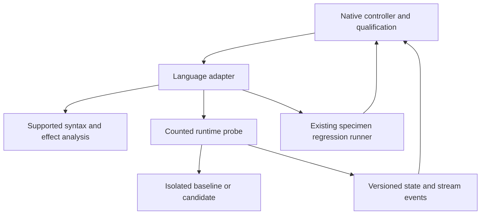

# Technical Design: Java Deconvolution Adapter

Status: **provisional design, 2026-11-09; prototype not-run; production not approved**.
The owner requested design generation from the revised requirements. This permits
design work, not evidence substitution or production task generation.
See [research](research.md), [gate](prototype-gate.md) and [review](design-review.md).

## Overview, goals and non-goals

Qualify profile `java-junit-v1`: source-bound state/effect analysis, runtime finite-domain
comparison, targeted controls and whole-responsibility compression for a supported
Java subset. Preserve actual language behavior and existing public contracts.
No universal proof, new interpreter, generic framework, transparent arbitrary
runtime instrumentation or inherited language-parity claim.

## Boundary Commitments

### This spec owns
- Java implementations of the four adapter interfaces and its profile manifest.
- Runtime bindings, effect/codec rules, targeted mutations and profile-specific tests.
- Supported metric definitions, specimen admission and complete adapter accounting.

### Out of Boundary
- Core qualification/comparator policy, model API clients and other language adapters.
- Upstream specimen edits/adoption, altered frozen checks or golden normalization.
- Common schema changes without producer/consumer review.

### Allowed Dependencies
Propose enabling tree-sitter-java on the existing ast-grep-language dependency for syntax metrics only. This adds a lockfile dependency and needs a separate version/license/MSVC/platform decision. Resolve symbols via the selected JDK's public compiler Trees API in the counted adapter; missing classpath or unresolved elements means unverified.
Runtime: One specimen-declared JDK release, one Maven or Gradle wrapper and exact JUnit Platform/engine versions. Freeze classpath/module path, locale, charset, timezone and build options from the chosen specimen; no latest-version substitution.
Use exact locked existing versions; do not upgrade dependencies during a paired
trial. Prototype alternatives require recorded version/license/platform decisions
before execution. No manifest or dependency is changed by this design.

### Revalidation Triggers
Changed source closure, checks, parser, runtime, module/features/classpath, formatter,
effect model, hooks, codec, wire schema or comparator profile invalidates affected
evidence. Revalidate common fixtures and this profile; notify sibling consumers
when shared contracts change.

## Architecture and shared contracts

The normative producer-owned [adapter contract v1](../native-deconvolution-closure/adapter-contract.md)
defines all request/result fields, tagged values, limits, ordering and outcomes.
This adapter implements StateFrameAnalyzer, PureCoreVerifier,
AdverseMutantGenerator and SpecimenTraceRunner; it does not copy their policy.
Native closure owns shared registration and protocol version changes.
Adapters are sibling consumers; Java and Rust do not depend on each other.

Dependency direction: common records -> language analysis/runtime bindings ->
controller integration. Runtime observation and regression execution are distinct.
No shared controller call imports specimen code directly.

## File Structure Plan

Provisional ownership paths; budgets and necessity are validated by the prototype.

| Path | Responsibility |
|---|---|
| `native/src/adapters/java/mod.rs` | Four trait implementations and profile dispatch; no duplicated policy |
| `native/src/adapters/java/analysis.rs` | Supported AST effects, binding identities and source-anchored coverage gaps |
| `native/src/adapters/java/mutation.rs` | Source-bound supported mutation operators |
| `native/src/adapters/java/metrics.rs` | Versioned scope metrics and canonical-format integration |
| `native/adapters/java/src/lesscode/ProbeMain.java` | Counted JVM probe entrypoint and reserved protocol output |
| `native/adapters/java/src/lesscode/Observe.java` | Explicit state/sink wrappers, tagged values and completion events |
| `native/adapters/java/src/lesscode/ScopeAdapter.java` | Specimen binding, factories, reset/cleanup and supported invocation |
| `native/adapters/java/src/lesscode/Resolve.java` | Public compiler API symbol/type extraction under frozen classpath |
| `native/tests/java_adapter.rs` | Independent expected results and runtime/profile integration |
| `native/tests/fixtures/java_adapter/` | Adverse, codec, metric and unsupported-form fixtures |
| `native/src/lib.rs`, `native/src/adapters/mod.rs` | Core-owned narrow registration reviewed jointly |
| `native/complexity-budgets.json` | Explicit measured allocations before production tasks |
| `native/Cargo.toml`, `native/Cargo.lock` | Only separately accepted dependency changes, if needed |

Common adapter_traits.rs, specimen_runner.rs, state_contract.rs and comparator
remain owned by native closure. The runtime probe code above is maintained
apparatus, not excluded fixture code. Source-generating templates count too.
Avoid inventing a new packaging framework; use isolated recorded build commands.

## Components and Interfaces

### StateFrameAnalyzer and EffectProfile

Admit resolved non-reflective calls over a closed object graph with explicit
snapshot accessors and deterministic methods. Inspect public, inherited, private,
protected and static writes; visibility is not a purity criterion. final references,
records and annotations do not prove deep immutability. Resolve overloaded targets
and distinguish local assignments from writes through aliased object roots.
Virtual calls require a frozen closed receiver set; otherwise return unverified.

Reflection, dynamic class loading, JNI/native methods, unsynchronized concurrency
and unobserved persistence are outside v1 unless a separate profile proves their
hooks and effects. Do not use JVM agents or bytecode rewriting in v1. Generated
source/annotation processors must be inventoried and frozen; unresolved generated
behavior blocks admission.

Encode signed integers by width and decimal value, float/double by raw bits, char
and String as UTF-16 units, boxed values with null/type tags, and records/objects
by explicit ordered fields. Preserve declared alias relationships independently of
process addresses. Freeze value-equality versus identity contracts; Java equals
may execute code and is not an implicit trusted comparator. Distinguish normal
return, thrown exception class/message and harness failure; freeze overflow rules.

AnalysisResult contains resolved state-root writes and CoverageGap records.
A clean AST scan never upgrades unsupported semantics to verified. FrameSpec is
frozen independently of the candidate. Runtime state checks validate only the
declared finite executions, not every possible heap state.

### PureCoreVerifier and value codec

Use ComparisonRequest/DomainSpec exactly as specified by the shared contract.
Compile/load baseline and candidate in separate fresh runtime instances with the
same setup and environment. Enumerate every admitted Cartesian input combination
subject to frozen constraints; hash case IDs and require matching completion count.
Do not silently drop inputs that fail conversion or replace unsupported values.
Compare return/error and relevant post-state/stream events, then reset state.

Preserve four outcomes: verified, divergent, unverified, execution-failed.
A minimal witness is claimed only for the named completed shrink strategy;
otherwise report a reduced or original witness. Stop after first divergence if
desired, but retain that untested cases were not established equivalent.

### SpecimenTraceRunner and hooks

Build the specimen through its existing wrapper, then launch a dedicated
ProbeMain with the frozen runtime classpath. Store the original protocol output
stream before setting captured System.out/System.err; undeclared native fd output
or reset of those streams prevents qualification. Observe flush events at supported
Writer/OutputStream seams, plus explicit pre/post state and error cleanup.
Snapshot access uses declared accessors/test bindings, not broad reflective access.
All bindings and wrappers are counted. A required inaccessible boundary blocks
this profile rather than causing production behavior changes.

Execute JUnit through the specimen build separately for regression evidence.
JUnit listeners identify tests and lifecycle results, not arbitrary field/JDBC
events. JDBC is supported only if an existing driver/listener seam can be frozen
and independently challenged; otherwise it is an explicit coverage gap.

RunRequest limits and process lifecycle are delegated to the common supervisor.
All new process launches use argv vectors, bounded capture and owned cleanup.
Source/check/adapter/runtime/config hashes are checked before and after execution.
A missing hook, unfinished task, changed evaluator or incomplete trace blocks
qualification. No wall-clock/performance success target is introduced.

### AdverseMutantGenerator

Mandatory operator families for the admitted scope: aliased field write including mutable final referent; omitted catch cleanup; inverted error precedence; dropped Writer flush.
Freeze valid applicability, independent expected witnesses and test/case identities
before candidate evaluation. Preserve compilation/type correctness for mandatory
controls during calibration. Invalid generated mutants remain recorded and cannot
satisfy the calibrated mandatory set. An inapplicable family must be declared at
scope admission; do not exclude it retrospectively to improve the score.
Use the shared seven mutant statuses and the complete denominator.

### Metrics and compression

Define java-statements-v1 on a frozen Java grammar before measuring: count declarations and executable statements with explicit nested-body and multi-declarator rules. Keep expression/decision and physical/canonical line counts separate. Freeze a specimen-installed formatter; do not use raw layout or Python statement rules. Baseline/candidate use the same definition and packing controls. Java profile metrics do not silently change the legacy Language enum or comparator schema.

Require at least 20% canonical lines and 10% versioned statements removed plus
the gate's absolute target, counting all replacement helpers/configuration/callers.
Report unsupported metrics as unavailable. Preserve separate behavior,
consolidation and compression outcomes. Common legacy receipts are regression
fixtures; profile metrics use explicit identities rather than reinterpret old data.

### Proposed java-statements-v1 counting rule

Count one unit per variable declarator with an initializer or local declaration,
expression statement, return, throw, break, continue and yield. Count each
if/switch/loop/try/catch/synchronized construct once, then recurse into its bodies.
Blocks, class/method signatures, comments and finally labels add no units;
field initializers count per declarator. Recurse into lambda bodies. Count a
control construct once rather than again as an enclosing generic statement.
Freeze grammar fixtures for these rules before any baseline measurement; this
definition is not comparable to Python or Rust counts.

Use an existing specimen JSON library where present for the tagged wire envelope.
If none is suitable, record a dependency decision before implementing the probe;
do not hand-build a general JSON parser. Compiler API and codec dependencies are
part of the counted runtime integration and pinned classpath.

## System Flows and failure handling

1. Admit specimen/profile/dependencies; freeze scope, effect/domain/control manifests.
2. Validate baseline build/tests and record repeatability before candidate generation.
3. Analyze candidate; return unverified on unsupported semantic coverage.
4. Execute finite-domain probes and ordered trace comparison in fresh instances.
5. Run calibrated adverse controls and selected complete regression tests.
6. Reconcile identities, domain/test completeness, outcomes, metrics and apparatus.
7. Emit candidate validity/compression receipt; adoption is a later explicit action.

Do not execute candidate code during static discovery. Timeout/crash/malformed
protocol follows common cleanup and execution-failed behavior. Divergent evidence
retains its causal step; unsupported coverage remains unverified even when tests
pass. Failed cleanup is retained and prevents a successful run disposition.

## Contradictions and disposition

| ID | Competing claims / source | Resolution and authority | Evidence / affected criteria and consumers | Status |
|---|---|---|---|---|
| A1 | Full parity in historical brief vs bounded revised requirements | Current requirements and owner revision 2026-11-09 govern; qualify named profile only | 1.1, 1.3, 2.3, 2.4; profile fixtures required | Resolved contract; fidelity unproven |
| A2 | Syntax/passing tests treated as semantic proof vs unresolved calls/effects | Separate analysis gaps, runtime traces and regression reports | 1.2, 1.4, 2.1, 4.1, 4.2; independent adverse cases | Resolved contract; hook coverage open |
| A3 | Runner output interpreted as complete trace | Dedicated probe plus explicit hooks; reporter data only for regression | 3.1, 3.2, 3.3, 4.3, 4.4; source-bound failure controls | Resolved design; runtime spike required |
| A4 | Per-file caps imply apparatus budget fit | R41 whole total plus file caps; no per-adapter reset | 5.1, 5.2, 5.3; native core and all siblings | Allocation open; blocks production |
| A5 | Sequential language roadmap or scope authorization implies delivery | Owner Java admission and design request authorize design; sibling gates remain independent | 5.4, 5.5; common schema conformance | Resolved planning |

Additional language-specific competing claims are resolved by the supported
semantics and metric sections above. Sources: [requirements](requirements.md),
[amendment](review-amendment.md), shared contract, actual source/manifest evidence
in [research](research.md), and R41. Any newly discovered contract conflict must
be resolved before approval; empirical open items stay gate blockers.

## Requirements Traceability

| Criteria | Components / validation |
|---|---|
| 1.1, 1.2, 1.3, 1.4 | StateFrameAnalyzer, EffectProfile, frozen frame and alias/callee controls |
| 2.1, 2.2, 2.3, 2.4 | PureCoreVerifier, tagged codec, complete DomainSpec, witnesses and incomplete-run controls |
| 3.1, 3.2, 3.3 | AdverseMutantGenerator, calibrated inventory and seven dispositions |
| 4.1, 4.2, 4.3, 4.4 | SpecimenTraceRunner, runtime hooks, supervisor, isolation/identity fixtures |
| 5.1, 5.2, 5.3, 5.4, 5.5 | Metrics, full accounting, prototype gate, common regression/CI and revalidation |

## Testing Strategy and Migration

Unit/contract fixtures cover supported and rejected syntax, state-root aliases,
special numeric/text values, exception identity, codec round-trip and statement
packing. Runtime controls cover missed state cleanup, wrong write/flush order,
unobserved mutation, false completion, output limits, changed check hashes and
killed descendants. Each has an expected independent outcome, not just reference
agreement. Include failure-path and zero-input/empty-domain controls.

Run language regression suites through the pinned specimen runner; native tests
use nextest 0.9.143 and Rust 1.98.1, Python reference suites use pytest-xdist.
Keep serial probe attribution separate from parallel regression execution.
Use [testing](../../../docs/testing.md) and existing
[Dagger/native CI](../../../docs/ci-validation.md), including platform-specific
runtime-hook smoke checks. No separate CI framework.

Initially register the profile only for explicitly selected runs; retain existing
Python and legacy compare behavior. No automatic adoption or source replacement.
A failed profile rolls back to its prior version/unsupported disposition without
changing goldens. Production migration follows prototype proceed and design review.

## Unresolved empirical prerequisites

No real Java specimen has yet been admitted. Select a licensed, locally buildable responsibility with mutable state, exception cleanup and an injectable output sink. Require baseline tests and a concrete deletion hypothesis before freezing a source revision; a synthetic example alone cannot qualify.

Required before any prototype run: exact specimen/revision/license, dependency
locks and runtime paths, hook reachability, metric rule fixtures, independent
controls and accounting population. Required before production approval: real-code
proceed, whole-budget fit, compatibility evidence and inline design re-review.
The design supplies a bounded plan; it does not assert these prerequisites passed.
