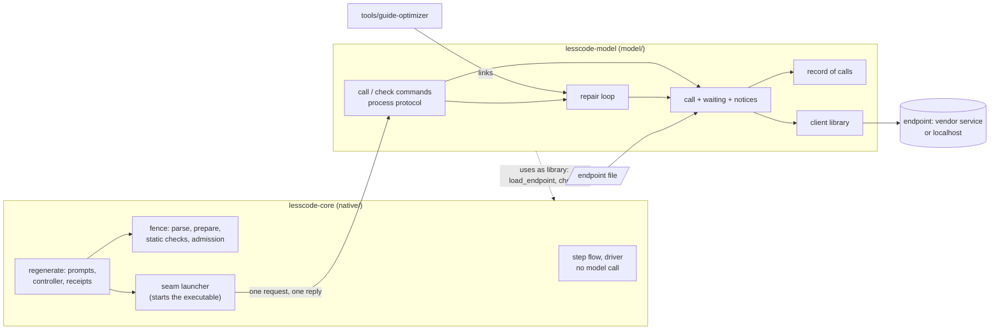
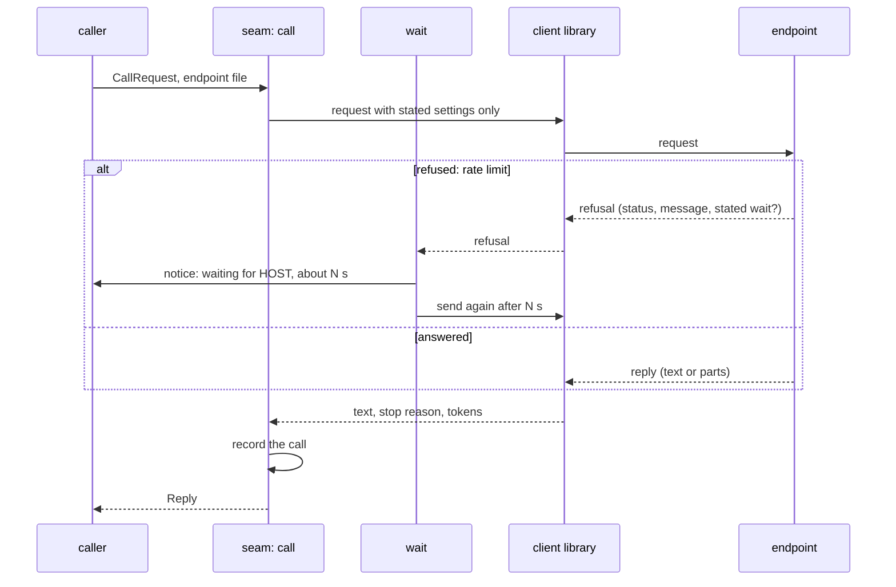

# Design: the model seam

Generated 2026-11-12 (Europe/Berlin) from the approved [requirements](requirements.md).
Revised 2026-11-12 after the [prototype gate](prototype-gate.md) was assessed as `proceed` (R105, R106, R107).
Approved by the owner on 2026-11-12, 20:16. Discovery log: [research.md](research.md).

**Amendment 1, 2026-11-13 (owner decision, requirements Amendment 2).** The component Measure is added:
an indicator of a configured model against a task set, with a verdict on whether the model is good enough
direct, good enough with the repair loop, or not good enough as is. Nothing else in the design changes.

**Amendment 2, 2026-11-13 (as built, tasks 1.1 and 1.2).** Three deviations from the text below, none of
them a change of what a requirement asks:

- Requirement 2.6: no response format is sent to the endpoint. Whether an endpoint accepts one cannot be
  known without a rule per endpoint, and an unknown setting was the commonest refusal in R102. The reply's
  text, with or without a code fence, is checked here against the part of JSON Schema a request uses
  (`type`, `required`, `properties`, `items`). New file `model/src/structure.rs`, component Call.
  `Sent` therefore has no `structure_requested` field.
- `CallError` has a fifth kind of failure, `Unreadable`: the endpoint answered and the reply could not be
  read. `Refused` carries the wait an endpoint stated in a header as the endpoint wrote it.
- `client.rs` offers one attempt, `send`. The call with waiting, notices and the record is built on it in
  `wait.rs` (group 2).

**Amendment 3, 2026-11-13 (as built, task 2.1).** Five points where `wait.rs` says more than the text
below, none of them a change of what a requirement asks:

- `call` lives in `wait.rs`, not `client.rs`. `call_with` is the same call with its time given
  (`Time`: `now` and `sleep`); `call` passes the machine's (`Clock`). Tests give a time that does not
  sleep.
- No wait is shorter than one second. An endpoint that states a wait of nothing would otherwise be asked
  again without a pause, and twice nothing never reaches the limit. The prototype of R106 had this gap.
- The limit counts the time since the call began, refused attempts and pauses together, as the task says.
  A wait that would pass the limit is not made: the call ends before it.
- A record line that cannot be written fails the call with `CallError::Config` naming the path, so the
  postcondition "exactly one record line" is not broken silently.
- `Limits` holds `wait` only; `answer_seconds` comes with task 2.2.

**Amendment 4, 2026-11-14 (as built, task 2.2).** Five points, none of them a change of what a
requirement asks:

- `client.rs` offers a request on its way, `begin` and `Attempt`, whose answer is awaited in steps
  (`answer_within`); `send` is one attempt awaited to its end. The seam ends a slow request itself by
  dropping it at the limit; the library's web timeout is not set, so there is one mechanism and one
  message.
- `Time` has a third part, `answer_within`, which by default waits on the machine's time. A test gives
  one that moves only its own clock.
- The answer limit counts for one request, from the moment it is sent. `NoAnswerInTime` states the limit.
  A refused attempt that is waited out starts a new count.
- The earlier calls whose median counts are the answered requests of this process, each with the time
  from sending to answer, without the waits. A request that failed is not among them.
- The notice comes when a request has run for the expected time and every 30 seconds after that. Its
  tests need a process each (nextest), because the expected time depends on the process's answers.

**Amendment 5, 2026-11-14 (as built, task 3).** Five points where `repair.rs` says more than the text
below, or differs from it:

- `Outcome::Rejected` holds `last: Reply`, not `Option<Reply>`. The loop makes at least one call, and a
  call that returns nothing is a `CallError` and ends in `Failed`; a rejection without a reply cannot
  occur, so no caller has to handle one.
- Every reply is handed to the check, a cut-off one too; the check alone decides. "No reply arrived"
  means a reply whose text is empty. A rejected reply that is empty or did not stop as complete (cut off,
  refused by the model, any other stop) is followed by the request as the caller stated it, not by the
  repair request that may have preceded it. This is what the research tool did in R99.
- A request sent again as it was counts as one of the repairs allowed, so `repairs` bounds the calls:
  at most `repairs + 1`.
- A call that fails ends the loop at once as `Failed`, with the attempts made before it. The loop does
  not retry a failed call; waiting out a refusal is the call's own work.
- `repair_request` is public. It changes the request text only: the request, the rejected reply, the
  reasons as a list. The words are those measured in R99, with "pack" replaced by "answer". The type
  `repair::Attempt` is not re-exported at the crate root, where `Attempt` is the request on its way.

**Amendment 6, 2026-11-14 (as built, task 4.1).** Five points where `protocol.rs` and `main.rs` say more
than the text below, or differ from it:

- `--endpoint-env` may be left out; the default endpoint file is then read, as the launcher's
  `endpoint_file: Option<&Path>` needs.
- A request that states no protocol number is refused like one that states another number.
- A request that cannot be read is answered on standard output too, with
  `{"ok": false, "error": {"kind": "request", …}}`, so a caller always reads one JSON object once the
  command line was usable. A command line that cannot be used writes nothing to standard output.
- The kinds of a failed call are `configuration`, `unreachable`, `refused`, `unreadable`,
  `no_answer_in_time` and `wait_limit`. `configuration` (the endpoint file, a record that cannot be
  written) ends with exit code 2, as the table under Error Handling says; the others with 3.
- The arguments are read by a function of `main.rs`; `clap`, which the design allows, is not a
  dependency.

**Amendment 7, 2026-11-14 (as built, task 4.2).** Six points where `check.rs` says more than the text
below, or differs from it:

- The request is the one the core's `build_prompt` writes for the module of R102, with the target of
  R102 (`written_stmts_max` 6) and an empty surface, and 8,000 output tokens.
- One code fence around the whole reply is removed before `parse_result` (the seam's `unfenced`), so a
  fenced answer is not a reason to reject.
- Between `prepare_candidate` and `evaluate_tier1_static` the reply's files are written to the copy with
  the core's `write_candidate`; a path outside the scope is a rejection with the core's message. Every
  reply gets a copy of its own in the temporary directory, which is removed at the end.
- The report is text on standard output: one line with model, host, calls answered, seconds, tokens and
  waits, then the finding; for a rejection one line per call with the check that rejected it.
- "The model that answered" is the model named in the request (`Sent::model`). `Reply` does not hold the
  name an endpoint returns; if an endpoint answers with another model, the check does not show it.
- `--endpoint-env` may be left out, as for `call`. An unusable endpoint file ends with exit code 2 and
  is also stated on standard output.

**Amendment 8, 2026-11-14 (as built, task 4.3).** Nine points where `measure.rs`, `taskset.rs` and the
`measure` command say more than the text below, or differ from it:

- A task set on disk is a directory with one directory per task. A task's directory is the tree to be
  rewritten, with `task.json` (definitions, scope files, targets; optional contract, language and output
  tokens) and `public-surface.json` beside it. Tasks are taken in the order of their directories' names.
  A supplied set is only read; replies are judged on copies in a temporary directory.
- `Task` and `TaskSet` are as designed. What the core's checks need for a task is held by `CoreCheck`,
  which `taskset::load` and `taskset::built_in` return beside the set; `CoreCheck::judge` is the check
  handed to `measure`. A caller with another check hands in its own function.
- The built-in set lives in `model/tasks/` and is embedded in the binary: `1-total-price` (R102),
  `2-shipping-fee` (a private name and a constant in the surface), `3-discount` (four statements
  allowed), `4-orders` (two writes allowed, the session not allowed in a pure function). The tests hold an
  answer to each that passes and careless answers that the intended check rejects.
- The check command's task is the first of the built-in set, so `check.rs` holds no task of its own. Its
  file is `src/prices.py`; Amendment 7's first point otherwise stands.
- Once more than a fifth of the trials have failed for a reason of the endpoint, the trials left are not
  started and count as not run: no verdict is possible any more, and each could wait out its limit.
- `calls`, `output_tokens` and `seconds` count every answered call of the run, the rejected ones too, so
  the cost per accepted answer includes the answers that were not accepted.
- Quick mode: "good enough so far" needs every trial to have passed, so a trial that did not run gives
  "undecided" at best; "not good enough" is at most two fifths of the trials that ran. `--quick` together
  with `--trials` is refused.
- `--endpoint-env` may be left out. An endpoint file, task set or `--out` file that cannot be used ends
  with exit code 2. `--out` is the one file the command writes outside the temporary directory.
- The command has no `--max-wait`; the default limits apply. It prints nothing between trials.

## Overview

The model seam is a second binary, `lesscode-model`, with its library. It is the only place in the
repository that talks to a model service. It is built on an existing client library, adds what that
library does not do (waiting with an estimate, the check command, the repair loop, the record of calls),
and is reached by the core through a process boundary: one request in, one reply out. The core keeps its
commands, its receipts and the fence, and loses its HTTP code.

### Goals

- One endpoint file works for a vendor's service, another vendor's and a local one, with the same call.
- A wait is announced with an estimate; a failure states its reason on the terminal.
- An adopter can check a configured endpoint in one command.
- The core and the driver link no client library and make no model call themselves.

### Non-Goals

- No change to what admission, the control cases or the step flow decide.
- No streaming to the user, no tool calls by the model, no prices, no ranking of models.
- No decision about what a model is asked to do with a codebase.
- No plugin system for client libraries: one library, replaceable only by changing the seam.

## Boundary Commitments

### This Spec Owns

- The crate `model/` (`lesscode-model`): the call, waiting, notices, the record, the repair loop, the check
  command, the process protocol.
- The way the core's `regenerate` command and the research tool reach a model.
- The content of new receipts where it concerns what was sent to a model.
- Building and releasing the second binary.

### Out of Boundary

- `native/src/step/` and `native/src/adapters/driver/`: untouched.
- The checks themselves: `parse_result`, `prepare_candidate`, `evaluate_tier1_static`, admission, controls.
  The seam calls them or is handed them; it does not change them.
- Prompts: `build_prompt` and the guides stay where they are.
- The onboarding skill and the later spec on proposing simplifications.

### Allowed Dependencies

- `model/` may depend on: the chosen client library, an async runtime used only inside the crate,
  `serde`/`serde_json`, `clap`, and `lesscode-core` as a library for `load_endpoint`, `Endpoint` and the
  checks the check command runs.
- `native/` (the core) may depend on nothing new. It may start the executable `lesscode-model`. It must not
  link `model/` or any client library. After migration it no longer depends on `ureq`.
- `tools/guide-optimizer` may link `model/`.
- Direction: `model/` to `native/`, never the reverse, except by starting the executable.

### Revalidation Triggers

- A new major version of the client library, or a change of library: rerun the first cases (2.7) and the
  wait cases (3.x).
- A change to the process protocol: rerun the core's `regenerate` tests and the receipts' verification.
- A change to `Endpoint` or the endpoint file's keys: rerun requirement 1 and the check command.
- A change to what a receipt states about a call: rerun the replay test and admission of stored receipts.

## Architecture

### Existing Architecture Analysis

`native/src/regenerator.rs` holds endpoint loading, a hand-written request on `ureq`, response parsing,
receipts and the Refine/BestOfN controller. The controller already receives the model call as a function
(`ModelCall`), with `default_call_fn` as the live one. `tools/guide-optimizer/src/model.rs` has a second
client. The step flow and the driver have no network code. Details and sources: research.md.

### Architecture Pattern & Boundary Map



Pattern: a process boundary between a model-free core and one adapter crate. The seam is an adapter with
one port (the call); the library behind it is an implementation detail.

### Technology Stack

| Concern | Choice | Status |
| --- | --- | --- |
| Client library | `genai` 0.7.4 (MIT or Apache-2.0), pinned | chosen; gate P1 passed, the alternative `llm` 1.3.8 failed (R105) |
| TLS | the library's default (`rustls`); the platform's TLS (`native-tls`) builds as well | gate P2 (R106) |
| Async runtime | `tokio`, current-thread, created inside the seam's blocking functions; no async in any public signature | follows from the library |
| Process protocol | JSON on standard input and output, notices on standard error | this design |
| Language, lints, tests | Rust 1.98.1, `clippy`, `cargo-nextest`, as the core | project standard |
| Lock file | the seam's own `Cargo.lock`; not a workspace member, like `tools/guide-optimizer` | project pattern |

## File Structure Plan

### Directory Structure

```
model/
  Cargo.toml            crate lesscode-model: library and binary
  Cargo.lock
  src/
    lib.rs              public surface: re-exports, nothing else
    request.rs          CallRequest, Reply, Stop, Sent: the data of one call
    client.rs           one call through the client library; maps style to adapter, reads the reply
    wait.rs             WaitPolicy, recognising a refusal to wait out, estimating, the wait loop
    notice.rs           Notice trait and the terminal notice (standard error)
    error.rs            CallError and its one-line reasons; shortens an endpoint's message; no key
    record.rs           one JSON line per call to the path the caller names
    repair.rs           the repair loop around a caller's check
    check.rs            the fixed task of the check command and its judgement by the core's checks
    protocol.rs         JSON forms of the call and check commands; exit codes
    measure.rs          trials over a task set, the indicator, the verdict rule
    taskset.rs          a task set and its check; the built-in set and its files
    main.rs             command line: call, check, measure
  tasks/                the built-in task set: four small modules with their requests
  tests/
    stub_endpoint.rs    a local stub service for refusals, stated waits, parts, cut-off, silence
    call.rs             requirement 2 against the stub
    waiting.rs          requirement 3 against the stub
    failures.rs         requirement 4 and the key never shown
    repair.rs           requirement 6 with scripted replies
    check_command.rs    requirement 5 through the binary
    measure.rs          requirement 10 with scripted replies and through the binary
    live.rs             the first cases, run only when an endpoint file is named in the environment
```

### Modified Files

| File | Change |
| --- | --- |
| `native/src/regenerator.rs` | remove `ureq_post`, `openai_call` and the hand-written `call`; `default_call_fn` and `cmd_run` reach the model through the launcher; a failed turn writes its reason to standard error; new receipts state what was sent |
| `native/src/seam.rs` (new) | the launcher: find the executable, write the request, read the reply, pass notices through |
| `native/Cargo.toml` | drop `ureq` |
| `native/complexity-budgets.json` | ceiling for `seam.rs`; `regenerator.rs` shrinks |
| `native/tests/regenerator.rs` | transport tests move to the launcher with a scripted executable; the replay test stays |
| `tools/guide-optimizer/src/model.rs` | `Live` calls the seam; its own request, reply reading and wait are deleted |
| `tools/guide-optimizer/src/adapter.rs` | its repair turns use `repair.rs` |
| `tools/guide-optimizer/Cargo.toml` | depend on `model/` |
| `.github/workflows/release.yml` | build and publish `lesscode-model` for the five targets |
| `.github/workflows/native-core.yml`, `.dagger/` | build and test `model/` |
| `.env.sample`, `README.md`, `docs/` | the endpoint file, the check command, installing the second binary |

## System Flows

### One call



A refusal that is not a rate limit, or a wait beyond the limit, ends the call with a `CallError`; the
reason is written to standard error and returned.

### Repair loop

1. Call with the request. 2. Hand the reply's text to the caller's check. 3. Passed: return it as
accepted. 4. Rejected with a reply: call afresh with the request, the rejected reply and the reasons.
5. No reply or cut off: call again with the request as it was. 6. After the allowed repairs: return the
last reply marked rejected, with every attempt.

### The core's `regenerate` through the launcher

`regenerate run` builds the prompts as today, hands them to the launcher, the launcher starts
`lesscode-model call`, the executable's notices appear on the user's terminal, and the reply's text goes
to `parse_result` and the existing checks. The receipt is written by the core as today.

## Requirements Traceability

| Requirement | Met by |
| --- | --- |
| 1.1, 1.2, 1.3, 1.4, 1.5 | `load_endpoint` in the core, unchanged in its keys; `client.rs` reads the `Endpoint`; unknown style and missing entries are refused before any call |
| 1.6 | `client.rs` treats the address as data; a local stub and the owner's local endpoint are test cases |
| 1.7 | `error.rs` builds every message from fields that exclude the key; `record.rs` has no key field; test `failures.rs` searches all output for the key |
| 1.8 | `client.rs` has no address, model or key constant; test: source scan for the first cases' names and for URLs |
| 2.1, 2.2 | `request.rs` (`CallRequest` with optional settings), `client.rs` sends only `Some` values and reports them as `Sent` |
| 2.3, 2.4, 2.5 | `client.rs` reads text parts, leaves out reasoning, maps the stop reason to `Stop`, reads tokens |
| 2.6 | `client.rs`: `structure` asks the endpoint for that structure where it can; `Reply.structured` says whether the text parses to it |
| 2.7 | `tests/live.rs`, run in gate P1 and recorded in a research entry |
| 2.8 | no model name in `model/src`; test: source scan |
| 3.1, 3.2, 3.3, 3.4, 3.5, 3.6, 3.7, 3.8 | `wait.rs` and `notice.rs`; one call at a time per `call`; `Reply.waits` and the record carry the waits |
| 4.1, 4.2, 4.3, 4.5 | `error.rs` (`CallError` variants and their reasons), written by `notice.rs`; `repair.rs` reports a rejected answer as `Rejected`, never as `CallError` |
| 4.4 | `protocol.rs` exit codes; the core's launcher and `regenerate` return non-zero |
| 5.1, 5.2, 5.3, 5.4, 5.5, 5.6, 5.7 | `check.rs` and `main.rs check`; the task's files are embedded and written to a temporary directory |
| 6.1, 6.2, 6.3, 6.4, 6.5, 6.6, 6.7 | `repair.rs` |
| 7.1, 7.2 | no change under `native/src/step/` and `native/src/adapters/driver/`; test: the step flow's suite passes with no `lesscode-model` on the machine |
| 7.3, 7.4, 7.5 | `repair.rs` takes the check as a required argument and writes no file; `check.rs` calls the core's checks unchanged |
| 8.1, 8.5 | `native/src/seam.rs`, `default_call_fn`, `cmd_run` |
| 8.2 | `tools/guide-optimizer/src/model.rs` |
| 8.3, 8.4 | the launcher returns `Sent`; the receipt's call fact is built from it |
| 8.6 | the functions that verify earlier receipts (`request_kwargs`, `hash_set`) stay; the replay test stays |
| 9.1, 9.2, 9.3, 9.4 | `record.rs` |
| 10.1, 10.2, 10.3, 10.7, 10.9, 10.12, 10.13 | `measure.rs`: trials through `repair.rs`, counts, cost per accepted answer, trials not run |
| 10.4, 10.5, 10.6, 10.8 | `measure.rs`: the verdict rule, one function over the counts |
| 10.10, 10.11 | `taskset.rs`: the built-in set and the form a caller supplies |
| 10.14, 10.15 | `main.rs measure`: exit codes; trials run in a temporary directory |

## Components and Interfaces

| Component | Domain/Layer | Intent | Req Coverage | Files |
| --- | --- | --- | --- | --- |
| CallData | seam | The data of one call: request, reply, what was sent | 2.1, 2.2, 2.4, 2.5 | model/src/request.rs, model/src/lib.rs |
| Call | seam | One call through the client library, read in any shape | 1.1, 1.2, 1.3, 1.6, 1.8, 2.1, 2.2, 2.3, 2.4, 2.5, 2.6, 2.8 | model/src/client.rs |
| Waiting | seam | Wait out a refusal, estimate, tell the user, stop at the limits | 3.1, 3.2, 3.3, 3.4, 3.5, 3.6, 3.7, 3.8 | model/src/wait.rs, model/src/notice.rs |
| Failures | seam | Reasons of a failed call, without the key | 1.4, 1.5, 1.7, 4.1, 4.2, 4.3, 4.5 | model/src/error.rs, model/src/notice.rs |
| Record | seam | One line per call where the caller says | 9.1, 9.2, 9.3, 9.4 | model/src/record.rs |
| RepairLoop | seam | Propose, check, repair with reasons | 6.1, 6.2, 6.3, 6.4, 6.5, 6.6, 6.7, 7.3, 7.4 | model/src/repair.rs |
| CheckCommand | seam, command line | Is this endpoint usable | 5.1, 5.2, 5.3, 5.4, 5.5, 5.6, 5.7, 7.5 | model/src/check.rs, model/src/main.rs |
| ProcessProtocol | seam, command line | One request in, one reply out, exit codes | 4.4 | model/src/protocol.rs, model/src/main.rs |
| Launcher | core | Start the executable for a model request | 7.2, 8.1, 8.3, 8.4, 8.5 | native/src/seam.rs |
| Measure | seam, command line | The indicator of a model against a task set, and its verdict | 10.1, 10.2, 10.3, 10.4, 10.5, 10.6, 10.7, 10.8, 10.9, 10.10, 10.11, 10.12, 10.13, 10.14, 10.15 | model/src/measure.rs, model/src/taskset.rs, model/src/main.rs |

### Call data

File: `request.rs`.

```rust
pub struct CallRequest {
    pub purpose: String,                  // named by the caller, goes into the record
    pub system: String,
    pub user: String,
    pub max_output_tokens: u32,
    pub temperature: Option<f64>,         // sent only when Some
    pub structure: Option<serde_json::Value>, // a JSON schema the reply should satisfy
}

pub enum Stop { Complete, CutOff, Refused, Other(String) }

/// What was actually sent, for receipts and records.
pub struct Sent {
    pub host: String,
    pub model: String,
    pub max_output_tokens: u32,
    pub temperature: Option<f64>,
    pub reasoning_level: Option<String>,
    pub structure_requested: bool,
}

pub struct Wait { pub seconds: f64, pub stated_by_endpoint: bool }

pub struct Reply {
    pub text: String,                     // text parts joined, no reasoning
    pub stop: Stop,
    pub input_tokens: u64,
    pub output_tokens: u64,
    pub reasoning_tokens: Option<u64>,
    pub cached_input_tokens: Option<u64>,
    pub structured: Option<bool>,         // Some only when a structure was asked for
    pub seconds: f64,
    pub waits: Vec<Wait>,
    pub sent: Sent,
}
```

### Call

File: `client.rs`.

```rust
pub struct Limits { pub wait: WaitPolicy, pub answer_seconds: u64 }

pub fn call(
    endpoint: &lesscode_core::regenerator::Endpoint,
    request: &CallRequest,
    limits: &Limits,
    notice: &dyn Notice,
    record: Option<&std::path::Path>,
) -> Result<Reply, CallError>;
```

- Blocking. Creates a current-thread runtime for the duration of the call.
- Maps the endpoint's style to the library's adapter; the address and key go to the library as data.
- Sends `max_output_tokens`, and `temperature`, the reasoning level and the structure only when stated.
- Precondition: the endpoint is complete (`load_endpoint` succeeded). Postcondition: exactly one record
  line when `record` is given, whether the call succeeded or not.

### Waiting

Files: `wait.rs`, `notice.rs`.

```rust
pub struct WaitPolicy { pub total_seconds: u64 }      // default 600

pub trait Notice {
    fn waiting(&self, host: &str, expected_seconds: u64, waited_so_far: u64, attempt: u32);
    fn still_running(&self, host: &str, running_seconds: u64);
    fn failed(&self, reason: &str);
}
pub struct Terminal;                                   // writes to standard error
```

- A refusal is waited out when its status says "too many requests" or "service unavailable". Anything
  else is a failure.
- The estimate, in this order: a wait the endpoint states in its reply's headers; a number of seconds the
  endpoint states in its message; otherwise a first step of ten seconds. The wait actually made is the
  larger of that and twice the wait that has just failed in this call, so a stated wait that proves
  untrue is not repeated until the limit (shown on a stub in
  [R106](../../../docs/research/2026-11-12/13-model-seam-gate-p2-p3.md)).
- Before each wait: `waiting`. While an accepted call runs longer than twice the median of the earlier
  calls of this process, or longer than 60 seconds when there is none: `still_running` every 30 seconds.
- When the waits of one call exceed `total_seconds`: `CallError::WaitLimit`.
- One request at a time within a call; nothing is sent in parallel to shorten a wait.

### Failures

File: `error.rs`.

```rust
pub enum CallError {
    Config(String),                                   // endpoint file: which file, which entry
    Unreachable { host: String, detail: String },
    Refused { host: String, status: u16, said: String },   // said: the endpoint's message, at most 300 characters
    NoAnswerInTime { host: String, seconds: u64 },
    WaitLimit { host: String, waited_seconds: u64, limit_seconds: u64, attempts: u32 },
}
impl CallError { pub fn reason(&self) -> String }      // one line; never contains the key
```

### Record

File: `record.rs`.

One JSON line per call appended to the path the caller names: time, purpose, host, model, success, the
settings sent, tokens in and out, reasoning and cached tokens where reported, seconds, waits, and the
reason of a failure. No key. No file is written when no path is given.

### Repair loop

File: `repair.rs`.

```rust
pub struct Verdict { pub passed: bool, pub reasons: Vec<String> }
pub struct Attempt { pub passed: bool, pub reasons: Vec<String>, pub stop: Stop,
                     pub input_tokens: u64, pub output_tokens: u64 }
pub enum Outcome {
    Accepted { reply: Reply, attempts: Vec<Attempt> },
    Rejected { last: Option<Reply>, attempts: Vec<Attempt> },
    Failed { error: CallError, attempts: Vec<Attempt> },
}

pub fn with_repairs(
    call: &mut dyn FnMut(&CallRequest) -> Result<Reply, CallError>,
    request: &CallRequest,
    check: &mut dyn FnMut(&str) -> Verdict,
    repairs: usize,                                    // default 2
) -> Outcome;
```

The check is a required argument: there is no way to run the loop without one. `Accepted` is constructed
in one place, after a `Verdict` with `passed`.

### Check command

Files: `check.rs`, `main.rs`.

`lesscode-model check --endpoint-env FILE [--max-wait SECONDS]`

- The task: the ten-line Python function of R102 with its request, embedded in the binary and written to
  a temporary directory. The check: the core's `parse_result`, then `prepare_candidate` and
  `evaluate_tier1_static` on the candidate. At most two repairs, so at most three calls.
- Output: the model that answered, seconds, tokens, waits, and either "this endpoint can be used" or the
  refusal in the endpoint's words or the check that rejected the reply.
- Exit codes: 0 usable; 3 the endpoint failed; 4 the reply was rejected by the check; 2 usage.
- Writes nothing in the current directory.

### Measure

Files: `measure.rs`, `taskset.rs`, `main.rs`. Added 2026-11-13 with requirements Amendment 2.

The question it answers: is this model good enough for this kind of task, alone or with the repair loop,
or does more have to be built around it. "Good enough" has no meaning without a task set and its check,
so both are named in every report.

```rust
pub struct Task { pub id: String, pub request: CallRequest }
pub struct TaskSet {
    pub name: String,
    pub check_name: String,
    pub tasks: Vec<Task>,
}

pub struct Counts {
    pub trials: u32,
    pub not_run: u32,          // a call failed for a reason of the endpoint
    pub first_passed: u32,     // the first reply passed the check
    pub passed: u32,           // passed within the repairs allowed
    pub calls: u32,
    pub output_tokens: u64,
    pub seconds: f64,          // waits included
}

pub enum Verdict {
    GoodEnoughDirect,          // first_passed / run >= 3/4
    GoodEnoughWithRepair,      // else passed / run >= 9/10
    NotGoodEnoughAsIs,         // else; an optimiser around the instruction is indicated
    // quick mode only
    GoodEnoughSoFar,           // all five passed
    NotGoodEnough,             // at most two passed
    Undecided,
    NoVerdict { why: String }, // more than one fifth of the trials not run
}

pub fn verdict(counts: &Counts, quick: bool) -> Verdict;

pub fn measure(
    call: &mut dyn FnMut(&CallRequest) -> Result<Reply, CallError>,
    set: &TaskSet,
    check: &mut dyn FnMut(&Task, &str) -> crate::repair::Verdict,
    trials: u32,               // spread evenly over the tasks of the set
    repairs: usize,
) -> Counts;
```

- A trial is `with_repairs` on one task. Rates are taken over the trials that ran.
- `verdict` is a pure function of the counts; the thresholds are two constants beside it, with the runs
  they come from named in a comment.
- The built-in set: four small Python modules, each with a request in the form of a regenerate turn and a
  stated target, checked by the core's `parse_result`, `prepare_candidate` and `evaluate_tier1_static`.
  Graded: one that every model tried so far passes at once (the function of R102), one with a public
  name that must survive, one with a statement target that a careless rewrite misses, one with state
  spread over two functions. Twenty trials are five of each.
- A caller's set: the next spec supplies requests that ask for a simplification and the step flow as the
  check; `measure` is the same.
- `lesscode-model measure --endpoint-env FILE [--trials N] [--quick] [--task-set DIR] [--out FILE]`
  prints the task set, the check, the model, the counts with their rates, calls, output tokens and time
  per accepted answer, and the verdict; `--out` writes the same as JSON. Exit codes: 0 for the three
  "good enough" verdicts; 4 for "not good enough", "not good enough as is" and "undecided"; 3 for no
  verdict; 2 usage. Trials run in a temporary directory.
- What the verdict means for "a DSPy-style algorithm around the model": the repair loop is the smallest
  such algorithm and is always available. "Good enough direct" says it is rarely needed; "good enough
  with the repair loop" says it is needed and sufficient; "not good enough as is" says to try an optimiser
  around the instruction (`tools/guide-optimizer`) and to measure its result with this same command. The
  runs of 2026-11-10 to 2026-11-12 show both outcomes of that: it lifted one model and did nothing for
  another.

### Process protocol

Files: `protocol.rs`, `main.rs`.

`lesscode-model call --endpoint-env FILE [--record PATH] [--max-wait SECONDS] [--answer-limit SECONDS]`

- Standard input: one `CallRequest` as JSON. Standard output: one JSON object, `{"ok": true, "reply": …}`
  or `{"ok": false, "error": {"kind": …, "reason": …}}`. Standard error: notices and the failure reason,
  for the user.
- Exit codes: 0 answered; 3 the call failed; 2 usage or unreadable request.
- The protocol carries a `"protocol": 1` field in both directions; the launcher refuses another number.

### Launcher

File: `native/src/seam.rs`, in the core.

```rust
pub struct SeamReply { pub text: String, pub meta: J }   // meta: stop, tokens, seconds, waits, sent
pub fn call_through_seam(
    endpoint_file: Option<&Path>, system: &str, user: &str,
    max_output_tokens: i64, temperature: Option<f64>, structure: Option<&J>,
) -> Result<SeamReply, String>;
```

- Finds the executable: the path in `LESSCODE_MODEL_BIN`, else beside the running executable, else on the
  search path. Not found: an error that says the model commands need `lesscode-model` and where it was
  looked for.
- Standard error of the executable is inherited, so notices reach the terminal.
- Uses only the standard library and the core's JSON type.

## Data Models

- Endpoint file: unchanged keys (`LESSCODE_MODEL_API_STYLE`, `_BASE_URL`, `_NAME`, `_API_KEY`, optional
  `_REASONING_EFFORT`); model and level may be set per run in the environment.
- Receipt, new turns: the call fact gains `"mode": "seam-1"` and the `Sent` fields; it carries no `effort`
  or `temperature` unless sent. Receipts written before stay as they are and verify with the functions
  that exist.
- Record line: see Record.

## Error Handling

| Situation | What the user sees | Exit |
| --- | --- | --- |
| endpoint file missing or incomplete | the file and the entry | 2 |
| unknown request style | the styles known | 2 |
| endpoint not reachable | host and the transport's message | 3 |
| refused, not a rate limit | host, status, the endpoint's message shortened | 3 |
| rate limit | a notice with an estimate before each wait; after the limit, waited time, limit and attempts | 3 after the limit |
| no answer within the answer limit | host and the limit | 3 |
| reply cut off | reported as cut off; in the repair loop the request is sent again | none by itself |
| reply rejected by the check | the check's reasons; marked rejected | 4 from the check command |
| `lesscode-model` not installed | which command needs it and where it was looked for | 3 from `regenerate` |

Monitoring is the record of calls; nothing is sent anywhere else.

## Testing Strategy

- **Call against a stub endpoint** (`tests/call.rs`): reply as a string and as parts with reasoning
  (2.3); stop reasons and tokens (2.4); cut-off (2.5); a structure asked for and met, and not met (2.6);
  a request without temperature carries none on the wire, with one carries it (2.2).
- **Waiting** (`tests/waiting.rs`): refusal with a stated wait in a header, in the message, and with
  neither; the notice names host and estimate before the wait (3.2 to 3.4); a slow answer produces
  `still_running` (3.5); the limit ends the call with the report (3.6); waits appear in the reply and the
  record (3.7); the stub sees never more than one open request (3.8). Time is injected, the tests do not
  sleep.
- **Failures** (`tests/failures.rs`): unreachable, refused, silent (4.1 to 4.3); the key appears in no
  output, record or error (1.7, 9.3); missing file and entry (1.4), unknown style (1.5).
- **Repair** (`tests/repair.rs`): accepted on the first, second and third call; rejected after two
  repairs with all reasons (6.5); a cut-off reply is asked again unchanged (6.2); `Accepted` never without
  a passed verdict (6.7); the loop does not compile without a check (7.4).
- **Check command** (`tests/check_command.rs`): through the binary against the stub: usable, refused,
  rejected; exit codes; at most three requests seen by the stub (5.6); no file in the working directory
  (5.7).
- **Measure** (`tests/measure.rs`): the verdict rule at and around each threshold (15 and 14 of 20 first
  replies; 18 and 17 of 20 passed; the three quick outcomes; five of twenty not run gives no verdict)
  (10.4 to 10.6, 10.8, 10.13); with scripted replies, counts and cost per accepted answer (10.1 to 10.3),
  an endpoint failure counted as not run (10.12); through the binary against the stub: the report names
  task set, check, model and trials (10.9), exit codes (10.14), a supplied task set (10.11), no file in
  the working directory (10.15).
- **Core** (`native/tests/regenerator.rs`): `regenerate run` with a scripted executable in place of
  `lesscode-model`; the receipt states what the executable reported as sent and nothing else (8.3, 8.4);
  a failed turn's reason on standard error (8.5); the executable missing (7.2 message); the recorded
  three-turn replay still passes (8.6).
- **Separation** (CI): the step flow's and driver's suites run on a machine image without
  `lesscode-model` (7.1, 7.2); a scan of `native/Cargo.lock` finds no client library; a scan of
  `model/src` finds no model name and no address (1.8, 2.8).
- **Live first cases** (`tests/live.rs`): the six cases of 2.7 and the check command on each, run by hand
  with endpoint files outside the repository and recorded in a research entry; not part of CI.

## Security Considerations

- The key is read by `load_endpoint`, handed to the client library and held nowhere else. It is not a
  field of any type that is printed, recorded or serialised.
- The process protocol passes the endpoint file's path, not the key.
- An endpoint's message is shortened to 300 characters before it is shown or recorded.
- New dependencies are pinned in the seam's own lock file; the core's lock file does not change except
  for the removal of `ureq`.

## Performance & Scalability

One process start per call from the core: tens of milliseconds against calls of seconds to minutes. No
shared state between calls; the median for `still_running` lives for one process only.

## Migration Strategy

1. Build `model/` with its tests against the stub; nothing else changes.
2. Run the first cases and the check command live.
3. Move `tools/guide-optimizer` onto the seam; delete its client.
4. Add the launcher to the core; move `regenerate` onto it; remove the hand-written request and `ureq`.
5. Release both binaries; update the docs.

Each step leaves the repository working. Step 4 is the only one that changes the core.

## Prototype gate

See [prototype-gate.md](prototype-gate.md). Assessed 2026-11-12 as `proceed`: P1 passed (one library on
all six first cases), P2 passed (five targets, either TLS option), P3 passed on a stub, P4 passed for the
process boundary and earlier receipts. Two items are carried into implementation, each as a task with
its check: one real refusal waited out with its announced estimate (3.1 to 3.4 live), and a new receipt
that states only what was sent (8.4), shown once the hand-written request has left the core.

Found in the gate and taken into this design: the seam returns a reply's text as the model wrote it, and
the core removes one code fence around it before parsing; the Anthropic style's address gets its version
segment when the endpoint file leaves it out.

## Contradictions and disposition

Compared: requirements and brief of this spec, steering (`tech.md`, `structure.md`, `prototype-first.md`,
roadmap), `native/src/regenerator.rs`, the specs `deconvolution-loop` and `refinement-evidence-integrity`
(receipts), `README.md`, the research entries R36 (dependency decision for `ureq`), R99, R102, R103.

| # | Competing claims | Authority | Resolution | Verification | Status |
| --- | --- | --- | --- | --- | --- |
| 1 | Requirement 3.6 limits "the total wait for one call" to ten minutes; the term "wait" in the requirements includes the time an endpoint takes to answer. Mistral Large needed three to six minutes per call on 2026-11-12, and long answers can exceed ten | owner, 2026-11-12 | the ten minutes count time spent on refused attempts and pauses; the time an accepted call takes to answer has its own limit (60 minutes, as today) and produces "still running" notices | tests in `waiting.rs` for both limits | resolved: owner agreed 2026-11-12 (requirements Amendment 1) |
| 2 | The core has model HTTP code on `ureq` by the dependency decision of R36; requirement 7 and the brief want the core free of it | owner, 2026-11-12 (later) | the hand-written request and `ureq` leave the core in migration step 4 | scan of `native/Cargo.lock` | resolved by design |
| 3 | Receipts hash a request shape that includes `effort` and `temperature` (`request_kwargs`); requirement 8.4 forbids stating a setting that was not sent | requirement 8.4, with 8.6 for earlier receipts | new receipts carry `"mode": "seam-1"` and the settings sent; earlier receipts keep their form and their verification | replay test; admission of stored receipts | resolved by design; shown in gate P4 |
| 4 | `tech.md` and R36 favour few pinned dependencies; the client library adds about 180 crates | owner instruction to use an existing library | the library lives only in `model/` with its own lock file | gate P2; scan of the core's lock file | open empirical risk (P2) |
| 5 | Requirement 2.7 names a model on Anthropic's service as a first case; the only Anthropic endpoint file is the owner's, under a spend stop of 40 USD with about 32.9 recorded | owner | at most three small calls for this case, inside the stop | the record of calls | resolved: owner agreed 2026-11-12 (requirements Amendment 1) |
| 6 | `README.md` lists `regenerate` among the core's commands; after migration it needs a second binary | this design | the command stays in the core and says what is missing when the seam is not installed; docs updated | test for the message | resolved by design |
| 7 | The check command's "same fence" (5.2): `regenerate`'s runtime checks need a project's tests, which a check on an adopter's machine does not have | requirement 5.7 (changes no file of the project) | the check uses the parsing and static checks only, on an embedded task | `check_command.rs` | resolved by design; stated in the docs as "the model can produce an answer the tool accepts in form", not "the model's changes are correct" |
