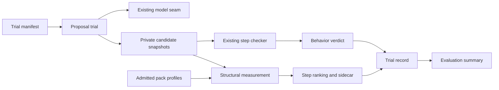
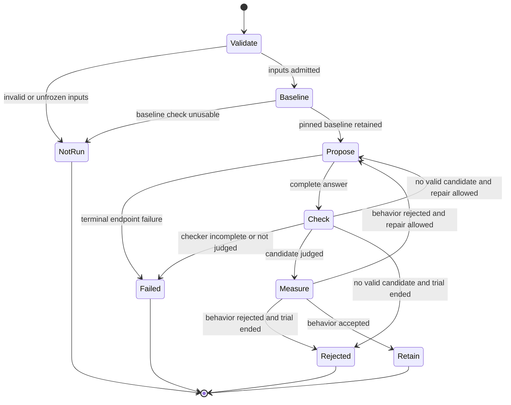

# Design: model simplification

> **Superseded on 2026-11-17 by the owner.** This spec measured where a field is written. The owner meant a hidden state machine spread across files, to be consolidated with the solver approach. Kept as a record; do not start work from this file. Start from [state-consolidation/brief.md](../state-consolidation/brief.md) and [R133](../../../docs/research/2026-11-17/20-model-simplification-closed.md).

Status: **provisional; not approved for production**. Requirements approved
2026-11-17. The [prototype gate](prototype-gate.md) is not run. This document
proposes contracts; no listed new command or module exists yet.

## Overview

Add a bounded proposer to `lesscode-model` and a deterministic simplicity library
to `lesscode-core`. Reuse the existing model call/repair loop and step checker.
The proposer evaluates immutable candidates in a private repository, retains the
existing behavioral verdict and emits a separate structural comparison.

The decisive unknown is whether pack-derived branch and state facts support useful,
non-gameable comparisons on real responsibilities. The prototype qualifies those
facts before any production task plan. Two cases are attempted, with failures retained.

### Goals
- Make branch/state planning and complete-replacement comparisons reproducible.
- Attribute gains separately to measurement corrections, pins, candidates and assistance.
- Demonstrate at least one useful real step under frozen controls and budgets.

### Non-Goals
- A general alias solver, equivalence prover, repository-wide agent or prompt optimizer.
- Replacing transport, test runners, step acceptance, guards or historical ledgers.
- Continuing optimization after a behavior-accepted answer, or adopting it upstream.

## Boundary Commitments

### This Spec Owns
- **Measurement**: admitted structural profiles, qualified identities, comparable facts and deltas.
- **Step reporting**: requested branch/state ranking and a separate simplicity sidecar.
- **Proposal trial**: immutable inputs, private candidate snapshots, repair/check orchestration and provenance.
- **Evaluation**: useful-yield summaries and this feature's bounded feasibility gate.

### Out of Boundary
Endpoint credentials, transport, waiting and request-style handling remain in the
model seam. Tests/fault verdicts, pins, guard exit codes and ledger acceptance remain
in `step`. Onboarding owns its wider journey and protection-policy changes.
Specimen domain behavior, upstream adoption and model/provider comparisons are excluded.

### Allowed Dependencies
Dependency direction: admitted pack data and tree primitives -> Measurement ->
Step reporting; Proposal trial -> core Measurement and existing step services;
Proposal trial -> model seam call/repair; Evaluation -> retained trial records.
Core never links `lesscode-model`, and Measurement/step never call it.
No new library is proposed. Existing `model` already depends on `native`.

### Revalidation Triggers
Changes to profile rules, identity mapping, parser versions, scope, test/pack hashes,
candidate preparation, report schemas or runtime invalidate affected comparisons.
Recheck plan consumers, pack admission, step/guard/ledger tests and future onboarding.
A prompt, model setting or repair-budget change starts a distinct evaluation arm.

## Architecture

### Existing Architecture Analysis
`Pack` is a strict deserialized structure; `Rule` selects nodes by kind, fields and
prefixes. `analyse` returns sites and file/line write labels, not semantic state
targets. `FileFunctions` groups names and misses indirect calls. Those facts cannot
serve as resolved alias or whole-responsibility evidence.

`Context::open` requires a committed declaration and baseline/step revisions.
`run_check(CheckArgs)` is public and writes the established verdict. Its mutation
and frame checks consume the existing embedded pack. The model's `with_repairs`
accepts a caller-provided check and stops on the first accepted reply.

### Architecture Pattern & Boundary Map



Use direct Rust functions and existing subprocess/runtime adapters, not a plugin
framework or a new service. The measurement profile is a companion of an admitted
language pack. Separating it from mutation rules prevents a corrected write metric
from silently deleting planted faults.

### Technology Stack

| Layer | Existing version | Use |
| --- | --- | --- |
| Rust | 1.98.1; native edition 2021, model edition 2024 | Existing crates and toolchain |
| Syntax | ast-grep-core/language 0.51.0 | Existing parsing/tree walk; no second parser |
| Typed data | serde 1.0.229, serde_json 1.0.154 | Strict manifests and versioned records |
| Digests/CLI | sha2 0.11.0; native clap 4.6.0 | Existing identities and argument handling |
| Model | existing genai 0.7.4 and tokio 1.54.1 through seam | No new transport or vendor rule |
| Revision isolation | installed Git, exact version captured per run | Private object histories only |

Versions above come from the current manifests; existing lockfiles remain authoritative.

## File Structure Plan

Proposed production paths, eligible only after the gate. Existing budgets apply;
splitting a responsibility into files does not increase its permitted scope.

### Directory Structure

| Files | Component | Single responsibility |
| --- | --- | --- |
| `native/src/simplicity/mod.rs` | Measurement | Typed facts, report/profile identities and public comparison interface |
| `native/src/simplicity/profile.rs` | Measurement | Structural profile admission and generic selector interpretation |
| `native/src/simplicity/facts.rs` | Measurement | Qualified branch/state fact extraction |
| `native/src/simplicity/compare.rs` | Measurement | Scope matching, comparability and outcome classification |
| `native/packs/python.metrics.json` | Measurement | Python grammar/binding/target selectors; no project/model rules |
| `native/src/step/simplicity.rs` | Step reporting | Revision comparison and sidecar generation |
| `model/src/simplify/mod.rs` | Proposal trial | Trial state transitions and model repair/check adapter |
| `model/src/simplify/snapshots.rs` | Proposal trial | Immutable source copying and private Git revision preparation |
| `model/src/simplify/record.rs` | Proposal trial | Attempt provenance and summary emission |
| `model/src/simplify/evaluate.rs` | Evaluation | Typed outcome counters and attribution summaries |
| `native/tests/simplicity.rs`, `native/tests/step_simplicity.rs` | Validation | Measurement and step-report contracts |
| `model/tests/simplify.rs` | Validation | Stubbed proposal lifecycle and source-preservation checks |
| `docs/experiments/model-simplification/` | Research only | Rust spike, PowerShell orchestration and evidence manifests, separate from production |

### Modified Files
- `native/src/lib.rs`: expose Measurement only.
- `native/src/adapters/driver/cli.rs`: expose companion-profile admission using existing pack validation conventions.
- `native/src/step/plan.rs`: opt-in rankings and added facts; default legacy output remains available.
- `native/src/step/check.rs`: optional sidecar after the existing verdict; no new behavioral predicate.
- `native/src/step/mod.rs`: register the step reporting module.
- `native/tests/step_plan.rs`: verify ranking compatibility and explicit legacy write labels.
- `model/src/lib.rs`, `model/src/main.rs`: expose and dispatch the `simplify` command.
- `model/src/repair.rs`: add a fallible-check entry point around the same loop;
  retain the existing infallible API as a wrapper, with identical behavior.
- `docs/model-endpoint.md`: document proposal command and independent outcome meanings.
`native/packs/python.json`, `model/src/measure.rs`, guard and
ledger semantics are unchanged by the proposed production design. Compatibility
tests can extend their existing suites without redesigning those components.

## System Flows



Transport retries stay inside the seam. An interrupted or not-judged checker stops
the trial as incomplete; it is not a model rejection to repair. A passing behavior
verdict ends proposals even when simplicity is unchanged, mixed or unmeasurable.
All terminal paths retain completed records; no automatic rerun resumes a partial trial.
Each materialized candidate gets a separate simplicity outcome, including rejected
candidates. Invalid scope or incomplete judging yields explicit unavailable/partial
evidence, never useful classification. Structural results cannot supply a behavioral
rejection or override the seam's refusal/attempt-limit stop decisions.

## Requirements Traceability

| Requirement | Summary | Components | Interfaces | Flows |
| --- | --- | --- | --- | --- |
| 1.1, 1.2, 1.3, 1.4, 1.5, 1.6, 1.7 | Frozen responsibility and isolation | Proposal trial, Measurement | TrialManifest, Snapshots, compare | Validate, Baseline, Check |
| 2.1, 2.2, 2.3, 2.4, 2.5, 2.6, 2.7, 2.8, 2.9 | Reproducible branch/state facts | Measurement | Profile, measure, FactSet | Measure |
| 3.1, 3.2, 3.3, 3.4, 3.5, 3.6 | Requested rankings with protection | Step reporting | plan arguments, plan-v2 | Baseline |
| 4.1, 4.2, 4.3, 4.4, 4.5, 4.6, 4.7, 4.8, 4.9 | Bounded proposals/repair | Proposal trial | run_trial, existing call/with_repairs | Propose, Check |
| 5.1, 5.2, 5.3, 5.4, 5.5, 5.6, 5.7 | Existing behavioral meaning | Proposal trial, Step reporting | CheckArgs, snapshot checks, behavior link | Baseline, Check |
| 6.1, 6.2, 6.3, 6.4, 6.5, 6.6, 6.7, 6.8, 6.9, 6.10 | Independent comparable report | Measurement, Step reporting | compare, sidecar | Measure, Retain |
| 7.1, 7.2, 7.3, 7.4, 7.5, 7.6, 7.7 | Provenance and no adoption claim | Proposal trial | trial/attempt records | all terminal paths |
| 8.1, 8.2, 8.3, 8.4, 8.5, 8.6 | Attribution | Evaluation | ArmManifest, summarize | Retain |
| 9.1, 9.2, 9.3, 9.4, 9.5, 9.6, 9.7 | Useful yield | Evaluation | Target, EvaluationSummary | Retain |
| 10.1, 10.2, 10.3, 10.4, 10.5, 10.6 | Model independence/compatibility | Measurement, Step reporting | ProfileBinding, sidecar | Validate, Measure |
| 11.1, 11.2, 11.3, 11.4, 11.5, 11.6, 11.7, 11.8, 11.9 | Real-code qualification | Research | prototype-gate.md, freeze.json, dated results | gate stages |

## Components and Interfaces

| Component | Intent | Dependencies | Contracts |
| --- | --- | --- | --- |
| Measurement | Source facts and conservative comparisons | Outbound P0: existing parser/admitted packs | Service |
| Step reporting | Offline ranking and sidecar | Outbound P0: Measurement, step context/verdict; inbound P1: consumers | Service, CLI |
| Proposal trial | One immutable proposal/repair trial | Outbound P0: seam, step checker, Git; inbound P0: approved manifest | Service, batch, state |
| Evaluation | Provenance-aware trial summaries | Inbound P0: trial records/arm manifests | Batch |

### Measurement

```rust
fn measure(profile: &Profile, scope: &SourceSnapshot) -> Result<FactSet, MeasureError>;
fn compare(base: &FactSet, candidate: &FactSet, target: &Target)
    -> Result<SimplicityReport, CompareError>;
```

Preconditions: scope paths are normalized relative paths, contents match declared
hashes, profile admission succeeded. Postcondition: every counted fact has a source
location and qualified owner; unresolved facts have reasons. No file writes, model
calls or execution of source. Order is deterministic by path, owner and span.

Profile contract `simplicity-profile-v1`: language, parent mutation-pack digest,
grammar identity, selector rules, supported constructs and explicit gaps. Selectors
use node kinds, field paths and typed roles (`condition`, `binding`, `assignment_target`,
`receiver`, `attribute`, `subscript`, `scope`, `call`) rather than Rust branches on
language names. The generic evaluator supports this finite set; missing roles produce
unsupported facts. Admission checks unknown fields/kinds, selector arity, required
roles and controls. The companion is admitted as part of the pack bundle. Existing
packs without it retain existing commands and report structural profile unavailable.

Python first subset: names, function/class scopes, assignments including annotations
and augmented assignments, attribute/subscript targets, explicit global/nonlocal
bindings, conditionals and loops. Destructuring, dynamic attributes, dynamic call
targets, match patterns and escaping aliases are unresolved until separately qualified.
Track straight-line aliases only until reassignment/control-flow ambiguity. A method
name or type annotation alone cannot establish that an arbitrary call is pure.

Qualified functions use file plus lexical class/function path and declaration ordinal;
never merge unrelated methods just because their names match. Lambdas and module
statements have explicit owners. Rename matching requires a frozen correspondence
map; no fuzzy automatic merging. Targets use binding identity plus an access path.
`self.field` is a lexical instance-field family, not a claim about individual runtime
objects. Unsupported receiver identity makes the affected dispersion claim unavailable.

Proposed profile measures:
- `B`: distinct explicit conditional sites, including if/elif, ternaries, while,
  iteration tests, comprehension filters and assertions. Count each physical site
  once over the complete responsibility. Exception-handler entries are companion `E`.
- `P`: atomic condition leaves plus short-circuit operators and comparisons across
  the responsibility, including assigned, returned and table-held Boolean expressions;
  comparison chains count each comparison. Deduplicate the same AST occurrence across
  selectors. A bare condition is one atom. If a condition's logic moves into a
  call/data representation that cannot be accounted for, mark that claim unresolved.
  Thus folding or storing expressions cannot erase decision work.
- `W`: identified nonlocal write sites; `L`: local rebindings; `U`: unresolved effects.
  Supported mutation-call roles require an established target/effect contract;
  otherwise they contribute U, not a fictitious zero-write observation.
- Per target `t`: write-site set, writer-function set and file set. Report
  `D = sum(max(0, writers(t)-1))` and `S = sum(max(0, sites(t)-1))` with raw relations.
  D measures writer dispersion, S repeated write locations, not semantic purity.

All targets/helpers/callers added by a replacement are charged. Known dependencies
remain named contracts; custom logic cannot be hidden behind a newly unresolved
callee. Unchanged external gaps may be reported beside a bounded local claim only
when their non-interference with that claim is an explicit frozen assumption backed
by controls. Otherwise that axis is not measurable. A decrease in W with increased
or newly relevant U is not an improvement. Merging functions alone cannot qualify D;
retained decisions/write sites and delegation must also be accounted for.

Comparison is per axis: Improved/Unchanged/Regressed/Mixed/NotMeasurable. A positive
percentage uses the positive baseline denominator; zero -> no percentage. Preserve
signed integer deltas. Overall “useful” requires behavior acceptance and a frozen
target plus non-worsening companion controls. No weighted aggregate or size reward.

### Step reporting

Proposed CLI: `step plan --rank faults|branches|state --profile PATH`.
Default `faults` without a profile keeps `step-plan-v1`. New modes produce
`step-plan-v2`; the old `state_writes` column is labeled mutation sites, while L/W/U
and target/writer relations are explicit new fields. The metric correction is in
Python pack data without removing old assignment mutations.

Branches sort by descending B, then P, then ascending qualified path/owner. State
sorts by descending target writer-dispersion contribution, then S contribution,
then W, then qualified identity. A site's target contribution is divided across
its writers for ranking; comparison totals are never divided. Unmeasurable candidates
are a separate unranked list. Existing fault/frame/protection data remains visible.
These scores locate candidates, not proven opportunities.

Keep legacy protection facts at their actual name-group granularity. Link a fault
to a qualified function only when its source span supports the join. Ambiguous
same-name groups remain labeled groups/unknown attribution; never duplicate a
group's counts as if each function had that protection. Requested profile with
`--rank faults` also emits v2; requesting branches/state without a profile is a
named input error, not an implicit zero-score fallback.

Proposed `step check --simplicity-manifest PATH --simplicity-out PATH` writes a
`step-simplicity-v1` sidecar after the original verdict. It links that verdict's
digest and exact revisions. No extra fields enter the strict step declaration or
guard contract. Sidecar failure is printed and retained as not measurable where
writing is possible; it does not change step's established result/exit code. Consumers
must verify sidecar presence/digests before claiming simplicity. Refused candidates
can have structural facts, but cannot be useful. The proposer can call the same
measurement service directly for each private snapshot.

### Proposal trial

```rust
fn validate_trial(input: TrialManifest) -> Result<ValidatedTrial, TrialError>;
fn prepare_snapshots(trial: &ValidatedTrial) -> Result<Snapshots, TrialError>;
fn run_trial(trial: &ValidatedTrial, endpoint: &Endpoint, limits: &Limits)
    -> Result<TrialRecord, TrialError>;
```

Proposed CLI: `lesscode-model simplify --manifest PATH --endpoint-env PATH --out PATH`.
Exit convention uses the seam's existing usage/failed/rejected/answered categories;
the record carries the original step code and verdict separately. A behavior-accepted
unchanged candidate is answered successfully. A missing/unwritable record is a failed
trial, never a success inferred solely from process output.

Validate before any call: immutable source/test/profile identities, nonempty scope,
known public surface, output/work roots outside source, no traversal/symlinks escaping
scope, limits, intervention declaration and optional useful target. Reject dirty
judged inputs rather than silently using an older commit. Source snippets are data
for the requested rewrite, not authority to change the judge or execute commands.

Snapshots contain only the declared tracked tree and admitted test/support files,
not endpoint files, user Git configuration, credentials or untracked content. Build
a new private Git history from verified blobs, without remotes or copied hooks.
Private synthetic commits satisfy `Context::open`; they do not commit into or change
refs in the user's repository. Record original object IDs and byte hashes beside
synthetic IDs. An already-pinned source is the trial baseline; new pins are admitted
on original code in a separate private commit before any rewrite. Freeze the private
step declaration before proposals, including scope slots for permitted new helpers.

Each attempt starts from that frozen baseline and adds only validated source changes.
Candidate reply `simplification-edit-v1` is strict JSON with an `edits` array of
relative `path`, exact nonempty `before` text and replacement `after` text. Each
anchor must occur exactly once in the baseline; replacements must not overlap.
Authorized new files instead declare empty `before` with `create: true`; existing
files cannot use that form. Apply all edits atomically to a fresh snapshot; ambiguous
anchors, extra fields, mixed output and invalid encodings are rejected. Empty edits
are an unchanged candidate, still subject to the normal check. This keeps complete
module accounting without requiring a full module in every reply. Preserve raw bytes
and the resulting complete file hashes. Reuse existing preparation helpers where
their contracts fit; reject path,
public-surface, test or config edits before execution. A new helper must occupy an
authorized scope slot; arbitrary new files are rejected. Run `run_check(CheckArgs)`
in the private repository and retain its verdict. The model check callback passes
only on accepted behavior. Infrastructure/not-judged failures terminate without
another call. Add `with_fallible_check<E>` in the existing repair module: the same
call/request/repair arguments, a check returning `Result<Verdict, E>`, and result
`Result<Outcome, CheckFailure<E>>`. `CheckFailure` retains the error, current reply
and earlier completed attempts. `with_repairs` delegates with an infallible check;
there is one loop and no new transport or fake endpoint error. The trial translates
`CheckFailure` into an incomplete record. Default two repairs, no continuation after
acceptance. Preserve existing refusal/cutoff behavior; the trial adapter must reject
a refused, empty or incomplete answer before a passing check can be returned.

Recording wraps call and check boundaries: save each sent request and raw answer,
candidate hashes, rejection reasons and resource facts. This is necessary because
`repair::Attempt` stores counts/reasons but not every raw reply. Files are written
atomically under one trial directory. Interrupted trial remains incomplete; restart
uses a new ID. No automatic upstream record/guard/push operation occurs.

### Evaluation

```rust
fn summarize(arms: &[ArmManifest], trials: &[TrialRecord])
    -> Result<EvaluationSummary, EvidenceError>;
```

Arm identity fixes task population, profile, tests, model settings, prompt variant,
budgets and intervention class. Validate all referenced hashes; do not silently pool
different arms. Report scheduled/attempted/endpoint-failed/candidate-producing/
behavior-accepted/measurable/useful/adopted and incomplete counts. Categories overlap
where appropriate; define them, do not sum them as disjoint stages. Attempted means
at least one call was initiated. A transport failure can follow earlier candidates.
Rates use explicit numerator and denominator with zero denominator reported unavailable.

Keep per-responsibility outcomes and repeated trials separate. Useful/scheduled and
useful/attempted are distinct from accepted/attempted. Built-in model-measure results
retain their own task/check labels and thresholds. No changes to its counters.
Feedback-causality and ranking-effectiveness arms are optional, required only for
those claims. The first prototype makes neither claim. Unknown assistance is not
unassisted; adoption remains “not established” unless supplied verified adoption evidence.

## Data Models

Use strict serde types and enums, not arbitrary JSON maps in the new contracts.
Reuse the existing seam/step structures at their boundaries.

| Record | Required fields and invariants |
| --- | --- |
| `TrialManifest` | version, ID, source revision/hash map, scope and authorized new-file slots, tests/pins, step declaration hash, profile/mutation-pack IDs, tools/runtime identity, work root, budgets, target, intervention record |
| `ProfileBinding` | metric version, grammar version, parent pack digest, companion digest, supported constructs; cannot mix versions silently |
| `FactSet` | source/scope/profile IDs, qualified functions, B/P/E sites, L/W/U effects, target relations and gaps; absent != zero |
| `Target` | axis, minimum absolute/relative reduction, companion non-regression rules, declared assumptions; frozen before calls |
| `SimplicityReport` | before/after identities, deltas and per-axis status/reasons, original behavior link, target outcome; no behavioral acceptance field of its own |
| `TrialRecord` | version, manifest digest, state, attempts, raw/candidate/verdict/report links and hashes, intervention class, original/private revisions, adoption status |
| `EvaluationSummary` | arm identity, named counts/rates, per-case records, missing/incompatible exclusions, resource totals |

State target keys retain lexical context; identity maps cannot be invented after a
candidate to reduce dispersion. Replacing state representations without a defensible
map yields NotMeasurable for that axis. Keep scalar facts even when an overall claim
is unavailable. All evidence uses UTF-8 bytes with digest normalization explicitly
stated; Git object IDs and raw-byte SHA-256 are different fields.

## Error Handling

| Condition | Outcome |
| --- | --- |
| Invalid input, dirty scope, stale hashes, missing profile | No model call; named validation failure |
| Parse or unsupported structural construct | Affected axis NotMeasurable; behavioral checking still follows existing rules |
| Candidate outside scope or modifies frozen checks | Rejected with exact reasons; bounded repair permitted |
| Base tests fail, check void, timeout or incomplete record | Trial incomplete/failed; no useful classification or repair against infrastructure |
| Endpoint refusal or terminal failure | Stop, preserve attempts and seam reason once |
| Behavior accepted, no structural gain | Stop; report accepted and unchanged/mixed/not measurable |
| Old or mismatched sidecar/ledger | Incompatible comparison; no historical rewrite or automatic re-baselining |

## Testing Strategy

- Measurement controls: same-source determinism, comment/local rename invariance,
  local versus global/nonlocal/attribute/subscript writes, aliases, shadowed method
  names, module/lambda ownership, compound predicates, unknown calls and target
  renames (2.1-2.9, 6.2-6.8, 10.3).
- Anti-gaming: move branches to helpers/files, generic setter, merge writer functions,
  newly unknown effects; verify complete accounting and withheld claims (1.4-1.6, 11.2).
- Integration: legacy plan output, opt-in rankings/ties/unranked, sidecar failure
  with unchanged step code, stale sidecar hashes, unchanged guard and historical
  ledger behavior, mutation-population identity (3.1-3.6, 6.10, 10.4-10.6).
- Trial with stub endpoint: first accepted/unchanged stops, rejection then repair,
  terminal failure/refusal/cutoff, judge interruption, raw-answer retention, malicious
  path/test edits, private commits and byte-identical original source/refs (1, 4, 5, 7).
- Evaluation fixtures: all failure denominators, zero denominators, repeated cases,
  mismatched profiles, assisted/unknown trials, no implied adoption (8, 9).
- Real cases and failure controls are specified in the prototype gate (11). Native
  tests use nextest; hosted/native verification uses existing Dagger configuration.
  No performance benchmark or historical threshold weakening is a validation step.

## Security Considerations

The manifest, test commands and endpoint file are user-trusted inputs; model output
is untrusted. The model cannot set commands, dependencies, tests, profile rules or
output paths. Validate candidate relative paths and reject traversal/escaping links.
Only declared tracked source context is sent; no automatic inclusion of `.env` or
Git data. Logs never contain keys. Specimen tests run with model credentials absent
and no external network. Isolation limits accidental mutation; it is not a claim
of an adversarial OS sandbox for arbitrary test commands.

## Operational Bounds and Migration Strategy

Keep unchanged commands and receipts readable. New rankings/profile reports are
opt-in, with explicit versions. Existing mutation pack stays fixed; the companion
corrects structural write interpretation without changing frame/guard semantics.
If later evidence requires modifying mutation eligibility, that is a separately
versioned pack change with coverage diff and compatible reruns, not part of this
first migration. Revert the opt-in feature without rewriting historic evidence.

Work roots and build caches remain under D:\BuildArtifacts on Windows. Runs are
sequential per endpoint. Limits are operational, not performance goals. Respect
existing file/function budgets; no registry ceiling is raised in this design.
Code/test/support accounting remains separate from specimen structural improvement.

## Contradictions and disposition

| ID | Competing claims and sources | Authority/date | Resolution and rationale | Affected interfaces | Evidence/revalidation | Status |
| --- | --- | --- | --- | --- | --- | --- |
| C1 | New branch/state ranking vs gradual-steps 2.2 fault ranking | Approved new requirements 3; 2026-11-17 | Opt-in ranking, default preserved | plan-v1/v2 | Compatibility test | Resolved proposal |
| C2 | Correct Python state counting vs pack mutations/frames | Requirements 2.4, 5.2, 10.4-10.6 | Admitted measurement companion; legacy mutation profile unchanged | profile, frame, ledger | Exact mutant-set control in gate | Resolved proposal; empirical qualification open |
| C3 | Model proposals vs model-free step flow | model-seam 7; requirements 10.1 | Proposer in model crate, judge in core | run_trial/run_check | Separation CI plus stub test | Resolved proposal |
| C4 | No user commits vs checker demands committed declaration | Requirements 1.3, 1.7; Context::open | Only private synthetic histories; original refs/bytes unchanged | Snapshots | Before/after source/ref hashes | Resolved proposal |
| C5 | Historical line-based U5 targets vs branch/state objective | Owner 2026-11-12/17 and approved requirements 6.9 supersede historical metric objective | Retain U1-U7 evidence principles, replace feature-specific usefulness targets explicitly in new gate; no old success inherited | gate | Dated R115 disposition and gate review | Resolved by current objective; targets remain provisional |
| C6 | Historical WSL/retired Python instructions vs current host policy | Current AGENTS; tech.md external-runtime exception | Rust/PowerShell development; target Python tests in Linux container, no WSL execution or new Python product tooling | prototype runner | Container/collection preflight before trials | Resolved interpretation; setup not run |
| C7 | Full semantic state language vs syntactic primitives | Requirements 2.6-2.7; actual analysis.rs | Bounded identities, explicit unresolved effects, no purity/equivalence claim | FactSet | Aliasing/escape controls; fail affected axis | Open empirical risk |
| C8 | Step acceptance vs useful simplification | Owner 2026-11-17; requirements 4.8, 6.10 | Separate sidecar; no repair after accepted unchanged answer | trial/guard | Stub and compatibility tests | Resolved proposal |
| C9 | Independent evidence review vs foreground-only work | Current owner rule; prototype-first native unlock | Authoring review runs inline; qualification still requires independent evidence review, by an owner-designated reviewer or explicitly authorized agent | gate review | Retain review identity and outcome before proceed; no subagent dispatched by this plan | Future evidence-review prerequisite; not waived |

These are provisional design dispositions, not empirical resolutions. C7 and C9,
the gate's not-run status and normal design approval keep production tasks locked.

## Supporting References

[Research and source findings](research.md), [requirements](requirements.md),
[prototype gate](prototype-gate.md), and [prototype-first policy](../../steering/prototype-first.md).
