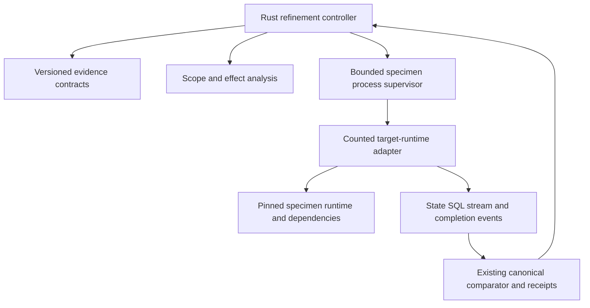

# Technical Design: Native Deconvolution Closure

Status: **provisional revised design, 2026-11-09; not approved for production**.
The [prototype gate](prototype-gate.md) is not run. This replaces the former
self-contained-interpreter and unconditional shim-removal assumptions.
[Review amendment](review-amendment.md) records disposition and evidence.

## Overview

Move orchestration and reusable verification decisions into Rust while executing
specimen semantics in their pinned runtime. Compare the complete replacement
before selecting ports. Historical E5/E6 results motivate this experiment but do
not establish native-port fidelity or cross-language parity.

### Goals / Non-Goals

Qualify native state/density analysis, bounded runtime comparison, adverse
controls, recording and model transport with preserved observable behavior.
No new interpreter, universal purity proof, automatic proof from syntax alone,
speed target, blanket rewrite or unconditional retirement of Python adapters.

## Boundary Commitments

### This spec owns
- Versioned common evidence/adapter contracts and their Python implementation.
- Rust orchestration and comparison, bounded domain scheduling and witness handling.
- Explicit runtime instrumentation, transport lifecycle and whole-replacement inventory.
- Compatibility with current recording, receipt, regenerator and metric contracts.

### Out of Boundary
- TypeScript/Java/Rust adapter implementations; they consume the versioned contract.
- Upstream business changes, altered goldens or weakened acceptance checks.
- Owner WIP: `docs/experiments/deconvolution/e3-evidence-regeneration/results/sql-divergences-round21.json`,
  `docs/experiments/deconvolution/e4-lifecycle/results/sql-divergences-round21.json`,
  `src/lesscode_baseline/rules/evaluate.py`, `tests/test_rule_evaluation.py`.

### Allowed Dependencies
Reuse exact existing lockfile versions and pinned project runtimes.
Evaluate Ruff AST crates, Oxc and JUnit readers as alternatives from R27; none
is selected or added by this amendment. New dependencies need a repository-level
version/license/platform and integration-cost decision. Java scope admission is
not approval of a particular parser dependency. No global zero-new-crates policy
may silently override a separately approved adapter decision.

### Revalidation Triggers
Changed runtime/parser, effect profile, wire schema, source/check hashes, domain,
normalization, metric definition, dependency lock or accounting population
invalidates the affected evidence. Re-run affected prototypes and cross-language
contract fixtures before downstream task approval.

## Contradictions and disposition

| ID | Conflicting claims / evidence | Resolution | Status / gate |
|---|---|---|---|
| C1 | Native self-containment versus Python specimen execution and SQLAlchemy hooks (`native/shim/recording_shim.py`) | Native controller plus explicitly maintained runtime adapter; count both | Resolved scope; runtime parity unproven |
| C2 | Syntax scan and samples described as mathematical equivalence versus callable-based Python verifier | Explicit supported profile; four outcomes; exhaustive finite domains distinguished from sampling | Resolved contract; fidelity prototype required |
| C3 | Per-file caps treated as sufficient versus R41 7,173 total no-growth ceiling | Both checks mandatory; unchanged canonical method and full added-code inventory | Budget fit open; blocks production |
| C4 | Approved design/tasks versus not-run prototype | Design approval reset; old task plan superseded by research checklist | Resolved sequencing; proceed evidence absent |
| C5 | All files capped at 400 versus legacy measured exceptions | Existing registry ceilings remain authoritative; new files/functions use 400/300/80 defaults | Resolved; per-task verification |
| C6 | Token heuristic versus existing provider count endpoint | Preserve provider count; estimates cannot authorize a request | Resolved contract |
| C7 | Trait names without signatures or task ownership | Common contract owned here; explicit schema/conformance work before adapters | Provisional contract; integration spike required |
| C8 | Java excluded / prerequisite to Rust versus owner admission on 2026-11-09 | Java authorized; adapters are sibling consumers | Resolved in steering and roadmap |

Authority and evidence for the table: the owner's 2026-11-09 amendment request
and Java clarification govern C1/C8 scope; the current Python shim and verifier
govern C1/C2 feasibility; [R41](../../../docs/research/2026-11-08/08-state-boundary-ceiling-amendment.md)
and [budget registry](../../../native/complexity-budgets.json) govern C3/C5;
[prototype-first](../../steering/prototype-first.md) governs C4;
[provider guard](../../../src/lesscode_baseline/regenerator.py) governs C6.
C7 is a new provisional contract, not observed implementation. Requirements
1.1-1.5 and 3.1-3.5 are affected by C2; 5.1-5.5 by C1/C7; 6.1 by C6;
6.3-6.5 by C3-C5. All adapter consumers must revalidate schema/profile conformance
after C1/C2/C7 changes; C8 changes planning only. Current documentary resolution
is not runtime evidence for any row.

No unresolved contradiction may be relabeled an assumption to gain approval.
Open empirical risks stay visible and block the dependent phase. Design review
must compare requirements, this table, predecessor decisions and consumer specs.

## Architecture



Dependencies flow from controller to analysis/runner to common contracts.
Language adapters do not own comparator acceptance rules. The runtime adapter
imports and invokes specimen functions, attaches SQL/state/stream hooks and
applies frozen reset/seed/cleanup semantics. Rust coordinates these actions;
pipes alone supply neither runtime execution nor instrumentation.

## File Structure Plan

These are provisional ownership locations, not approved allocations.
Reuse existing modules before creating duplicates.

| Path | Responsibility / change |
|---|---|
| `native/src/adapter_traits.rs` | Common profile, result, domain, event and adapter interfaces |
| `native/src/adapters/mod.rs` | Core-owned internal profile registry and narrow language module registration |
| `native/src/state_contract.rs` | Existing outcome metrics; compatible evidence integration |
| `native/src/state_frame.rs` | Resolved effect-profile analysis and trace/frame comparison |
| `native/src/density.rs` | Thin integration with existing measures; create only if needed |
| `native/src/pure_verifier.rs` | Domain scheduler and witness handling, no Python interpreter |
| `native/src/stream_monitor.rs` | Ordered runtime-event and emitted-byte comparison |
| `native/src/mutant_generator.rs` | Supported AST operators and explicit mutant dispositions |
| `native/src/specimen_runner.rs` | Deadlines, bounded transport, child/resource cleanup |
| `native/shim/recording_shim.py` | Retained counted adapter; evolve only after prototype parity |
| `native/src/token_guard.rs` | Provider counting and bounded stateful stream decoding |
| `native/src/recording.rs`, `native/src/regenerator.rs` | Integrate runner/results while retaining contracts |
| `native/src/lib.rs`, `native/complexity-budgets.json` | Registration and measured budgets |
| `native/tests/adapter_contract.rs`, `native/tests/state_boundary.rs` | Independent expected outcomes and contract conformance |
| `native/tests/specimen_runner.rs`, `native/tests/json_parity_test.rs` | Abort/protocol and byte-parity checks |

Do not delete reference verification modules until all callers are inventoried
and replacement equivalence is evidenced. Retained reference/test support and
production adapters are reported in separate strata; moving logic changes no total.

## Components and Interfaces

The producer-owned [adapter contract v1](adapter-contract.md) is normative for
all four language profiles. It specifies request/result fields, tagged values,
limits, events, regression/mutant dispositions and accounting. The signatures below
are its concise overview. Producer and consumers change together; duplicate policy
in an adapter is prohibited. A separate internal profile registry avoids silently
changing the legacy public Language enum and serialized compare contracts.


### Common contracts

The first prototype freezes schema v1. All requests bind protocol version,
language/profile ID, baseline/candidate/check hashes, operation, declared domain,
runtime/adapter versions, timeout and output bounds. Unknown schema/profile fails
closed. The existing external CLI remains compatible; internal outcomes map to
documented existing failure codes rather than introducing unreviewed exit codes.

```rust
enum VerificationResult {
    Verified { evidence: EvidenceRef, domain: DomainId },
    Divergent { witness: WitnessRef },
    Unverified { reason: CoverageGap },
    ExecutionFailed { failure: ExecutionFailure },
}
trait StateFrameAnalyzer {
    fn analyze(&self, request: &AnalysisRequest) -> AnalysisResult;
}
trait PureCoreVerifier {
    fn compare(&self, request: &ComparisonRequest) -> VerificationResult;
}
trait AdverseMutantGenerator {
    fn generate(&self, request: &MutationRequest) -> MutationBatch;
}
trait SpecimenTraceRunner {
    fn run(&self, request: &RunRequest) -> RunResult;
}
```

Named records are wire-contract concepts, not implemented types.
AnalysisRequest contains source scope, frozen FrameSpec and EffectProfile.
AnalysisResult contains source-anchored writes, resolved assumptions and gaps.
ComparisonRequest contains runtime entrypoints and DomainSpec.
MutationRequest contains the frozen valid-control inventory and source scope;
MutationBatch contains source-bound mutants plus generation failures.
RunRequest binds operation, isolated workspace and limits; RunResult contains
ordered events, artifacts and explicit completion/failure disposition.
EvidenceRef and WitnessRef identify hashed immutable evidence; DomainId binds the
domain manifest. CoverageGap and ExecutionFailure carry reason/step and evidence.

### Frame and semantic contracts

FrameSpec is frozen from baseline plus declared allowed effects, never inferred
from the candidate as authorization. Compare pre/post state and ordered events,
including failure invariants. Resolve aliases/callees through the admitted
EffectProfile; unknown effects return Unverified.

DomainSpec records each parameter's finite values, Cartesian combinations,
constraints, exact case count and execution limit. Use tagged values for large
integers, IEEE float bits (NaN/infinities/signed zero), bytes and ordered structures;
ordinary JSON null must not stand for NaN. Freeze equality and exception-type/
message rules per observable contract. A deadline is not proof of nontermination.
Only complete enumeration can return Verified for the named domain. Sampling is
reported separately and cannot substitute for exhaustive qualification.

### Runtime protocol and observation

Use versioned line-delimited JSON control/events on reserved protocol stdout;
the adapter captures application stdout/stderr separately and transports raw bytes
as tagged byte payloads. Adapter diagnostics go to a separately drained stderr.
Each event has request ID, step, monotonic sequence, kind and typed payload.
Kinds include state/SQL observations, write, flush, log, abort and completion.
Required internal buffer observations need runtime hooks; OS pipe capture alone
cannot certify them. Concurrent streams use declared partial-order rules;
normalization is frozen, never added to hide differences.

Require matching completion record, child exit disposition and declared event
coverage. Bound message and aggregate size; concurrently drain pipes. Timeout,
malformed frames, truncated UTF-8/JSON, missing completion and unsupported hooks
prevent qualification. Terminate only owned child process trees, clean owned DB
resources and retain failure evidence. Isolate candidates from frozen checks;
hash checks before/after. Working/output paths resolve under the repository and
`D:/BuildArtifacts/lesscode/` respectively, never a drive root.
A separate process/hash check is not an adversarial sandbox.

### Mutation, model and metric contracts

Mutation statuses: killed-with-witness, survived, equivalent-with-evidence,
invalid, not-exercised, timeout and infrastructure-failure. Frozen mandatory
controls cannot disappear from the denominator after a failure. All valid
non-equivalent mandatory controls must be killed; empty/incomplete inventories
cannot pass.

TokenGuard sends the same model/system/messages to provider counting as generation;
a counting failure prevents generation. Preserve 120,000 input-token guard and
existing cumulative limits. Streaming decoding retains state across arbitrary
byte chunks, handles split Unicode/events, records usage/stop reason and rejects
missing termination or provider errors. Partial text is never accepted as complete.

Density reuses canonical and separated-form definitions from existing measures,
not raw CST node counts. Maintain distinct validity/structure/compression results.
Use `jsonval.rs`/existing receipt kernels for golden bytes; test signed zero,
non-ASCII, order and non-finite handling. Do not substitute RFC 8785 normalization.

## Requirements Traceability

| Criteria | Components and evidence |
|---|---|
| 1.1, 1.2, 1.3, 1.4, 1.5 | StateFrameAnalyzer, frozen FrameSpec, runtime observations, adverse aliases/failure state |
| 2.1, 2.2, 2.3, 2.4, 2.5 | Density integration, existing measures/state_contract, metric parity fixtures |
| 3.1, 3.2, 3.3, 3.4, 3.5 | PureCoreVerifier, DomainSpec, tagged values and four result states |
| 4.1, 4.2, 4.3, 4.4, 4.5 | StreamMonitor, MutantGenerator, complete control inventory |
| 5.1, 5.2, 5.3, 5.4, 5.5 | SpecimenTraceRunner/adapter, lifecycle, protocol and frozen digest tests |
| 6.1, 6.2, 6.3, 6.4, 6.5 | TokenGuard, regenerator feedback, prototype gate, budget and existing CI |

## Testing Strategy and Migration

Freeze independent expected outcomes for alias mutation, hidden callee effects,
multi-parameter domain divergence, unsupported constructs, non-finite values,
failure cleanup, buffer truncation and reordered events. Compare against reference
outputs where appropriate; reference agreement alone is insufficient.
Exercise crash, timeout/descendants, oversized/malformed messages, forged/missing
completion, changed check hashes and partial model responses.
Double-record and replay frozen E3/E4, then exercise E5/E6 boundary controls and
scope measurements using matched source/evaluator identities.
Keep old recording available until paired parity passes; rollback is selecting
the recorded old adapter/version, never rewriting goldens.

Use `cargo +1.98.1 nextest run --locked --manifest-path native/Cargo.toml --test budgets`
for task-local budgets, the full pinned nextest/pytest-xdist commands in
[testing](../../../docs/testing.md), and existing
[Dagger/native CI](../../../docs/ci-validation.md) before delivery claims.
Doctests remain separate. No benchmark or new platform framework is required.

## Build versus adopt and unresolved feasibility

R27's [reuse map](../constraint-guided-compression/design.md#rust-ecosystem-reference-current-leverage-zero-new-dep-crates-in-cargolock-and-stage-2-candidates)
is mandatory input: compare existing ast-grep with Ruff AST for Python parity;
Oxc is a downstream TypeScript candidate; syn is syntax infrastructure, not an
effect oracle; JUnit supplies test results, not semantic traces. Retain CPython
execution rather than building an interpreter. Do not adopt serde_jcs for frozen
Python JSON bytes. Research decisions and unmeasured alternatives stay in
[research.md](research.md).

Open blockers: runtime-hook completeness, metric/domain fidelity and net
apparatus fit under R41. No library choice or line allocation is certified by
this document. The bounded prototype must resolve these before production planning.
