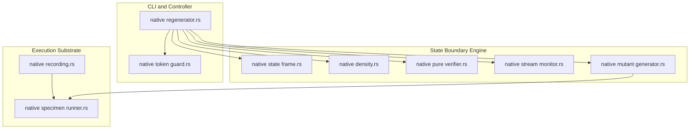

# Technical Design: Native Deconvolution Closure

## Overview

This specification delivers complete native closure of the deconvolution apparatus by transferring all auxiliary Python components into the compiled Rust substrate (`lesscode-core` / `lesscode_core` in `native/`).

**Purpose:** Consolidate the entire state-boundary verification, structural consolidation audit, adverse mutation testing, specimen recording, and refinement refiner loop into self-contained, high-performance native Rust modules, eliminating runtime reliance on Python shims and external Python verification scripts.  
**Users:** Maintainers, verification engineers, and automated refiner agents operating the Lesscode pipeline.  
**Impact:** Replaces ~1,600 lines of disparate Python apparatus (`src/lesscode_baseline/state_boundary/`, `native/shim/recording_shim.py`, and Python regenerator extensions) with a unified, modular Rust architecture strictly governed by the 400-line per-file complexity budget.

### Goals
- Transfer state frame analysis, AST density metrics, pure-core equivalence, stream monitoring, and adverse mutation gates to native Rust.
- Eliminate `native/shim/recording_shim.py` by transitioning to an inline native IPC runner protocol in `native/src/specimen_runner.rs`.
- Port token budgeting and streaming model response parsing natively in `native/src/token_guard.rs` and `native/src/regenerator.rs`.
- Preserve 100% byte-exact digest parity with existing frozen goldens (`FROZEN_E3_LF_BODY`, `FROZEN_E4_LF_BODY`).
- Guarantee strict compliance with `complexity-budgets.json` ($\le 400$ physical lines, $\le 300$ logical syntax units per file).

### Non-Goals
- Changing target specimen application logic or modifying baseline test suites.
- Relaxing verification rigor, reducing mutant sensitivity, or expanding equivalence tolerance.
- Adding heavy external C bindings or PyO3 dependencies that compromise cross-platform CI portability.
- Modifying the 4 preserved owner WIP files.

---

## Boundary Commitments

### This Spec Owns
- Native Rust implementations of:
  - State frame conditions and boundary violation detection (`state_frame.rs`).
  - AST statement density and structural consolidation metrics (`density.rs`).
  - Static purity verification and bounded domain property checking (`pure_verifier.rs`).
  - Pre-abort stream buffer preservation and effect ordering (`stream_monitor.rs`).
  - Adverse state mutant AST synthesis and kill-rate accounting (`mutant_generator.rs`).
  - Native specimen runner protocol replacing `recording_shim.py` (`specimen_runner.rs`).
  - Token length budgeting and streaming response parsing (`token_guard.rs`).
- Module registration in `native/src/lib.rs` and budget allocation in `native/complexity-budgets.json`.

### Out of Boundary
- Upstream specimen business logic and unit test fixtures.
- Modifying the frozen historical research logs (`R01`–`R46`).
- Preserved owner WIP files:
  - `docs/experiments/deconvolution/e3-evidence-regeneration/results/sql-divergences-round21.json`
  - `docs/experiments/deconvolution/e4-lifecycle/results/sql-divergences-round21.json`
  - `src/lesscode_baseline/rules/evaluate.py`
  - `tests/test_rule_evaluation.py`

### Allowed Dependencies
- Rust toolchain: `rust-version = "1.98.1"` (--locked).
- Existing locked crates in `native/Cargo.lock`:
  - `ast-grep-core = 0.51.0`, `ast-grep-language = 0.51.0` (with `tree-sitter-python`).
  - `syn = 2.0.119`, `proc-macro2 = 1.0.107`.
  - `serde = 1.0.229`, `serde_json = 1.0.154`.
  - `sha2 = 0.11.0`, `clap = 4.6.0`, `ureq = 3.5.1`.
- Standard library: `std::process::Command`, `std::io::Read`, `std::fs`, `std::path::Path`.
- Zero new external crates added to `native/Cargo.lock`.

### Revalidation Triggers
- Any change to `FROZEN_E3_LF_BODY` or `FROZEN_E4_LF_BODY` golden body hashes.
- Any breach of the per-file 400 physical line / 300 syntax unit budget.
- Any change in the exit code contracts of `lesscode-core` (0, 2, 3, 4, 5, 6).

### Language-Adapter Trait Seam (unblocks typescript/java/rust adapters — finding F-4)

To provide the unified contract that `typescript-deconvolution-adapter`, `java-deconvolution-unification`, and `rust-deconvolution-unification` build upon (per `docs/architecture/multi-language-deconvolution.md`), this design shall define four Rust traits (in `native/src/state_contract.rs` or a new `native/src/adapter_traits.rs` within budget):

- `StateFrameAnalyzer`: extract mutable frame conditions and verify write sites for a given language AST.
- `PureCoreVerifier`: static purity audit plus bounded-domain equivalence with minimal counterexample witnesses.
- `AdverseMutantGenerator`: synthesize language-targeted mutants and enforce the 100% kill-rate gate.
- `SpecimenTraceRunner`: drive specimen execution over stdio IPC, capture pre-abort streams, and produce execution digests.

The concrete structs below (`StateFrameChecker`, `DensityEngine`, `PureVerifier`, `StreamMonitor`, `MutantGenerator`, `SpecimenRunner`, `TokenGuard`) are the Python-specimen implementations of these traits.

---

## Architecture

### Architecture Pattern & Boundary Map

The native closure architecture decomposes verification and execution into six cohesive, loosely coupled Rust modules under `native/src/`, layered cleanly over the existing core AST and recording primitives:



### Technology Stack

| Layer | Choice / Version | Role in Feature | Notes |
|---|---|---|---|
| **Native AST Parser** | `ast-grep-core 0.51.0` / `tree-sitter-python` | Python AST parsing, write-site extraction, mutation injection | Already locked in `Cargo.lock` |
| **Syntax Metrics** | `syn 2.0.119` / `proc-macro2 1.0.107` | Production budget verification (`budgets.rs`) | Governs line/unit caps |
| **Serialization** | `serde_json 1.0.154` / `jsonval.rs` | Python float and string-escaping parity | Canonical receipt format; byte parity vs Python `json.dumps` (`-0.0`, NaN, non-ASCII escaping) must be proven by `native/tests/json_parity_test.rs` before any `FROZEN_*` digest reliance (finding F-3; see R27 `serde_jcs` rejection) |
| **Cryptographic Hash** | `sha2 0.11.0` | SHA-256 sidecars and LF-body digests | Exact byte integrity |
| **HTTP & Streaming** | `ureq 3.5.1` | Model API requests and streaming token consumption | Pinned HTTP client |
| **Test Runner** | `cargo-nextest 0.9.150` | Parallel native test execution on Windows | Strict exit 0 policy |

---

## File Structure Plan

### New Files
- `native/src/state_frame.rs` ($\le 350$ lines): Frame condition extraction, static write-site checking, and state post-condition verification.
- `native/src/density.rs` ($\le 300$ lines): AST statement density and structural consolidation metrics integrating `state_contract.rs`.
- `native/src/pure_verifier.rs` ($\le 350$ lines): Static purity checking and bounded domain equivalence evaluation over $[-10, 10]$ and edge schemas.
- `native/src/stream_monitor.rs` ($\le 300$ lines): Stdout/stderr buffer interception, pre-abort byte comparison, and effect ordering.
- `native/src/mutant_generator.rs` ($\le 350$ lines): Adverse state mutant AST injection and test kill-rate evaluation.
- `native/src/specimen_runner.rs` ($\le 300$ lines): Direct native specimen execution protocol replacing `recording_shim.py`.
- `native/src/token_guard.rs` ($\le 200$ lines): Token budgeting and streaming model response parsing.
- `native/tests/state_boundary.rs`: Native test suite verifying state frame violations, pure equivalence, stream preservation, and adverse mutant kills.
- `native/tests/specimen_runner.rs`: Native test suite verifying specimen IPC and golden digest reproduction.

### Modified Files
- `native/src/lib.rs`: Expose new modules (`pub mod state_frame; pub mod density; ...`).
- `native/src/recording.rs`: Route sequence execution to `specimen_runner` instead of external `recording_shim.py`.
- `native/src/regenerator.rs`: Integrate `token_guard` and state failure kinds into refine loop.
- `native/complexity-budgets.json`: Register budgets for all 7 new modules.

### Retired / Removed
- `native/shim/recording_shim.py`: Retired and removed from counted apparatus.

---

## Requirements Traceability

| Requirement ID | Summary | Components | Interfaces |
|---|---|---|---|
| **1.1** | Declare mutable state frame conditions | `StateFrameChecker` | `StateFrameChecker::extract_frame()` |
| **1.2** | Observe undeclared state mutations | `StateFrameChecker` | `StateFrameChecker::verify_write_sites()` |
| **1.3** | Failure-side post-condition invariants | `StateFrameChecker` | `StateFrameChecker::verify_post_conditions()` |
| **1.4** | Incompatible state structure/type violation | `StateFrameChecker` | `StateFrameChecker::validate_type_invariants()` |
| **1.5** | Distinguish read vs. write vs. leak | `StateFrameChecker` | `StateFrameChecker::classify_access()` |
| **2.1** | Scope-wide metrics calculation | `DensityEngine` | `DensityEngine::calculate_scope_metrics()` |
| **2.2** | Dual line and statement reduction thresholds | `DensityEngine` | `DensityEngine::evaluate_outcome()` |
| **2.3** | Density Trap detection and rejection | `DensityEngine` | `DeconvolutionOutcome::compression_met` |
| **2.4** | Output structured deconvolution outcome | `DensityEngine` | `DeconvolutionOutcome` serde serialization |
| **2.5** | Self-contained native computation without Python | `DensityEngine` | Pure Rust ast-grep implementation |
| **3.1** | Static pure core verification (0 writes, 0 I/O) | `PureVerifier` | `PureVerifier::verify_static_purity()` |
| **3.2** | Bounded domain equivalence on valid/invalid inputs | `PureVerifier` | `PureVerifier::verify_bounded_equivalence()` |
| **3.3** | Minimal counterexample generation | `PureVerifier` | `PureDivergenceWitness` format |
| **3.4** | Unbounded domain fallback to dynamic traces | `PureVerifier` | `PureVerifier::fallback_dynamic()` |
| **3.5** | Prohibit claiming equivalence from happy-path traces | `PureVerifier` | `PureVerifier::require_exhaustive()` |
| **4.1** | Compare emitted streams prior to abort | `StreamMonitor` | `StreamMonitor::compare_pre_abort_bytes()` |
| **4.2** | Reject dropped, buffered, or truncated streams | `StreamMonitor` | `StreamMonitor::assert_stream_equality()` |
| **4.3** | Inject targeted adverse state mutants | `MutantGenerator` | `MutantGenerator::inject_mutants()` |
| **4.4** | Require 100% adverse mutant kill rate | `MutantGenerator` | `MutantGenerator::verify_kill_rate()` |
| **4.5** | Identify surviving untested boundary mutants | `MutantGenerator` | `MutantGenerator::report_survivors()` |
| **5.1** | Direct native sequence execution and digests | `SpecimenRunner` | `SpecimenRunner::run_sequence()` |
| **5.2** | Database lifecycle and checkpoint management | `SpecimenRunner` | `SpecimenRunner::manage_database()` |
| **5.3** | Divergence reporting and replay abort | `SpecimenRunner` | `SpecimenRunner::report_divergence()` |
| **5.4** | Exact byte parity with frozen LF-body digests | `SpecimenRunner` | `RecordingCore::verify_frozen_digests()` |
| **5.5** | Intermediate unmonitored file elimination | `SpecimenRunner` | Direct standard I/O pipe IPC |
| **6.1** | Native token budgeting and streaming refiner | `TokenGuard` | `TokenGuard::count_tokens()`, `TokenGuard::stream_response()` |
| **6.2** | Causal state failure prompt injection | `Regenerator` | `Regenerator::inject_state_feedback()` |
| **6.3** | Per-file physical and logical unit ceilings | `BudgetsChecker` | `cargo test --test budgets` |
| **6.4** | Prototype gate and budget amendment governance | `PrototypeGate` | `native-deconvolution-closure/prototype-gate.md` |
| **6.5** | 100% pass on Windows `cargo-nextest` | Native Test Suite | Windows PowerShell nextest execution |

---

## Components and Interfaces

### 1. `StateFrameChecker` (`native/src/state_frame.rs`)
* **Intent:** Extract frame conditions and verify mutable write boundaries (Req 1.1–1.5).

```rust
use serde::{Deserialize, Serialize};

#[derive(Clone, Debug, PartialEq, Serialize, Deserialize)]
pub struct FrameCondition {
    pub allowed_writes: Vec<String>,
    pub required_failure_invariants: Vec<String>,
}

#[derive(Clone, Debug, PartialEq, Serialize, Deserialize)]
pub enum StateViolationType {
    UnauthorizedWrite,
    MissingFailureInvariant,
    TypeMutationConflict,
}

#[derive(Clone, Debug, PartialEq, Serialize, Deserialize)]
pub struct StateViolation {
    pub location: String,
    pub violation_type: StateViolationType,
    pub witness: String,
}

pub struct StateFrameChecker;
impl StateFrameChecker {
    pub fn extract_frame(python_source: &str) -> Result<FrameCondition, String>;
    pub fn verify_write_sites(python_source: &str, frame: &FrameCondition) -> Result<(), StateViolation>;
    pub fn verify_post_state(post_state: &serde_json::Value, frame: &FrameCondition, is_error: bool) -> Result<(), StateViolation>;
}
```

### 2. `DensityEngine` (`native/src/density.rs`)
* **Intent:** Compute AST statement density and evaluate whole-responsibility compression against the Density Trap (Req 2.1–2.5).

```rust
use crate::state_contract::{DeconvolutionOutcome, ScopeMetrics};

pub struct DensityEngine;
impl DensityEngine {
    pub fn measure_scope(source_files: &[(String, String)]) -> Result<ScopeMetrics, String>;
    pub fn evaluate_compression(
        baseline: &ScopeMetrics,
        candidate: &ScopeMetrics,
        min_stmt_target: f64,
        min_line_target: f64,
    ) -> DeconvolutionOutcome;
}
```

### 3. `PureVerifier` (`native/src/pure_verifier.rs`)
* **Intent:** Statically audit function purity and check bounded property equivalence (Req 3.1–3.5).

```rust
#[derive(Clone, Debug, PartialEq, Serialize, Deserialize)]
pub struct PureDivergenceWitness {
    pub function_name: String,
    pub input_value: serde_json::Value,
    pub baseline_result: Result<serde_json::Value, String>,
    pub candidate_result: Result<serde_json::Value, String>,
}

pub struct PureVerifier;
impl PureVerifier {
    pub fn verify_static_purity(func_source: &str) -> bool;
    pub fn verify_bounded_domain(
        baseline_code: &str,
        candidate_code: &str,
        func_name: &str,
    ) -> Result<(), PureDivergenceWitness>;
}
```

### 4. `StreamMonitor` & `MutantGenerator` (`native/src/stream_monitor.rs`, `native/src/mutant_generator.rs`)
* **Intent:** Enforce output buffer preservation and execute adverse mutation testing (Req 4.1–4.5).

```rust
pub struct StreamMonitor;
impl StreamMonitor {
    pub fn compare_pre_abort_bytes(expected: &[u8], actual: &[u8]) -> Result<(), String>;
}

#[derive(Clone, Debug, Serialize, Deserialize)]
pub struct StateMutant {
    pub mutant_id: String,
    pub target_file: String,
    pub mutation_kind: String,
    pub mutated_source: String,
}

pub struct MutantGenerator;
impl MutantGenerator {
    pub fn generate_state_mutants(source: &str, file_name: &str) -> Vec<StateMutant>;
    pub fn evaluate_kill_rate(total_mutants: usize, killed_mutants: usize) -> Result<f64, String>;
}
```

### 5. `SpecimenRunner` (`native/src/specimen_runner.rs`)
* **Intent:** Direct native specimen sequence execution and recording bridge, retiring `recording_shim.py` (Req 5.1–5.5).

```rust
use std::path::Path;

pub struct SpecimenRunner;
impl SpecimenRunner {
    pub fn run_record_native(
        python_venv: &Path,
        scope: &str,
        scratch_dir: &Path,
    ) -> Result<serde_json::Value, String>;

    pub fn run_replay_native(
        python_venv: &Path,
        scope: &str,
        goldens: &[std::path::PathBuf],
        scratch_dir: &Path,
    ) -> Result<serde_json::Value, String>;
}
```

### 6. `TokenGuard` (`native/src/token_guard.rs`)
* **Intent:** Model token budgeting and streaming response parser (Req 6.1–6.5).

```rust
pub const MAX_INPUT_TOKENS: i64 = 120_000;

pub struct TokenGuard;
impl TokenGuard {
    pub fn estimate_tokens(text: &str) -> i64;
    pub fn validate_budget(prompt: &str) -> Result<i64, String>;
    pub fn parse_streaming_chunk(chunk_bytes: &[u8]) -> Result<Option<String>, String>;
}
```

---

## Testing Strategy

### Unit Tests
- `tests/test_state_frame.rs`:
  - Verify detection of unauthorized attribute and global assignments.
  - Verify rejection when expected failure invariants (`AuditedAbsence`) are missing.
- `tests/test_density.rs`:
  - Assert that micro-function consolidation with <10% statement reduction fails `compression_met`.
  - Assert that $\ge 20\%$ line reduction and $\ge 10\%$ statement reduction passes `compression_met`.
- `tests/test_pure_verifier.rs`:
  - Assert that pure functions with hidden print/logging or global writes fail purity checks.
  - Assert that bounded equivalence discovers boundary discrepancies and outputs minimal witnesses.
- `tests/test_token_guard.rs`:
  - Verify token counting accuracy and budget overflow handling.

### Integration Tests
- `tests/test_specimen_runner.rs`:
  - Replay frozen E3 and E4 golden traces natively and verify 0 Level 1 / Level 2 divergence.
  - Verify exact byte-for-byte LF-body digest match against `FROZEN_E3_LF_BODY` and `FROZEN_E4_LF_BODY`.
- `tests/test_native_mutant_generator.rs`:
  - Inject planted adverse mutants into E5/E6 specimen candidates and assert 100% kill rate.
- `cargo test --test budgets`:
  - Verify that every maintained file in `native/src/` satisfies physical line ($\le 400$) and logical unit ($\le 300$) caps.
