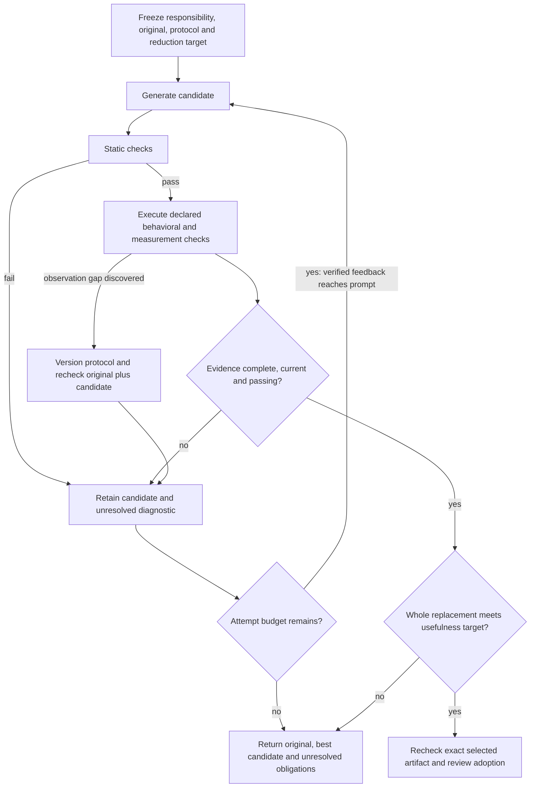

# Compression with checked evidence and recoverable refinement

Status: owner-requested concept proposal, 2026-11-08. This is not an approved
technical design or production task plan. See [requirements](requirements.md)
and [R39](../../../docs/research/2026-11-08/06-refinement-correctness.md).

## What is in the way

The concept remains plausible: replace a complete responsibility with a simpler
representation while preserving its observable contract. Current evidence does
not establish that the automatic refinement machinery achieves it reliably.
There are three distinct problems:

1. **The controller corrupts the connection between evidence and action.** R39
   shows lost feedback, incorrect obligation discharge, a passing best record
   paired with failing candidate files, and incorrect outcome reporting. These
   are repairable software defects.
2. **The evaluator observes a subset of behavior.** E3 missed exception-side
   state changes; E4 missed partial-output and binding-time differences. The
   gap is in what is observed, so running the same corpus again cannot close it.
3. **Correctness and useful reduction are separate experiments.** R38's 7,004
   lines describe an apparatus cap, not successful compression. A correct
   controller can still produce no worthwhile replacement. Discovery must name
   which implementation will disappear and what existing capability or simpler
   representation will replace it before expanding infrastructure.

The detailed specs already prohibit most of the first two failure classes. The
missing connection was executable evidence at the same scope as the claims.
Existing tests verify scores, hashes and selected labels; the relevant controls
did not check delivered bytes, causal feedback use, or rejection after a process
timeout. The E4 transition test feeds a historical successful verdict into the
reward function. That verifies classification of the supplied verdict, not a
fresh behavioral pass of the candidate.

## Adjusted operating concept

Use a bounded candidate search with a separately checked acceptance decision.
The model proposes code. The evaluator produces observations. A small decision
boundary decides whether those observations support the requested claim. A
search score orders attempts; it cannot authorize acceptance by itself.

Keep an explicit distinction between a check that passed, failed, timed out, was
not run, was unsupported, or became stale. An empty collection is not evidence
that an optional stage ran. Required stages are declared before candidate
generation; optional stages remain optional with their limitations reported.

Evidence belongs to a tuple of original identity, candidate identity, protocol
identity and execution identity. Results from different tuples cannot be merged
into a fictional all-passing candidate. Retaining the best means retaining its
files as well as its score. Finishing a run verifies that the delivered artifact
has the identity named by its evidence.

Obligations are candidate-specific. A failure becomes resolved only after a
recheck or a reviewed applicability decision. Discovering a new counterexample
is useful information, but it is not resolution. Preserve it in the final report
even if a later attempt omits that observation.

## Practical software verification

Use several independent checks, each aimed at a different failure mechanism.
Do not treat agreement between two ports as an independent correctness oracle.

| Layer | Concrete approach | What it catches |
|---|---|---|
| Decision rules | Small table-driven tests whose expected outcomes come from requirements | Threshold bypass, missing evidence interpreted as success, contradictory oracle payloads |
| Controller transitions | A tiny independent state model plus generated or enumerated sequences of attempts, failures, selection and exhaustion | Lost obligations, feedback resets, selecting records whose files were overwritten |
| Artifact integration | Run actual controller, candidate filesystem, process adapter and receipt admission together | A passing record attached to the wrong bytes, timeout-after-report, stale output reuse |
| Evaluator challenge | Plant named faults in the decision machinery and verify the expected regression detects each | Tests that execute a branch but do not constrain its result |
| Specimen behavior | Existing tests plus focused differential/property checks against the frozen original | State after exceptions, partial stdout, effect order, callback binding and other corpus omissions |
| Compression outcome | Whole-responsibility accounting and review of the exact selected artifact | Smaller local functions with larger helpers, formatting compression, unsupported usefulness claims |

Start with ordinary Rust integration tests under nextest and Python tests under
pytest-xdist. The R39 probes already use those tools with no new runtime
dependencies. Keep the retained Python implementation as a compatibility
reference, while deriving the expected result independently from the contract.

For the controller, enumerate short action sequences first. Useful properties:

- Adding a worse rollout cannot cause a different, failing artifact to be
  delivered under the prior best's passing verdict.
- Replacing a complete successful execution with a timeout cannot improve
  validity, even when the same verdict file remains.
- Removing a required observation cannot turn failure or unknown into pass.
- A newly failing witness remains open until checked on the selected candidate.
- Every actual next prompt contains its applicable allowed feedback; held-out
  material is rejected before submission, including static retries.
- Reordering independently scored rollouts with a unique best preserves the
  selected content; equal scores follow an explicitly documented tie policy.

If hand-enumerated cases become inadequate, Hypothesis stateful testing can
generate sequences of actions and check invariants after transitions. It is a
possible test-only dependency decision, not an installation made here. The
independent model must be simpler than the implementation and written from the
requirements, or it can reproduce the same bugs.
[Official Hypothesis stateful documentation](https://hypothesis.readthedocs.io/en/latest/stateful.html).

After the regressions pass, challenge their sensitivity with a small, named
mutation inventory: ignore the process exit, clear feedback, mark discovery as
discharge, retain only best metadata, lower the validity threshold, and return
compression-met without measurements. Require detection of these meaningful
faults, not a blanket percentage over arbitrary mutants. Use isolated copies,
verify each mutation landed, establish a healthy baseline in the same copy and
environment, and retain the failure that actually killed it. A build error or
unrelated timeout is not a behavioral kill. cargo-mutants reports caught, missed,
unviable and timeout outcomes; its nextest integration supports the repository's
runner choice. No mutation tool was installed or run in this investigation.
[Result semantics](https://mutants.rs/using-results.html),
[nextest integration](https://mutants.rs/nextest.html).

## Behavioral coverage and recovery

For each responsibility, make a small observation matrix before rewriting:
normal returns; invalid but reachable inputs; exception identity and contractual
details; state after success and failure; emitted output before a later failure;
external effects and their order; callback/patch binding times; persistence and
transaction behavior; and concurrency where the declared contract requires it.
Mark each as checked, excluded with a reason, or unresolved. These are scope
choices, not a claim to enumerate every possible behavior.

E3's `capture_payload` exception-side state and E4's partial CLI output provide
concrete challenge cases. Their source domains differ: the E3 witness is within
the declared types; some E4 findings use malformed or out-of-type inputs. Do not
quietly discard either. State which observations the trial promises to preserve,
and make any exclusion visible before accepting a replacement.

On finding a new mismatch:

1. Minimize and retain a concrete replay on the original and candidate.
2. Check whether it is a source mismatch, an evaluator defect or an unsupported
   observation. An unknown result remains unknown.
3. Add a focused regression when the observation is in scope. Version the
   protocol and recheck both trees; do not rewrite an old receipt as passing.
4. Feed the diagnostic into the next actual prompt and retain that prompt's
   provenance. Use a causal scripted model in machinery tests: it returns a
   repair only when it receives the diagnostic. A predetermined good second
   answer proves no feedback effect.
5. Stop at the frozen budget. Retain the original, best candidate, negative
   results and unresolved obligations. Revisit the replacement hypothesis when
   it cannot preserve behavior with useful savings.

Before broader use, run one bounded real-code trial through the repaired loop,
then a separate held-out responsibility. Live model calls test generation
efficacy; deterministic scripted calls test controller correctness. Report these
separately. A held-out finding can become a training regression for the next
protocol revision, but that example is then no longer independent held-out
evidence. Do not expose held-out diagnostics during the current search.

## Smallest recovery sequence

First correct and qualify the existing controller against the R39 failures.
Then run a causal feedback and artifact-delivery integration test. Then select
one substantial responsibility using the existing capability inventory and a
concrete deletion hypothesis, freeze the strengthened observation boundary and
usefulness target, and run a bounded compression trial. Expand only after that
trial produces both preserved declared behavior and useful whole-replacement
reduction. These are proposed gates, not scheduled adoption work.

Keep the correction inside the existing regenerator/oracle boundaries where
possible. Do not build a generic evidence platform to fix a few state transitions.
Any support code counts under the R38 accounting rules; tests and research
artifacts remain separately reported. If correctness cannot fit the cap, report
the measured conflict for an explicit decision; do not weaken correctness.

The missing ingredient is a testable connection from each requirement to an
observable execution and a meaningful adverse control. Detailed prose cannot
substitute for that connection. This approach reduces false confidence and
provides recovery; it does not prove universal equivalence for arbitrary code.
