# Design Document: Refinement Evidence Integrity

## Overview

This specification formalizes the technical design for repairing the evidence and candidate lifecycle in the refinement loop. The goal is to ensure that any candidate reported as accepted or valid is the exact code evaluated, that process failures and timeouts are never masked by stale or contradictory verdict files, that discovered counterexamples causally inform subsequent attempts, and that decision outcomes (search stopping, behavioral validity, compression, adoption) remain strictly decoupled.

### Goals
- Bind evaluation outcomes and delivered files to identical candidate bytes across multiple rollouts and turns.
- Enforce strict validation of runtime oracle process execution, timeouts, and verdict payload consistency.
- Ensure runtime diagnostics and counterexamples reliably reach subsequent turn prompts while honoring held-out data boundaries.
- Correct obligation tracking so that discovering a failure retains an unresolved obligation rather than falsely discharging it.
- Decouple search stopping thresholds from behavioral validity, and report compression as unmeasured when targets are absent.
- Maintain dual-language parity between the native Rust implementation (`native/src/regenerator.rs`) and the Python baseline (`src/lesscode_baseline/regenerator.py`).
- Stay within the R38 7,004 canonical line ceiling.

### Non-Goals
- Adding new solver backends, graph rewrite engines, or external orchestration frameworks.
- Expanding language support or modifying baseline AST analyzers.
- Authorizing Slice B adoption or claiming general compression efficacy on unverified workloads.

## Boundary Commitments

### This Spec Owns
- The refinement controller candidate lifecycle and file restoration in `native/src/regenerator.rs` and `src/lesscode_baseline/regenerator.py`.
- The `RuntimeOracle` process adapter execution checks and verdict payload validation logic.
- The turn feedback propagation, prompt construction, and obligation tracking state transitions.
- The outcome evaluation logic for `validity` and `compression_met` fields in `RefineOutcome`.
- Independent verification tests in both Rust and Python that challenge the decision machinery with adverse evidence.

### Out of Boundary
- E3/E4 dataset re-generation or changing recorded historical research receipts.
- Slice B adoption planning or execution.
- Modifying AST parsing, surface derivation, or complexity metrics calculation rules.

### Allowed Dependencies
- Rust: `lesscode-core` internal crates, `serde_json`, `std::fs`, `std::process`. No new external crates.
- Python: Standard library (`subprocess`, `json`, `pathlib`, `dataclasses`, `shutil`), pinned `pytest`, `pytest-xdist`.

### Revalidation Triggers
- Any change to `RefineOutcome` schema or `RuntimeOracle` interface.
- Any change to the canonical line count calculation that threatens the 7,004-line ceiling.
- Any failure in the existing 45-test native or 59-test reference test suites.

## Architecture

```mermaid
flowchart TD
    subgraph Refinement Loop
        Init[Start Run] --> Turn[Turn N: Outer Loop]
        Turn --> RestoreCandidate[Restore cand_root from frozen_root]
        RestoreCandidate --> ModelCall[Model Call with turn_feedback]
        ModelCall --> ParseWrite[Parse & Write Candidate to cand_root]
        ParseWrite --> Tier1[Evaluate Tier 1: Static]
        Tier1 -->|Fail| StaticFeedback[Generate Static Feedback & Retry]
        Tier1 -->|Pass| Tier2Check{Runtime Evaluator Configured?}
        Tier2Check -->|No| CheckBest
        Tier2Check -->|Yes| OracleExec[Run RuntimeOracle Process]
        OracleExec --> ValidateProcess{Process Exit == 0?}
        ValidateProcess -->|No / Timeout| InfraFail[Report runtime_infrastructure]
        ValidateProcess -->|Yes| ValidatePayload{Verdict Consistent & Passing?}
        ValidatePayload -->|Contradictory / Fail| KillVerdict[Report kill & divergence]
        ValidatePayload -->|Valid Pass| PassVerdict[Report Tier 2 Pass 1.0]
        InfraFail --> CheckBest
        KillVerdict --> CheckBest
        PassVerdict --> CheckBest
        CheckBest[Compare with best: Score > best.score?]
        CheckBest -->|Yes| UpdateBest[Update best & Snapshot cand_root files]
        CheckBest -->|No| NextRollout
        UpdateBest --> NextRollout{More Rollouts?}
        NextRollout -->|Yes| Turn
        NextRollout -->|No| TurnComplete[Turn Complete: Extract feedback from best]
        TurnComplete --> BoundCheck[Enforce Feedback Boundary]
        BoundCheck --> MoreTurns{More Turns & Budget Remains?}
        MoreTurns -->|Yes| Turn
        MoreTurns -->|No| Finish[Restore Best Candidate Files to cand_root]
        Finish --> Decide[Compute validity, compression_met, unresolved obligations]
        Decide --> Deliver[Deliver RefineOutcome & Matching cand_root]
    end
```

### Component Design & Contracts

#### 1. RuntimeOracle Process & Verdict Validation (Requirements 2.1 - 2.5)
- **Rust (`RuntimeOracle::evaluate`):**
  - Execute `recording::call` with timeout deadline.
  - If process return code is non-zero and not 1 (e.g. exit 2, timeout 124, signal):
    - Withhold acceptance regardless of any written `oracle-verdict.json`.
    - Return `(code, Some("oracle process failed or timed out"), J::obj(vec![]))`.
  - If verdict file is missing or unparseable:
    - Return `(2, Some("oracle output unparsable: no verdict at oracle-verdict.json"), J::obj(vec![]))`.
  - If process return code is 0:
    - Parse `payload`. Inspect `"ok"` (bool), `"passed"` (int), `"total"` (int), `"failures"` (array).
    - Validate internal consistency: If `ok == true`, verify that `failures` is empty and `passed == total` (with `total >= 1`).
    - If contradictory (e.g. `ok: true` but `passed < total` or `failures` non-empty):
      - Return `(1, Some("contradictory oracle verdict: ok=true but failures present or passed < total"), results)`.
    - If `ok == true` and consistent: return `(0, None, J::obj(vec![]))`.
    - If `ok == false`: return `(1, Some(divergence), results)` with pass fractions.

#### 2. Exact Candidate Retention & Restoration (Requirements 1.1 - 1.4)
- **Candidate Snapshot:**
  - In `run_refine_loop`, maintain a snapshot of candidate files representing the current `best` candidate:
    - In Rust: store file contents in memory (`Vec<(PathBuf, Vec<u8>)>`) or in a retained temp directory alongside `cand_root`.
    - In Python: store in a dictionary `best_files: dict[str, str] = {rel_path: content}`.
  - Whenever `turn_best` improves `best`, update `best_files` with the exact files currently on disk in `cand_root`.
  - Upon exiting `run_refine_loop` (either on `accepted` or `exhausted`), restore the files from `best_files` back into `cand_root`.
  - Assert that delivered candidate bytes match the selected rollout evidence.

#### 3. Feedback Delivery & Boundary Enforcement (Requirements 3.1 - 3.2)
- **Feedback Scoping:**
  - Declare `turn_feedback` *outside* the `for turn` loop (not inside).
  - At the end of each turn, if `best` has diagnostic divergences or measure gaps, extract `fb = turn_feedback_from(best)`.
  - Validate `fb` against `held_out_names` using `enforce_feedback_boundary`.
  - Assign `turn_feedback = Some(fb)`.
  - On the next turn, pass `turn_feedback` into `TurnRequest` and include it in `build_prompt`.

#### 4. Obligation Tracking & Discharge Semantics (Requirements 3.3 - 3.6)
- **Invariant:** A discovered counterexample or failure is an active obligation. Finding a failure must NEVER discharge an obligation.
- **Discharge Rule:**
  - `discharged_obligations` shall return an empty set if `record.score < 1.0` or `record.failure_kind.is_some()`.
  - Obligations active on this record (`known_obligations(record)`) can never be discharged by this record.
  - When a candidate achieves `score >= 1.0` (or passes the specific verification stage), prior obligations that are not exhibited are discharged.
  - At loop termination, `unresolved_obligations` includes all obligations from `known_obligations(&best)` not in `resolved`.

#### 5. Independent Outcome Decisions (Requirements 4.1 - 4.6)
- **Stopping Threshold vs. Validity:**
  - A candidate meeting `budget.threshold` stops the search loop (`status = "accepted"`).
  - However, `validity` is an independent boolean:
    `validity = runtime_evaluator.is_some() && best.tier == 2 && best.score >= 1.0 && best.failure_kind.is_none() && unresolved.is_empty()`.
  - A low search threshold (e.g. 0.50) without runtime evaluation or with partial score will set `validity = false`.
- **Compression Targets:**
  - `compression_met`: If `static_targets` is `None` or empty, `compression_met = false`.
  - If `static_targets` is present, `compression_met = true` only if tier 1 passed and no target gaps remain.

## File Structure Plan

| File | Change | Responsibility |
|---|---|---|
| `native/src/regenerator.rs` | Modify | Fix oracle process handling, verdict validation, candidate retention, feedback scoping, obligation discharge, validity and compression decisions. |
| `src/lesscode_baseline/regenerator.py` | Modify | Python reference fixes: candidate snapshot and restoration, feedback scoping across turns, obligation discharge correction, validity and compression decisions. |
| `native/tests/regenerator.rs` | Modify | Add independent regression test cases verifying R39 probe behaviors and causal recovery. |
| `tests/test_regenerator.py` | Modify | Add Python reference regression tests covering the 5 reproduced failure modes. |

## Requirements Traceability

| Requirement | Design Component | Verification |
|---|---|---|
| 1.1 - 1.4 (Candidate Identity & Retention) | Section 2 (Candidate Snapshot & Restoration) | `accepted_best_matches_delivered_candidate` (Rust & Python) |
| 2.1 - 2.5 (Oracle Completeness & Consistency) | Section 1 (RuntimeOracle Validation) | `failed_process_cannot_pass_from_success_file`, `timeout_cannot_pass_from_success_file`, `contradictory_counts_cannot_pass` |
| 3.1 - 3.2 (Feedback Propagation) | Section 3 (Feedback Scoping) | `next_turn_receives_runtime_counterexample` (Rust & Python) |
| 3.3 - 3.6 (Obligation Invariants) | Section 4 (Obligation Tracking) | `still_failing_counterexample_remains_unresolved` (Rust & Python) |
| 4.1 - 4.2 (Validity Separation) | Section 5 (Decision Separation) | `low_search_threshold_cannot_establish_validity` (Rust & Python) |
| 4.3 - 4.6 (Compression Accounting) | Section 5 (Compression Targets) | `missing_measurement_cannot_establish_compression` (Rust & Python) |
| 5.1 - 5.6 (Decision Verification) | Regression suite + probe integration | Full probe execution under nextest & pytest-xdist |
| 6.1 - 6.6 (Bounded Recovery) | Preserved original fallback & budget stopping | Integration and exhaustion tests |
