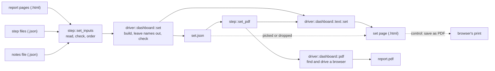

# Design: the report set

Generated 2026-11-26, about 18:50 (Europe/Berlin) from the approved
[requirements](requirements.md). The [prototype gate](prototype-gate.md) was run on 2026-11-27 and
says `proceed` ([R200](../../../docs/research/2026-11-27/01-report-set-prototype-gate.md)). It showed
this text to be wrong at three points. They were corrected on 2026-11-27 as the owner decided that
day (D4 to D6 below): a report page's project name and step title come from the notes file; the
rule for names searches only the project's own texts and refuses on distinctive names; the set
section is built from the page's smaller parts. **Approved by the owner on 2026-11-27** ("approved"), and amended the same day in its structure: the dashboard code is a module of its own (D7 to D9). Tasks: [tasks.md](tasks.md).
Discovery and decisions: [research.md](research.md).

## Overview

**Purpose**: a person who wants to show what several reworks did gets one file that holds them, one
page that draws them, and a PDF of that page.

**Users**: the owner; a developer or maintainer showing results; a pipeline that produces the report
without a person.

**Impact**: two commands are added under `step`. The page inside the binary gains a third way to be
filled. No existing command changes its output, exit codes or receipts.

### Goals
- A set is made from report pages that already exist, and from step files for reworks the tool did
  not run. Nothing of a project is run to make it.
- The same parts of the page draw a step in a run's report and in a set.
- A project shown by counts only has no name in the set, the page or the PDF.
- The PDF is the page, printed by a browser that is already installed.

### Non-Goals
- Measuring state or local complexity in the tool. They stay handed in.
- Writing notes. The tool has no model.
- A served page for a set, editing a set in the page, uploading.
- A PDF without a browser; Firefox.
- Replacing `step reports`.

## Boundary Commitments

### This Spec Owns
- The format of a report set, version 1, and the one module that reads and checks it.
- The format of a step file: a rework stated by hand, with handed-in numbers.
- The format of a notes file.
- The commands `step set` and `step set-pdf`, their arguments, messages and exit codes.
- The set mode of the page: the part that shows a set, the control that loads one, the layout for
  print and the control that saves as PDF.
- Finding an installed browser and driving it without a window.
- The section on sets in `docs/steps.md`, `docs/report-set.md`, and the example under
  `docs/examples/report-set/`.

- The module `dashboard`: one directory, `native/src/dashboard/`, that holds everything that shows
  a run or a set and nothing else (decided by the owner on 2026-11-27, D7 to D9). The ten existing
  files of the run page move there from `adapters/driver/` in a first task group, with no change
  of behaviour; the new files of this spec are written there.

### The border between core and dashboard
- **Dashboard** is what turns results into something to look at: the snapshot and its log, the
  report types, the page's text and markers, the list, the removal of names, the subject, the
  listener, the opener, the watch, and from this spec the set, its names and the PDF.
- **Core** is everything that measures, plants faults, runs and judges. Core holds no drawing, no
  page text and no knowledge of a set.
- **`step` decides, the dashboard shows.** The command files stay under `step` (`check_page`,
  `plan_page`, `reports`, and the new `set`, `set_inputs`, `set_pdf`): arguments, checks in order,
  exit codes. They call into `dashboard` and hold no page logic.
- **One crossing exists today and stays, named:** the runner and the command runner in
  `adapters/driver/` tell the dashboard's watch what happens (`tell`, `Event`), and the watch reads
  three of the runner's types. No other file of core names `dashboard`. A test reads the source
  tree and fails when another one does.
- The page's own files stay in `native/page/`; they are text the dashboard takes in.
- Same crate, same binary. The paths `adapters::driver::page_*` of 2.2.0 are gone after the move;
  nothing outside this repository is known to use them, and the release notes say so.

### Out of Boundary
- What a run measures, judges or writes into its snapshot (`run-dashboard`,
  `gradual-refactoring-steps`).
- The live run page: its listener, its states, its stages.
- `step reports` and its list page.
- The handed-in measures of `step check --measures`; this spec reads the same shapes and does not
  change that file's format.
- The research programs that count holders and shapes.

### Allowed Dependencies
- `dashboard::report` (the types `Report`, `Lens`, `Protection`, `Graph`, `Calls`,
  `TypeShapes`), `dashboard::snapshot::Snapshot`, `dashboard::text` (`data_of`, the markers), `dashboard::names`
  (`leave_out`), `adapters::driver::process` for running a program under a time limit.
- `serde`, `serde_json`, `sha2`, `clap`: already in the crate. No new crate.
- The page's view library as it is in the binary.
- A Chromium-based browser on the machine, for `step set-pdf` only.
- Playwright in `verification/`, for the checks only.

Dependency direction: `step::set*` → `dashboard::set` → `dashboard::report`, `dashboard::snapshot`,
`dashboard::names`, `dashboard::text`. Nothing in `dashboard` or in `adapters::driver` depends on
`step`. `dashboard::pdf` uses `adapters::driver::process`; that is the dashboard using core, which
is the allowed direction.

### Revalidation Triggers
- A change of `Snapshot` or `Report` that removes or renames a field: sets of version 1 must still
  be read, or the format version rises.
- A change of the text `const data = ` in a written page: the set's input side.
- A change of `leave_out`: the search for names in a set (3.1, 3.5) is run again on the example.
- A change of the page's parts `Lenses`, `PerFunction`, `Graph`, `Shapes`: the set's browser checks.
- A new major version of the browsers named: the PDF check on both systems.

## Architecture

### Existing Architecture Analysis

- `step plan --page` and `step check --page` build a `Snapshot` and write `run.html` with it at the
  marker `/*DATA*/null` (`dashboard::text::report`).
- `dashboard::text::data_of` takes the run out of a written page of any version.
- `step reports` reads pages, optionally calls `dashboard::names::leave_out` on each run, writes copies
  and `list.html`.
- `step check --measures` reads lenses and shapes measured elsewhere (`step::check_handed`) and puts
  them into the `Report` marked `handed_in`.
- The page is one script with parts as functions; drawings are SVG.

### Architecture Pattern & Boundary Map



- **Pattern**: a pipeline of pure steps with files at both ends. Reading and checking is one module,
  used by both commands and by nothing else.
- **Kept from the existing code**: the page as one file, the markers, the report types, the removal
  of names.
- **New**: the set's head, the step file, the set part of the page, the browser.

### Technology Stack

| Layer | Choice | Role | Notes |
| --- | --- | --- | --- |
| Command line | `clap`, as in `step::mod` | `step set`, `step set-pdf` | no new crate |
| Data | `serde`, `serde_json`, `sha2` | the set, the step file, the notes file | `deny_unknown_fields` on the set's own types |
| Page | `native/page/run.html`, Preact with htm (in the binary) | set mode, load, print layout | no new library |
| PDF | an installed Chrome, Chromium or Edge, started headless | prints the page | found at run time; named in the documentation |
| Checks | cargo-nextest; Playwright in `verification/` | Rust suites; the page in a browser | Linux through Dagger and a container |

## File Structure Plan

### Directory Structure
```
native/
├── page/
│   ├── run.html                      # modified: set mode, load control, print layout
│   ├── set.spec.mjs                  # new: the set page in a browser
│   └── set-six.json                  # new: fixed set for the browser checks
├── src/
│   ├── lib.rs                        # modified: one line, `pub mod dashboard;`
│   ├── adapters/driver/
│   │   ├── mod.rs                    # modified: the ten `page_*` module lines go
│   │   ├── runner.rs                 # modified: one import, `dashboard::watch`
│   │   └── run_command.rs            # modified: one import, `dashboard::watch`
│   ├── dashboard/                    # new directory: everything that shows a run or a set
│   │   ├── mod.rs                    # new: the module lines, and what the border is
│   │   ├── snapshot.rs               # moved from adapters/driver/page_snapshot.rs
│   │   ├── log.rs                    # moved from page_log.rs
│   │   ├── report.rs                 # moved from page_report.rs
│   │   ├── subject.rs                # moved from page_subject.rs
│   │   ├── watch.rs                  # moved from page_watch.rs
│   │   ├── serve.rs                  # moved from page_serve.rs
│   │   ├── open.rs                   # moved from page_open.rs
│   │   ├── list.rs                   # moved from page_list.rs
│   │   ├── text.rs                   # moved from page_text.rs; then modified: `set()`, the marker
│   │   ├── names.rs                  # moved from page_names.rs; then modified: gives back the names
│   │   ├── set.rs                    # new: the set's types, reader, checker, builder
│   │   ├── set_names.rs              # new: names out of a set; one number per name; the last search
│   │   └── pdf.rs                    # new: find a browser, drive it, time limit
│   └── step/
│       ├── set.rs                    # new: `step set`, arguments and outcome
│       ├── set_inputs.rs             # new: a page, a step file, a notes file → inputs
│       ├── set_pdf.rs                # new: `step set-pdf`
│       └── mod.rs                    # modified: two commands
└── tests/
    ├── report_set.rs                 # new: format, building, refusals, determinism
    ├── report_set_names.rs           # new: counts only
    ├── report_set_pdf.rs             # new: the PDF command with a stand-in browser and a real one
    └── fixtures/report_set/          # new: pages, step files, notes, changed sets
docs/
├── steps.md                          # modified: section "A set of reports"
├── report-set.md                     # new: the three formats
└── examples/report-set/              # new: inputs, set.json, set.html, README.md
verification/playwright.config.mjs    # modified: one more test file
```

### Modified Files
- `native/page/run.html`: a third marker `/*SET*/null`; the part `Set`; the load control; the rules
  for print; `App` chooses `Set` when a set is present. With no set the page behaves as before.
- The move: the ten `page_*.rs` files of `native/src/adapters/driver/` become the files of
  `native/src/dashboard/` without their prefix. Their content changes only in the paths they
  import and in the three `include_str!` paths to `native/page/`. Every file that imports them
  changes its import and nothing else: eight files under `step`, two in the driver, and the test
  files that import them, which keep their names.
- `native/src/lib.rs` gets one line. It is at its size ceiling in the budgets file; whether the
  line fits is found in the first task. If it does not, the owner decides between one more line
  for `lib.rs` and another place for the directory.
- `native/src/dashboard/text.rs`: `set(&ReportSet) -> Result<String, String>`.
- `native/src/dashboard/names.rs`: `leave_out` returns the names it replaced, with their numbers.
  `step::reports` ignores the result.
- The budgets file: the ten moved files are listed under their new paths with the same ceilings.
- `native/src/step/mod.rs`: `StepCommand::Set`, `StepCommand::SetPdf`.
- `verification/playwright.config.mjs`: `set.spec.mjs` in `testMatch`.
- `docs/steps.md`.

## System Flows

### Making a set

```mermaid
sequenceDiagram
    participant P as person or pipeline
    participant S as step set
    participant I as set_inputs
    participant B as dashboard::set
    P->>S: inputs in order, --out, [--notes] [--page] [--without-names-of]
    S->>I: read each input
    I-->>S: runs, step files, notes, or the first that cannot be read
    S->>B: build
    B->>B: names out per project, then search that project's steps and the notes for them
    B-->>S: the set, or a refusal that names the part
    S->>P: set.json, [set.html], where each was written; exit 0 or 3
```

Nothing is written unless every check has passed. The set is written first, then the page.

### The PDF by command

```mermaid
sequenceDiagram
    participant P as pipeline
    participant C as step set-pdf
    participant D as dashboard::pdf
    participant X as browser
    P->>C: set.json, --out report.pdf
    C->>C: read and check the set (exit 3 on refusal)
    C->>D: find a browser (exit 2 when none)
    C->>C: write the page into a new directory of its own
    D->>X: headless, own profile directory, print to PDF, time limit
    X-->>D: PDF, or nothing, or still running
    D->>D: stop what is left of the browser; remove the directory
    C->>P: report.pdf and exit 0, or no file and exit 2
```

## Requirements Traceability

| Requirement | Summary | Components | Interfaces | Flows |
| --- | --- | --- | --- | --- |
| 1.1, 1.2, 1.9 | one file; what a step holds; versions and inputs | `dashboard::set` | `ReportSet`, `Step`, `Input` | Making a set |
| 1.3, 1.4 | where a number is from; not measured is said | `dashboard::set`, `dashboard::report` | `Lens.command`, `Lens.handed_in`, `Lens.measured`, `Snapshot.tool` | |
| 1.5, 1.6, 1.7, 1.8 | faults, drawing, shapes, time | `dashboard::set` | `Report.functions`, `Report.graph`, `Report.shapes`, `Snapshot.seconds` | |
| 1.10 | refusing a file that is not a set of this version | `dashboard::set` | `read` | both |
| 2.1, 2.2, 2.10 | one step per input, in order; a set of one; refused steps alike | `set`, `set_inputs` | `SetArgs.inputs`, `build` | Making a set |
| 2.3, 2.4 | handed-in numbers; a step from them alone | `set_inputs`, `dashboard::set` | `StepFile`, `Step.judged` | Making a set |
| 2.5 | notes at the set or at a step | `set_inputs`, `dashboard::set` | `NotesFile`, `Note` | Making a set |
| 2.6 | runs nothing, changes no project | `set`, `set_inputs` | reads only; writes at `--out` and `--page` | |
| 2.7 | same inputs, same set | `dashboard::set` | `as_of`; no clock; ordered maps | |
| 2.8, 2.9 | refusals by exit code; no overwrite | `set`, `set_inputs` | `Refused`, `--force` | Making a set |
| 3.1, 3.2, 3.3, 3.4 | names out of the set; counts kept; one number per name; said per project | `dashboard::set_names`, `dashboard::names` | `without_names`, `Project.counts_only` | Making a set |
| 3.5, as amended 2026-11-27 | a note that names what was left out: refused for a distinctive name, warned for an everyday word | `dashboard::set_names` | `names_in`, `Found` | Making a set |
| 3.6 | page and PDF show only what the set holds | `run.html` | the page draws from the set alone | |
| 4.1, 4.10 | the page written with the set, only when asked | `set`, `dashboard::text` | `--page`, `dashboard::text::set` | Making a set |
| 4.2 | from disk, no request | `run.html` | no address in set mode | |
| 4.3, 4.4, 4.6 | steps side by side; each step as a report; refused alike | `run.html` | `Set`, `SetStep`, `Tiles`, `Lenses`, `PerFunction`, `Graph`, `Shapes` | |
| 4.5, 4.7, 4.8 | marks; notes as text; versions and inputs | `run.html` | `Set`, text nodes only | |
| 4.9 | both schemes, phone width, keyboard | `run.html`, `set.spec.mjs` | | |
| 5.1, 5.2, 5.3, 5.5, 5.6 | load a set; say which is shown; refuse a bad file; counts only alike; reopen shows the first | `run.html` | `load`, `checkSet` | |
| 5.4 | nothing is sent | `run.html` | no fetch, no address | |
| 6.1, 6.2, 6.3, 6.4, 6.6, 6.7 | the layout for paper | `run.html` | rules under `@media print`; the mark `print` | |
| 6.5 | one control that saves as PDF | `run.html` | `savePdf` | |
| 7.1, 7.2, 7.7 | the PDF file; what it holds; no overwrite | `set_pdf`, `dashboard::pdf` | `SetPdfArgs`, `print` | The PDF by command |
| 7.3, 7.4 | no window, no question, no network, no install; browsers named | `dashboard::pdf`, `docs/steps.md` | `find`, `--browser`, `LESSCODE_BROWSER` | |
| 7.5, 7.6 | no browser; time limit; nothing left running | `dashboard::pdf`, `set_pdf` | `NoBrowser`, `NotPrinted`, exit 2 | The PDF by command |
| 7.8 | Windows and Linux | `dashboard::pdf`, `report_set_pdf.rs` | | |
| 8.1, 8.2, 8.5 | arguments only; says where it wrote; writes only there | `set`, `set_pdf` | | |
| 8.3, 8.4 | no set unless asked; old reports and list the same | `run.html`, `dashboard::text` | existing tests and `states.spec.mjs`, `list.spec.mjs` unchanged | |
| 9.1, 9.2 | how to; the formats | `docs/steps.md`, `docs/report-set.md` | | |
| 9.3, 9.4 | the example, kept true by the checks | `docs/examples/report-set/`, `report_set.rs`, `report_set_pdf.rs` | | |

## Components and Interfaces

| Component | Layer | Intent | Requirements | Depends on | Contracts |
| --- | --- | --- | --- | --- | --- |
| `dashboard::set` | dashboard | the set: types, reading, checking, building | 1, 2.1 to 2.5, 2.7, 2.10 | `dashboard::report`, `dashboard::snapshot` | Service, State |
| `dashboard::set_names` | dashboard | counts only | 3 | `dashboard::names`, `dashboard::set` | Service |
| `set_inputs` | step | files to inputs | 2.3 to 2.5, 2.8 | `dashboard::text::data_of`, `dashboard::set` | Service |
| `set` | step | the command `step set` | 2, 4.1, 4.10, 8 | the three above, `dashboard::text` | Batch |
| `dashboard::pdf` | dashboard | a browser, found and driven | 7.3 to 7.8 | `process` | Service |
| `set_pdf` | step | the command `step set-pdf` | 7, 8 | `dashboard::set`, `dashboard::text`, `dashboard::pdf` | Batch |
| set mode of `run.html` | page | show, load, print | 3.6, 4, 5, 6 | the page's parts | State |

### Dashboard

#### `dashboard::set`

| Field | Detail |
| --- | --- |
| Intent | One place that knows what a report set is |
| Requirements | 1.1 to 1.10, 2.1, 2.2, 2.4, 2.5, 2.7, 2.10 |

**Responsibilities & Constraints**
- Owns the set's types and its format version.
- Reads a set strictly: its own types refuse unknown fields; each step's run is read as a
  `Snapshot`, which the tool already reads tolerantly across its versions.
- Builds a set from inputs without reading a clock or a file.

##### Service Interface
```rust
pub const FORMAT: u32 = 1;

pub struct ReportSet {
    pub schema: u32,                 // FORMAT
    pub kind: String,                // "lesscode report set"
    pub tool: Tool,                  // the tool that wrote the set
    pub as_of: Option<String>,       // the end of the newest input's run
    pub inputs: Vec<Input>,
    pub projects: Vec<Project>,
    pub notes: Vec<Note>,            // about the set as a whole
    pub steps: Vec<Step>,            // in the order the inputs were named
}
pub struct Input { pub name: String, pub sha256: String, pub kind: InputKind, pub ended: Option<String> }
pub enum InputKind { Report, StepFile, Notes }
pub struct Project { pub id: String, pub name: Option<String>, pub counts_only: bool }
pub struct Note { pub text: String, pub by: Option<String> }
pub struct Step {
    pub id: String,                  // "1", "2", …
    pub project: String,             // a Project.id
    pub title: String,
    pub judged: bool,                // false: stated in a step file, not judged in this set
    pub outcome_from: Option<String>,// where a step file's outcome is from, e.g. a verdict file
    pub notes: Vec<Note>,
    pub run: Snapshot,               // cut down: no stages, no copies, no commands of the project
}

pub enum Refused { Part { part: String, why: String } }

pub fn read(text: &str) -> Result<ReportSet, Refused>;
pub fn build(inputs: Vec<StepInput>, notes: Vec<PlacedNote>, tool: Tool) -> Result<ReportSet, Refused>;
pub fn write(set: &ReportSet) -> Result<String, String>;   // the same bytes for the same set
```
- Preconditions: `build` gets inputs already read; it does no IO.
- Postconditions: every step has all six lenses, each marked measured or not; `as_of` is the newest
  `ended`; `read(write(set))` gives the same set.
- Invariants: a `Step.project` names an entry of `projects`; step ids are unique.

**Implementation Notes**
- `read` refuses with the part named: `schema` (newer or missing), a missing head field, a field the
  format does not know, `steps[2].run` that is not a run.
- Maps are written in a fixed order so that the same set gives the same bytes.

#### `dashboard::set_names`

| Field | Detail |
| --- | --- |
| Intent | A project shown by counts only has no name anywhere in a set |
| Requirements | 3.1 to 3.5 |

##### Service Interface
```rust
/// Takes the names of `project` out of every step of it and gives them back.
pub fn without_names(set: &mut ReportSet, project: &str) -> Vec<String>;
pub struct Found { pub place: String, pub word: String, pub everyday: bool }
/// Where names of `project` still stand as whole words: in the texts of its own steps and in the
/// notes of the set. Never in the names of the format's parts, never in another project's steps.
pub fn names_in(set: &ReportSet, project: &str, names: &[String], page: &str) -> Vec<Found>;
```
- `without_names` calls `dashboard::names::leave_out` per run and then makes the numbers agree across the
  steps of the project: the same name gets the same number in every step.
- A name is searched as a whole word: `run` is not found in `runtime`.
- A name is **everyday** when it stands as a whole word in the text of the page inside the binary
  (`page`), as `run` and `load` do. Every other name is **distinctive**.
- `build` calls `names_in` last, before anything is written. A distinctive name is a refusal that
  names the place and the word (3.5). An everyday name is a warning on standard error with the place
  and the word, and the set is written.
- Why not a search of the written set, as this design first had it (R200): `run` is the name of a
  part of every step, and five of the 180 names of the gate's Python project are words the page
  uses in its own sentences. A plain search refused every set of that project and the note "The
  first run of the tests took longer."
- Limit, accepted by the owner: a note may name a function whose name is an everyday word without
  being refused. The warning is what the person gets. A word of ordinary language that the page
  does not happen to use is treated as distinctive, and the refusal names it so that the note can
  be worded another way.
- The names of the input files stand in the head of a set. For a project shown by counts only they
  are searched like a note.

#### `dashboard::pdf`

| Field | Detail |
| --- | --- |
| Intent | Print one page to one PDF with a browser that is already there |
| Requirements | 7.3 to 7.8 |

##### Service Interface
```rust
pub enum NotMade {
    NoBrowser { looked_for: Vec<String> },
    NotPrinted { why: String },      // ended without a PDF, or stopped at the time limit
}
pub fn find(named: Option<&Path>) -> Result<PathBuf, NotMade>;
pub fn print(browser: &Path, page: &Path, pdf: &Path, seconds: u64) -> Result<(), NotMade>;
```
- `find` looks, in this order: the path given with `--browser`; the variable `LESSCODE_BROWSER`;
  on the search path `chrome`, `google-chrome`, `chromium`, `chromium-browser`, `msedge`,
  `microsoft-edge`; on Windows the usual places of Chrome and Edge under the program directories.
- `print` starts the browser headless with a profile directory of its own inside the command's
  working directory, with the address of the page ending in `#print`, and waits at most `seconds`.
  It stops the browser and whatever it started when the time is over, and removes the directory.
- The PDF is written beside its place under another name and moved there only when it is whole.

### Step

#### `set_inputs`

**Responsibilities**: turns one named file into one input. A file is a report page when
`dashboard::text::data_of` reads it, a step file or a notes file when its `kind` says so.

```rust
pub enum StepInput { Run { name: String, sha256: String, run: Snapshot, label: Label }, Stated { name: String, sha256: String, step: StepFile } }

#[serde(deny_unknown_fields)]
pub struct StepFile {
    pub schema: u32, pub kind: String,           // "lesscode step"
    pub project: String, pub title: String,
    pub before: Option<String>, pub after: Option<String>,   // commits
    pub outcome: Option<String>, pub outcome_from: Option<String>,
    pub lenses: Vec<HandedLens>, pub shapes: Vec<TypeShapes>,
    pub functions: Vec<Protection>,
    pub scope_before: Option<PathBuf>, pub scope_after: Option<PathBuf>,   // receipts of measure-scope
    pub seconds: Option<f64>,
}
#[serde(deny_unknown_fields)]
pub struct NotesFile { pub schema: u32, pub kind: String, pub notes: Vec<PlacedNote>, pub labels: Vec<Label> }   // "lesscode notes"
pub struct PlacedNote { pub about: String, pub text: String, pub by: Option<String> }   // about: "set" or a step's number
#[serde(deny_unknown_fields)]
pub struct Label { pub about: String, pub project: String, pub title: String }          // about: the file name of a report page
```
- A report page holds the path of a working copy and a branch, and neither the project's name nor
  a title for the step (R200). Both come from a `Label` in the notes file, found by the page's file
  name. A page without a label is refused, with the file named and what is missing. A label for a
  file that is not among the inputs, and two labels for one file, are refused too.
- A step file states its own project and title; a label for a step file is refused.
- A run whose `ended` is false is refused (2.8). Two inputs with the same project, the same commits
  and different outcomes are refused as contradicting each other (2.8).
- Where a step file names scope receipts, the drawing and the structure lens are taken from them and
  are not marked handed in; everything else in a step file is.
- `HandedLens` is the type of `step::check_handed`, made `pub(crate)`; that file's format is not
  changed.

#### `set` and `set_pdf`

##### Batch / Job Contract
```
lesscode-core step set <input>... --out <set.json> [--notes <file>] [--page [place]]
                       [--without-names-of <project>]... [--force]
lesscode-core step set-pdf <set.json> --out <report.pdf> [--browser <path>] [--seconds <n>] [--force]
```
- **Trigger**: the command line. Nothing else starts them.
- **Input / validation**: every input is read and checked before anything is written.
- **Output**: `step set` writes the set, then the page where `--page` is given (without a place:
  beside the set, with `.html`). `step set-pdf` writes the PDF. Each prints one line per file
  written.
- **Exit codes**, in the tool's existing meaning: `0` written; `3` invalid input, a refusal, a file
  in the way without `--force`, or a failure to write; `2`, for `step set-pdf` only: no browser
  found, or the browser made no PDF in time. `1` is not used.
- **Idempotency**: the same inputs give the same set and the same page. The PDF's bytes are the
  browser's and are not promised to be the same.

### Page

#### Set mode of `run.html`

| Field | Detail |
| --- | --- |
| Intent | Show a set, take another, and lay itself out for paper |
| Requirements | 3.6, 4.2 to 4.9, 5.1 to 5.6, 6.1 to 6.7 |

**Responsibilities & Constraints**
- `const set = /*SET*/null;` beside `events` and `data`. `App` shows `Set` when `set` or a loaded set
  is present, and otherwise what it shows today.
- `Set` shows, in this order: the head (which set, as of when, the tool's version, the inputs);
  the notes of the set; one table of the steps side by side, a row per step and a column per lens;
  then per step a section `SetStep`.
- `SetStep` shows the step's outcome in its own words, the step's notes, the commits where the step
  names them, and then `Tiles`, `Lenses`, `PerFunction`, `Graph` and `Shapes`, called with that
  step's run as they are called today. It does not call `Result`: that part draws functions and
  calls only where the run names the commit it compared with, and words the outcome by exit code,
  and a stated step has neither (R200). `Result` and the page of one run stay as they are.
- The outcome line says for a judged step which tool and command judged it, and for a stated step
  "Stated in a step file, not judged in this set", with `outcome_from` where it is given. Both
  stand in the same block.
- Inside a set, a handed-in number is marked "handed in" and not "not measured by this run": a set
  is not a run. `Lenses` and `Shapes` take the wording from the mode the page is in.
- Every text of a set goes onto the page as a text node. No part of a set is used as markup, as an
  address or as a script.
- The page asks for nothing from another machine in set mode: no address appears in it.

##### State Management
- **State**: `shown`: the set written in, or a loaded one with its file name; `message`: why the
  last file was not taken. Nothing is kept between openings (5.6).
- **Loading**: a file input and a drop on the page give a file to `load`. `checkSet` applies the
  same rules as `dashboard::set::read` for the head: `kind`, `schema` not above the page's, the required
  parts. A file that fails leaves `shown` as it was and sets `message` with the part's name.
- **Print**: rules under `@media print` take the light scheme's values, hide the controls, and keep
  figures and table rows whole. The control `savePdf`, the browser's own print, and the address
  ending in `#print` all put the page in the same state first: every folded part open, and the mark
  `data-drawn` on the page's root once every step is drawn.

## Data Models

### The report set (version 1)

```json
{
  "schema": 1,
  "kind": "lesscode report set",
  "tool": { "name": "lesscode-core", "version": "2.3.0" },
  "as_of": "2026-11-26T13:48:39Z",
  "inputs": [ { "name": "check.html", "sha256": "…", "kind": "report", "ended": "2026-11-26T13:48:39Z" } ],
  "projects": [ { "id": "p1", "name": "drift-rdp", "counts_only": false },
                { "id": "p2", "name": null, "counts_only": true } ],
  "notes": [ { "text": "…", "by": "agent, skill untangle-state" } ],
  "steps": [ { "id": "1", "project": "p1", "title": "Display path", "judged": true,
               "outcome_from": null, "notes": [], "run": { "…": "a snapshot" } } ]
}
```

- A project shown by counts only has `name: null`; the page calls it "project 2".
- `run` is a `Snapshot` without `stages`, `copies`, `commands`, `writes_in_repository` and
  `faults.example`. For a project shown by counts only, `subject.repository` is absent too.
- A step from a step file has a `run` whose `report.lenses` are all `handed_in`, except the
  structure lens where scope receipts were named; `judged` is false.

The step file and the notes file are given under `set_inputs`. All three are described for other
programs in `docs/report-set.md`.

## Error Handling

### Error Strategy
Check everything, then write. A refusal names the file and the part, changes nothing, and ends with
the exit code of its kind.

### Error Categories and Responses

| Situation | Message names | Exit |
| --- | --- | --- |
| An input cannot be read, or is neither a page nor a step file nor a notes file | the file | 3 |
| A page whose run did not end | the file | 3 |
| Two inputs contradict each other about a step | both files, and what differs | 3 |
| A note for a step that is not there | the note | 3 |
| A report page has no label, a label names no input or a step file, or two labels name one file | the file and what is missing or double | 3 |
| A note or an input's file name holds a distinctive name that was left out | the note or file, and the word | 3 |
| A distinctive name of a counts-only project still stands in a text of one of its steps | the step, the part and the word | 3 |
| An everyday word that is also a name stands in a note or in a text of the project's steps | the place and the word, as a warning; the set is written | 0 |
| A set with a newer format, a missing part or an unknown part | the part | 3 |
| A file is in the way and `--force` is not given | the file | 3 |
| No browser found | which were looked for, and where | 2 |
| The browser made no PDF, or the time ran out | which, and after how long | 2 |

### Monitoring
None. The commands print what they wrote and why they refused, on standard error for refusals.

## Testing Strategy

### Unit tests (in the modules)
- `dashboard::set::read` refuses a newer `schema`, a missing `steps`, an unknown field in the head and a
  step whose `run` is not a run, each naming the part (1.10).
- `dashboard::set::build` gives `as_of` as the newest end, steps in the order of the inputs, and the same
  bytes when called twice (2.1, 2.7).
- `dashboard::set_names::without_names` gives one number per name across two steps of one project (3.3).
- `dashboard::set_names::names_in` finds a distinctive name in a note and in a text of the project's
  step; marks a name that is a word of the page as everyday; finds nothing in the names of the
  format's parts, in another project's step, or inside a longer word (3.5).
- `dashboard::pdf::find` takes `--browser` before the variable and the variable before the search path,
  and lists what it looked for when it finds none (7.4, 7.5).

### Integration tests (`native/tests/`)
- `report_set.rs`: from two report pages and one step file `step set` writes a set with three steps;
  a set of one from one page (2.2); a refused step is in the set (2.10); an unfinished run, two
  contradicting inputs and a file in the way each end with 3 and write nothing (2.8, 2.9); no file
  of the fixture's project differs afterwards (2.6); without `--page` no page is written (4.10);
  `step check --page` on the toy repository writes the same data with this feature (8.3, 8.4).
- `report_set_names.rs`: with `--without-names-of`, no name of the fixture project is in the set or
  the page; counts and edges are as before (3.1 to 3.4); a note with a distinctive left-out name
  ends with 3 and names the word; a note with a name that is an everyday word of the page ends with
  0, writes the set and prints the warning (3.5). The fixture project has a function named `run`.
- `report_set.rs` also: a report page without a label ends with 3 and names the file; with a label
  the step carries the label's project and title.
- `report_set_pdf.rs`: with a stand-in program as the browser: a PDF that appears is moved into
  place and the exit is 0; a stand-in that writes nothing gives 2; one that never ends is stopped at
  the time limit, leaves no process, and gives 2; no browser gives 2 with the list; a bad set gives
  3 (7.1, 7.5 to 7.7). With a real browser, where one is found: the example's PDF exists and holds
  the count of functions of each drawing (7.2, 7.8); skipped with a printed reason where none is.
- The example: `docs/examples/report-set/set.json` is built again from its inputs and equals the
  committed file (9.3, 9.4).

### Browser checks (`native/page/set.spec.mjs`, Playwright)
- The page with `set-six.json` inside shows six rows and six sections, at 1,280 and 400 wide, light
  and dark, without sideways scrolling of the page (4.3, 4.4, 4.9).
- A step not judged, a lens not measured and a handed-in number each carry their mark (4.5); a
  refused step has the same block as an accepted one (4.6). A stated step without a commit shows
  its drawing; no step of a set says "this run".
- A note that contains `<script>` and `<b>` shows those characters (4.7).
- Picking a second set replaces the first and names the file; a file that is not a set leaves the
  first and shows a message with the part; reloading the page shows the first (5.1 to 5.3, 5.6).
- No request leaves the page in any of these (4.2, 5.4).
- With print media emulated: no control is visible, every folded part is open, the colours are the
  light scheme's (6.1, 6.2, 6.4).
- Every control is reached and used by keyboard (4.9).
- `states.spec.mjs` and `list.spec.mjs` pass unchanged (8.4).

### Not covered by a check
- 6.3, that no drawing or table row is cut across two sheets, is read by a person in the PDF of the
  example; the rules are in the page, and no check measures a page break.

## Security Considerations
- A set that is handed to the page is not trusted. Its text is shown as text; it is never an
  address, markup or script (4.7).
- The page sends nothing (5.4).
- The browser is started with a profile directory of its own, without the person's profile, on a
  `file:` address the command wrote, and is stopped by the command (7.3, 7.6).
- The command starts only a browser it found by the rules above or was pointed at; it never
  downloads one (7.4).

## Performance & Scalability
Not a target of this project. One bound is checked at the gate (G7): the page with six steps inside
is at most 400 KiB. No limit on the number of steps is designed in.

## Decisions of the owner, 2026-11-26, about 19:05

All three were decided as recommended.

| # | Decision | Decided |
| --- | --- | --- |
| D1 | A rework the tool once judged, of which no report page exists (R173, R161), enters a set through a step file and is marked "not judged in this set", with `outcome_from` naming the verdict. Alternative: verdict files as a third kind of input | The step file, marked |
| D2 | The commands are `step set` and `step set-pdf` | `step set` and `step set-pdf` |
| D3 | The checks on Linux need a Chromium in the container that runs them | The PDF on Linux is shown once in a Linux container with a Chromium (see C4); the page's own checks stay Playwright on the host |

## Decisions of the owner, 2026-11-27, after the gate

All three were decided as recommended. Evidence for each:
[R200](../../../docs/research/2026-11-27/01-report-set-prototype-gate.md).

| # | Decision | Decided |
| --- | --- | --- |
| D4 | Where a report page's project name and step title come from. Alternatives: options on `step set`; options on `step check` that write them into the page | The notes file, under `labels` |
| D5 | The rule that keeps the names of a counts-only project out. Alternatives: refuse on every name unless the word is listed as allowed; check the steps and leave notes unchecked | Search only that project's steps and the notes; refuse on distinctive names, warn on everyday words. Requirement 3.5 is amended to this |
| D6 | How the set page draws a step. Alternative: change `Result` so that it draws stated steps too | The set section composes the smaller parts; `Result` stays |

## Decisions of the owner, 2026-11-27, after the design was approved

The owner asked that the dashboard and visualization code be a module of its own, easy to tell
from lesscode's core. All three were decided as recommended. This amends the approved design in its
structure only; no format, command or behaviour changes.

| # | Decision | Decided |
| --- | --- | --- |
| D7 | How separate. Alternatives: a crate of its own in a workspace; naming only | A module directory of its own inside the crate, `native/src/dashboard/` |
| D8 | Whether the run page's ten existing files move too. Alternatives: only the new files; new now and the move after the last group | All move, as the first task group, before anything of this spec is built |
| D9 | Where the commands that write pages live. Alternative: move them with the module | They stay under `step`; `step` decides, the dashboard shows |

## Contradictions and disposition

Checked: [requirements](requirements.md), [brief](brief.md), `product.md`, `tech.md`,
`structure.md`, `prototype-first.md`, the `run-dashboard` requirements and design, the
`lesscode-metrics` brief, the code named above, and the [prototype gate](prototype-gate.md).

| # | Competing claims | Authority | Resolution | Status |
| --- | --- | --- | --- | --- |
| C1 | Requirement 2.7 (the same inputs give the same set) against 4.8 (the page says when the set was made) | both approved 2026-11-26 | "When it was made" is `as_of`, the end of the newest input's run. The set holds no reading of the clock | resolved in this design; the owner sees it here |
| C2 | Requirement 2.4 (a step from handed-in numbers is marked as not judged by the tool) against the fact that two of R199's reworks were judged by the tool and have no report page | requirements point 1; R173, R161 | The mark reads "not judged in this set", and the step may name its verdict in `outcome_from` | resolved by the owner, 2026-11-26: the step file, marked |
| C3 | The brief leaves open whether the set page is a second page or a mode of an existing one; `run-dashboard` is complete and its page is checked | brief, 2026-11-26; `run-dashboard` validation | A mode of `run.html`. Its own checks run unchanged in the first task that touches it | resolved; revalidation named |
| C4 | Owner's memory rule that a browser check runs through Playwright and never in a container, against Requirement 7.8 (the PDF on Linux) | owner rules; requirement 7.8 | The page's checks stay Playwright on the host. The PDF command on Linux is the tool's own behaviour and is shown once in a Linux container with a Chromium, as the opener of the run page was (R182) | resolved by the owner, 2026-11-26: once in a container |
| C5 | Requirement 7.2 (every drawing in the PDF) against a browser that may print before the page's script has drawn | requirement 7.2 | Not resolvable on paper | resolved by the gate, 2026-11-27 (G5): Edge on Windows and Chromium on Linux print all eight drawings as shapes with text. The page draws while it loads, and the browser prints after loading |
| C6 | Requirement 6.3 (nothing cut across sheets) has no check | requirement 6.3 | Read by a person in the example's PDF; said under Testing Strategy | resolved as a stated limit |
| C7 | `tech.md` on new dependencies against the browser | `tech.md` | No crate is added. The browser is a program the person already has, as `ssh-keygen` and `curl` are for `signed-approvals` | resolved |

| C8 | Requirement 3.5 as approved (a note that contains a left-out name is refused) against the gate: five of 180 names are everyday words, and the note "The first run of the tests took longer." was refused | requirement 3.5; R200 | Refused for a distinctive name, warned for an everyday word; the requirement carries a dated amendment | resolved by the owner, 2026-11-27 (D5) |
| C9 | Goal "the same parts of the page draw a step in a run's report and in a set" against `Result`, which cannot draw a stated step | this design; R200 | The shared parts are `Tiles`, `Lenses`, `PerFunction`, `Graph` and `Shapes`. The outcome block is the set's own | resolved by the owner, 2026-11-27 (D6) |
| C10 | Research finding "a report page already holds its whole run … nothing new is needed" against the gate: the page holds no project name and no step title | research.md; R200 | Both are handed in with the notes file | resolved by the owner, 2026-11-27 (D4) |

| C11 | The `run-dashboard` design and its handovers place the run page's files in `adapters/driver/`, against the owner's wish of 2026-11-27 for a module of its own | `run-dashboard` design; owner, 2026-11-27 | The files move to `native/src/dashboard/` in the first task group. The `run-dashboard` spec gets a dated note with the new paths; its records are not rewritten | resolved by the owner, 2026-11-27 (D7, D8) |
| C12 | "No new crate" in this design against a separation the compiler enforces | this design; owner, 2026-11-27 | One crate. The border is kept by a test that reads the source tree | resolved by the owner, 2026-11-27 (D7) |

Nothing is open. Not shown by the gate and left to the first task: the tool's own page, changed in
place, still passes `states.spec.mjs` and `list.spec.mjs`; and `dashboard::names::leave_out`, which the
prototype did not run, gives numbers that can be made to agree across two steps.
