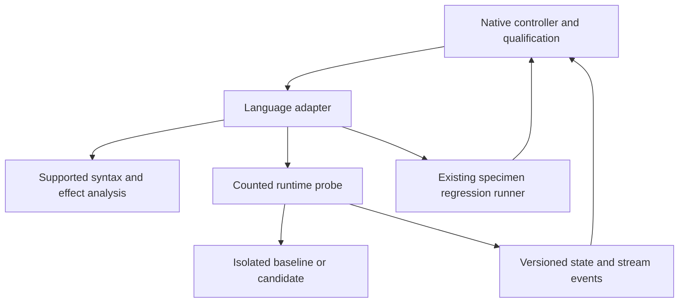

# Technical Design: Rust Deconvolution Adapter

Status: **provisional design, 2026-11-09; prototype not-run; production not approved**.
The owner requested design generation from the revised requirements. This permits
design work, not evidence substitution or production task generation.
See [research](research.md), [gate](prototype-gate.md) and [review](design-review.md).

## Overview, goals and non-goals

Qualify profile `rust-nextest-v1`: source-bound state/effect analysis, runtime finite-domain
comparison, targeted controls and whole-responsibility compression for a supported
Rust subset. Preserve actual language behavior and existing public contracts.
No universal proof, new interpreter, generic framework, transparent arbitrary
runtime instrumentation or inherited language-parity claim.

## Boundary Commitments

### This spec owns
- Rust implementations of the four adapter interfaces and its profile manifest.
- Runtime bindings, effect/codec rules, targeted mutations and profile-specific tests.
- Supported metric definitions, specimen admission and complete adapter accounting.

### Out of Boundary
- Core qualification/comparator policy, model API clients and other language adapters.
- Upstream specimen edits/adoption, altered frozen checks or golden normalization.
- Common schema changes without producer/consumer review.

### Allowed Dependencies
Reuse syn 2.0.119 with full/visit and proc-macro2 span-locations from Cargo.lock. They provide syntax and source locations, not whole-program effect or trait resolution. V1 supports explicitly resolved calls and an inventoried closed subset; compiler-dependent semantic expansion is a deferred alternative, not a hidden dependency.
Runtime: Rust 1.98.1 and nextest 0.9.143 per docs/testing.md, frozen target triple, feature set, Cargo.lock, profile, panic strategy, overflow checks and environment. Run reference/candidate with matching configurations.
Use exact locked existing versions; do not upgrade dependencies during a paired
trial. Prototype alternatives require recorded version/license/platform decisions
before execution. No manifest or dependency is changed by this design.

### Revalidation Triggers
Changed source closure, checks, parser, runtime, module/features/classpath, formatter,
effect model, hooks, codec, wire schema or comparator profile invalidates affected
evidence. Revalidate common fixtures and this profile; notify sibling consumers
when shared contracts change.

## Architecture and shared contracts

The normative producer-owned [adapter contract v1](../native-deconvolution-closure/adapter-contract.md)
defines all request/result fields, tagged values, limits, ordering and outcomes.
This adapter implements StateFrameAnalyzer, PureCoreVerifier,
AdverseMutantGenerator and SpecimenTraceRunner; it does not copy their policy.
Native closure owns shared registration and protocol version changes.
Adapters are sibling consumers; Java and Rust do not depend on each other.

Dependency direction: common records -> language analysis/runtime bindings ->
controller integration. Runtime observation and regression execution are distinct.
No shared controller call imports specimen code directly.

## File Structure Plan

Provisional ownership paths; budgets and necessity are validated by the prototype.

| Path | Responsibility |
|---|---|
| `native/src/adapters/rust/mod.rs` | Four trait implementations and profile dispatch; no duplicated policy |
| `native/src/adapters/rust/analysis.rs` | Supported AST effects, binding identities and source-anchored coverage gaps |
| `native/src/adapters/rust/mutation.rs` | Source-bound supported mutation operators |
| `native/src/adapters/rust/metrics.rs` | Versioned scope metrics and canonical-format integration |
| `native/adapters/rust/Cargo.toml` | Separate counted probe crate manifest with pinned dependency and feature bindings |
| `native/adapters/rust/src/main.rs` | Compiled probe entrypoint with reserved protocol writer and scope invocation |
| `native/adapters/rust/src/observe.rs` | Explicit sink/state observations and tagged Rust values |
| `native/adapters/rust/src/scope.rs` | Specimen entrypoint binding, setup/reset/cleanup and compiled case dispatch |
| `native/tests/rust_adapter.rs` | Independent expected results and runtime/profile integration |
| `native/tests/fixtures/rust_adapter/` | Adverse, codec, metric and unsupported-form fixtures |
| `native/src/lib.rs`, `native/src/adapters/mod.rs` | Core-owned narrow registration reviewed jointly |
| `native/complexity-budgets.json` | Explicit measured allocations before production tasks |
| `native/Cargo.toml`, `native/Cargo.lock` | Only separately accepted dependency changes, if needed |

Common adapter_traits.rs, specimen_runner.rs, state_contract.rs and comparator
remain owned by native closure. The runtime probe code above is maintained
apparatus, not excluded fixture code. Source-generating templates count too.
Avoid inventing a new packaging framework; use isolated recorded build commands.

## Components and Interfaces

### StateFrameAnalyzer and EffectProfile

Admit closed safe synchronous code with concrete types and explicitly resolved
calls. Track field and dereference assignments and mutating method calls back to
owned state roots. mut bindings and &mut alone are neither sufficient proof of
external mutation nor sufficient evidence of impurity. Rc/Arc aliases and
Cell/RefCell/Mutex/RwLock/atomics need explicit observable state models; an
unresolved interior-mutability effect returns unverified.

Unexpanded behavior-bearing macros, unresolved trait/dynamic dispatch, unsafe/FFI,
thread scheduling and unobserved global state are outside v1. Freeze cfg/features
and build-script outputs. Known derive expansions may be admitted only with
recorded source/tool identity and justified effect summaries; syn parsing cannot
prove expansion behavior. Compile failures are execution-failed, not mutants killed.

Encode integer widths/signs, float bit patterns, Option/Result tags, tuples and
declared struct fields. Preserve error variant/message and panic distinctions.
A panic is comparable only when the frozen panic strategy permits observing it;
aborting or killed processes without attributable evidence are execution-failed.
Allocation addresses are not cross-process identity. Borrow/ownership behavior
outside the declared observable contract cannot be inferred from serialized values.

AnalysisResult contains resolved state-root writes and CoverageGap records.
A clean AST scan never upgrades unsupported semantics to verified. FrameSpec is
frozen independently of the candidate. Runtime state checks validate only the
declared finite executions, not every possible heap state.

### PureCoreVerifier and value codec

Use ComparisonRequest/DomainSpec exactly as specified by the shared contract.
Compile/load baseline and candidate in separate fresh runtime instances with the
same setup and environment. Enumerate every admitted Cartesian input combination
subject to frozen constraints; hash case IDs and require matching completion count.
Do not silently drop inputs that fail conversion or replace unsupported values.
Compare return/error and relevant post-state/stream events, then reset state.

Preserve four outcomes: verified, divergent, unverified, execution-failed.
A minimal witness is claimed only for the named completed shrink strategy;
otherwise report a reduced or original witness. Stop after first divergence if
desired, but retain that untested cases were not established equivalent.

### SpecimenTraceRunner and hooks

Build a standalone probe crate against each isolated specimen using frozen
features and locks; the probe uses explicit source-bound wrappers at state and
Write/flush seams. Do not modify the production checkout or frozen regression
tests. If a private entrypoint requires a test-only binding, inventory that
binding as maintained adapter code and verify it does not change behavior.

Protocol output belongs only to the probe. Capture output through declared
injected Write sinks; println/raw fd writes that bypass the observer are coverage
gaps unless a separately qualified interception path exists. Do not promise
transparent interception of arbitrary Rust output. The common supervisor detects
missing completion and drains/limits stderr even after abort.

Run nextest separately for regression and mutation-suite results. Consume its
pinned test list plus JUnit output with test identities and skip accounting.
Do not depend on unstable JSON execution events or treat JUnit output as raw
behavioral trace bytes. Keep doctests separate. Use serial behavioral probes
while retaining mandated parallel regression runners.

RunRequest limits and process lifecycle are delegated to the common supervisor.
All new process launches use argv vectors, bounded capture and owned cleanup.
Source/check/adapter/runtime/config hashes are checked before and after execution.
A missing hook, unfinished task, changed evaluator or incomplete trace blocks
qualification. No wall-clock/performance success target is introduced.

### AdverseMutantGenerator

Mandatory operator families for the admitted scope: interior-state update outside shell; dropped Err cleanup; swallowed error match arm; missing Write::flush.
Freeze valid applicability, independent expected witnesses and test/case identities
before candidate evaluation. Preserve compilation/type correctness for mandatory
controls during calibration. Invalid generated mutants remain recorded and cannot
satisfy the calibrated mandatory set. An inapplicable family must be declared at
scope admission; do not exclude it retrospectively to improve the score.
Use the shared seven mutant statuses and the complete denominator.

### Metrics and compression

Freeze rust-statements-v1 separately from rust-syntax-units-v1 budget units. Define semicolon statements, let bindings, tail expressions, match arms and nested items explicitly with packing controls. Format isolated copies with pinned rustfmt and unchanged edition/config; do not mix physical and canonical counts. Macros whose expanded behavior matters require supported accounting or leave the metric unavailable.

Require at least 20% canonical lines and 10% versioned statements removed plus
the gate's absolute target, counting all replacement helpers/configuration/callers.
Report unsupported metrics as unavailable. Preserve separate behavior,
consolidation and compression outcomes. Common legacy receipts are regression
fixtures; profile metrics use explicit identities rather than reinterpret old data.

### Proposed rust-statements-v1 counting rule

Count each let binding statement and each expression statement/tail expression
once. For control expressions (if/match/loop/while/for), count the control once
and recurse into executable body statements; count each match arm once plus
its body statements, without counting its outer body expression twice.
Item/type/function signatures add no units; executable nested function bodies
are counted once in their own scope. Macro invocations are unavailable unless
the profile freezes a supported expansion accounting rule. Keep these specimen
units separate from syn item/statement units used by the budget checker.
Freeze nested-tail/control/arm and semicolon packing fixtures before measurement.

## System Flows and failure handling

1. Admit specimen/profile/dependencies; freeze scope, effect/domain/control manifests.
2. Validate baseline build/tests and record repeatability before candidate generation.
3. Analyze candidate; return unverified on unsupported semantic coverage.
4. Execute finite-domain probes and ordered trace comparison in fresh instances.
5. Run calibrated adverse controls and selected complete regression tests.
6. Reconcile identities, domain/test completeness, outcomes, metrics and apparatus.
7. Emit candidate validity/compression receipt; adoption is a later explicit action.

Do not execute candidate code during static discovery. Timeout/crash/malformed
protocol follows common cleanup and execution-failed behavior. Divergent evidence
retains its causal step; unsupported coverage remains unverified even when tests
pass. Failed cleanup is retained and prevents a successful run disposition.

## Contradictions and disposition

| ID | Competing claims / source | Resolution and authority | Evidence / affected criteria and consumers | Status |
|---|---|---|---|---|
| A1 | Full parity in historical brief vs bounded revised requirements | Current requirements and owner revision 2026-11-09 govern; qualify named profile only | 1.1, 1.3, 2.3, 2.4; profile fixtures required | Resolved contract; fidelity unproven |
| A2 | Syntax/passing tests treated as semantic proof vs unresolved calls/effects | Separate analysis gaps, runtime traces and regression reports | 1.2, 1.4, 2.1, 4.1, 4.2; independent adverse cases | Resolved contract; hook coverage open |
| A3 | Runner output interpreted as complete trace | Dedicated probe plus explicit hooks; reporter data only for regression | 3.1, 3.2, 3.3, 4.3, 4.4; source-bound failure controls | Resolved design; runtime spike required |
| A4 | Per-file caps imply apparatus budget fit | R41 whole total plus file caps; no per-adapter reset | 5.1, 5.2, 5.3; native core and all siblings | Allocation open; blocks production |
| A5 | Sequential language roadmap or scope authorization implies delivery | Owner Java admission and design request authorize design; sibling gates remain independent | 5.4, 5.5; common schema conformance | Resolved planning |

Additional language-specific competing claims are resolved by the supported
semantics and metric sections above. Sources: [requirements](requirements.md),
[amendment](review-amendment.md), shared contract, actual source/manifest evidence
in [research](research.md), and R41. Any newly discovered contract conflict must
be resolved before approval; empirical open items stay gate blockers.

## Requirements Traceability

| Criteria | Components / validation |
|---|---|
| 1.1, 1.2, 1.3, 1.4 | StateFrameAnalyzer, EffectProfile, frozen frame and alias/callee controls |
| 2.1, 2.2, 2.3, 2.4 | PureCoreVerifier, tagged codec, complete DomainSpec, witnesses and incomplete-run controls |
| 3.1, 3.2, 3.3 | AdverseMutantGenerator, calibrated inventory and seven dispositions |
| 4.1, 4.2, 4.3, 4.4 | SpecimenTraceRunner, runtime hooks, supervisor, isolation/identity fixtures |
| 5.1, 5.2, 5.3, 5.4, 5.5 | Metrics, full accounting, prototype gate, common regression/CI and revalidation |

## Testing Strategy and Migration

Unit/contract fixtures cover supported and rejected syntax, state-root aliases,
special numeric/text values, exception identity, codec round-trip and statement
packing. Runtime controls cover missed state cleanup, wrong write/flush order,
unobserved mutation, false completion, output limits, changed check hashes and
killed descendants. Each has an expected independent outcome, not just reference
agreement. Include failure-path and zero-input/empty-domain controls.

Run language regression suites through the pinned specimen runner; native tests
use nextest 0.9.143 and Rust 1.98.1, Python reference suites use pytest-xdist.
Keep serial probe attribution separate from parallel regression execution.
Use [testing](../../../docs/testing.md) and existing
[Dagger/native CI](../../../docs/ci-validation.md), including platform-specific
runtime-hook smoke checks. No separate CI framework.

Initially register the profile only for explicitly selected runs; retain existing
Python and legacy compare behavior. No automatic adoption or source replacement.
A failed profile rolls back to its prior version/unsupported disposition without
changing goldens. Production migration follows prototype proceed and design review.

## Unresolved empirical prerequisites

Screen native/src/recording.rs record/replay process-lifecycle responsibility, including run_shim, callers and transitive helpers, in an isolated source copy. Freeze the complete closure and external evaluator before editing. If private access, required effects or realistic savings cannot be covered, return revise and select another complete native responsibility; do not force deletion or change the evaluator.

Required before any prototype run: exact specimen/revision/license, dependency
locks and runtime paths, hook reachability, metric rule fixtures, independent
controls and accounting population. Required before production approval: real-code
proceed, whole-budget fit, compatibility evidence and inline design re-review.
The design supplies a bounded plan; it does not assert these prerequisites passed.
