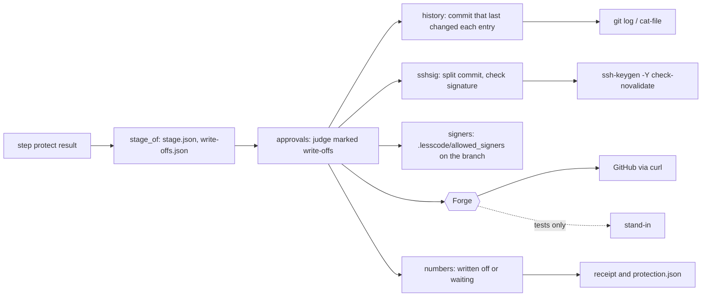

# Design: approvals an agent cannot make

Written 2026-11-25, about 14:30 (Europe/Berlin). **Not approved.** Prototype gate: **proceed**
([prototype-gate.md](prototype-gate.md), record [R192](../../../docs/research/2026-11-25/03-signed-approvals-prototype.md)).
Discovery and the options weighed: [research.md](research.md). Requirements: [requirements.md](requirements.md)
(approved 2026-11-25).

## Overview

A write-off counts as approved when the commit that last changed its entry in `write-offs.json`
carries an SSH signature. The key must be named in the project's signer list
(`.lesscode/allowed_signers`) and listed among the signing keys of the GitHub account that list
names. `step protect result` reads the commit, checks the signature with `ssh-keygen`, and asks
GitHub through `curl`, both started as outside programs the way the core already starts `git`.
The approver and the date on the receipt are the key and the commit. An agent can still write a
proposal, but without the owner's passphrase it cannot make the commit that counts.

### Goals

- Only the owner's signed commit makes a write-off count (requirement 1).
- A key counts only where the project and GitHub both name it (requirement 2).
- The receipt shows each approval's key and commit, and each refusal's reason (requirement 3).
- The same verdict on Windows and Linux, tested in CI without the owner's key or the network
  (requirement 7).

### Non-goals

- Approvals of Kiro spec phases in `spec.json`; the release-signing key; signing of other commits.
- A lesscode command that writes or commits an approval. lesscode stays a reader of Git.
- Defence against an agent that replaces programs on the owner's machine (see Security).

## Boundary Commitments

### This Spec Owns

- What "approved" means for a write-off in `step protect result`: the mark, the commit that last
  changed the entry, the signature, the signer list, the forge's keys.
- The signer list's place and form in a project under work: `.lesscode/allowed_signers`.
- How the result and the receipt show approvals and refusals.
- The guide of the owner's key and of approving, and the parts of the steps guide, the skill
  `protect-before-reduce` and the 2.2.0 notes that speak of approving.
- The re-approval of the earlier approvals in the clones, as a task of the owner with a record.

### Out of Boundary

- `step protect begin`, `step check`, `step pin` and the numbers of a stage other than "written off"
  and "waiting".
- The forge's own protections (branch rules, required signatures) and the merge.
- The owner's private key, its passphrase and its storage. lesscode never reads a private key.

### Allowed Dependencies

- Outside programs, each with a fixed argument list: `git` (the existing read-only allow-list of
  `revisions.rs`), `ssh-keygen` (`-Y check-novalidate` only), `curl` (one GET to
  `https://api.github.com/users/<account>/ssh_signing_keys`).
- Existing crates only (`serde`, `serde_json`, `sha2`). No new crate.
- In tests: `git commit -S` with keys the test makes, and a stand-in forge passed to a library
  function.

### Revalidation Triggers

- GitHub changes or removes the signing-key endpoint, or starts requiring a token for it.
- OpenSSH changes the wording of `check-novalidate`'s success line.
- Git changes where it stores the signature (`gpgsig`, `gpgsig-sha256`).
- A project under work keeps its stage files on a forge other than GitHub.
- The owner's terminal prompt fails on the first real signing (gate row G9).

## Architecture

### Existing Architecture Analysis

`step protect result` (`protect_result.rs`) opens a `Context` (declaration, base and step trees),
reads the committed verdict, `stage.json` and `write-offs.json` from the branch (`on_branch`), and
lets `protect_numbers::numbers` place every unnoticed fault as written off or waiting.
`WriteOff::approved()` decides from `reason`, `approved_by` and `approved_at`. The receipt
(`protect_receipt.rs`) prints "Approved by … on …". Exit codes: 0 enough, 1 waiting, 2 not judged,
3 bad input.

### Architecture Pattern and Boundary Map



The new work sits between reading the files and counting: `approvals` fills in, for every
write-off marked approved, either the signed approval or the reason it does not count.
`numbers` stays pure and only reads that.

### Technology Stack

| Layer | Choice | Role |
| --- | --- | --- |
| Signature check | OpenSSH `ssh-keygen` ≥ 8.2, outside program | verifies a commit's SSH signature, prints the key's fingerprint |
| Forge | `curl`, outside program; GitHub REST, no token | lists the account's signing keys |
| History | `git log`, `git cat-file` (existing allow-list) | the commit that last changed an entry; the raw commit |
| Fingerprints | `sha2` (existing) and a small base64 codec in the core | the listed keys' and the forge keys' `SHA256:` fingerprints |

## File Structure Plan

### Directory Structure

```
native/src/step/
├── approvals.rs     # judges each marked write-off: history, signature, list, forge
├── forge.rs         # trait Forge, ForgeKey, ForgeError; GitHub through curl
├── signers.rs       # reads .lesscode/allowed_signers from the branch; account and keys
└── sshsig.rs        # splits a commit into payload and signature; runs ssh-keygen; fingerprints
native/tests/
├── step_protect_signed.rs        # the cases of requirement 7.3 through the library
└── step_support/signing.rs       # test keys, signed commits, the stand-in forge
docs/
└── approvals.md                  # the owner's key, GitHub, the signer list, approving, rotating
```

### Modified Files

- `native/src/step/mod.rs`: declare the four modules.
- `native/src/step/revisions.rs`: `history(repo, revision, path)` (commits with parents, newest
  first, `git log --format=%H %P`) and `commit_object(repo, hash)` (`git cat-file commit`); both
  within `READ_ONLY`.
- `native/src/step/protect_numbers.rs`: `WriteOff` gains `approved: Option<bool>` (the mark) and the
  judged `approval: Option<Signed>` / `refusal: Option<Refusal>` (not read from the file);
  `approved()` becomes `approval.is_some()`; `Waiting.why` becomes a `String` and a waiting fault
  carries its `Refusal`.
- `native/src/step/protect_result.rs`: `run_result_with(args, &dyn Forge)`; `run_result` passes
  `GitHub`. Calls `approvals::judge` between `stage_of` and `numbers`.
- `native/src/step/protect_receipt.rs`: the approval line from the signature; the signer-list line
  (3.2); refusals beside approvals (3.3); the module comment no longer says the tool cannot know.
- `native/tests/step_protect_result.rs`, `native/tests/step_protect_numbers.rs`: approvals made by
  signed commits; the counted cases go through `run_result_with` with the stand-in.
- `docs/steps.md`, `.agents/skills/protect-before-reduce/SKILL.md` (role table, phases 7 and 9),
  `docs/releases/2.2.0.md`.
- `.kiro/specs/brownfield-test-stage/requirements.md`: a dated note at 4.3 pointing here.

## System Flows

```mermaid
sequenceDiagram
    participant O as Owner
    participant Git
    participant R as step protect result
    participant SK as ssh-keygen
    participant GH as GitHub
    O->>Git: sets "approved": true, git commit -S (passphrase)
    R->>Git: log of write-offs.json; per marked entry the newest commit that changed it
    R->>Git: cat-file commit
    alt no gpgsig header
        R-->>R: refusal "not signed"
    else signature present
        R->>SK: -Y check-novalidate -n git (payload on stdin)
        alt fails
            R-->>R: refusal "does not verify"
        else good, fingerprint fp
            R-->>R: fp in signer list? else refusal "not in the signer list"
            R->>GH: signing keys of the account (once per run)
            alt unreachable or error
                R-->>O: Not judged (exit 2)
            else
                R-->>R: fp among them? approval : refusal "not on the forge"
            end
        end
    end
    R-->>O: numbers, receipt, protection.json, exit 0 or 1
```

The forge is asked once, and only when at least one marked write-off reached it. A stage with no
marked write-off is judged as before and reads neither the list nor the network.

## Requirements Traceability

| Req | Summary | Where |
| --- | --- | --- |
| 1.1 | counts only with a good signature by an allowed key on the last change | `approvals::judge`, `revisions::history`, `sshsig::check` |
| 1.2 | a later unsigned change takes the approval away | `approvals::last_change` (newest commit whose entry differs from its first parent's) |
| 1.3 | waiting, with one of four reasons | `Refusal` kinds `NotSigned`, `DoesNotVerify`, `NotListed`, `NotOnForge`; `numbers::stand` |
| 1.4 | approver and date from the signed commit | `Signed { account, title, fingerprint, commit, date }`; `approved_by`/`approved_at` not read |
| 1.5 | proposals from anyone | `approved` absent or false: "its write-off is not approved" as today |
| 1.6 | one signed commit approves every entry it changed | per-entry last change; no per-commit limit |
| 1.7 | exit codes kept | `run_result_with` |
| 2.1 | list on the branch and forge, both | `signers::read` (step tree), `approvals::judge` |
| 2.2 | listed but not on the forge: refused, by fingerprint | `Refusal::NotOnForge { key }` |
| 2.3 | no list or no account: not judged | `signers::read` → `NotJudged`, only when a marked entry needs it (see Contradictions C1) |
| 2.4 | forge unreachable: not judged | `ForgeError` → exit 2 |
| 2.5 | key removed from the forge stops counting | the forge is asked on every run; nothing cached |
| 2.6 | forge only from GitHub on the command line | `run_result` passes `GitHub`; the stand-in lives in `native/tests` |
| 3.1 | receipt: account, title, fingerprint, commit, date | `protect_receipt::of_write_off` |
| 3.2 | receipt: account, keys counting of listed | `protect_receipt` signer-list line |
| 3.3 | refusals beside approvals | `protect_receipt` |
| 3.4 | result file with the same facts | `Signed`, `Refusal` serialized in `protection.json` |
| 4.1 | one command to commit the approval | `docs/approvals.md`: `git commit -S -m … -- <stage>/write-offs.json` |
| 4.2 | unsigned approval: say so, show the command | refusal text: `git commit --amend -S --no-edit` when the commit is the branch head; else the two-commit repair |
| 4.3 | the agent does not sign or script approvals | skill, role table and phases 7 and 9 |
| 4.4 | the owner reads the change first | `docs/approvals.md`, and the skill's stop at phase 9 |
| 5.1–5.6 | key, passphrase, GitHub with `gh`, scope removed, list, Git per project, rotation | `docs/approvals.md` |
| 6.1 | unsigned approvals stop counting | follows from 1.1; the 2.2.0 notes |
| 6.2 | re-approval in the clones | owner's task with the guide (see Contradictions C2) |
| 6.3 | record of old and new commits | a research entry of the task |
| 7.1 | same verdict on Windows and Linux | `ssh-keygen` and `git` on both; tests run in the Windows job and the Dagger Linux run |
| 7.2 | no host Git signing settings, agent or allowed-signers | the check never calls `git verify-commit`; `ssh-keygen -Y check-novalidate` reads no allowed-signers file and no agent |
| 7.3 | the cases | `step_protect_signed.rs` |
| 7.4 | CI without forge or owner's key | stand-in forge; keys made per test |
| 8.1–8.3 | guides | `docs/approvals.md`, `docs/steps.md`, skill, `docs/releases/2.2.0.md` |

## Components and Interfaces

### `signers` (`signers.rs`)

```rust
pub struct SignerList { pub account: String, pub keys: Vec<ListedKey> }
pub struct ListedKey { pub kind: String, pub fingerprint: String }
/// `.lesscode/allowed_signers` as committed on the branch; None when absent.
pub fn read(context: &Context) -> Result<Option<SignerList>, String>;
```

- Git's allowed-signers format: `principals [options] keytype base64 [comment]`. Every line must
  have exactly one principal `github.com/<account>`, the same account on every line; other
  principals (an e-mail for Git's own view) are allowed and ignored.
- Options: only `namespaces="…"` that includes `git`. Any other option (`cert-authority`,
  `valid-before`, …) is bad input (exit 3), named with its line.
- No line, or two accounts: `NotJudged` with what is missing (2.3).

### `sshsig` (`sshsig.rs`)

```rust
pub struct Split { pub payload: Vec<u8>, pub signature: Option<Vec<u8>> }
/// The commit object without its gpgsig / gpgsig-sha256 header, and that header's value.
pub fn split(raw: &[u8]) -> Split;
pub enum Checked { Good { fingerprint: String }, Bad(String) }
/// ssh-keygen -Y check-novalidate -n git -s <file>; payload on stdin.
pub fn check(split: &Split) -> Result<Checked, String>;   // Err: ssh-keygen cannot be started
/// "SHA256:" + base64 (no padding) of SHA-256 over the key blob.
pub fn fingerprint(blob_base64: &str) -> Result<String, String>;
```

- Only the header block (up to the first empty line) is searched; continuation lines start with a
  space. A signature that is not `-----BEGIN SSH SIGNATURE-----` (for example PGP) is `NotSigned`
  with the words "not signed with an SSH key".
- The signature goes to a file under the process's temporary directory, removed after the call.
  `ssh-keygen` runs with stdin from the payload, no terminal, and with `SSH_AUTH_SOCK` removed.
- `Err` when `ssh-keygen` cannot be started: the result is not judged (exit 2) and names it.

### `forge` (`forge.rs`)

```rust
pub struct ForgeKey { pub key: String, pub title: String }
pub enum ForgeError { Unreachable(String), NoAccount(String), Refused(String) }
pub trait Forge { fn signing_keys(&self, account: &str) -> Result<Vec<ForgeKey>, ForgeError>; }
pub struct GitHub;   // curl --fail --silent --show-error --proto =https --max-time 20
                     //      -H "Accept: application/vnd.github+json" <url>?per_page=100&page=N
```

- `account` must match `[A-Za-z0-9-]{1,39}`; anything else is bad input before `curl` starts.
- curl exit 6, 7 or 28: `Unreachable`; HTTP 404: `NoAccount`; other HTTP errors (403 rate limit):
  `Refused` with GitHub's words. Pages are read until one has fewer than 100 keys.
- `curl` that cannot be started: not judged, named.

### `approvals` (`approvals.rs`)

```rust
pub struct Signed { pub account: String, pub title: String, pub fingerprint: String,
                    pub commit: String, pub date: String }
pub enum RefusalKind { NotSigned, DoesNotVerify, NotListed, NotOnForge }
pub struct Refusal { pub kind: RefusalKind, pub commit: String, pub key: Option<String>,
                     pub repair: Option<String> }
pub struct Judged { pub list: Option<SignerList>, pub counted: usize }
/// Fills `approval` or `refusal` of every write-off whose `approved` is true.
pub fn judge(context: &Context, path: &str, offs: &mut [WriteOff], forge: &dyn Forge)
    -> Result<Result<Judged, String /* not judged */>, String /* bad input */>;
```

Order, per run: (1) for each marked entry, its last change (newest commit in `history` whose entry,
matched by `file` and `fault`, differs from the same entry in its first parent; a root commit
compares with "no entry"); (2) `split` and `check`; (3) the signer list, read once when a good
signature needs it; (4) the forge, asked once when a listed key needs it. `date` is the
committer date (`%cI`). `repair` for `NotSigned`: `git commit --amend -S --no-edit` when the commit
is the branch's head, otherwise "set `approved` to false in one commit and back to true in a signed
one".

### Changes to the existing components

- `protect_numbers::WriteOff`:
  ```rust
  #[serde(default)] pub approved: Option<bool>,
  #[serde(default, skip_deserializing)] pub approval: Option<Signed>,
  #[serde(default, skip_deserializing)] pub refusal: Option<Refusal>,
  // approved_by, approved_at: still read, so older files parse; they decide nothing.
  pub fn approved(&self) -> bool { self.approval.is_some() && self.reason_given() }
  ```
  `stand` gives the refusal's words where an entry was marked but refused, and, for an entry that
  has `approved_by` but no mark, "approved the old way, which no longer counts: approve it in a
  signed commit" (6.1).
- `protect_receipt`: "Approved with the key "<title>" (<fingerprint>) of github.com/<account>, in
  <commit> on <date>." and one line "Signer list: github.com/<account>, <n> of <m> listed keys on
  the forge." when the list was read.
- `protect_result::run_result_with`: `approvals::judge` after `stage_of`; its "not judged" is exit 2
  and writes nothing, like the existing cases.

## Data Models

`write-offs.json` (schema 1, one field more):

```json
{ "file": "src/app.py", "function": "helper", "fault": "drop_statement@9:4",
  "kind": "nothing_a_caller_sees", "reason": "Nothing reads the count.",
  "proposed_by": "agent", "approved": true }
```

`.lesscode/allowed_signers`:

```
github.com/norandom,11855163+norandom@users.noreply.github.com namespaces="git" ssh-ed25519 AAAA… lesscode approvals
```

`protection.json`: each written-off entry carries `approval`; each waiting fault whose write-off
was refused carries `refusal` (`kind`, `commit`, `key`, `repair`); the top level carries `signers`
(`account`, `listed`, `on_forge`) when the list was read. The receipt id stays
`step-protection-v1`: the fields are added, none removed.

## Error Handling

| Situation | Exit | Words |
| --- | --- | --- |
| a marked entry, no `.lesscode/allowed_signers` on the branch | 2 | the list is missing, and where it goes (docs/approvals.md) |
| list without a `github.com/` principal, or two accounts | 2 | what the list lacks |
| list with an unsupported option or an unreadable line | 3 | the line |
| `ssh-keygen` or `curl` cannot be started | 2 | which program |
| forge unreachable, unknown account, refused (rate limit) | 2 | curl's or GitHub's words |
| marked entry, unsigned / bad / unlisted / not on forge | 1 (waiting) | the refusal, its commit, key and repair |

Nothing is cached between runs (2.5). Nothing is written on exit 2 or 3, as today.

## Testing Strategy

- **Unit** (`sshsig.rs`, `signers.rs`, `forge.rs`): `split` on objects with and without `gpgsig`,
  with `gpgsig-sha256`, with a message line that starts with a space; `fingerprint` equals
  `ssh-keygen -l` for a key the test makes; the list parser on every rule of `signers`; curl
  exit codes and HTTP statuses mapped to `ForgeError` (on recorded outputs, no network).
- **Library, real Git and OpenSSH, stand-in forge** (`step_protect_signed.rs`), on the toy stage of
  `step_protect_result.rs`:
  1. signed by a listed key on the forge → written off, receipt with title, fingerprint, commit (1.1, 3.1, 3.2);
  2. unsigned approval → waiting "not signed", with `--amend` repair on the head (1.3, 4.2);
  3. one byte of the commit changed is impossible to make through Git, so: a signature from a
     second commit grafted by hand into the object with `git hash-object -w -t commit` → "does not
     verify" (1.3);
  4. key not in the list → "not in the signer list" (1.3);
  5. listed, not on the stand-in forge → "not on the forge", named by fingerprint (2.2);
  6. key removed from the stand-in forge between two runs → counted, then waiting (2.5);
  7. signed approval, then an unsigned change of its reason → waiting (1.2);
  8. one signed commit approving two entries → both written off (1.6);
  9. stand-in forge unreachable → exit 2, nothing written (2.4);
  10. marked entry, no list → exit 2 (2.3); list with `cert-authority` → exit 3;
  11. an entry with only `approved_by`/`approved_at` → waiting with the "old way" words (6.1).
- **Binary** (`step_protect_result.rs`): every case that stops before the forge (unsigned, no
  list, no mark), so the binary's tests need no network; and the command has no option that names
  another forge (2.6: `--help` lists none).
- **Platforms**: the tests run in the Windows job and in the Dagger Linux run (7.1, 7.4). Test keys
  have no passphrase and are made per test; `SSH_AUTH_SOCK` is removed in the tests' Git calls.
- **The owner's first signing** (gate G9): done with the guide during the re-approval task; its
  output goes into that task's record.

## Security Considerations

- **What the check stops**: an agent with shell access, the repository and the owner's `gh`
  session, but without the passphrase of the signing key. It can write proposals and marks and
  commit them, signed with a key of its own or unsigned. None of them counts, because its key is
  either not on the forge (it cannot add one once the owner has taken the scope back, 5.4) or not
  in the list.
- **What it does not stop**: a key held unlocked in an SSH agent, a passphrase typed where the
  agent can read it, or an agent that replaces `git`, `ssh-keygen`, `curl` or lesscode on the
  owner's machine. The guide says so. What remains then is that anyone can run the result again on
  another machine and get the same answer, since the signatures are in Git and the keys are on
  GitHub.
- **Keys held by CI**: the account's "GitHub Actions Signing Key - observability-k8s" is on the
  forge, but does not count unless the owner lists it. The receipt names every key by its title,
  so an approval signed by such a key would be visible.
- lesscode reads no private key and starts no signing.

## Contradictions and disposition

Documents checked: this spec's requirements and the owner's answers; brownfield-test-stage
requirements 4.3 and design (`step protect result`); `native/Cargo.toml` ("No HTTP client");
`revisions.rs` (read-only Git); the skill `protect-before-reduce`; AGENTS.md (PowerShell, Dagger,
no WSL); handover 89; R192.

| # | Conflict | Authority | Resolution | Status |
| --- | --- | --- | --- | --- |
| C1 | Requirement 2.3 says "no signer list → not judged" without a condition. Taken literally, every stage without write-offs would need a list and the network. | requirements (owner, 2026-11-25) | Read as "when an approval is to be judged": the list and the forge are consulted only when an entry is marked approved and its signature is good. A stage with no marked entry is judged as today. | **open decision**: the owner confirms the reading at design approval |
| C2 | Requirement 6.2 says "one signed commit per clone". The drift-rdp clone has three stage branches with approvals (`protect/protect-yuv` `6602eb1`, `protect/protect-shared-frame` `39e09d4`, the prototype's `protect/display-path` `4da65d8`) plus two adverse-control branches, none an ancestor of another. scitools-hook has one (`protect/protect-cycles`). | requirements; facts of the clones | Proposed: one signed commit per stage branch that is to be merged (yuv, shared-frame, cycles: three). The prototype's and the adverse controls' branches stay as they are, as records of their time; re-run today they would read "not signed". | **open decision** |
| C3 | The core has "No HTTP client" on purpose; the forge needs HTTP. | `native/Cargo.toml` comment (model-seam spec) | `curl` as an outside program, like `git`. No crate added; the comment stays true. | resolved |
| C4 | brownfield-test-stage 4.3: "record who approved it and when", from fields. | requirement 1.4 of this spec, which says it replaces that | `approved_by`/`approved_at` are no longer read for a decision; a dated note at 4.3 points here. | resolved |
| C5 | `revisions.rs` allows read-only Git only. | existing design | Only `log` and `cat-file` are added uses; both are already on the list. Test helpers that commit live in `native/tests`. | resolved |
| C6 | The prototype used `cmd /c` once, against "PowerShell, never cmd.exe". | AGENTS.md owner rule | Recorded in R192; the relied-on run used PowerShell's `Start-Process`. The implementation starts programs from Rust. | resolved |
| C7 | Gate row G9 (the owner's passphrase prompt through Git on Windows) not run. | prototype-first steering | An empirical risk with a falsifier: the first signing of the re-approval task. On failure the guide changes, the check does not. | open empirical risk, bounded |
| C8 | Handover 89 suggested that one key setup could serve release signing too. | handover (agent's note) vs the owner's answer 3 | Release signing uses a zipsign key in a GitHub environment, not an SSH key. Out of scope (requirements boundary). | resolved |
