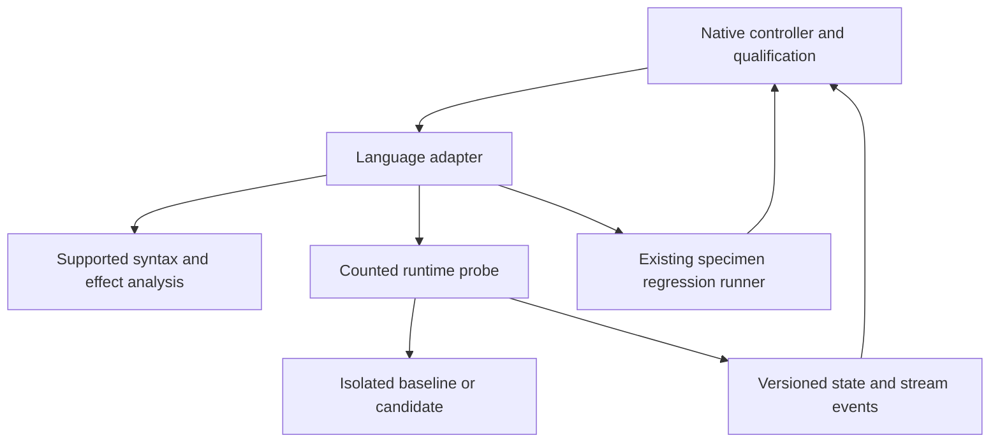

# Technical Design: TypeScript / JavaScript Deconvolution Adapter

Status: **provisional design, 2026-11-09; prototype not-run; production not approved**.
The owner requested design generation from the revised requirements. This permits
design work, not evidence substitution or production task generation.
See [research](research.md), [gate](prototype-gate.md) and [review](design-review.md).

## Overview, goals and non-goals

Qualify profile `ts-node-v1`: source-bound state/effect analysis, runtime finite-domain
comparison, targeted controls and whole-responsibility compression for a supported
TypeScript / JavaScript subset. Preserve actual language behavior and existing public contracts.
No universal proof, new interpreter, generic framework, transparent arbitrary
runtime instrumentation or inherited language-parity claim.

## Boundary Commitments

### This spec owns
- TypeScript / JavaScript implementations of the four adapter interfaces and its profile manifest.
- Runtime bindings, effect/codec rules, targeted mutations and profile-specific tests.
- Supported metric definitions, specimen admission and complete adapter accounting.

### Out of Boundary
- Core qualification/comparator policy, model API clients and other language adapters.
- Upstream specimen edits/adoption, altered frozen checks or golden normalization.
- Common schema changes without producer/consumer review.

### Allowed Dependencies
Reuse ast-grep 0.51.0 and locked TypeScript grammar for syntax/metrics. Compare Oxc's symbol/scope graph with the specimen's installed TypeScript compiler API during the prototype; choose one source of binding identities. No Oxc version is approved by this design.
Runtime: Node 24.22.1 where compatible with the specimen lock; the specimen's exact TypeScript compiler/module mode and existing test runner are frozen at admission. A runtime mismatch requires a new profile, never a silent upgrade.
Use exact locked existing versions; do not upgrade dependencies during a paired
trial. Prototype alternatives require recorded version/license/platform decisions
before execution. No manifest or dependency is changed by this design.

### Revalidation Triggers
Changed source closure, checks, parser, runtime, module/features/classpath, formatter,
effect model, hooks, codec, wire schema or comparator profile invalidates affected
evidence. Revalidate common fixtures and this profile; notify sibling consumers
when shared contracts change.

## Architecture and shared contracts

The normative producer-owned [adapter contract v1](../native-deconvolution-closure/adapter-contract.md)
defines all request/result fields, tagged values, limits, ordering and outcomes.
This adapter implements StateFrameAnalyzer, PureCoreVerifier,
AdverseMutantGenerator and SpecimenTraceRunner; it does not copy their policy.
Native closure owns shared registration and protocol version changes.
Adapters are sibling consumers; Java and Rust do not depend on each other.

Dependency direction: common records -> language analysis/runtime bindings ->
controller integration. Runtime observation and regression execution are distinct.
No shared controller call imports specimen code directly.

## File Structure Plan

Provisional ownership paths; budgets and necessity are validated by the prototype.

| Path | Responsibility |
|---|---|
| `native/src/adapters/typescript/mod.rs` | Four trait implementations and profile dispatch; no duplicated policy |
| `native/src/adapters/typescript/analysis.rs` | Supported AST effects, binding identities and source-anchored coverage gaps |
| `native/src/adapters/typescript/mutation.rs` | Source-bound supported mutation operators |
| `native/src/adapters/typescript/metrics.rs` | Versioned scope metrics and canonical-format integration |
| `native/adapters/typescript/runner.mjs` | Counted Node runtime entrypoint; reserved protocol writer and process-output interception |
| `native/adapters/typescript/observe.mjs` | Frame snapshots, sink/stream hooks and tagged JS value conversion |
| `native/adapters/typescript/scope.mjs` | Explicit scope entrypoints, factories and reset/cleanup adapters; no business logic |
| `native/tests/typescript_adapter.rs` | Independent expected results and runtime/profile integration |
| `native/tests/fixtures/typescript_adapter/` | Adverse, codec, metric and unsupported-form fixtures |
| `native/src/lib.rs`, `native/src/adapters/mod.rs` | Core-owned narrow registration reviewed jointly |
| `native/complexity-budgets.json` | Explicit measured allocations before production tasks |
| `native/Cargo.toml`, `native/Cargo.lock` | Only separately accepted dependency changes, if needed |

Common adapter_traits.rs, specimen_runner.rs, state_contract.rs and comparator
remain owned by native closure. The runtime probe code above is maintained
apparatus, not excluded fixture code. Source-generating templates count too.
Avoid inventing a new packaging framework; use isolated recorded build commands.

## Components and Interfaces

### StateFrameAnalyzer and EffectProfile

Admit ordinary functions and closed class/object graphs with resolved lexical bindings,
explicit data properties and supported deterministic callees. Static analysis records
property/module/closure writes, deletes and mutating calls, not merely assignment
tokens. A local variable assignment is not an external effect. Alias propagation
must map writes to frozen object roots; unresolved aliases fail coverage.

Proxies, getters/setters with unresolved effects, eval, dynamic imports, worker
threads, native addons and arbitrary concurrent tasks are unverified in profile v1.
Promise-returning entrypoints may be admitted only with an explicit await/quiescence
boundary and rejection capture; scheduled work left after completion invalidates
the run. Blocking timers and open handles are bounded by the supervisor.
Allowlisted Array/String methods require exact callable identity and frozen
semantics; method spelling alone is insufficient.

Use UTF-16 code-unit strings (including lone surrogates), tagged undefined/null,
binary64 bits and explicit negative zero. Plain records and arrays preserve key
and element order where observable. Object identity is expressed only as
within-observation alias IDs, never heap addresses. Cycles need a declared graph
codec; otherwise report unverified. Do not use JSON.stringify as the value oracle.

AnalysisResult contains resolved state-root writes and CoverageGap records.
A clean AST scan never upgrades unsupported semantics to verified. FrameSpec is
frozen independently of the candidate. Runtime state checks validate only the
declared finite executions, not every possible heap state.

### PureCoreVerifier and value codec

Use ComparisonRequest/DomainSpec exactly as specified by the shared contract.
Compile/load baseline and candidate in separate fresh runtime instances with the
same setup and environment. Enumerate every admitted Cartesian input combination
subject to frozen constraints; hash case IDs and require matching completion count.
Do not silently drop inputs that fail conversion or replace unsupported values.
Compare return/error and relevant post-state/stream events, then reset state.

Preserve four outcomes: verified, divergent, unverified, execution-failed.
A minimal witness is claimed only for the named completed shrink strategy;
otherwise report a reduced or original witness. Stop after first divergence if
desired, but retain that untested cases were not established equivalent.

### SpecimenTraceRunner and hooks

The runner saves its original protocol writer before loading specimen modules,
redirects supported console/stdout/stderr writes into byte events, and wraps
declared sinks to observe write/flush/abort. Raw fd writes or bypassed hooks are
unsupported unless a separate OS-byte observation and attribution test closes
the gap. The scope adapter provides initial state, operation calls and post-state
snapshots. No generic proxy wrapping may change specimen identity/behavior.
Compile with the specimen's unchanged build configuration before launching the
probe; preserve source maps so witnesses point to original TS/JS. Run its existing
Node/Vitest/Jest suite separately through the same bounded supervisor. Test runner
IPC/reporter output is never accepted as a replacement for state/stream events.

RunRequest limits and process lifecycle are delegated to the common supervisor.
All new process launches use argv vectors, bounded capture and owned cleanup.
Source/check/adapter/runtime/config hashes are checked before and after execution.
A missing hook, unfinished task, changed evaluator or incomplete trace blocks
qualification. No wall-clock/performance success target is introduced.

### AdverseMutantGenerator

Mandatory operator families for the admitted scope: alias property write outside shell; omitted catch cleanup; swallowed promise rejection; dropped or reordered sink flush.
Freeze valid applicability, independent expected witnesses and test/case identities
before candidate evaluation. Preserve compilation/type correctness for mandatory
controls during calibration. Invalid generated mutants remain recorded and cannot
satisfy the calibrated mandatory set. An inapplicable family must be declared at
scope admission; do not exclude it retrospectively to improve the score.
Use the shared seven mutant statuses and the complete denominator.

### Metrics and compression

Reuse native logical_statements.v1 and its grammar identity. Freeze a specimen-installed formatter and exact flags for canonical physical lines; missing formatter means admission stops. Add packing controls for semicolons, declarations, expressions and multiline literals. Preserve existing TS/TSX comparison receipts. JS files require explicit grammar/profile tests; JSX/TSX dynamic execution is excluded from v1 unless separately qualified.

Require at least 20% canonical lines and 10% versioned statements removed plus
the gate's absolute target, counting all replacement helpers/configuration/callers.
Report unsupported metrics as unavailable. Preserve separate behavior,
consolidation and compression outcomes. Common legacy receipts are regression
fixtures; profile metrics use explicit identities rather than reinterpret old data.

### Binding backend selection

Prefer the specimen's existing pinned TypeScript compiler API for resolved
bindings when its source/build configuration is available; its invocation and
source-bound extraction live in the counted scope.mjs adapter. Oxc is the
alternative to evaluate if this integration fails coverage or costs excessive
maintained glue. Choosing Oxc requires a version/license/platform decision and
the same alias/shadowing/rebinding conformance corpus. Do not maintain two
independent semantic truth sources in production. Native ast-grep remains the
syntax/metric substrate in either case.

## System Flows and failure handling

1. Admit specimen/profile/dependencies; freeze scope, effect/domain/control manifests.
2. Validate baseline build/tests and record repeatability before candidate generation.
3. Analyze candidate; return unverified on unsupported semantic coverage.
4. Execute finite-domain probes and ordered trace comparison in fresh instances.
5. Run calibrated adverse controls and selected complete regression tests.
6. Reconcile identities, domain/test completeness, outcomes, metrics and apparatus.
7. Emit candidate validity/compression receipt; adoption is a later explicit action.

Do not execute candidate code during static discovery. Timeout/crash/malformed
protocol follows common cleanup and execution-failed behavior. Divergent evidence
retains its causal step; unsupported coverage remains unverified even when tests
pass. Failed cleanup is retained and prevents a successful run disposition.

## Contradictions and disposition

| ID | Competing claims / source | Resolution and authority | Evidence / affected criteria and consumers | Status |
|---|---|---|---|---|
| A1 | Full parity in historical brief vs bounded revised requirements | Current requirements and owner revision 2026-11-09 govern; qualify named profile only | 1.1, 1.3, 2.3, 2.4; profile fixtures required | Resolved contract; fidelity unproven |
| A2 | Syntax/passing tests treated as semantic proof vs unresolved calls/effects | Separate analysis gaps, runtime traces and regression reports | 1.2, 1.4, 2.1, 4.1, 4.2; independent adverse cases | Resolved contract; hook coverage open |
| A3 | Runner output interpreted as complete trace | Dedicated probe plus explicit hooks; reporter data only for regression | 3.1, 3.2, 3.3, 4.3, 4.4; source-bound failure controls | Resolved design; runtime spike required |
| A4 | Per-file caps imply apparatus budget fit | R41 whole total plus file caps; no per-adapter reset | 5.1, 5.2, 5.3; native core and all siblings | Allocation open; blocks production |
| A5 | Sequential language roadmap or scope authorization implies delivery | Owner Java admission and design request authorize design; sibling gates remain independent | 5.4, 5.5; common schema conformance | Resolved planning |

Additional language-specific competing claims are resolved by the supported
semantics and metric sections above. Sources: [requirements](requirements.md),
[amendment](review-amendment.md), shared contract, actual source/manifest evidence
in [research](research.md), and R41. Any newly discovered contract conflict must
be resolved before approval; empirical open items stay gate blockers.

## Requirements Traceability

| Criteria | Components / validation |
|---|---|
| 1.1, 1.2, 1.3, 1.4 | StateFrameAnalyzer, EffectProfile, frozen frame and alias/callee controls |
| 2.1, 2.2, 2.3, 2.4 | PureCoreVerifier, tagged codec, complete DomainSpec, witnesses and incomplete-run controls |
| 3.1, 3.2, 3.3 | AdverseMutantGenerator, calibrated inventory and seven dispositions |
| 4.1, 4.2, 4.3, 4.4 | SpecimenTraceRunner, runtime hooks, supervisor, isolation/identity fixtures |
| 5.1, 5.2, 5.3, 5.4, 5.5 | Metrics, full accounting, prototype gate, common regression/CI and revalidation |

## Testing Strategy and Migration

Unit/contract fixtures cover supported and rejected syntax, state-root aliases,
special numeric/text values, exception identity, codec round-trip and statement
packing. Runtime controls cover missed state cleanup, wrong write/flush order,
unobserved mutation, false completion, output limits, changed check hashes and
killed descendants. Each has an expected independent outcome, not just reference
agreement. Include failure-path and zero-input/empty-domain controls.

Run language regression suites through the pinned specimen runner; native tests
use nextest 0.9.143 and Rust 1.98.1, Python reference suites use pytest-xdist.
Keep serial probe attribution separate from parallel regression execution.
Use [testing](../../../docs/testing.md) and existing
[Dagger/native CI](../../../docs/ci-validation.md), including platform-specific
runtime-hook smoke checks. No separate CI framework.

Initially register the profile only for explicitly selected runs; retain existing
Python and legacy compare behavior. No automatic adoption or source replacement.
A failed profile rolls back to its prior version/unsupported disposition without
changing goldens. Production migration follows prototype proceed and design review.

## Unresolved empirical prerequisites

Start admission screening from the prior TS01 repository and its complete degradation responsibility plus callers. TS01 removed only 19 physical lines and is not a qualifying 20% canonical reduction result. If this family has insufficient remaining redundancy or no observable state/stream boundary, reject it and select a different licensed TypeScript family before freezing the trial.

Required before any prototype run: exact specimen/revision/license, dependency
locks and runtime paths, hook reachability, metric rule fixtures, independent
controls and accounting population. Required before production approval: real-code
proceed, whole-budget fit, compatibility evidence and inline design re-review.
The design supplies a bounded plan; it does not assert these prerequisites passed.
