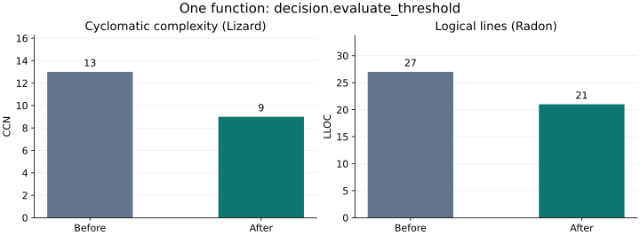

# Lesscode

The goal is substantial code simplification while preserving features. In grown
codebases, custom implementations, boilerplate and supporting layers can often
be replaced by capabilities already provided by the project's framework,
libraries or language. Lesscode aims to help identify those opportunities and
check the resulting changes.

The work is to move responsibility into suitable existing capabilities: use a
framework shorthand, reuse a library operation, or express the same behavior
with clearer idiomatic code. Success means less code and structure to maintain
for the same features and public contracts. Moving custom code into another
module, hiding it behind a wrapper, or dropping a feature does not establish
that result. A replacement's dependencies, configuration and behavioral
differences also count when judging whether it simplifies the project.

## What works today

Check whether a proposed Python simplification preserves declared behavior, and
inspect what changed in complexity, duplication and source size.

When a coding agent removes a layer or rewrites a module, a smaller diff is only
part of the review. Lesscode compares the original and supplied candidate using
the same checks and pinned open-source analyzers. It produces a local report
with the evidence behind acceptance, rejection or an incomplete result.

The current implementation is a Python evaluation CLI. You supply both versions
and the checks. No LLM account, commercial analysis license or source upload is
required.

## What you get

| Review question | Evidence |
| --- | --- |
| Did the declared behavior checks pass? | Baseline and candidate outcomes, expected check IDs and diagnostic logs |
| What became more complicated or repetitive? | Lizard function complexity, hotspots and jscpd clone locations with token counts |
| How much source changed? | Source bytes, defined physical lines, deterministic compressed size and separate test-file changes |
| Can someone inspect the result? | Versioned JSON, a readable summary, raw outputs and a hash-checked artifact index |
| Was the comparison held constant? | Source fingerprints, frozen profile, check inventory and recorded tool identities |

`accepted` means the candidate passed the recorded profile. It does not prove
equivalence or certify code quality. Missing required evidence prevents
acceptance; an observed behavior failure cannot be offset by fewer lines.

## A measured example on Lesscode

The [library replacement trial](docs/experiments/leaf-contracts/README.md) records
an empirical adoption decision: five library-backed record readers matched
5,404 differential cases, but saved only four physical lines including their
support code. That candidate was not adopted into the runtime. Production code,
test code and trial code are counted separately in its raw results.

We applied the workflow to this package and simplified the threshold evaluator:



This is a local result. Across 13 product modules, LLOC changes from 4,132 to
4,126 and the highest CCN stays 56. Source shrinks by 98 bytes, while compressed
size grows by 5. Whole-package evaluation is incomplete because duplication
inventory could not be reconciled; a separate `decision.py` scope is accepted.
No maintenance-hours or runtime improvement is claimed.

The [worked example](docs/examples/self-evaluation.md) includes the code change,
remaining hotspots, fixed checks, raw evidence and reproduction commands.
The [measurement guide](docs/measurement-guide.md) explains convolution, naming,
idiom and maintenance effort beyond line counts.

## Try an unchanged pair first

Clone this repository, then follow [runtime setup](docs/runtime-setup.md) and
[analyzer setup](docs/analyzer-setup.md). Setup uses uv and provisions the pinned
tools explicitly. Evaluation never installs them.

From the repository root, compare the included licensed fixture with itself.
Use new output names if you repeat the example.

<details>
<summary>Windows PowerShell</summary>

```powershell
.\.venv\Scripts\lesscode-baseline.exe plan --profile benchmarks/profiles/python.json --baseline tests/fixtures/real/boltons_mathutils/source --candidate tests/fixtures/real/boltons_mathutils/source --tool-paths .tools/analyzers/entrypoints.json --out ../lesscode-first-plan.json
.\.venv\Scripts\lesscode-baseline.exe run --plan ../lesscode-first-plan.json --out ../lesscode-first-run
Get-Content ../lesscode-first-run/summary.md
```

</details>

<details>
<summary>Linux or macOS</summary>

```sh
.venv/bin/lesscode-baseline plan --profile benchmarks/profiles/python.json --baseline tests/fixtures/real/boltons_mathutils/source --candidate tests/fixtures/real/boltons_mathutils/source --tool-paths .tools/analyzers/entrypoints.json --out ../lesscode-first-plan.json
.venv/bin/lesscode-baseline run --plan ../lesscode-first-plan.json --out ../lesscode-first-run
cat ../lesscode-first-run/summary.md
```

</details>

With the pinned tools available, expect an accepted run, unchanged structural
measurements, 23 functions and maximum cyclomatic complexity 15. Open
`summary.md` for the decision and limitations; `report.json` and the indexed raw
artifacts contain the supporting records. Planning prints the commands; inspect
them before running checks.

The fixture profile contains checks specific to boltons. For your own code,
define the scope and independent checks before preparing the comparison. See
[profile configuration](docs/profiles.md). Start with one module and one change;
the [adoption guide](docs/adoption.md) gives a review process you can try without
making it a merge gate.

## Read the technical details

The [documentation index](docs/README.md) groups the guides by task.

- [Technical overview](docs/technical-overview.md): architecture, measurement definitions, decision precedence, storage and experiment design.
- [CLI reference](docs/cli.md): commands, optional evidence, installed-wheel usage and exit codes.
- [Profiles](docs/profiles.md): scope rules, check contracts, thresholds and evaluator ownership.
- [Validation evidence](docs/ci-validation.md): native Windows, Linux and macOS checks and retained artifacts.

The Python baseline completed 33 independently reviewed tasks and covers all 56
acceptance criteria. The [final validation report](.kiro/specs/efficiency-baseline/validation.md)
links the evidence. These fixtures validate the evaluator, not the effectiveness
of a simplification skill on arbitrary repositories.

## Where the project is going

The next proposed feature is configurable measured rules for coding agents:
limits, change budgets and regression ratchets with actionable violations.
The general configurable enforcement workflow is not implemented yet. This
repository already has scoped [AGENTS.md guidance](src/lesscode_baseline/AGENTS.md)
for role-revealing names, idiomatic code and justified abstractions. The current
CLI evaluates supplied changes under a fixed profile.

Optional simplification skills, deterministic rewrites, JavaScript/TypeScript
and Java support, and MCP integration are later work. The CLI runs independently
of a skill or MCP server. See the [roadmap](.kiro/steering/roadmap.md).
