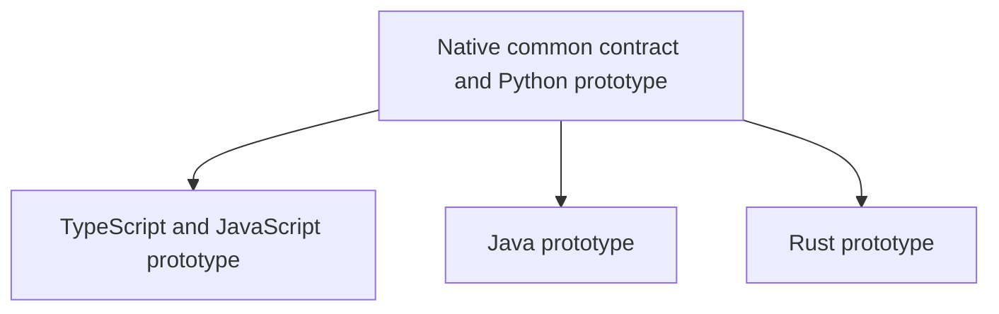

# Multi-language deconvolution: proposed contracts and roadmap

Amended 2026-11-09 following owner confirmation that Java was recently added.
**Status: authorized language direction; contracts provisional, implementation
and empirical parity not approved.**

## Scope and evidence

Target languages: Python, TypeScript, JavaScript, Java and Rust.
E5/E6 are evidence for the recorded Python responsibilities only. They do not
prove an unseen-language adapter, complete semantic analysis or native closure.
See [R47](../research/2026-11-09/05-deconvolution-spec-review-amendment.md).

A Rust controller owns common verification decisions and evidence comparison.
Each target-runtime adapter executes source semantics and observes declared
state/SQL/stream effects. Adapter source, embedded scripts, wrappers and generators
remain maintained apparatus regardless of location.

## Common contract ownership

[native closure](../../.kiro/specs/native-deconvolution-closure/design.md) owns
schema/profile versioning and the StateFrameAnalyzer, PureCoreVerifier,
AdverseMutantGenerator and SpecimenTraceRunner contracts. Downstream adapters
consume these contracts and cannot redefine comparator acceptance.

All evidence binds source/check/runtime/configuration identities. Outcomes are
verified for a named finite domain, divergent with witness, unverified for
coverage gaps, or execution-failed. Test reports and syntax scans are supporting
evidence, not behavioral traces or general proofs. The prototype must resolve
wire/value/domain details and test conformance before production adoption.

## Dependency graph

These are logical dependencies, not authorization for parallel agent execution.
Language provisional designs may inform the common protocol before its freeze;
production integration requires qualified versioned contracts and each adapter's
own proceed result. There is no Java-to-Rust dependency.

| Adapter | Initial profile to freeze in design | Important unresolved semantics |
|---|---|---|
| Python | Pinned CPython/specimen dependencies, counted current adapter | Aliases/callees, SQL listeners, failure state, internal buffers |
| TypeScript/JS | One pinned Node and specimen-native runner | Closures, proxies/getters, async rejection, object identity |
| Java | One pinned JDK/build/JUnit combination | Dispatch, reflection, mutable referents behind final/records |
| Rust | Pinned toolchain/features/nextest | Macros, trait calls, interior mutation, unsafe/FFI |

Additional runtimes/runners require separate qualification. Java scope admission
does not choose tree-sitter-java or authorize JVM agents. Syntax tools
(ast-grep, syn) and candidate semantic libraries (Ruff AST, Oxc) must be compared
against real required coverage, dependency costs and platform compatibility.

## Contradictions and disposition

| Conflict | Resolution | Remaining evidence |
|---|---|---|
| Earlier Java exclusion versus owner scope addition | Java authorized; product/tech steering amended | Dependency and prototype decisions |
| Sequential Java-before-Rust plan | Adapters depend on common core only | Contract conformance per adapter |
| Native self-containment versus target semantics | Native controller plus counted runtime adapters | End-to-end parity |
| final/records or absence of &mut called pure | Resolve effects and observable mutation; unsupported cases unverified | Language adverse cases |
| Test-runner output called full trace capture | Explicit runtime hooks plus protocol completion/coverage | Faulted recorder tests |
| Per-file budgets called total savings | Whole replacement plus R41 ceiling and file/function checks | Measured inventory |
| Broad parity from E5/E6 | Restrict evidence to recorded Python scopes | New-language real-code trials |

## Gate and accounting

Every spec needs frozen source/check identities, supported profile, independent
adverse cases, finite-domain coverage, operational limits, absolute/relative
usefulness targets and complete apparatus inventory before executing its gate.
Use the unchanged R41 canonical method and 7,173 no-growth ceiling unless explicitly
amended. Preserve per-file measured exceptions; new Rust defaults are 400 physical
lines, 300 syntax units and 80 lines/function. Moving code earns no reduction.

Runtime/grammar changes revalidate affected fixtures. Use pinned nextest,
pytest-xdist and existing Dagger/native CI per docs/testing.md and
docs/ci-validation.md. Keep candidate workspaces isolated from frozen checks and
preserve unrelated owner WIP. No universal equivalence or latency claim is made.

## Aligned designs — 2026-11-09

The owner requested design generation from the revised requirements.
The [shared contract](../../.kiro/specs/native-deconvolution-closure/adapter-contract.md)
is owned by native closure and consumed by
[TypeScript/JS](../../.kiro/specs/typescript-deconvolution-adapter/design.md),
[Java](../../.kiro/specs/java-deconvolution-unification/design.md), and
[Rust](../../.kiro/specs/rust-deconvolution-unification/design.md).
All four designs are generated and provisional; all prototype gates are not-run.
The shared contract defines the internal profile registry; it does not change the
legacy public comparison schemas. Each adapter separates a behavioral probe from
its regression runner and counts both maintained bindings and instrumentation.
