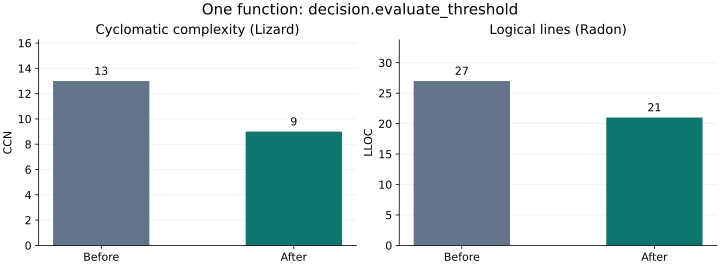
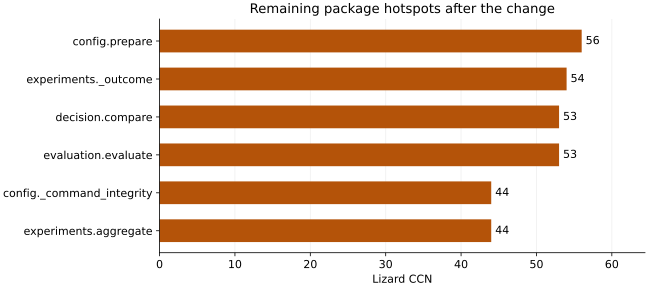

# Example: evaluate and simplify Lesscode itself

We measured all 13 Python modules in `src/lesscode_baseline`, then simplified
one function in `decision.py`. The local change reduced branching and logical
lines without adding a helper, class or public signature. The repository still
has substantial complexity, and its whole-package evaluation is incomplete.

The baseline is commit `d864008`. The exact candidate revision, source identities,
fixed-resource hashes and measured values are retained in the
[machine-readable receipt](../evidence/self-evaluation-2026-10-31.json).

## The change and why it is simpler

`evaluate_threshold` selects a candidate value, absolute delta or percentage
delta according to one of three validated operators. The previous code repeated
selection and missing-value reasoning across branches:

```python
elif threshold.operator == "absolute_maximum":
    observed = delta.after
    reason = delta.reason if observed is None else None
elif threshold.operator == "delta_maximum":
    observed = delta.absolute_delta
    reason = delta.reason if observed is None else None
else:
    observed = delta.percentage_delta
    reason = delta.percentage_reason
```

The replacement makes the operator-to-value relationship explicit:

```python
else:
    observed, reason = {
        "absolute_maximum": (delta.after, delta.reason),
        "delta_maximum": (delta.absolute_delta, delta.reason),
        "percentage_delta_maximum": (delta.percentage_delta, delta.percentage_reason),
    }[threshold.operator]
```

Validation of operator, metric key, units and comparability stays in place.
Missing evidence still carries its correct reason, maximum comparisons remain
inclusive, and the result fields retain their roles. The table belongs to this
closed set of operators; no new strategy classes or dispatch framework are needed.

The dictionary eagerly reads ordinary fields on a validated record. It is built
per call. Runtime performance has not been benchmarked, and the same substitution
would need reconsideration for expensive or side-effecting property access.

## Measured local result



| Changed function | Before | After | Change |
| --- | ---: | ---: | ---: |
| Lizard CCN | 13 | 9 | -4 |
| Radon logical lines (LLOC) | 27 | 21 | -6 |
| Lizard NLOC | 28 | 25 | -3 |

LLOC is not the same counter as NLOC or physical lines. Radon 6.0.1 supplies
auxiliary LLOC evidence; it is not a newly implemented built-in metric or gate.
See the [measurement guide](../measurement-guide.md) for definitions and limits.

The focused module has zero detected clone pairs before and after under the
fixed 50-token/5-line jscpd settings. This is a branching and repetition
simplification, not a measured clone-count improvement. Small repeated policy
can matter to a reader without meeting a clone detector's thresholds.

## The package result is much smaller

The same product-file and function inventory was measured on both sides.
These product metrics exclude tests, documentation, charts and example tooling;
they do not claim that the entire checkout became smaller.

| All 13 product modules | Before | After | Change |
| --- | ---: | ---: | ---: |
| Functions | 200 | 200 | 0 |
| Highest function CCN | 56 | 56 | 0 |
| Sum of function CCN | 1,367 | 1,363 | -4 |
| Radon LLOC | 4,132 | 4,126 | -6 |
| Physical lines | 4,953 | 4,950 | -3 |
| Source bytes | 256,434 | 256,336 | -98 |
| Compressed source bytes | 60,066 | 60,071 | +5 |

The CCN sum is a descriptive sum over the same 200 functions, not a universal
complexity or simplicity score. Compression got slightly worse. Matching source
line endings were preserved, so newline conversion is not counted as improvement.



These hotspots remain candidates for careful review. Some encode necessary
validation and evidence policy. Moving their branches into more helpers would
not by itself establish reduced convolution.

## What the checks established

The fixed example profile runs the same 107 decision, contract and experiment
tests against both source trees, with their IDs and test-resource bytes frozen
outside those trees. A changed test file with unchanged IDs was also verified
to fail the external check.
It also runs 24 threshold-oracle cases covering each operator's values,
boundaries, missing-value reasons and unit mismatches. A deleted, skipped or
replaced selected test cannot silently produce a pass. Both groups passed on
both sides.

The evaluator is a pre-refactor installed wheel whose hash is recorded in the
receipt. Its code, profiles and check runner are outside the supplied source
trees. The candidate's implementation does not decide whether its own run is
accepted. The full regression suite separately passed all 363 tests in 682.646
seconds, with ten POSIX-only skips and one local Windows symlink-privilege skip.
Its command, exit 0, raw log hashes and skip scope are recorded in the receipt
and archive. It was not redundantly rerun after documentation-only edits.

### Two scopes, two different outcomes

The whole-package profile returned `incomplete`. jscpd did not report the short
`src/lesscode_baseline/__init__.py` in its scanned inventory, although the
independent tokenizer found nine tokens. The adapter refused to treat that as
complete duplication evidence. No required metric was removed, and this example
does not claim a whole-package pass.

A separate `decision-only.json` profile measures the changed module while
retaining the supporting source and fixed tests. That run is `accepted` under
its narrower recorded scope. It does not repair or override the whole-package
result. Keep both reports when assessing the example.

This exposes a real limitation to address in future duplication-adapter work:
whole-scope completeness must account explicitly for meaningful files omitted
by the pinned scanner. Quietly ignoring them would weaken the evidence contract.

## Simplicity and maintenance interpretation

The review found one changed product file and function, no additional product
helper or class, no signature or serialized-field change, and no required caller
changes. The example adds separate validation and publication tooling outside
that product scope. The three operator names directly identify the selected values and their
missing-evidence reasons. The guards still express policy visibly.

Those observations support a small local simplification. They do not prove the
entire codebase is idiomatic or easy to maintain. The target module's auxiliary
Radon Maintainability Index moves from 17.15 to 18.10 with `multi=False`.
Radon describes MI as experimental; it is not used for acceptance and is not a
measurement of hours saved. Runtime change and actual maintenance effort remain
unmeasured. The [measurement guide](../measurement-guide.md#distinguish-maintenance-proxies-from-observed-effort)
describes how a follow-up change task could measure effort.

The scoped [AGENTS.md](../../src/lesscode_baseline/AGENTS.md) applies naming,
idiom, responsibility and evidence-preservation rules to future edits now.
It is instruction-based guidance. An automatic configurable prevention engine
remains separate proposed work.

## Reproduce the example

Start with [package](../runtime-setup.md) and [analyzer setup](../analyzer-setup.md).
These PowerShell commands export the recorded revisions into new sibling trees.
The explicit Git newline setting reproduces the measured Windows exports; do
not overwrite an existing source or output directory.

```powershell
$receipt = Get-Content -Raw docs/evidence/self-evaluation-2026-10-31.json | ConvertFrom-Json
git -c core.autocrlf=true archive --format=zip --output ../lesscode-before.zip $receipt.baseline_revision
git -c core.autocrlf=true archive --format=zip --output ../lesscode-after.zip $receipt.candidate_revision
uv.exe run --no-project --no-python-downloads --python .venv/Scripts/python.exe python -m zipfile -e ../lesscode-before.zip ../lesscode-before
uv.exe run --no-project --no-python-downloads --python .venv/Scripts/python.exe python -m zipfile -e ../lesscode-after.zip ../lesscode-after
uv.exe venv --managed-python --python 3.12.10 ../lesscode-self-evaluator
uv.exe pip install --python ../lesscode-self-evaluator/Scripts/python.exe ../lesscode-before
..\lesscode-self-evaluator\Scripts\lesscode-baseline.exe plan --profile benchmarks/profiles/self-evaluation/profile.json --baseline ../lesscode-before --candidate ../lesscode-after --tool-paths .tools/analyzers/entrypoints.json --out ../lesscode-self-plan.json
..\lesscode-self-evaluator\Scripts\lesscode-baseline.exe run --plan ../lesscode-self-plan.json --out ../lesscode-self-run
```

This installs the baseline evaluator in a separate environment; the supplied
candidate is not the gate. A rebuilt wheel will have its own recorded identity.
Expect run exit 3 for the retained whole-package duplication limitation. To run
the focused comparison, prepare another new plan with
`benchmarks/profiles/self-evaluation/decision-only.json`, then run it into a new
directory; that profile returned exit 0 in the recorded example. On Linux/macOS,
use the corresponding environment paths from the setup guide. Record your own
runtime and source identities when comparing results.

For auxiliary LLOC and MI, the example uses Radon 6.0.1's programmatic
`raw.analyze` and `metrics.mi_visit(code, multi=False)` on exactly the product
files in the report:

```powershell
uv.exe run --no-project --no-python-downloads --python .venv/Scripts/python.exe --with radon==6.0.1 --with mando==0.7.1 --with colorama==0.4.6 --with six==1.17.0 python benchmarks/profiles/self-evaluation/measure_auxiliary.py --report ../lesscode-self-run/report.json --baseline ../lesscode-before --candidate ../lesscode-after --out ../lesscode-self-auxiliary.json
```

The script checks the source hashes before measurement. The receipt records
per-file raw metrics and pinned dependency versions. This avoids ambient Radon
CLI configuration changing the scan. Keep these auxiliary observations separate
from built-in metric evidence.

Regenerate the charts from the published receipt with:

```powershell
uv.exe run --no-project --no-python-downloads --python .venv/Scripts/python.exe --with matplotlib==3.10.7 python benchmarks/profiles/self-evaluation/plot.py
```

The [evidence archive](../evidence/self-evaluation-2026-10-31.zip) retains both
run directories, their indexes and raw outputs, the fixed evaluation resources,
auxiliary metrics and regression logs. The receipt records its digest. Extract
it to a new directory and use `report.recover` on `run/` and `decision-run/` to
verify retained reports. Reproduction can produce different elapsed times;
neither they nor a static metric should be presented as maintenance time saved.
