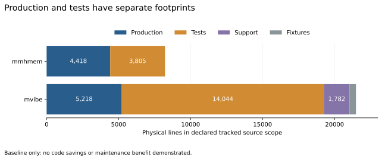

# Local adoption: repeatable baselines before compression claims

Two user-nominated projects now have source-bound footprint baselines. A Rust
parser check rejected misleading metrics, and a concrete standard-library
replacement failed its first behavioral probe. No application rewrite or code
saving is claimed in this round.

The immediate research question is which complete responsibilities can use an
existing capability or a simpler implementation with less maintained code and
the same behavior. CI operability does not answer that question.

## What was measured

| Declared tracked source | Production physical lines | Test physical lines | Support | Fixtures |
| --- | ---: | ---: | ---: | ---: |
| mmhmem, Rust | 4,418 | 3,805 | Not inventoried | Not separately classified |
| mvibe, Python and TypeScript | 5,218 | 14,044 | 1,782 | 445 |



These are declared source scopes, not whole-repository all-language totals or
comparable feature populations. Documentation, manifests, shell scripts, builds,
dependencies, ignored/untracked files and agent tooling are outside these source
totals. Rust inline test ranges were reviewed and counted separately. Tests are
behavioral evidence and are not the default reduction target.

The [mmhmem baseline](mmhmem-baseline.json) records 36 tracked Rust files,
including 22 with production segments. Its initial revision is
`0e125a7b0405d552aa943caf37d1b1a0623c5068`. The
[mvibe baseline](mvibe-baseline.json) records 153 tracked Python/TypeScript files,
including 37 production files. Each record binds actual file bytes, not just Git
HEAD. Manifests and dependency locks were inspected; a complete installed-library
semantic audit has not been performed and no new application dependency was added.

## Rust measurements needed a parser check

Lizard 1.17.31 detected only five routines in `src/services/shunt.rs`, where
source inspection and Mozilla's parser identify 14 named functions. Lifetime
syntax merged function spans. Its provisional 125-routine/299-CCN production
totals are rejected, and the current collector withholds Lizard-derived Rust
NLOC, function and complexity fields rather than emitting credible-looking zeros.

[Mozilla rust-code-analysis](https://github.com/mozilla/rust-code-analysis)
0.0.25 was installed through Cargo with Rust 1.98.1 and the release's locked
dependencies. It reports the following for the production segments:

| RCA metric | Result |
| --- | ---: |
| Physical code lines, RCA PLOC | 3,281 |
| Logical lines, RCA LLOC | 462 |
| Named functions | 159 |
| Closures | 100 |
| Cyclomatic aggregate | 571 |
| Cognitive aggregate | 117 |

Root aggregates are counted once per file; they include the analyzer's nested
syntax spaces. They are not Lizard CCN, Clippy's cognitive-complexity gate or
Lesscode native grammar-statement counts. No maintenance-effort estimate follows.
Two RCA runs produced identical JSON for all 22 files. The function probe
identifies all 14 named functions in the inspected file; this is a calibration
case, not a proof that every Rust construct is understood.

Both initial footprint runs were identical on repetition. A later live rerun
stopped on a changed `src/lib.rs` hash. Inspection established LF-to-CRLF
conversion only, alongside an independently advanced repository HEAD. The
original profile is retained as [mmhmem-initial.json](mmhmem-initial.json);
the reviewed [current profile](mmhmem.json) admits the new bytes. Physical counts
remain unchanged. Do not merge snapshots silently or reuse inline test ranges
after a substantive source change.

The final live replay's repository HEAD advanced again while the measured source
identity stayed identical. Its source and metric payloads match exactly; only
revision metadata differs. Both revisions and raw-output hashes are retained.

## Clone counts locate small families, not the whole problem

jscpd 4.0.5 scanned isolated production-only copies in mild mode, with minimum
five lines and 50 tokens. It reports four Rust token clones with 56 duplicated
lines and one mvibe clone with 12 duplicated lines. These are scanner-defined
counts, not removable lines. Overlapping pairs cannot simply be added together.

The mvibe scanner tokenized 36 of 37 declared production files; its denominator
is 5,181 lines, versus 5,218 physical lines in the collector. The distinct source
and tokenized populations are retained in JSON. Exact-token clone findings do
not establish semantic redundancy or rule out framework/library substitutions.

The repeated Rust breadcrumb helpers nominate one existing service boundary for
review. They do not justify a new general-purpose pipeline. See the recorded
[hypotheses and stopping conditions](hypotheses.md).

## The first stdlib shortcut failed on required behavior

P01 asked whether Python's existing `urllib.request.proxy_bypass_environment`
could replace mvibe's custom NO_PROXY rule helpers. The
[source-bound probe](proxy_probe.py) extracts only five reviewed pure helpers;
it does not import the application or read its environment. The hypothesis and
disproof condition were recorded before executing the probe.

Of 11 explicit cases, four differed: leading-dot bare-host handling, IPv4 CIDR,
IPv6 CIDR and scheme-qualified rules. The proposed drop-in replacement is
rejected. [Every case and outcome is retained](proxy-probe-result.json).
No full candidate implementation or before/after source reduction was produced.

Original application tests were unchanged and not executed in this measurement
round. The 11 probe cases are research apparatus, not an application test-suite
pass or equivalence proof. Adopted production delta is zero. A fuller trial
would include all helpers, transport callers, adapters and original proxy tests;
the observed mismatch stops this particular alternative before that expense.

Denominators: two user-selected repositories inventoried; one replacement family
given a finite feasibility probe; zero complete paired rewrite trials; zero
adoptions. Repeats and individual test cases are not independent experiments.

This round adds 228 physical lines of research programs: 123 for collection,
66 for the feasibility probe and 39 for plotting, plus profiles, evidence and
documentation. These are experiment costs, not production features or savings.
Their hashes and counts are retained in [verification.json](verification.json).

## Reproduce locally

Versions, compiler identities, lock hashes, executable hash and the exact Cargo
install command are in [toolchain.json](toolchain.json). The Rust release lock
contains a yanked crossbeam-channel 0.5.6; the install warning is retained and the
lock was not silently updated. The tool is research-only, outside product
dependencies. Hashes identify this build; bit-identical builds on another host
are not asserted. Python uses uv, never Windows Store Python.

From `D:/Source/lesscode`, choose a fresh output path:

```powershell
cargo +1.98.1 install rust-code-analysis-cli --version 0.0.25 --locked --root .tools/rust-code-analysis-cargo-0.0.25
$run = '.runs/local-adoption/mmhmem/replica-01'
uv.exe run --no-project --python 3.12.10 --with-requirements docs/experiments/local-adoption/requirements-analysis.lock python docs/experiments/local-adoption/measure.py docs/experiments/local-adoption/mmhmem.json --out "$run/baseline.json" --production-copy "$run/production"
```

Use `mvibe.json` and a fresh mvibe output for the other project. The collector
does not execute project code. It measures tracked files under the manifest's
classification and checks source integrity; it is research tooling, not a new
native CLI command or automatic Rust compression gate.

For Rust, stage the production copy in a fresh external directory. Run RCA with
relative source paths and an existing, absolute output directory:

```powershell
$rca = (Resolve-Path .tools/rust-code-analysis-cargo-0.0.25/bin/rust-code-analysis-cli.exe).Path
$stage = Join-Path ([IO.Path]::GetTempPath()) ('lesscode-mmhmem-' + [guid]::NewGuid().ToString('N'))
Copy-Item -LiteralPath "$run/production" -Destination $stage -Recurse
New-Item -ItemType Directory -Path "$run/rca" | Out-Null
$out = (Resolve-Path "$run/rca").Path
Push-Location $stage
try { & $rca --metrics --paths src --output-format json --pr --output $out } finally { Pop-Location }
```

Inspect the exit code and require 22 JSON files for this frozen scope. Use
`ConvertFrom-Json -AsHashtable` in PowerShell: Halstead keys `n1`/`N1` are distinct.
For cloning, use the existing [locked analyzer setup](../../analyzer-setup.md),
then scan the production copy with Node 24.22.1 and jscpd 4.0.5:

```powershell
& 'C:/Program Files/nodejs/node.exe' .tools/analyzers/node/node_modules/jscpd/bin/jscpd "$run/production" --format rust --min-lines 5 --min-tokens 50 --mode mild --max-lines 100000 --max-size 10mb --reporters json --output "$run/clones" --silent
```

For mvibe select `python,typescript,tsx`. The raised maximums prevent accidental
file-size exclusions; bytes are not a benefit metric. Repeat the feasibility probe:

```powershell
uv.exe run --no-project --python 3.12.10 python docs/experiments/local-adoption/proxy_probe.py --baseline .runs/local-adoption/mvibe/baseline.json --out .runs/local-adoption/mvibe/proxy-replica.json
uv.exe run --no-project --python 3.12.10 --with-requirements docs/experiments/local-adoption/requirements-plot.txt python docs/experiments/local-adoption/plot.py
```

Raw outputs remain under `.runs/local-adoption/`, outside the specimens and
excluded from Git. Durable records retain selected results, per-source identities,
analyzer-output hashes, limits and intermediate failures. Reproduce against the
recorded source bytes; a new project revision requires a newly admitted baseline.

## OpenCode installation and next trial

The discovery skill is installed at
`D:/Source/mmhmem/.opencode/skills/lesscode-discovery/`, with a local measurement
guide and an explicit native Python/TypeScript boundary. The
[installation receipt](opencode-installation.json) records all installed hashes.
In OpenCode, ask: "Use lesscode-discovery, read its local-measurement reference,
and nominate one complete responsibility with a concrete replacement API. Keep
the scan read-only and record rejected alternatives."

Next: review the breadcrumb-publication family as one complete responsibility
and measure a concrete candidate only if the shared existing boundary removes
enough maintained code to warrant its support cost. Otherwise retain it and
seek a larger library substitution. Preserve unchanged tests and include callers,
tables, adapters, error and audit policies in the replacement count. Neither
another size cap nor another round of platform CI establishes compression.

The [COBESY composition blueprint](composition-blueprint.md) keeps this round in
the experiment track without turning baseline counts into a success story.
