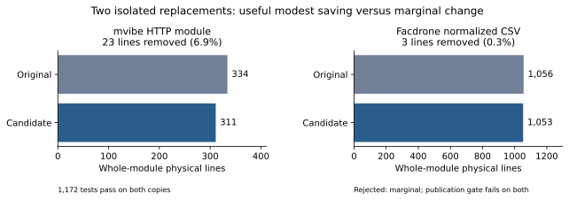

# P02: A tested 23-line reduction in environment proxy routing

The isolated mvibe candidate removes **23 of 334 module lines (6.9%)** and
**16 of 190 AST statements (8.4%)**. All **1,172 existing Python tests pass on
both copies**, with no skips or test changes. A frozen differential corpus
also matches on **118,588 observations**. The candidate is retained as a
reviewable patch; the mvibe checkout has not been changed.

This is a modest real replacement, not substantial project-wide compression.

It follows [P01](../local-adoption/README.md), which rejected a stdlib proxy
matcher because it lost required behavior. P02 keeps that policy and shares
its duplicated mechanics instead. It is the same responsibility, a second
alternative—not an independent repository sample.

## What actually disappears

Two IP helpers each parsed a rule, parsed a host, and handled the same failures.
One typed helper now shares those steps while retaining **network containment
versus exact-address equality**. That distinction matters for scoped IPv6.
Two URL-rule branches now share port extraction but retain their different
scheme and fallback behavior. `any` preserves the existing ordered,
short-circuit bypass decision. Transport selection and client configuration
are unchanged. No dependency, wrapper layer, configuration or external helper
was added.

| Accounting boundary | Before | Candidate | Reduction |
| --- | ---: | ---: | ---: |
| Full HTTP module, physical lines | 334 | 311 | 23 |
| Full HTTP module, AST statements | 190 | 174 | 16 |
| Full HTTP module, decisions | 58 | 58 | 0 |
| Full HTTP module, functions/methods | 21 | 20 | 1 |
| Proxy responsibility, selected definition lines | 178 | 157 | 21 |
| Proxy responsibility, AST statements | 118 | 102 | 16 |
| All 37 declared production files, physical lines | 5,218 | 5,195 | 23 (0.44%) |

Physical lines include blanks/comments. The selected-definition boundary includes
the complete client class, transport, proxy normalization and matcher helpers;
inter-definition blank lines explain its smaller physical delta. AST statements
include definitions/imports/docstrings; they are not advertised as LLOC.
Decision count includes branch/loop/exception/comprehension nodes and boolean
operand transitions. It is a stated structural count, not McCabe or an effort score.

The trial therefore supports a useful distinction: less repeated implementation
can leave decision count unchanged. It does not establish reduced maintenance
effort, broad automatic discovery, or a general compression percentage.

## Behavioral boundary

| Frozen check | Before | Candidate |
| --- | ---: | ---: |
| Existing Python tests | 1,172 passed | 1,172 passed |
| Failed/errors/skipped | 0/0/0 | 0/0/0 |
| Rule outcomes, including exception type/message | 109,896 | 0 mismatches |
| Complete URL/rule-list bypass decisions | 8,676 | 0 mismatches |
| Fake transport construction/request/closure traces | 16 | 0 mismatches |

The corpus includes CIDR, IPv4, IPv6/scopes, malformed brackets and ports,
scheme-qualified rules, leading dots, Unicode, empty rules, rule ordering and
wildcard short-circuiting. A deliberate leading-dot policy mutation is detected.
Repeated cases and repetitions are not independent trials. All 41 tracked files
under `tests/` are byte-unchanged. The existing offline suite guards external
network/keyring effects; no account traffic or paid inference was used.

**Verification level: finite differential testing plus unchanged regression
tests and inline code review. No SMT solver ran, and no universal equivalence is
claimed.** This is separate from the earlier arithmetic CEGIS prototype. UI/host
TypeScript integration and live inference were not rerun for this Python-only
isolated experiment.

## Reproduce and inspect

- [Hypothesis recorded before editing](hypothesis.md)
- [Complete candidate diff](candidate.patch)
- [Measured result](result.json), [snapshot identities](snapshot.json)
- [Baseline oracle](oracle-baseline.json), [candidate oracle](oracle-candidate.json)
- [Resolved environment](environment.txt)
- [Final verification and provenance](verification.json)
- [Frozen oracle](check.py), [rewrite](rewrite.py), [measurement](measure.py)

Use uv 0.13.5 and CPython 3.12.10. `prepare.py` copies tracked working-tree
files from the snapshot identified in `snapshot.json`, preserving the specimen.
Then `uv sync --project .runs/proxy-routing-trial/before --frozen --python 3.12.10`
builds the isolated environment from its unchanged `uv.lock`. Run `check.py`
against before/before first, then `rewrite.py` and before/after. Run the same
`python -m pytest -q -n 2 --dist=loadscope --junitxml=...` from each copy through
`uv run --no-project --python <before/.venv/Scripts/python.exe>`, setting
`PYTHONPATH` to that copy's absolute root. The installed editable distribution
belongs to before; this explicit source path selects the candidate during its run.
Raw logs and JUnit files are retained in `.runs/proxy-routing-trial/`.

Research scripts, differential fixtures and documentation are experiment cost,
separate from the 23-line production reduction. Nothing here claims that the
experiment apparatus itself became smaller. Existing unrelated Lesscode edits
and both live specimen checkouts are preserved.

The final receipt counts 305 research program lines in this trial directory
(including shared copying/verification and the comparison chart), and 229 in
the Facdrone trial directory. These are bespoke trial costs, not evidence that
an automatic reusable compressor has been implemented. The native Lesscode
comparison CLI was not invoked; these results use the supplied source pairs,
direct AST accounting and external behavioral checks.

## COBESY writeup handoff

Target behavior: inspect a complete patch with paired behavior evidence before
calling a baseline a compression result. Lead with the measured modest saving;
then show why P01 failed, what P02 shares, and what its checks exclude. The owner
and local coding agent are the adoption anchors. The learning assumption is that
metric improvement alone can be mistaken for useful compression—not a diagnosis
of team culture. Disproof remains any changed routing outcome, exception,
transport effect, hidden replacement cost or readability regression.

Next empirical question: can a larger grown responsibility remove an entire
custom mechanism, rather than only duplicate parsing? Facdrone is the next
specimen. Do not scale this 0.44% project delta into a forecast for it.
