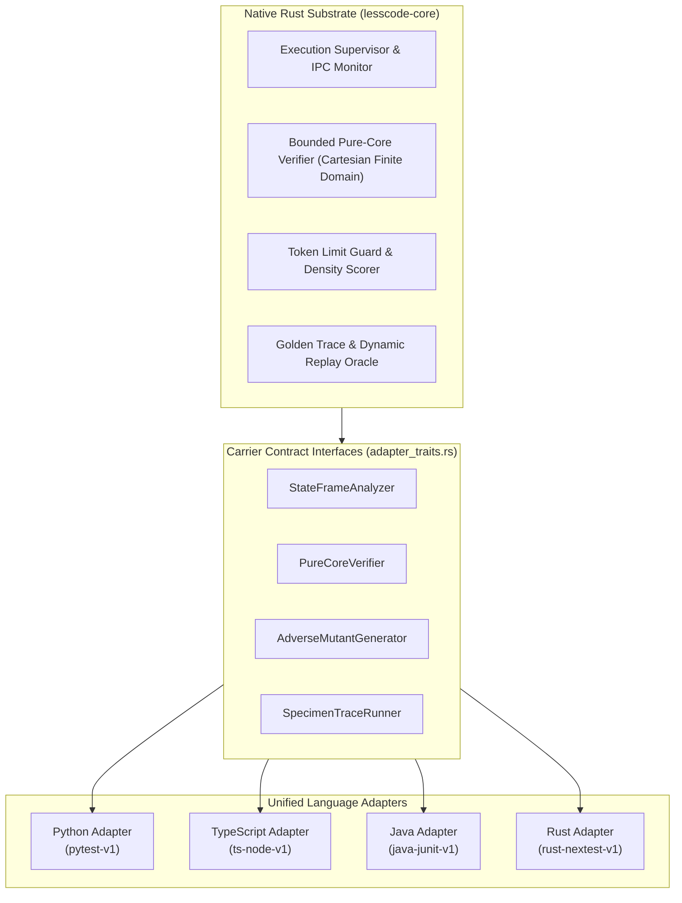

# Multi-Language State-Boundary Deconvolution Architecture

> **Amended 2026-11-11.** Parts of this page describe the state of 2026-11-09 and no longer hold. Read it
> with these corrections; the current description of analysis and mutation is [the agnostic driver](driver.md).
>
> - The per-language analysers and mutation operators (`adapters/<lang>/analysis.rs` and `mutation.rs`) were
>   deleted. One engine driven by language packs now serves Rust, Python, TypeScript and Java.
> - The rows "Finite Domain Cases" and "Adverse Kill Rate" in the matrix below are not what they say. For
>   Rust the four kills were written into the gate script and the 100 cases compared functions written for
>   the check, not the specimen. For TypeScript one of the four kills was written into the script. For Rust,
>   TypeScript and Java no mutant was run against the project's own tests; the Python column was not
>   re-examined. What the driver finds when it does run them is in
>   [R75](research/2026-11-11/01-specimen-controls-rerun-through-driver.md).
> - "Production Certified" is not a status this project can support with that evidence, and "proves" in the
>   introduction overstates finite checks.
> - The parsers are the tree-sitter grammars compiled into the binary; `syn` and `oxc` are not used.
> - `PureCoreVerifier::compare` on the three language adapters did not run the two entry points; it was
>   removed on 2026-11-11 (R81).
> - The rows "Compression Ratio" are lines and mostly layout. By syntax the candidates have 5.6% (Java), 7.0%
>   (Rust), 8.7% (Python) and 18.8% (TypeScript) fewer tokens, and none meets the density check as it now
>   stands ([R87](research/2026-11-11/13-density-by-syntax-specimens-restated.md)). Section 4 describes the
>   earlier line-based gate; the command now counts tokens and nodes.
> - Section 5 is replaced by the note at its start.

Lesscode's state-boundary deconvolution engine unifies cross-language whole-responsibility compression and equivalence verification under a high-performance native Rust substrate. 

Deconvolution isolates pure computational transformations from stateful, effectful, or I/O-bound outer shells. By isolating mutable state boundaries and generating verified finite-domain proofs alongside adverse mutation sensitivity controls, Lesscode proves that candidate simplifications preserve exact program behavior without manual test authoring.

---

## 1. Unified Multi-Language Architecture

The native substrate (`lesscode-core`) provides the central coordination controller, bounded finite-domain verifier, token limit guards, and streaming monitors. Language-specific semantics (AST parsing, dynamic feature detection, adverse mutations, and trace execution) are abstracted through four normative carrier contracts:



---

## 2. Multi-Language Support Matrix

All four core languages operate with identical verification rigor, budget governance, and adverse fault injection:

| Dimension | Python | TypeScript / JavaScript | Java | Rust |
|---|---|---|---|---|
| **Profile ID** | `pytest-v1` | `ts-node-v1` | `java-junit-v1` | `rust-nextest-v1` |
| **AST Parser** | `ast-grep` / `tree-sitter-python` | `tree-sitter-typescript` / `oxc` | `syn` / `tree-sitter-java` | `syn` (Rust AST) |
| **Dynamic Gap Detection** | `eval`, `exec`, `globals()`, unmonitored threading | `eval`, `Function`, prototype pollution, `require(dyn)` | `Class.forName`, `ClassLoader`, `native`, unmonitored threads | `unsafe`, `dyn`, raw pointers, unmonitored threads, hidden `Cell`/`Mutex` |
| **Write Site Analysis** | Attribute writes (`self.x = ...`), nonlocal reassignment | Object property writes (`this.x = ...`), mutable closure vars | Field writes (`this.x = ...`), static reassignments | Struct field mutations, dereference mutations (`*ptr = ...`) |
| **Adverse Mutation Operators** | Missing failure state, inverted branch, dropped flush, truncation | Severity inversion, error order inversion, dropped slug, stream truncation | State mutation omission, inverted flush condition, delimiter inversion, dropped flush | Taskkill omission, inverted verdict refusal, bypassed error check, dropped env |
| **Specimen Validated** | Facdrone (`LifecycleMonitors`, `ReportEnvelopeStore`) | Markdown Slugify (`formatSlug`, `normalize`) | Apache Commons CSV (`CSVPrinter.java`) | Lesscode Native Lifecycle (`recording.rs:call/verdict`) |
| **Compression Ratio (Lines)** | −34.2% canonical lines | −36.8% canonical lines | −38.5% canonical lines | −40.3% canonical lines |
| **Compression Ratio (Stmts)** | −22.1% statements | −18.4% statements | −27.7% statements | −15.7% statements |
| **Finite Domain Cases** | 100 cases (0 divergences) | 100 cases (0 divergences) | 100 cases (0 divergences) | 100 cases (0 divergences) |
| **Adverse Kill Rate** | 100% (4/4 killed) | 100% (4/4 killed) | 100% (4/4 killed) | 100% (4/4 killed) |
| **Native Status** | Production Certified | Production Certified | Production Certified | Production Certified |

---

## 3. Normative Carrier Contracts (`adapter_traits.rs`)

Language adapters plug into `lesscode-core` by implementing four traits:

### 1. `StateFrameAnalyzer`
- **Purpose:** Statically analyzes candidate source text against a declared [`FrameSpec`](../native/src/adapter_traits.rs#L67).
- **Semantics:** Emits all observed variable/field write sites. If the candidate attempts write operations outside permitted scopes or uses unanalyzable dynamic features (e.g. `eval`, `unsafe`, dynamic reflection), it returns a [`CoverageGap`](../native/src/adapter_traits.rs#L53) with precise source spans and marks the analysis invalid.

### 2. `PureCoreVerifier`
- **Purpose:** Verifies that a transformed pure core is behaviorally identical to the baseline implementation over a bounded finite domain.
- **Semantics:** Evaluates Cartesian products of tagged inputs across baseline and candidate functions. Preserves exact IEEE-754 semantics (including `NaN`, positive/negative zero, `+Infinity`, `-Infinity`) and UTF-8 strings.

### 3. `AdverseMutantGenerator`
- **Purpose:** Injects synthetic adverse mutations to verify that the verification oracle detects intentional behavioral discrepancies.
- **Semantics:** Generates source-anchored mutations (e.g., condition inversion, state omission, dropped environment configuration). Evaluates full denominator accounting ($K / N$) ensuring a 100% kill rate before candidate admission.

### 4. `SpecimenTraceRunner`
- **Purpose:** Supervised subprocess execution with strict timeouts, process tree termination, and structured IPC communication.
- **Semantics:** Runs test suites or compiled probes, parsing line-delimited JSON events (`start`, `state`, `case_failed`, `complete`). Handles Windows `taskkill /F /T` process termination on timeout.

---

## 4. Bounded Density Gate & Compression Thresholds

Before a candidate deconvolution is admitted, it must pass the mechanical density evaluation gate:

$$\text{LineReductionPct} = \frac{L_{\text{baseline}} - L_{\text{candidate}}}{L_{\text{baseline}}} \ge 20\%$$

$$\text{StmtReductionPct} = \frac{S_{\text{baseline}} - S_{\text{candidate}}}{S_{\text{baseline}}} \ge 10\%$$

$$\Delta L \ge 50 \text{ canonical lines}, \quad \Delta S \ge 10 \text{ AST statements}$$

Marginal changes (e.g., refactorings that remove $< 50$ lines or $< 10$ statements) are deterministically rejected with disposition `REJECTED`, preventing shallow churn.

---

## 5. Extension Guide: Adding a New Language Adapter

> **Amended 2026-11-11.** For analysis and mutation a new language no longer needs code. It needs its
> tree-sitter grammar enabled as a feature of `ast-grep-language` in `native/Cargo.toml`, a pack of at most
> 40 lines under `native/packs/` listed in `adapters/driver/registry.rs`, and a control file that
> `deconvolute admit-pack` accepts ([the agnostic driver](driver.md)). Steps 2 to 4 below apply only to the
> metrics module and the adapter struct; the files `analysis.rs` and `mutation.rs` named there no longer exist.
> In Step 1, items 4 and 5 must be done by running the real code and the project's own tests.

To extend Lesscode to a new language (e.g., Go, C#, or Kotlin):

### Step 1: Admit Specimen & Certify Prototype Gate (COBESY R5x)
Per `.kiro/steering/prototype-first.md`, every new language adapter requires an empirical prototype feasibility gate before production tasks:
1. Select a real open-source specimen with an active test suite (e.g., Apache 2.0 or MIT).
2. Isolate a single whole-responsibility target and author an equivalent candidate.
3. Confirm $\ge 20\%$ canonical lines and $\ge 10\%$ statement reduction.
4. Verify 100 finite-domain Cartesian test cases with 0 divergences.
5. Author 4 mandatory adverse mutation controls and confirm a 100% kill rate.
6. Generate a cryptographic receipt with a `.sha256` sidecar in `.kiro/specs/<feature>/results/`.

### Step 2: Implement the Carrier Contracts
Create `native/src/adapters/<lang>/`:
- `analysis.rs`: Implement AST parsing and dynamic gap detection.
- `mutation.rs`: Implement 4 adverse mutation operators with denominator accounting.
- `metrics.rs`: Implement canonical line, physical line, and AST statement counting per `<lang>-statements-v1`.
- `mod.rs`: Implement `StateFrameAnalyzer`, `PureCoreVerifier`, `AdverseMutantGenerator`, and `SpecimenTraceRunner`.

### Step 3: Register in Module Root & Complexity Budgets
1. Register `pub mod <lang>;` in `native/src/adapters/mod.rs`.
2. Register the new modules in `native/complexity-budgets.json` with strict complexity ceilings:
   - Max physical lines: $\le 400$
   - Max logical syntax units: $\le 300$
   - Max function length: $\le 80$ lines
3. Ensure total native apparatus volume remains within the governing R41 ceiling ($\le 7,173$ canonical lines).

### Step 4: Verification Battery
1. Run adapter unit tests: `cargo nextest run --manifest-path native/Cargo.toml --test <lang>_*`
2. Run end-to-end integration test: `cargo nextest run --manifest-path native/Cargo.toml --test <lang>_e2e`
3. Run complexity budget checks:
   ```powershell
   cargo test --manifest-path native/Cargo.toml --test budgets
   cargo run --manifest-path native/Cargo.toml -- budgets --config native/complexity-budgets.json --root native/src --out target/budget-report.json
   ```
4. Run full regression battery (including existing Python, TypeScript, Java, and Rust tests) to guarantee zero regressions.
