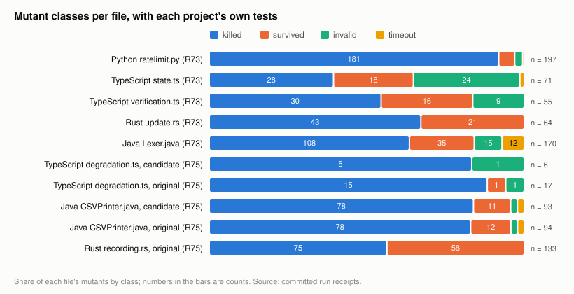
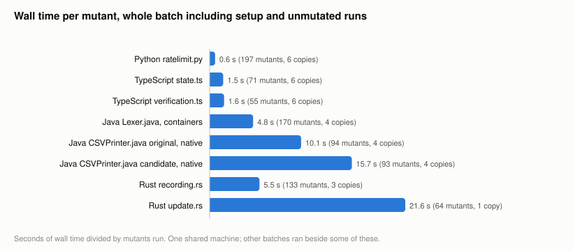
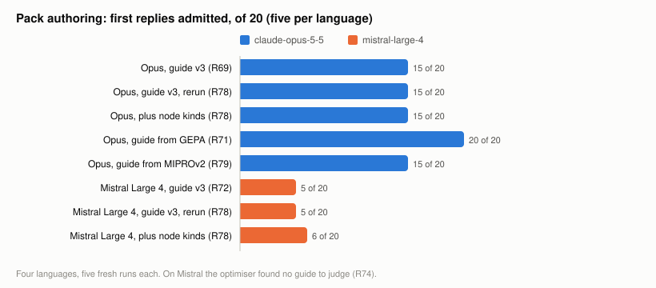
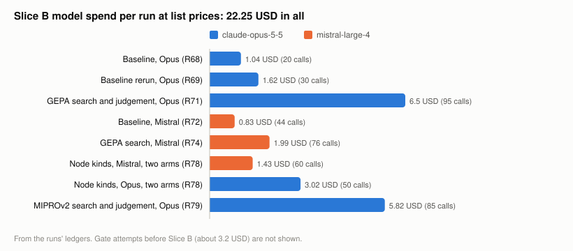
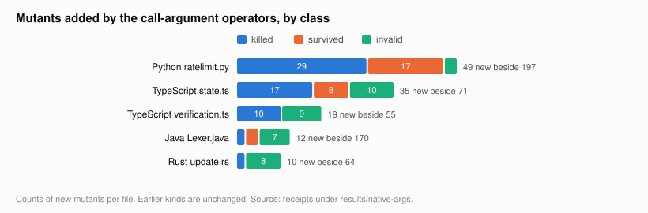
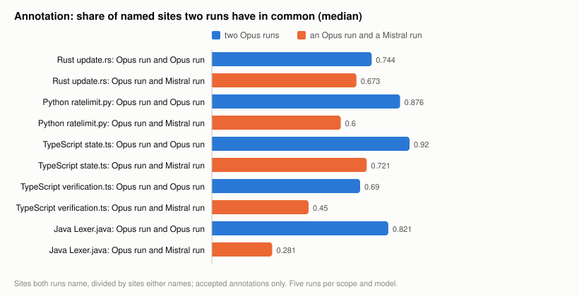

# Feasibility of the agnostic mutation driver as one Rust binary

Written 2026-11-10, Europe/Berlin, after the second attempt of the `agnostic-annotation-driver` prototype
gate. Composition recorded in `docs/reports/blueprints/2026-11-10-agnostic-driver-feasibility-blueprint.md`.

- Project: Lesscode, research on making AI-generated code smaller and less entangled without changing its
  behaviour.
- Period covered: 10 November 2026, research entries R55 to R64. Sections 8 and 9, added 2026-11-11, cover R65 to R83
  and have the figures.
- Audience: the owner, who decides whether to start requirements and design for a Rust port; then the
  implementer of that port, and an adopter who wants to know whether running the tool can damage their code.
- Status: a prototype in Python that passed its gate on the second attempt, on five files in four languages.
  Nothing in the native crate was changed for it. Every number names the entry it comes from.
- Owner decisions this report builds on (2026-11-10): the apparatus must be ported to Rust; there will be one
  runtime, not two; breaking codebases must be avoided.

The claim this report argues: the agnostic driver is feasible as a single Rust binary. Its mechanism was shown
to work on four languages with one engine and a small data pack per language. The port replaces the present
line-scanning adapters with that engine, using parsers the crate already depends on plus two grammars. The
design keeps a codebase safe, because the tool only ever changes copies and because its output says where tests
are too weak to permit a cut. Three things are not shown and are named at the end: the port itself, its size
against the apparatus cap, and its speed on Rust code.

## 1. What the Rust numbers mean

The owner asked whether every Rust "cut" to deconvolute the code was flawed. No Rust code was cut, and nothing
was deconvoluted in this work. The numbers describe something else.

A mutant is a small deliberate bug: a negated condition, a dropped statement, two checks swapped. The driver
plants one mutant at a time in a copy of a file and runs that file's tests. If a test fails, the mutant is
killed, which is the good outcome: the tests noticed. If all tests pass, the mutant survived, and the question
becomes whether the bug is real or whether the change makes no difference.

On the Rust scope, one file of `mmhmem` (`src/setup/ui/update.rs`), the second attempt planted 66 mutants. The
tests killed 45. Of the 21 survivors an independent reviewer judged 20 to be real bugs the tests do not check
and one to be harmless (R64). So the finding is about that file's tests, not about the driver and not about any
rewrite: about a third of the small bugs one can plant there go unnoticed, most of them in text shown on the
terminal, which the tests check only loosely. The driver did its job on every one of the 66.

The earlier deconvolution result for Rust (R52: a lifecycle responsibility reduced from 248 to 148 lines, no
divergence in 100 compared cases) was not re-run or re-examined here. One caveat about it does follow from
today's work. Its four adverse controls were produced by the hard-coded operators, which R55 showed to be
written for that very specimen. Four tailored controls being caught says less about the sensitivity of that
check than the same count from a general generator would.

## 2. The tool does not touch your code

Avoiding damage to a codebase was a design condition of the prototype, and it is the first thing a port has to
keep.

- Mutants are written into isolated copies of a repository, never into the checkout they were cloned from. The
  upstream checkouts were only read (R57).
- Before a batch the harness records the hash of each file it will change and requires the unmutated tests to
  pass. After each mutant it restores the original bytes and checks the hash. After the batch it runs the
  unmutated tests again. A batch in which any of this fails is void and none of its results count
  (gate Amendment 3e).
- A run that did not actually test anything is not a result. A test command that fails to start, or a build that
  runs out of memory, is recorded as an error, retried once and never stored. This rule was added after one
  launch failure had been counted as a kill; all 240 kills recorded before that were checked against their logs
  and none was affected (R62).
- Across every counted batch of both attempts the copies ended byte-identical to their starting state.

One weakness is known. The harness restores a file when it exits normally. When a batch was stopped from
outside, the copy was left with a mutant in it and had to be restored from its commit by hand (R60, R62). In a
copy that costs nothing. A port must nevertheless restore on interruption as well, or work in a scratch copy it
creates and discards itself, so that the property does not depend on how a run ends.

## 3. What was shown

The gate compared ways of producing mutants on scopes outside the project's own specimens. A scope is one source
file with the tests that belong to it. Two languages were used to develop the approach (Rust, Python) and two
were held out (TypeScript with two files, Java).

The form that passed is called arm D in the log. One engine, with no language or project name in it, reads a
data pack for the language: which syntax nodes are conditions, failure signals, state writes and adjacent
checks, and a handful of templates such as how a negation is written. It applies four generic operators at
every place the pack makes eligible. No model is involved when it runs.

Attempt 1 failed. TypeScript landed mutants in only two of the required three kinds, because dropped statements
and negated type guards did not type-check, and with that the row requiring both held-out languages was not met
(R61). Attempt 2 extended the pack format: calls made for their effect count as state writes, an expression
returned by a yes-or-no function counts as a condition, operators such as `==` and `!=` or `<` and `<=` can be
swapped, and a returned `true` or `0` can be replaced by its counterpart (R63). The result, with every mutant
run and no sampling:

| Scope | Role | Mutants | Did not compile | Killed | Survived | Timed out | Killed or a real test gap, of those that ran |
| --- | --- | --- | --- | --- | --- | --- | --- |
| Rust `update.rs` | development | 66 | 0 | 45 | 21 | 0 | 65 of 66, 98% |
| Python `ratelimit.py` | development | 199 | 5 | 183 | 10 | 1 | 190 of 194, 98% |
| TypeScript `state.ts` | held-out | 74 | 26 | 28 | 19 | 1 | 47 of 48, 98% |
| TypeScript `verification.ts` | held-out | 66 | 16 | 33 | 17 | 0 | 45 of 50, 90% |
| Java `Lexer.java` | held-out | 189 | 15 | 123 | 39 | 12 | 155 of 174, 89% |

Source: R64. The targets, fixed before the first attempt, were mutants in at least three kinds per scope and at
least 70% of them either killed or a real test gap. All five scopes meet both. The share in the last column uses
labels from independent reviewers who saw only the code, the tests and each change; on a blind sample the
designer's own labels agreed with theirs in 17 of 18 cases, and the reviewer was right in the one that differed.

Two further results matter for the port.

The packs for the held-out languages can be written by a model. Given a short authoring guide and the Rust and
Python packs, the model wrote packs for TypeScript and Java. Deterministic checks admitted both on the first
reply, and on all three held-out scopes they produce exactly the mutants of the hand-written packs (R64). Adding
a language was one offline model call and a set of checks, not code.

Asking a model which places to mutate is optional. That variant, arm A, produced valid annotations in 81% to 100%
of cases, but every mutant it led to is also among arm D's, and two identical runs agreed on only 60% to 94% of
their sites. It selects; it does not find anything the engine does not already run. That is why the recommended
form has no model at run time (gate decision rule, R64).

## 4. What the results say about cutting code safely

The driver exists so that a later rewrite can be trusted. A rewrite is accepted when the tests still pass. That
is only as strong as the tests, and the survivors measure how strong they are in a given place.

| Scope | Mutants that ran | Survived | Of those, real bugs the tests miss |
| --- | --- | --- | --- |
| Rust `update.rs` | 66 | 21, 32% | 20 |
| Python `ratelimit.py` | 194 | 10, 5% | 7 |
| TypeScript `state.ts` | 48 | 19, 40% | 19 |
| TypeScript `verification.ts` | 50 | 17, 34% | 12 |
| Java `Lexer.java` | 174 | 39, 22% | 32 |

Source: R64. On four of the five files, between a fifth and two fifths of the small bugs planted went unnoticed.
A rewrite of such a file that passes its tests could contain a bug of the same kind and nobody would see it.
The Python file is the counter-example: 230 tests for 478 lines, and 5% survive.

What the reviewers found behind the survivors is concrete. In `state.ts`, three safety checks can be removed
with all tests passing: that the state directory lies inside the project root, that the state path is not a
symbolic link, and the rethrow that the symbolic-link error passes through (R60, confirmed in R64). In the Java
lexer the tests never read the token flags or the recorded first end-of-line string, which the parser depends
on. In the Rust file most survivors change what the user sees on the terminal.

For the owner's constraint this gives a rule the tool can enforce: before a responsibility is rewritten, run the
driver on it, and treat every surviving mutant that is a real bug as a test to write first. Where the survivors
are many, the area is not ready to be cut. The project already has this step in its loop as the missing-test
report; what was missing was a generator that works on code other than the specimens.

This is a statement about protection, not about gain. Nothing in this work measured how much code can be
removed.

## 5. Feasibility of the Rust port

The prototype is about 570 lines of Python (an engine of 273 lines and a validator of 296) and 115 lines of
packs for four languages (R64). The question is what building the same thing into `lesscode-core` involves.

### What the native crate has today

The three analysis adapters and the three mutation adapters do not parse. Each analysis adapter walks the
source line by line and matches text; each mutation adapter replaces fixed substrings. That is six files and 869
lines (`adapters/{rust,java,typescript}/analysis.rs` at 145, 143 and 132 lines; `mutation.rs` at 155, 155 and
139). Python has neither.

### What the port replaces and adds

| Part | Today | After the port |
| --- | --- | --- |
| Mutation operators | three files of specimen-bound substring rules, 449 lines; none for Python | one engine applying generic operators from a pack; the three files are deleted |
| Write-site and gap analysis | three files of line-based text rules, 420 lines; a stub for Python | optionally the same engine reading the same pack, since the pack already names write sites and function boundaries |
| Language knowledge | Rust source code | one data file per language, 26 to 33 lines in the prototype |
| Parsing | `syn` for Rust in the budget checker; `ast-grep` with Python and TypeScript grammars elsewhere | `ast-grep` for all four |
| Pack admission | does not exist | a check that every node kind a pack names exists in the grammar and that control annotations behave as expected |
| Batch runner | the specimen runners | copy, baseline, mutate, restore, classify, as in the prototype harness |

### Dependencies

The crate already pins `ast-grep-core` and `ast-grep-language` at 0.51.0, with only the Python and TypeScript
grammars switched on. The same crate offers `tree-sitter-rust` and `tree-sitter-java` as features. Turning them
on adds two grammar crates to the lock file and to the license inventory and lengthens the build; it adds no
new kind of dependency. No model client is needed at run time. Writing a pack for a new language uses a model
once, offline, and could stay a maintainer's script outside the binary.

One thing must be checked early. The prototype used the Python binding of `ast-grep` at version 0.39.5, the
crate pins 0.51.0. Node kinds can differ between grammar versions. The packs therefore have to pass the
admission check against the crate's own grammars before anything else is built on them. The check exists for
exactly this and takes seconds.

### Size against the apparatus cap

The counted native apparatus stands at its no-growth cap of 7,173 canonical lines (R53), and the gate left this
row open as the owner's decision (R64). No Rust was written, so what follows is an estimate and is labelled as
one.

A Rust version of 570 lines of Python that leans on the same parser library plausibly lands between 750 and
1,000 lines. Against that stand the files it makes unnecessary.

| Port scope | Removed | Added (estimate) | Net (estimate) |
| --- | --- | --- | --- |
| Mutation only | 449 | 750 to 1,000 | 300 to 550 more |
| Mutation and analysis | 869 | 750 to 1,000 | 120 fewer to 130 more |

So the cap can probably be held if the port also takes over the analysis adapters, and probably cannot if it
replaces mutation alone. This is the main reason to port both together. It also gives Python the analyzer
that R55 found missing; since 1.0.2 that command only reports that it is not implemented. The estimate ignores the batch runner, which may reuse existing
runner code or may add to the count, and it uses physical lines where the cap counts canonical lines of a
defined set. It needs a measurement before it carries a decision.

Amendment, 2026-11-10 (after the sizing spike,
[R65](../research/2026-11-10/11-annotation-driver-rust-sizing-spike.md)). The spike replaced the estimate
with a measurement and corrected two things in this section.

- Size. A faithful Rust port of the engine and validator is 1,035 physical lines, 898 canonical, at the top
  of the estimated range. The estimate had left out pack admission, which is another 413 canonical lines as
  ported. The removable adapter files are 753 canonical lines. On a whole-crate view the core is a net of 145
  canonical lines more.
- The cap. This section assumed the port must fit under the 7,173-line cap by removing as much as it adds.
  The cap's counted set (R41) is a fixed list of files that contains neither the adapters nor the
  deconvolution command code, so removing the adapters does not lower the counted figure. Whether the driver
  counts toward the cap is the owner's decision; under the way the cap has been applied so far, the adapters
  were outside it.
- The grammar risk did not materialise: with the crate's own parser version the port reproduces the
  prototype's sites and mutants exactly on all five scopes.

### Speed
After the batching was changed (R62), a full pass takes about 90 seconds for 199 Python mutants, 70 and 94
seconds for the two TypeScript files and under 12 minutes for 189 Java mutants, with six workers. Rust is the
exception. Each mutant needs a rebuild of the crate under test, about 12 to 21 seconds, and four concurrent
builds of that crate ran out of memory on the test machine, so the Rust scope ran serially: 66 mutants in 23
minutes (R64). A port inherits this. It is a property of compiling Rust per mutant, not of the driver's
language, and the known remedies (limiting build jobs per worker, or compiling all mutants into one build and
switching them at run time) were not tried.

### Risks specific to the port

- The validator's rules about anchors, wrappers and terminators were tuned against five files. Porting them
  line for line is straightforward; whether they hold on unfamiliar code is the same open question in either
  language.
- Restoring on interruption, noted in section 2, has to be solved in the port and was not solved in the
  prototype.
- `cli_deconvolute.rs` is at 399 of its 400-line ceiling since the fail-loudly change in 1.0.2, so wiring new
  behaviour into that file means moving code out of it first.

## 6. What is not shown

- A Rust implementation. Everything that ran was the Python prototype.
- The port's size. The table above is an estimate.
- Breadth. Five files from four repositories, three of them the owner's, and both TypeScript files from one
  repository. The hand-written packs for the held-out languages were shaped by their author with knowledge of
  those files; the clean evidence is that the model's packs came out identical, which also means the case of a
  model writing a different or wrong pack, and the one repair attempt the procedure allows, was never exercised.
- Typed languages. 35% and 24% of the TypeScript mutants and 8% of the Java mutants did not compile. The targets
  were met in spite of this.
- Depth of the operators. A failure signalled by returning a non-literal value still has no operator. Negating a
  single equality and swapping its operator produce the same mutant twice; counting such pairs once changes no
  verdict (Java goes from 89% to 88%) but the duplicate should not ship.
- The meaning of "kind". Twelve of the fourteen Rust survivors classed as state writes drop a line printed to
  the terminal. Three kinds landed is a weaker statement about breadth than it sounds.
- Compression. This work is about the instrument that tells whether tests can be trusted. How much code a
  rewrite removes was not measured here.
- Hardening against model drift, the owner's second priority. Only its baseline exists: two identical
  annotation runs agree on 60% to 94% of their sites. In the recommended form the model's only output is a pack,
  written once and admitted by checks, so there is little left at run time to drift.

## 7. Decisions

The gate result unlocks requirements and a design for approval. It does not unlock production tasks. Three
choices shape that design.

1. Scope of the port. Mutation and analysis together is the option the size estimate favours and the one that
   gives Python an analyzer. Mutation alone is smaller work now and very likely needs the cap raised.
2. First step. A sizing spike inside the design phase: switch on the two grammars, run the pack admission check
   against the crate's own grammar versions, port the validator's kind check and one operator, and count the
   lines. That turns the estimate in section 5 into a measurement and tests two of the three conditions under
   which this report's claim would be wrong.
3. The cap. Decide after the spike whether 7,173 holds, with the measured figure in hand.

The claim would be wrong if the crate's grammars reject the packs' node kinds for a language, if a port cannot
restore a scope byte for byte when a run is interrupted, or if the measured port exceeds the cap with nothing
left to remove. The first is checked in minutes, the third in the spike, the second in the design of the batch
runner.

## 8. Update, 2026-11-11: the port exists; what was built and measured since

Added 2026-11-11, about 09:00 Europe/Berlin, before three further changes to the code that the owner chose
today (a signal handler, the removal of two functions that report success without running anything, and
operators for changed arguments and literals in calls). A second update follows when those are done. Period
covered: research entries R65 to R80. The sections above are left as they were written.

### The claim, one day later

The claim of this report held. The driver is one engine in the one binary for Rust, Python, TypeScript and
Java; it reproduces the prototype exactly; the six line-scanning adapter files are deleted; and the
specification is validated with one criterion met in part. The three things section 6 named as not shown are
now measured:

| Not shown on 2026-11-10 | Measured | Entry |
| --- | --- | --- |
| The port itself | Sites and mutants equal the prototype's on five files; 556 of 556 mutants get the prototype's class with the projects' own tests | R67, R73 |
| Its size | Twenty files of at most 348 lines under per-file budgets; the binary grows from 10.99 to 13.26 MB; build time unchanged | R65, R73 |
| Its speed on Rust | Still the slowest: 21.6 seconds per mutant with one copy, 5.5 with three copies that each build inside themselves | R73, R75 |

### What the driver finds in real code

| File | Mutants | Killed | Survived | Invalid | Timeout |
| --- | --- | --- | --- | --- | --- |
| Python `ratelimit.py` | 197 | 181 | 10 | 5 | 1 |
| TypeScript `state.ts` | 71 | 28 | 18 | 24 | 1 |
| TypeScript `verification.ts` | 55 | 30 | 16 | 9 | 0 |
| Rust `update.rs` | 64 | 43 | 21 | 0 | 0 |
| Java `Lexer.java` | 170 | 108 | 35 | 15 | 12 |
| TypeScript `degradation.ts`, candidate | 6 | 5 | 0 | 1 | 0 |
| TypeScript `degradation.ts`, original | 17 | 15 | 1 | 1 | 0 |
| Java `CSVPrinter.java`, candidate | 93 | 78 | 11 | 2 | 2 |
| Java `CSVPrinter.java`, original | 94 | 78 | 12 | 2 | 2 |
| Rust `recording.rs`, original | 133 | 75 | 58 | 0 | 0 |

A survivor is a planted fault the project's tests did not notice. For the question this project asks, whether
code can be cut safely, the orange share is where a cut is not protected by tests. It ranges from a twentieth
of a file's mutants to over two fifths.

The last five rows restate earlier results of this project. The gates of R50 to R52 had each reported "4 of 4
adverse controls killed". Read in the gate scripts, the Rust kills were written into the script, one
TypeScript kill was too, and one Java kill was a mutant that did not compile. Of the twelve hand-made
controls five have a driver mutant; with the projects' own tests four are killed and one survives (R75).

### How long a run takes

| Batch | Wall time | Mutants | Copies | Seconds per mutant |
| --- | --- | --- | --- | --- |
| Python `ratelimit.py` | 118 s | 197 | 6 | 0.6 |
| TypeScript `state.ts` | 107 s | 71 | 6 | 1.5 |
| TypeScript `verification.ts` | 88 s | 55 | 6 | 1.6 |
| Java `Lexer.java`, in containers | 814 s | 170 | 4 | 4.8 |
| Java `CSVPrinter.java` original, native | 946 s | 94 | 4 | 10.1 |
| Java `CSVPrinter.java` candidate, native | 1,462 s | 93 | 4 | 15.7 |
| Rust `recording.rs` | 738 s | 133 | 3 | 5.5 |
| Rust `update.rs` | about 1,380 s | 64 | 1 | 21.6 |

Wall time covers the whole batch: copying, setup, the unmutated runs before and after, and every mutant. The
cost per mutant is set by what the project's own build and test command costs, not by the driver. A full
Maven test phase per mutant (the two native Java rows) is two to three times dearer than compiling one file
and running one test class (the container row). Rust pays a rebuild per mutant; three copies bring it from
21.6 to 5.5 seconds on a different, smaller crate, so the two Rust rows are not a clean comparison. The
machine was shared, and the candidate Java batch ran beside a Rust batch.

One run today was void, and correctly so: three Rust copies shared a build directory through a global
environment variable, and 16 of 133 mutants got a wrong class. The driver's closing run of the unmutated
tests failed and voided the run. The safety argument of section 2 therefore has a second half that was not
written there: besides never touching the source tree, the driver has to notice when its copies are not
independent, and at present it notices only afterwards.

### Slice B: how much a model's output drifts, and what holds it

The driver takes its knowledge of a language from a pack, and a model can write that pack. Slice B asks how
reliable that is.

| Model and condition | First replies admitted, of 20 | Entry |
| --- | --- | --- |
| `claude-opus-5-5`, guide version 3 | 15 | R69 |
| `claude-opus-5-5`, guide version 3, rerun | 15 | R78 |
| `claude-opus-5-5`, plus the grammar's node kinds | 15 | R78 |
| `claude-opus-5-5`, guide found by GEPA | 20 | R71 |
| `claude-opus-5-5`, guide found by a MIPROv2-style search | 15 | R79 |
| `mistral-large-4`, guide version 3 | 5 | R72 |
| `mistral-large-4`, guide version 3, rerun | 5 | R78 |
| `mistral-large-4`, plus the grammar's node kinds | 6 | R78 |

Three readings. Changing the model moves admission more than anything else measured. An optimiser that
writes its next guide from the judged failures (GEPA) repaired the one language that failed; one that
proposes guides before seeing a failure (MIPROv2 as far as it applies here) did not. Giving the weaker model
the list of valid node kinds removed the invalid kinds and left admission where it was. In every arm the
admission barrier held: nothing inadmissible was admitted. No optimised guide was adopted, because the Rust
packs written under it still differ from the hand-written pack, which the owner decided to keep.

| Run | Calls | USD at list prices |
| --- | --- | --- |
| Baseline, Opus (R68) | 20 | 1.04 |
| Baseline rerun, Opus (R69) | 30 | 1.62 |
| GEPA search and judgement, Opus (R71) | 95 | 6.50 |
| Baseline, Mistral (R72) | 44 | 0.83 |
| GEPA search, Mistral (R74) | 76 | 1.99 |
| Node kinds, Mistral, two arms (R78) | 60 | 1.43 |
| Node kinds, Opus, two arms (R78) | 50 | 3.02 |
| MIPROv2 search and judgement, Opus (R79) | 85 | 5.82 |

Slice B has cost 22.25 USD; with the gate attempts before it the recorded total is about 25.5 of a stop the
owner raised to 40 USD. The two optimiser runs on Opus are more than half of it. A baseline of twenty
authoring runs costs between one and two dollars.

### What is still not shown

- A driver that is killed from outside can leave a project command running. That is the criterion met in
  part, and the first of today's three changes.
- Two functions in the library still report success without running anything. They are not reachable from
  the command line. Removing them is the second change.
- Seven of the twelve hand-made controls were faults the driver has no operator for: a changed argument, a
  changed literal inside a call, the order of a list, what a process prints. Operators for the first two are
  the third change.
- The Rust specimen candidate has never been built, so nothing is known about its behaviour.
- For Slice B: the annotation layer, where a model chooses sites, and the drift of one model over time.
- No release contains the driver.

The figures are written by `docs/reports/figures/make_figures.py` from the committed receipts and ledgers.

## 9. Second update, 2026-11-11: after the three changes, and the annotation layer

Added 2026-11-11, about 09:50 Europe/Berlin, after the three changes announced at the top of section 8, and
after the Slice B baseline for the annotation layer. Period covered: research entries R81 to R83. Section 8
is left as written; where a figure there was regenerated with more rows, this section says so.

### What changed in the tool

| Item of "still not shown" in section 8 | State now | Entry |
| --- | --- | --- |
| A driver killed from outside can leave a project command running | On Ctrl-C, Ctrl-Break, a termination signal or a closing console the driver kills the command with everything it started, restores the copy and ends the run as void. Tested with a real signal on five platforms. A driver killed outright still relies on its restore journal | R81 |
| Two library functions report success without running anything | Three were found and removed | R81 |
| No operator for a changed argument or a changed literal in a call | A sixth site kind, the argument list of a call, with three bounded operators | R81 |

### What the call-argument operators add

| File | Mutants before | New | Killed | Survived | Invalid |
| --- | --- | --- | --- | --- | --- |
| Python `ratelimit.py` | 197 | 49 | 29 | 17 | 3 |
| TypeScript `state.ts` | 71 | 35 | 17 | 8 | 10 |
| TypeScript `verification.ts` | 55 | 19 | 10 | 0 | 9 |
| Java `Lexer.java` | 170 | 12 | 2 | 3 | 7 |
| Rust `update.rs` | 64 | 10 | 2 | 0 | 8 |

The operators pay where calls carry literals and where argument order is not fixed by types. In the Python
file, swapping the first two arguments of a call leaves 16 mutants that no test notices. In Java and Rust the
same swap almost never builds (2 of 17), so there it costs a build and tells nothing; whether to switch it
off for those two languages is an open choice. The mutants of the five earlier kinds kept their classes in
556 of 557 cases; the exception is one Rust mutant that ran into its time limit while five batches shared the
machine.

Efficiency, in the terms of section 8: the new kind makes a run between 7% and 49% longer, in proportion to
the mutants it adds. The wall times of these reruns are not comparable with the earlier ones, because all
five ran at once; each took two to three times as long as alone.

Of the seven hand-made controls recorded as lost, one now has a counterpart (the changed string literal in
a call). Six remain out of reach of pack-driven operators as they stand.

### The annotation layer: the second place a model's output is relied on

Besides writing a language pack once, a model can be asked to name, per file, the sites worth mutating. The
driver validates every such annotation and mutates only accepted ones, so a wrong annotation cannot make a
run unsound. What can drift is the selection.

| File | Two Opus runs (median) | An Opus run and a Mistral run (median) | Sites in every Opus run / in any | Mistral runs with annotations |
| --- | --- | --- | --- | --- |
| Rust `update.rs` | 0.74 | 0.67 | 15 / 26 | 4 of 5 |
| Python `ratelimit.py` | 0.88 | 0.60 | 48 / 61 | 1 of 5 |
| TypeScript `state.ts` | 0.92 | 0.72 | 34 / 40 | 3 of 5 |
| TypeScript `verification.ts` | 0.69 | 0.45 | 11 / 25 | 1 of 5 |
| Java `Lexer.java` | 0.82 | 0.28 | 24 / 35 | 1 of 5 |

Agreement is the number of sites both runs name divided by the number either names. Two runs of the same
model on the same file do not select the same sites: 8% to 31% differ, and only 44% to 85% of
all sites ever named are named every time. Across models the selections differ more, mostly because the
second model names two to three times as many sites. And the second model often does not answer within its
output limit at all: 15 of 25 calls ended there.

The consequence for the question of this report, whether code can be cut safely with this tool, is the same
as for packs. The parts that decide soundness are mechanical: the validator, the admission checks, the
copies, the closing run. Where a model's choice enters, it decides how much is tried and how long it takes,
and that choice should not be read as stable from one call.

### Spend, updated

The figure of section 8 now has two more rows: the annotation baseline cost 2.64 USD on Opus and 1.56 USD on
Mistral. Slice B stands at 26.45 USD; the recorded total is about 29.7 of 40 USD. During the Mistral arm
seventeen calls were made whose cost reached the ledger only afterwards, because the caller could not read
that model's reply format; the replies were saved and were read later without a new call (R83).

### What is still not shown, as of this update

- The Rust specimen candidate has never been built.
- Six of twelve hand-made controls have no pack-driven counterpart: an argument replaced by a value of
  another form, a dropped list element, a removed chained call, what a process prints.
- A driver killed outright cannot clean up at that moment.
- The classes of the call-argument mutants come from one run under load.
- For Slice B: drift of one model over time; whether sites named in every run are better targets than sites
  named once; a second model that answers within its limit.
- No release contains the driver. Release 1.1.0 is being prepared; the owner tags it.