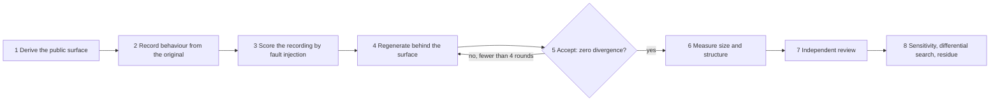

# Regenerate behind the surface: a measured loop for shrinking AI-generated code

Report on the Lesscode deconvolution research, November 2026; written
2026-11-04, updated 2026-11-06.

- Project: Lesscode, a research effort to make AI-generated codebases
  smaller and less entangled without changing their behaviour.
- Period covered: 1 to 6 November 2026. Seven experiments on two real
  codebases, recorded as dated entries R19 to R26 in the project's
  research log.
- Audience: a reader who knows software verification and SMT solving but
  has not followed this project. Every project-specific term is defined on
  first use; a glossary is at the end.
- Status: research results on two scopes of one Python codebase. Nothing
  here has been adopted into any product.

## 1. Executive summary

Coding agents produce working code that scatters one responsibility across
many small functions and files. Rewriting such code smaller is easy for the
same agents. Knowing that the rewrite still behaves the same is the hard
part, and tests alone do not settle it: they rarely assert on what bytes
reach the database or on what happens on an error path.

We built a loop that lets a language model rewrite one bounded part of an
existing codebase behind that part's real public interface, and that
measures how much of the old behaviour the rewrite demonstrably keeps. The
loop records the original's behaviour under an effect-capturing sandbox,
scores that recording by fault injection before any rewrite exists, lets
the model regenerate the code under a structural contract, accepts only on
zero divergence from the recording, measures size and internal coupling on
both versions, has a second agent review the diff, then searches the
rewrite for differences the recording cannot see.

On its first full run, on five modules (1,274 lines) of a Python trading
application with a PostgreSQL store, the loop accepted a rewrite in the
first of four allowed rounds. The rewrite had 16 percent fewer lines,
24 percent fewer functions and 29 percent fewer internal call edges, with
zero divergence on 64 recorded behaviour sequences and every existing test
passing. The same run measured the limits of that claim: the recording
catches 64 percent of injected faults, not the 70 percent we predicted,
and one real behavioural difference on an exception path was invisible to
the recording and was found by review and random testing instead.

On its second run, two days later, the regenerator was no longer an
interactive agent but a recorded program: one request per turn to a model
endpoint, every prompt and response hashed into the receipt, and a turn
rule that feeds a failed turn's successor only the first divergence and the
measure gaps. On seven modules (1,495 lines) of the same application the
loop accepted at the third of four allowed turns, after one turn in which
the model spent its whole output budget thinking and one in which the
candidate failed on a name only the recording apparatus imports. The
accepted rewrite had 25 percent fewer functions and 29 percent fewer
internal call edges, inside the bands we had preregistered, and only
6 percent fewer lines after canonical formatting, below the 10 to 20 we
had predicted; that prediction failed. The recording killed 68 percent of
injected faults on the rewrite, inside its band. A second agent's 128
probes and the solver's replays found seven differences invisible to the
recording, all on error or malformed-input paths. A corpus of 74 sequences
recorded after acceptance replayed on the rewrite with zero divergence.
The solver step voided itself on a failed control and is credited with
nothing.

Our conclusion is that the loop is a usable research instrument and worth
building into a spec-driven development workflow, as long as its output is
read as "measured protection with a declared residue" and never as
"equivalent". Automatic selection of what to rewrite and languages other
than Python remain unproven. Behaviour over several rounds has been
observed once.

## 2. The problem

### 2.1 What "convoluted" means here

The codebases in question work. Their tests pass. Their problem is
structural: a single responsibility, such as "record the evidence behind a
trading decision and store it", is spread over a dozen functions in four or
five files, each forwarding to the next, each validating a little, each
holding part of the state. Maintaining such code means reading all of it
to change any of it. We call this convolution, and the goal of the project
is deconvolution: fewer lines, fewer functions, fewer internal edges, the
same behaviour at the boundary that the rest of the system uses.

### 2.2 Why the obvious approaches failed on real code

Before the work reported here, the project tried three approaches on the
same kind of code. Each is recorded in the research log with its failure.

- Static state models. We extracted call and data-flow facts with a code
  query engine and built a model of the responsibility's state. On real
  code the model could not be shown to match the source: known aliasing
  and overwrite flows were missed, and adding evidence did not close the
  gap (entries R8 to R10).
- Model-checked models. We had a language model write a formal model of
  the scope and checked it with an SMT solver. The model could be checked
  for consistency but never for fidelity to the program, so a solver
  verdict about the model said nothing certain about the code. The
  approach was withdrawn as an equivalence authority (R19).
- Instructions without measurement. A skill with careful rewriting
  guidance, applied by an agent to real scopes, produced candidates that
  were sometimes larger and sometimes wrong (R11 to R18).

The common lesson was that any claim of "same behaviour" has to be checked
against the running original, not against a model of it. The research
direction changed accordingly on 3 November 2026.

## 3. The setting

### 3.1 Specimen codebases

Two real codebases served as specimens. Both are the owner's own projects,
used under isolated frozen copies that were never modified.

- Facdrone, a Python trading-research application: about 2,800 Python
  files, around 1,500 tests, an embedded PostgreSQL database started by the
  test fixtures, and a database schema managed by migrations. The scope
  used for the main experiments is its evidence-publication
  responsibility: five modules that capture which inputs a trading policy
  consumed, which signals and route it took, seal that evidence into the
  database with content digests, and read it back. Original size: 1,274
  lines, 660 statements, 67 functions, 13 database write sites, 84 call
  edges among the five files. The second scope, chosen by the owner from a
  written survey for the second run, is its signal lifecycle monitor: seven
  modules that plan monitoring windows after a served decision, assess
  evidence, append readings, raise flags through a store that is the sole
  transition authority, and expose five operator commands. Original size:
  1,495 lines, 759 statements, 69 functions, 12 write-site matches of which
  three are writes, 89 call edges among the seven files.
- mmhmem, a Rust server that gives coding agents shared memory. Its
  session bus (checkpoint and resume of working state) served as the Rust
  specimen for the recording oracle.

### 3.2 Host and constraints

All runs were native Windows 11 under a plain user account, with no
elevated privileges, no symbolic-link privilege and no Linux subsystem.
This matters because 236 of Facdrone's tests fail on such a host for
environmental reasons (file locks, POSIX-only modules). They were recorded
once as baseline failures and deselected identically for the original and
every candidate, never repaired.

The host is shared and sometimes busy. Every deadline in the loop is
adaptive: a probe measures other processes' CPU use, free memory and a
short benchmark, derives a factor between 1 and 4, and scales the
preregistered base deadline by it. A step that times out under load is
rerun once when the host is idle. One run was killed by the operating
system when memory ran out; a memory guard was added before every heavy
step and the affected measurement was rerun from scratch.

### 3.3 Experimental discipline

Each experiment was preregistered: predictions, kill criteria, frozen
input identities and budgets were written down before the run, and
predictions were never changed afterwards. Decisions the plan left open
were recorded as dated amendments. Every command ran through a receipt
writer that records arguments, environment, timing, exit status, the
host-load probe and the content hashes of apparatus and result files.
Failed attempts stay in the receipt. Research entries lead with the
conclusion and report failed predictions as failed.

## 4. The loop

The loop takes one declared scope (a set of source files) and returns a
candidate rewrite plus a protection statement. It has eight steps.

### Step 1. Derive the public surface

The public surface of a scope is the set of names defined inside it that
anything outside it references: production code, tests, and test code that
patches or overrides a name. Names conventionally marked private count if
something outside uses them. The derivation is mechanical, by parsing
every file in the repository.

Why it matters: on the Facdrone scope the derivation found 62 surface
names where a careful hand-written list had 47. Two of the extras were
private module globals that tests replace at runtime. A rewrite that
renamed or inlined them would have passed its own checks and broken those
tests.

### Step 2. Record behaviour from the original

A recorded corpus is a set of sequences. Each sequence starts from a
declared database state, issues a list of operations through the public
surface, and stores every observation needed to compare outcomes. The
recorder runs the original under a sandbox that captures effects: results,
raised errors, dumps of every affected table after each operation, files
produced, and the text and parameters of every SQL statement issued.

Observations are split into two levels. Level 1 is what the caller and the
persistent state can see: results, errors, table contents, files. Level 2
is how the code talked to the store: query text and parameters. A rewrite
may legitimately phrase a query differently, so Level 2 divergences are not
failures by themselves; they are arbitrated by a query differential (step
5). Timestamps are normalised to first-seen ordinals; the normalisation is
declared.

Two independent recordings of the same corpus must be byte-identical
without any masking, and a replay of the recording against the original
must show zero divergence. Both held (R22). The corpus contains sequences
derived from the existing tests and sequences generated from the surface's
operations with a recorded seed; the generated ones found two behaviours
no test exercised, both on failure paths.

This is differential testing in McKeeman's sense, with a recorded oracle
instead of a second implementation.

### Step 3. Score the recording by fault injection

Mutation testing, in the sense of DeMillo, Lipton and Sayward: inject a
small syntactic fault into the original, run the acceptance check, and
record whether the fault was caught (killed) or not (survived). Faults
that break compilation are incompetent and excluded. The kill rate is
killed divided by killed plus survived. Mutants judged equivalent by
inspection stay in the denominator; a rate that excludes them may be
reported only as a labelled post hoc figure.

This step turns "the tests pass" into a number before any rewrite exists.
On the Facdrone scope, the existing tests alone killed 42 of 59 sampled
mutants (0.712) and tests plus replay killed 44 (0.746). The gain was
small but of the right kind: the replay caught a change to the compression
level of stored evidence, which no test asserts on. Three hand-written
semantic faults (a ledger adopted before commit, a legacy path that skips
reference validation, that compression change) are kept as fixed controls
for every later run.

### Step 4. Regenerate behind the surface

The regenerator is a language-model agent. It receives the scope files,
the derived surface, the definitions of the measures, the size and
structure targets, a structural contract, and the exact acceptance
command. It receives nothing else and may edit nothing but the scope files.

The structural contract requires every function in the candidate to be
declared either pure core (no connection, session or engine parameter; no
call that executes, commits or flushes against the store) or effect shell.
A static check enforces both rules and requires every write site to lie
inside a declared shell function. The purpose is twofold: the rewrite
becomes easier to reason about, and step 8 has pure functions to search.

Rounds are capped at four. After each round the candidate's changes,
measures and acceptance outcome are recorded. Every file outside the scope
is hashed against the frozen original; any difference, including a touched
test, corpus or apparatus file, voids the candidate.

Since the second run the regenerator is a recorded program rather than an
interactive agent. It has a fixed signature: the inputs above, plus a
feedback field that is empty on the first turn and, on a turn after a
failed turn, carries exactly two things, the previous turn's first
divergence and its measure gaps against the targets (this is the turn
rule; any other key is refused before anything is sent). It makes one
streamed request per turn and writes the returned files into a fresh copy
of the frozen tree, refusing any path outside the scope. The receipt holds,
per turn, the content hashes of the system prompt, the user prompt, the
request body and the response, the model identifier as sent and as
returned, the token usage and the stop reason; the endpoint exposes no
seed, so none is claimed. The parameters that worked are part of the
preregistration: an output ceiling of 128,000 tokens at medium reasoning
effort with the thinking stream displayed. At 64,000 tokens and high
effort the model spent the whole budget thinking and returned nothing; a
turn that ends without a text block is a failed turn that counts against
the four, and its successor receives the same request again, because a
turn without a candidate has no divergence to report. A rewrite that keeps
every surface name can still fail: the arm's replay target imports what
the recorder needs, and one of those names was not in the derived surface
because only the recorder, outside the tree, used it. The surface a
candidate must keep is therefore the tree's references plus the recorder's
own imports.

Tests that patch private names are checked by a separate sentinel step
before the arm's verdict counts: every patched module global must still be
the name the candidate's own functions look up at call time, and every
patched instance attribute must keep its role. On the second scope that
check covered twelve names and six attributes on both trees.

### Step 5. Accept on zero divergence

A candidate is accepted when all recorded sequences replay with zero
Level 1 divergence, every existing test selected as a seed passes with the
same baseline deselections as the original, and a fixed observation
harness from an earlier trial (128 printed observations of the scope's
outputs) produces identical output. If any Level 2 pair differs, the
query differential loads at least one hundred perturbed database states,
each seeded with a boundary row that sits exactly on the predicate the
query tests, executes both queries, and requires identical result sets.
The arm fails closed: if the replay did not write a fresh result file
covering every sequence, the round failed.

An acceptance pass is a statement about the recorded sequences. Every
report states how many sequences and operations the pass covers.

### Step 6. Measure size and structure

On both trees, with the same script: physical lines, statements, functions,
write sites, distinct intra-scope call edges (caller function to callee
function, both in the scope), and file-to-file hops. Accounting is
whole-replacement: a helper the rewrite moves outside the scope still
counts. Tests, fixtures and research apparatus are reported separately and
never counted as reduction.

### Step 7. Independent review

A second agent, with the plan, the diff and both trees and without the
regenerator's reasoning, verifies the edit-scope rule, the surface
signatures, the apparatus hashes and the measures; states hypotheses about
behavioural differences; and probes each hypothesis concretely on both
trees. It also reports formatting effects on the measures. In the run
reported here the reviewer found that part of the statement reduction was
denser formatting and named the exception-path difference that step 8
later confirmed.

### Step 8. Sensitivity, differential search, residue

Sensitivity repeats step 3 on the candidate: a seeded sample of injected
faults, each applied in an isolated copy, run through the acceptance arm,
classified, and the copy restored and hash-verified before the next.

The differential search takes pairs of pure functions, original and
candidate, with the same signature, and runs a solver-backed differential
(CrossHair's `diffbehavior`, a concolic engine over Python with Z3
underneath) to look for an input on which they differ. Concolic execution
runs the code on concrete values while tracking symbolic constraints on
the path, then asks the solver for values that flip a branch; this is the
mechanism SAGE established for whitebox fuzzing. Before any solver verdict
counts, four verifier gates must pass per pair: more than one explored path
on each side (the drivers are actually symbolic); agreement of the two
drivers on a generated input corpus (the encoding is sound); a planted
fault in the candidate yields a counterexample and an equivalent renaming
exhausts its paths (the pipeline can detect and can finish); and every
counterexample reproduces on concrete replay (it is real). A verdict of
"no differences found" without path exhaustion is inconclusive and is
never reported as equivalence.

The residue is declared last: functions the corpus never reaches,
surviving mutants not judged equivalent, unresolved differential pairs,
differences the corpus alphabet cannot express, and input classes the
corpus never carried. The protection statement is the acceptance corpus
plus the measured sensitivity plus the differential outcome, with that
residue, and nothing stronger.

## 5. Results

### 5.1 The seven experiments

| Entry | Question | Specimen | Outcome |
| --- | --- | --- | --- |
| R20 | Can a recorded oracle be built for Rust and does it beat the tests? | mmhmem session bus | Oracle built, deterministic, caught every injected fault; the predicted gain over tests failed because tests already reached 96 percent of the scope. Generated inputs found a real panic (a byte cap falling inside a multi-byte character). |
| R21 | Do structural measures (edges, write sites) pick the scattered scopes automatically? | Facdrone, 2,275 responsibilities | Rejected. Two of five predictions failed; the measures did not rank the known scattered scopes first. Scope selection remains manual. |
| R22 | Can the oracle be built for Python with a database, and does replay halve the gap the tests leave? | Facdrone evidence publication | Oracle byte-deterministic. Kill rate 0.712 with tests, 0.746 with replay; the halving prediction failed. Replay caught a stored-representation fault tests miss. |
| R23 | Does solver-guided input generation resolve the faults the oracle missed? | Same scope, 10 surviving faults | Failed as run: the drivers concretised strings, and the oracle never called the scope's reader functions at all. |
| R24 | Same question, with the drivers corrected and a verifier in front of the solver | Same | Verifier controls passed. 7 of 10 faults killed: 4 by the extended oracle alone, 3 only by solver-found inputs. 0 proved equivalent. The preregistered threshold was missed, so the solver is admitted as a counterexample finder, not as an equivalence authority. |
| R25 | Does a model regenerate the scope smaller and less coupled within the acceptance rule? | Five modules, 1,274 lines | Accepted in round 1. See 5.2. |
| R26 | Does the recorded regenerator program, under the turn rule, meet the section 8 predictions on a second scope? | Seven lifecycle modules, 1,495 lines | Accepted at turn 3. Functions, edges, kill rate, oracle-blind differences and the held-out corpus held; the line prediction failed; the solver step void. See 5.3. |

### 5.2 The regeneration run in detail

Predictions were fixed before the run. Five held or partly held; one
failed.

| Prediction | Measured | Held |
| --- | --- | --- |
| Zero Level 1 divergence on all 64 sequences, identical harness output, all seed tests pass, within 4 rounds | Round 1: 64 sequences, 311 operations, 0 Level 1 divergences, 0 Level 2 pairs; 1,403 + 39 + 92 tests passed across three test groups | Yes |
| Statements at most 561, lines at most 1,083, functions at most 67 | 546 statements, 1,074 lines, 51 functions | Yes, with a caveat below |
| Call edges at most 67; write sites at most 13, all in shell functions; at least half the functions pure, static check passing | 60 edges; 11 write sites, all in the 15 declared shell functions; 36 of 51 functions pure; check passed | Yes |
| Kill rate on 30 injected faults at least 0.70; the three hand-written controls caught | 18 killed, 10 survived, 2 incompetent: 0.643; all three controls caught (two by tests, the compression change by replay only) | No on the rate |
| At least one realisable difference the recording cannot see | One: after an exception inside the capture function, the original leaves an audit note that the rewrite does not, because the rewrite calls the routing step after deduplication instead of before. Reproduced on concrete replay. Two other pairs inconclusive. | Yes, with a caveat below |

What the rewrite did: six record-validation helpers became one validator;
two sealing paths share one private function; a three-function resolver
walk became one function; several one-call helpers were inlined; two
caches were replaced by one resolver object. Only the five scope files
differ from the original; 4,851 other files are hash-identical.

Caveats, both from the independent review and both reported next to the
successes:

- Of the 114 statements removed, 26 are denser formatting. Reformatted
  into the original's style the candidate has about 572 statements, above
  the 561 target. The reductions in functions, edges and write sites do
  not depend on formatting.
- The exception-path difference was named by the reviewer reading the
  diff, then shown on 151 of 300 random inputs by the differential's own
  soundness corpus, and only then confirmed by the solver. The solver
  found nothing in the two other pairs. On this scope it added no
  difference that cheaper means had not already exposed.

Of the ten surviving injected faults, three change only type annotations
(never evaluated at runtime), two are equivalent by inspection, two differ
only on malformed input of mismatched length, and three are real gaps:
a malformed reference string, a ledger record without a currency field,
and lax validation of stored JSON. All three are inputs the recorded
corpus never carried.

Budget: research code written for this run was 545 lines against a
preregistered 400; the overrun is reported, nothing was compacted. Machine
time was about five and a half hours including the fault-injection and
solver phases, on a shared host at load factors between 1.0 and 3.6.

Three readings were added to this run afterwards, each as a dated
amendment that changes no verdict. Formatted with one pinned formatter,
the candidate has 1,188 lines, 6.8 percent fewer than the original and
above the 1,083 bar; the as-written figure stands as preregistered. In
separated form, with multi-name imports and tuple assignments counted one
per name, the candidate has 627 statements against the original's 718,
12.7 percent fewer. And the same fault-injection arm applied to the
original's own module killed 17 of 26 competent faults (0.654), one kill
apart from the candidate's 0.643; neither reaches 0.70, so the failed
prediction measures the recording's sensitivity on this module, not a loss
caused by the rewrite.

### 5.3 The second scope

The second run (R26, 6 November 2026) tested the section 8 predictions on
the first of their three scopes, with absolute bars fixed on this scope
before any heavy step: canonical lines at most 1,345, functions at most 55,
edges at most 66, kill rate on the candidate's own 30-fault sample in 0.60
to 0.75, at least one difference invisible to the recording, zero
divergence on a held-out corpus, and a structural contract S (write sites
at most 12 and all in shell functions, at least half the functions pure,
twelve patched names and six instance attributes preserved). The owner
chose the scope after four problems were put to them: patching by name
across lazy imports, a wall-clock read in one command, two commands no test
exercises on this host, and repository gates that name these modules. Four
functions were declared residue and the clock-reading command was left out
of the recording's alphabet.

| Prediction | Bar on this scope | Measured | Held |
| --- | --- | --- | --- |
| T1 Acceptance within three turns | turn 3 at the latest | turn 3 | Yes |
| T2 Lines, canonical | at most 1,345 (original 1,495) | 1,405, 6.0 percent fewer | No |
| T3 Functions | at most 55 (original 69) | 52, 24.6 percent fewer | Yes |
| T4 Call edges | at most 66 (original 89) | 63, 29.2 percent fewer | Yes |
| T5 Kill rate on the candidate | 0.60 to 0.75 | 19 of 28 competent faults, 0.679; the original's own sample 12 of 29, 0.414, a result about that sample's composition stated in advance; the 0.70 bar unmet on both | Yes |
| T6 A difference the recording cannot see | at least one, concretely replayed, on an error or malformed-input path | seven (F1 to F7): a `None` evidence accepted silently; bound writers accepting extra arguments; partial command output lost on a corrupted stored row; a changed exception chain; three seam names resolved at a different time; a changed import-time module set; a changed error ordering under double malformation | Yes |
| T7 Divergence on a held-out corpus | zero | 0 on 74 sequences, 424 operations, recorded after acceptance from a new seed; 26 of them the acceptance seed sequences replayed again, 47 new, 1 generated sequence a duplicate of an acceptance one | Yes |
| S Structural contract | as stated | 11 write sites, all in the 25 declared shells; 27 of 52 functions pure (0.519); every function declared; patch check passing on both trees | Yes |

The turn record, which is the first observation of the loop over more
than one round:

| Turn | Stop reason | Tokens in / out (of which thinking) | Elapsed | Outcome |
| --- | --- | --- | --- | --- |
| 1 | output budget exhausted | 36,347 / 128,000 (128,000) | 1,117 s | thinking only, no candidate; counts as a failed turn |
| 2 | end of turn, same request as turn 1 | 36,347 / 95,292 (64,819) | 782 s | seven files written; edit scope, structure and patch check pass; the arm failed at test collection on `labeled_reason`, a name only the recorder imports |
| 3 | end of turn, turn 1's request plus the feedback section | 36,805 / 102,681 (73,922) | 836 s | accepted: zero divergence on 50 sequences and 317 operations, every seed test passing |

The three turns used 109,499 input and 325,973 output tokens, about $7 at
the model's list price by our estimate from the receipt's usage figures.
The accepted turn cost about a third of that; the other two thirds bought a
thinking-budget exhaustion and an apparatus gap.

Of the four hand-written faults, three were caught on both trees at the
predicted place: a dropped revision bump by a test, a reordered emission
and a wrongly sourced census reference by the recording alone. The fourth,
a flag counted overdue one day early, survived on both trees, as predicted:
the alphabet can express the catching sequence and neither corpus carried
it. Fault injection also corrected the declared residue in both directions:
one function declared unreached is reached by a test, and one function not
declared is reached by nothing.

The solver step is void. Its control on the `window` pair, a planted fault
that 164 of 300 random inputs expose, was not reached by the solver in
5,559 iterations; the search spends its paths on early error branches of a
date computation. Under the preregistered rule a failed control voids the
whole step. Its two realised counterexamples on the other pairs still
replay concretely on both trees and are kept as evidence credited to no
step: one is the lost-output difference the reviewer had already found by
probing, the other a new error-ordering difference the drivers' author had
predicted by reading the two bodies before any gate ran.

Budget: 771 research lines against 900. The run took from 10:08 to 16:28
UTC between the first regenerator turn and the last held-out hash check,
after a morning of apparatus and preregistration, on a shared host; no
step timed out and none was rerun.

## 6. What we learned

**The set of recorded operations decides what is visible.** Four of the
seven faults killed in R24 died the moment the oracle began calling reader
functions it had never called. The exception-path difference in R25 is
invisible to the oracle for the same reason: no recorded operation calls
that function directly. Extending the oracle's alphabet is a new corpus
version and a re-validated baseline, not a tweak.

**Existing tests carry most of the protection.** Replay added four points
of kill rate on the original and one class of fault the tests cannot see.
In a workflow where a test-driven process owns the tests, the loop's job
is to measure what they miss and hand that back as a list of missing
tests, not to replace them.

**Strictness at Level 2 is a design choice.** Because the oracle compares
query text, a semantically identical query with a different row limit is
a divergence. That is right for fault detection and wrong for a rewrite
that is allowed to rephrase queries; the query differential exists to
arbitrate, and on this run it was never needed because the rewrite issued
identical queries.

**Random inputs reached the real difference before the solver.** This
matches the lesson of SAGE: constraint-guided generation pays off where
random generation cannot reach the branch. Here the branch was reachable
with 300 random inputs. The solver's place is the last gate, for the pure
functions where random generation stalls, and only behind the four
verifier checks.

**Statement counts are gameable; edges and functions are not.** Future
size claims are reported after canonical formatting of both trees.

**Tests that reach into internals block consolidation.** Two privately
named globals had to survive because tests patch them. Test suites that
exercise a scope through its surface leave the rewrite more room.

**The surface includes what the recorder imports.** A rewrite that kept
all 37 derived surface names was rejected at test collection because the
recording's replay target imports one more name, used by nothing in the
tree. Surface derivation must take the recorder as an input, or the loop
will reject candidates for a gap of its own making.

**The model's thinking budget is a parameter of the experiment.** Two of
six recorded turns ended with the whole output budget spent on reasoning
and no candidate returned, once at 64,000 tokens and high effort, once at
128,000 and medium. Those turns cost as much as productive ones and count
against the round cap, so output ceiling, effort and thinking display are
preregistered with the rest.

**A solver that fails its own control says nothing about the candidate.**
On the second scope the differential found a planted fault with random
inputs but not with the solver, and under the rule we had set that voided
the step. The counterexamples it had produced on other pairs are kept as
evidence, but the step's verdict is "not found". This repeats the earlier
finding that CrossHair stalls on date-heavy predicates, and it is the
reason the solver is the last gate and never the only one.

**A fault sample's composition is read before the run.** On the second
scope the original's 30-draw sample contained 8 annotation-only faults and
6 in the declared residue, which capped its kill rate at 0.517 before any
arm ran; we said so in the plan and reported 0.414 as the composition
result it is. A rate on the original is only a comparison for the
candidate's when both samples are read this way.

## 7. Limitations

- Two scopes of one codebase, one language, one host, two regenerators
  (an interactive agent, then a program) that were never compared on the
  same frozen scope. These are feasibility results, not efficacy results.
- Zero divergence is a statement about 64 sequences on the first scope and
  about 50 plus 74 sequences on the second. The measured sensitivities
  (0.643 and 0.679) and the declared residues are the honest size of the
  claim.
- Every real gap found so far is on malformed or failing inputs, where
  recorded traces are thinnest.
- On the first scope the fault-injection rate on the candidate was at
  first not comparable with the earlier rate on the original: different
  fault population, different test selection. The same arm was later run
  on the original (0.654 against 0.643), and the second scope sampled both
  trees the same way from the start; the original's sample there was
  composition-limited, as section 6 says.
- The solver differential failed its own control on the second scope and
  is void there. It has produced one credited counterexample in two runs,
  and nothing on either scope that review and random inputs had not
  already exposed.
- Performance, memory and other non-functional behaviour were not
  measured. The rewrite dropped a cache and repeats some hashing.
- The apparatus is Python-specific and was assembled by hand for this
  scope: the effect recorder, the measures, the fault injector and the
  solver drivers all depend on the language and the store.

## 8. A prediction for the next scopes

The owner asked what the loop would save on further code. One scope and
one round are thin ground, so this is a preregistration for the next three
scopes, not a result. Class: Python scopes of 800 to 2,500 lines with one
scattered responsibility, a relational store behind them, and an existing
test suite that executes most of the scope.

| Quantity | Predicted per scope | The prediction is wrong if |
| --- | --- | --- |
| Lines, after canonical formatting of both trees | 10 to 20 percent fewer | median under 10 on three scopes |
| Functions | 20 to 30 percent fewer | median under 15 |
| Intra-scope call edges | 25 to 35 percent fewer | median under 20 |
| Rounds to acceptance | 1 on two of three scopes, at most 3 on the third | any scope exhausts 4 rounds |
| Kill rate of the recording on the candidate | 0.60 to 0.75 | below 0.55, or above 0.85 with no change in method |
| Differences invisible to the recording | at least one per scope, on an error or malformed-input path | none found by review, random inputs and differential together |
| Divergence on a corpus recorded after acceptance | zero | any |

The last row is the one that decides trust. If an accepted rewrite
diverges on sequences recorded later, the acceptance alphabet is too weak
and must be strengthened before anything else is tuned.

The first of the three scopes has been measured (R26, section 5.3). The
bands above are unchanged; this is one row of three, and the medians are
not yet decided.

| Quantity | Scope 1 of 3: measured | Against the band |
| --- | --- | --- |
| Lines, canonical | 6.0 percent fewer (1,495 to 1,405) | outside the band; failed on this scope |
| Functions | 24.6 percent fewer (69 to 52) | held |
| Intra-scope call edges | 29.2 percent fewer (89 to 63) | held |
| Rounds to acceptance | 3 | held, as the one scope allowed up to 3; the other two must accept in round 1 for the row to hold as written |
| Kill rate on the candidate | 0.679 | held |
| Differences invisible to the recording | 7, all on error or malformed-input paths | held |
| Divergence on a corpus recorded after acceptance | zero on 74 sequences | held |

For the lines row to hold over three scopes, both remaining scopes must
reach at least 10 percent fewer canonical lines. The second scope's
rewrite removed functions and edges and kept most of the text; the first
scope's had duplicated sealing and validation paths to fold. Where a scope
carries fewer verbatim repeats, the loop removes structure before it
removes lines.

## 9. Where the loop belongs in spec-driven development

The owner develops with a spec-driven workflow in the Kiro style
(requirements, design, tasks, implementation, each gated by review), with
tests written by the implementation phase. The loop fits after
implementation as a deconvolution task with its own gate. It consumes what
that workflow already produces and returns artefacts the workflow can act
on.

- Inputs from the workflow: the spec's public contract, which the surface
  derivation checks itself against; the tests, which become the seeds;
  the host's baseline test failures, recorded as deselections.
- Outputs to the workflow: a missing-test report (surviving faults and
  reproduced differences, each with the input class that would
  distinguish it) as a task list for the next test iteration; the residue
  for the design's limitations section; the protection statement, with
  its numbers, for the validation report.
- The loop's own discipline (preregistered predictions, kill criteria,
  budgets, dated amendments) is the research-side counterpart of the
  workflow's phase approvals.

The regeneration step is where a model API endpoint enters. In the first
run the regenerator was an interactive agent, run once. For a repeatable
loop it becomes a program in the sense of DSPy: a signature with fixed
inputs (scope files, surface, contract, targets, and from the previous
round the first divergence, the measure gaps and the surviving faults) and
fixed outputs (candidate files, structure declaration, change log); a hard
metric (acceptance) and a soft one (measures against targets); and a
bounded optimisation loop of at most four turns per scope, where each turn
is fed only the first divergence and the measure deltas. That program now
exists and ran the second scope (section 4, step 4; section 5.3). Two
things it enables have not been done: bootstrapping the regenerator's
examples from accepted candidates across scopes, and comparing two
regenerator programs on the same frozen scope under the same oracle. The
second is the experiment that would show whether the loop or the model is
doing the work.

Detecting a repository's test infrastructure automatically is an
implementation concern, listed below. For research runs it is enough to
hand the loop the test files and deselections explicitly.

## 10. Open work, in order of how much it blocks the next step

1. Scope selection. Rejected once (R21); every scope so far was chosen by
   hand, the second from a written survey with its problems stated.
   Without it the loop serves a developer who already knows where the mess
   is.
2. Other languages. A Rust oracle exists (R20); no regeneration has run
   outside Python. The per-language tool stack is assessed in the
   project's tooling note: bounded model checking and cargo-mutants for
   Rust, CrossHair and cosmic-ray for Python, property tests only for
   JavaScript and TypeScript, where no mature concolic engine exists. The
   recorder is also written per scope: the second Python scope needed a
   new 534-line recorder for its own alphabet and reused only the generic
   parts of the first.
3. Four amendments to the loop's specification, each from an observation
   on the second run and none yet adopted: the surface is the tree's
   references plus the recorder's imports; the turn parameters (output
   ceiling, effort, thinking display) are preregistered and a thinking-only
   turn counts as failed; content hashes are over the bytes as stored (a
   CRLF host bit three times); receipt labels are distinct beyond letter
   case. Two rules from the first run, canonical-format counts on both
   trees and fault sampling on both trees, were executed by design on the
   second and should be written into the specification as they stand.
4. The remaining two scopes of the section 8 prediction, which decide the
   medians. The second and third must accept in round 1 for the rounds row
   to hold, and both must reach 10 percent fewer canonical lines for the
   lines row to hold.
5. Comparing two regenerator programs on the same frozen scope, which
   would separate the loop's contribution from the model's.
6. Cost and scaling. Each scope took a working day of machine time; the
   second also took about $7 of model time by our estimate.

Closed since the first version of this report, each on 5 or 6 November
2026 with its own receipt: canonical-format and separated-form measures
(built; the first scope's candidate re-read under both); the missing-test
report (built; a fresh agent given only the report wrote tests that
killed 3 of 3 listed gaps and exposed the exception-path difference on the
first scope; the second scope's report has 28 entries, tests described and
not written); static test-infrastructure detection for a Python repository
(built; it reproduced the importing files, the baseline deselections and
the marker expression, but not the coverage-derived seed list, and it
supplied the seeds the second scope used); multi-round behaviour (observed
once, three turns, with the turn rule exercised once); the regenerator as a
recorded program (built and used for the second scope).

## 11. Glossary

- Scope: the set of source files chosen for one run of the loop.
- Public surface: every name defined in the scope that anything outside
  the scope references, including tests and private names.
- Recorded corpus: sequences of surface operations recorded from the
  original with all observations; replayed against candidates.
- Level 1 / Level 2: observations of outcome (results, errors, stored
  state, files) versus observations of store interaction (query text and
  parameters).
- Kill rate: injected faults caught divided by faults caught plus faults
  not caught, incompetent faults excluded, equivalent faults kept.
- Pure core / effect shell: the declared split of a candidate's functions
  into those with no store access and those holding the connections and
  the write sites.
- Intra-scope edge: a call from one function in the scope to another.
- Concolic execution: running code on concrete inputs while collecting
  symbolic path constraints, then solving for inputs that flip branches.
- Verifier gates: the four checks that must pass before a solver verdict
  counts (symbolic-ness, encoding soundness, planted-fault and
  equivalent-renaming controls, concrete realisability).
- Residue: everything a run declares unprotected.
- Adaptive deadline: a preregistered base time scaled by a measured
  host-load factor.
- Turn rule: a regenerator turn after a failed turn receives the unchanged
  inputs plus only the previous turn's first divergence and its measure
  gaps; after an accepted, sensitivity-scored turn it also receives the
  surviving faults and realised counterexamples; nothing else.
- Held-out corpus: a corpus recorded from the original after a candidate
  has been accepted, from a seed that did not exist before, and replayed
  against that candidate; the row of the prediction table that decides
  trust.
- Patching check: a sentinel step that verifies, on both trees, that every
  name tests patch is still the module global the candidate's own
  functions look up at call time and that patched instance attributes keep
  their roles; a candidate that fails it is void whatever the acceptance
  arm said.

## 12. References

Project records (research log entries, each with plan, receipts and logs):

- R19, Dynamic deconvolution direction. `docs/research/2026-11-03/01-dynamic-deconvolution-direction.md`
- R20, Session-bus trace oracle (Rust). `docs/research/2026-11-03/02-e1a-session-bus-oracle.md`
- R21, Facdrone edge census. `docs/research/2026-11-03/03-e2-facdrone-edge-census.md`
- R22, Evidence-publication oracle (Python). `docs/research/2026-11-03/04-e1b-evidence-publication-oracle.md`
- R23, Concolic rung as run. `docs/research/2026-11-03/05-e1c-concolic-rung.md`
- R24, Corrected solver rung with verifier. `docs/research/2026-11-04/01-e1c2-corrected-solver-rung.md`
- R25, E3 evidence regeneration, with Amendments 1 to 3 (canonical and separated readings; the same arm on the original). `docs/research/2026-11-04/02-e3-evidence-regeneration.md`
- R26, E4 lifecycle regeneration with the recorded regenerator program. `docs/research/2026-11-06/01-e4-lifecycle-regeneration.md`
- E4 experiment directory: plan, scope rationale, README, review, residue statement, differential, mutants, rates and the missing-test report. `docs/experiments/deconvolution/e4-lifecycle/`
- The regenerator program and its recorded turns. `docs/experiments/deconvolution/regenerator/`
- Run report and prototype résumé after two scopes, written 2026-11-06. `docs/reports/deconvolution-loop-run-report.md`
- Retrospective of the earlier static track, R1 to R18. `docs/research/2026-11-02/01-retrospective.md`
- Symbolic-execution tooling per language, including the KLEE assessment and the verifier rules. `docs/symbolic-execution-tooling.md`
- Deconvolution-loop specification: algorithm-agnostic requirements with per-requirement feasibility status, and a design documenting the prototype. `.kiro/specs/deconvolution-loop/`

External works used or assessed in this project:

- P. Godefroid, M. Y. Levin, D. Molnar. Automated Whitebox Fuzz Testing. NDSS 2008. And: SAGE: Whitebox Fuzzing for Security Testing. Communications of the ACM 55(3), 2012. The reference point for constraint-guided input generation over blind fuzzing.
- C. Cadar, D. Dunbar, D. Engler. KLEE: Unassisted and Automatic Generation of High-Coverage Tests for Complex Systems Programs. OSDI 2008. Assessed and not adopted: the targets are interpreted languages with database effects.
- L. de Moura, N. Bjørner. Z3: An Efficient SMT Solver. TACAS 2008. The solver under CrossHair.
- P. Schanely. CrossHair: a concolic analysis tool for Python, with `diffbehavior`. https://github.com/pschanely/CrossHair. Version 0.0.112 used.
- D. R. MacIver, Z. Hatfield-Dodds, et al. Hypothesis: A new approach to property-based testing. Journal of Open Source Software 4(43), 2019. The random-generation rung and the differential's soundness corpus.
- cosmic-ray, mutation testing for Python (version 8.7.0); cargo-mutants, mutation testing for Rust.
- O. Khattab et al. DSPy: Compiling Declarative Language Model Calls into Self-Improving Pipelines. arXiv:2310.03714, 2023. The frame for the regenerator as a program with a metric and a bounded optimisation loop.
- cc-sdd, Kiro-style spec-driven development for coding agents, as installed in this repository under `.agents/skills/kiro-*`.

Standard references for two techniques summarised above:

- W. M. McKeeman. Differential Testing for Software. Digital Technical Journal 10(1), 1998.
- R. A. DeMillo, R. J. Lipton, F. G. Sayward. Hints on Test Data Selection: Help for the Practicing Programmer. IEEE Computer 11(4), 1978.
