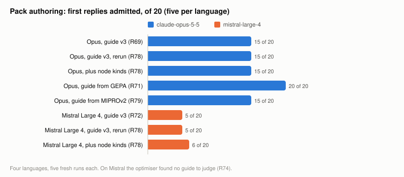
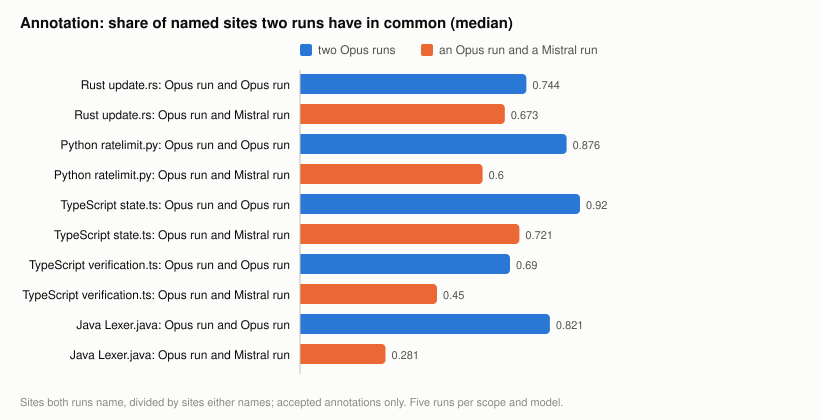
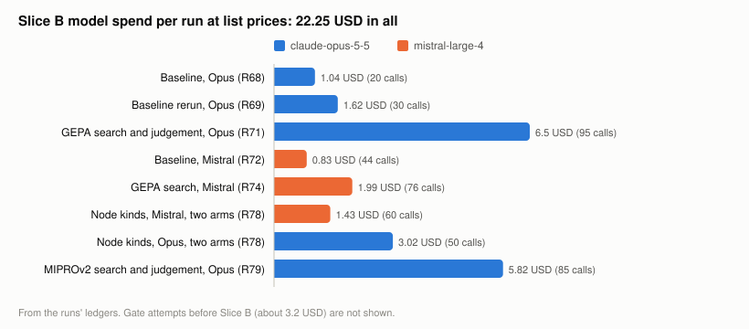

# Slice B: hardening against drift in model output. Closing summary

Written 2026-11-11, Europe/Berlin. Closes Slice B of `constraint-guided-compression` by the owner's decision
of the same day.

- Period covered: 10 and 11 November 2026, research entries R66 and R68 to R85.
- Audience: the owner; then anyone who wants to let a model write a language pack or choose mutation sites
  for the driver, and needs to know how far the result can be trusted.
- Status: measured and closed. One thing was never measured and is named at the end: drift of one model
  over time.
- Every number names the entry it comes from. Figures are written by `docs/reports/figures/make_figures.py`
  from the committed ledgers and summaries.

## The answer first

A model's output drifts, between runs and far more between models, and no instruction, optimiser or
selection rule tried here removed that. What made the drift harmless is mechanical and was already in the
tool: the admission of a language pack against the grammar and recorded control cases, the validation of
every annotation, and the driver's own safeguards. In every run of every experiment nothing inadmissible
was admitted and no rejected annotation became a mutant.

So the hardening is this: let a model propose, never let it decide. A model's choice may change how much
is tried and how long it takes. It must not be able to change whether a run is sound, and where a result
depends on its choice, that choice must not be reported as stable.

## What was asked

The driver takes what it knows about a language from a small data pack, and it can restrict a run to sites
named in a list of annotations. Both can be written by a model. Slice B asked how much such output varies,
and what holds when it does. The owner named the method at the start: bounded, verified prompt optimisation
(MIPROv2, GEPA if needed), on the current model first and a second model later, since changing the model is
itself a test of drift.

## What was measured

| Question | Finding | Entries |
| --- | --- | --- |
| Do repeated runs of one model write the same pack? | No. On `claude-opus-5-5` all packs were admitted at first, yet the Rust packs behaved in four different ways in five runs, unnoticed. With hand-written Rust controls no first Rust reply is admitted | R68, R69 |
| Does a second model write admissible packs? | Rarely on the first reply: `mistral-large-4` 5 of 20 against 15 of 20. Most failures are node kinds the grammar does not have | R72 |
| Does optimising the instruction help? | For the model that knows the grammars, yes: with the guide found by GEPA every first reply is admitted, in all four languages. For the other model, no improvement was found | R71, R74 |
| Does it matter which optimiser? | Here, yes. GEPA writes the next guide from judged failures and repaired Rust (5 of 5). A MIPROv2-style search proposes guides before seeing a failure and did not (0 of 5) | R79 |
| Does giving the author the grammar's node kinds help? | It removes invalid kinds (10 to 1 of 20 on Mistral) and leaves admission where it was (5 and 6 of 20) | R78 |
| Does repair with precise feedback help? | Yes, more than anything else for the weaker model: 15 of 20 admitted in the end; Opus Rust 10 of 10 after one repair | R78 |
| Do repeated annotation runs name the same sites? | No. Two Opus runs share 0.69 to 0.92 of their sites; an Opus and a Mistral run 0.28 to 0.72; three of five Mistral calls return nothing within their output limit | R83 |
| Do rules over several runs steady the selection? | Somewhat. The sites two of three runs name agree on 0.74 to 0.96, against 0.62 to 0.86 for single runs, without selecting more | R85 |

## What was adopted, and what was not

Adopted:

- Stronger admission. Hand-written control cases for Rust, and repair feedback that names the failing
  control and the operators expected and found (R69). This is what caught the unnoticed Rust drift.
- Two operator pairs for Python that the model's packs had and the hand-written pack lacked (R66 Amendment 3).
- `deconvolute merge-annotations`, which keeps the sites enough annotation lists agree on (after R85).
- In the tooling: a budget stop that holds back the cost of the final judgement, a dry run that fails when
  the scripted improvement is not found, and a reader for replies that arrive in parts.

Not adopted, with the reason:

- No optimised guide. The Rust packs written under GEPA's guide are admitted and consistent with each other,
  but differ from the hand-written pack in the same four points every time; the owner decided to keep the
  hand-written pack (R71, decision of 2026-11-11).
- The node kind list as input (R78): it fixes the failure it targets and not the outcome.
- The shipped packs stay hand-written. A model-written pack is something to admit and review, not to ship
  unseen.

## What it cost

Slice B cost 29.70 USD at list prices in 540 calls; with the gate attempts before it the recorded total is
about 32.9 USD of a stop the owner raised from 20 to 40 USD. The two optimiser runs on Opus are 12.3 USD of
it. A baseline of twenty pack-authoring runs costs one to two dollars; an annotation of five files, five
times, about two and a half.

## What went wrong along the way

- A budget stop starved a final judgement, and the tool reported an unfinished judgement as "not passed"
  (R71). Fixed.
- Run times in several entries were estimates and about an hour off; they were corrected from file times
  (R65 to R72).
- Two callers could not read the second model's reply format. The second time, seventeen paid calls had no
  ledger line until they were finished from their saved responses (R72, R83).
- The second model needed two to four times the output limit of the first, because it counts its
  reasoning against the limit; the arms therefore differ in more than the model.
- One evening's spend went past the figure proposed for it, inside the project stop (handover 32).

## What is not shown

- Drift of one model over time. Every comparison here is within two days. A model behind an endpoint can
  change without notice; the baselines of R69 and R83 can be repeated for about four dollars to find out.
- Whether a model-written pack finds the faults that matter. Packs were compared with the hand-written ones
  by the mutants they give, not by what a project's tests do with them.
- Whether the sites a model names are the important ones. The gate measured that once (R61, R64); Slice B
  measured only how steady the naming is.
- A third model, a grammar no model has seen, and a language without a hand-written pack to compare with.

## For someone who wants to use this

1. To add a language: let a model draft the pack if you like, run `admit-pack` with control cases written by
   hand for that language, expect a repair turn, and read the admitted pack before using it.
2. To restrict a run with annotations: take three annotation runs, merge them with
   `merge-annotations --min 2`, and describe the selection as what two of three runs agreed on.
3. Otherwise run without annotations. Every eligible site is the one selection that does not vary.
4. If a result will be compared over time, pin the pack by its hash (receipts carry it) and keep the
   annotation list with the receipt.
