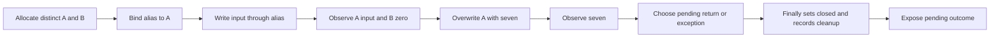

# R10: explicit state model passes the fixture's behavioral challenges

Report/discussion date: 2026-11-02, Europe/Berlin. Experiment: CG-G0e.
Predecessor: [R09](09-codeql-dependency-diagnostic.md). Spec:
[constraint-guided compression](../../../.kiro/specs/constraint-guided-compression/brief.md).

## Outcome and decision

The source-backed model matches **16 executable cases per language**: the six
frozen cases plus ten supplemental cases. All five deliberately wrong models
are rejected by the frozen cases in both Python and TypeScript. The first three
also reproduce the retained source mutants' observations. Fresh-process replay
matches the source outputs, model observations, traces and assessment.

This passes the bounded model-checking checkpoint. It does not pass the full
compression gate: no real-code replacement, net reduction, SMT proof or
autonomous modeling process was exercised. The model was authored by the
primary agent after seeing the source and oracle; this is not a blinded
evaluation, independent review, or evidence of reliable model discovery.

## What changed from the graph trials

G0c/G0d showed that the tested graph configuration misses aliased flow and can
retain input flow after overwrite. G0e supplies an explicit account of object
identity and update order rather than interpreting those graph rows as exact
semantics. It uses plain data and a fixture-specific function, with no new
framework, analyzer, dependencies or production integration.

The diagram describes the authored model, not an extracted graph or proof.
[Source anchors and assumptions](../../experiments/constraint-modeler/g0e/model-notes.md)
connect each obligation to the fixture. Model snapshots explain its transitions;
the runtime comparison observes events and outcomes, not internal snapshots.

## Measurements

Counts below are **mismatching cases per language**; both languages produced
the same counts. A mismatch is desired for a deliberately wrong model.

| Model | Frozen mismatches / 6 | Supplemental mismatches / 10 | First distinguishing input |
| --- | ---: | ---: | --- |
| Source-backed model | 0 | 0 | None |
| Write through independent object | 4 | 10 | value=-3, fail=false |
| Overwrite with eight | 6 | 10 | value=-3, fail=false |
| Leave cleanup flag false | 6 | 10 | value=-3, fail=false |
| Omit cleanup on exceptional exit | 3 | 5 | value=-3, fail=true |
| Retain input instead of overwriting | 6 | 8 | value=-3, fail=false |

Zero masks the alias mutation; seven masks the stale-value mutation. The
exception-cleanup error requires `fail=true`. This is evidence for keeping
discriminating inputs and effect observations, not a general mutation score.
Supplemental values were -100, -1, 1, 7 and 42, each with both failure flags;
they were declared before execution but were not hidden from the model author.

The original six fresh source observations match the frozen oracle before the
supplemental source outputs are used as references. Python's ValueError and
TypeScript's Error remain distinct. Both languages preserve event order and
cleanup before return/exception. The model comparing Python observations is
itself Python code, while the TS reference runs independently in Node; this
does not make the author or evaluator independent.

## Evidence and reproduction

- [Preregistered plan](../../experiments/constraint-modeler/g0e/plan.md)
- [Executed model snapshot](../../experiments/constraint-modeler/g0e-01/model.py)
- [Assessment with every counterexample](../../experiments/constraint-modeler/g0e-01/assessment.json)
- [Runtime commands, versions and hashes](../../experiments/constraint-modeler/g0e-01/receipt.json)
- [Replay assessment](../../experiments/constraint-modeler/g0e-replay/assessment.json)
- [Artifact/replay verification](../../experiments/constraint-modeler/g0e/verification.json)
- [Reproduction commands](../../experiments/constraint-modeler/g0e/README.md)

Execution used uv 0.13.5 with CPython 3.12.10 and Node 24.22.1. Node executes
the TS fixture through type stripping; this is not a TS type-check. No new
CodeQL extraction or solver execution occurred. Each source process has a
30-second timeout. Original sources, driver/oracle hashes, extended drivers,
model, harness, stdout/stderr and model traces are retained. No repair was
needed. No production or external specimen source changed.

## Next gate

Move to one bounded real-code responsibility with a concrete replacement
hypothesis, frozen behavior and whole-replacement accounting. Record where
CodeQL helps locate evidence, what the agent models from source, which
counterexamples challenge that model, and whether the smaller implementation
actually preserves behavior. A real-case target and usefulness threshold must
be fixed before its run. Do not turn this fixture into a generic heap interpreter
or count its small model as production compression.

The [full prototype gate](../../../.kiro/specs/constraint-guided-compression/prototype-gate.md)
remains **revise** until that evidence exists. This result supports attempting
the next bounded model/candidate trial; it does not authorize final production
design or tasks. Arbitrary objects, accessor side effects, append/allocation
failures, concurrency and unrestricted numeric domains remain outside this
fixture's demonstrated boundary.

COBESY handoff: lead with the successful but narrow checkpoint, retain the
negative graph results, make authorship/oracle exposure explicit, and direct
the next effort toward real maintained-code reduction rather than more scaffolding.
