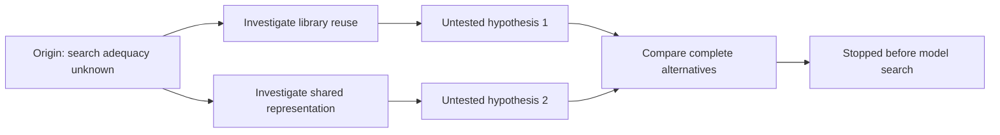

# Cairn can supply the exploration graph; search efficacy remains untested

Recorded and executed 2026-11-02. Decision: **adopt upstream for the prototype,
keep the compression feasibility gate at `revise`.** Owner prefers direct reuse
over building an equivalent orchestrator. This run tests that dependency first.

## Why the hypothesis changed

[R11](11-real-case-admission-screen.md) did not construct or execute a replacement.
Its negative screen therefore does not show that those responsibilities cannot
compress. Requiring a convincing saving before exploring alternatives can itself
exclude the discoveries we want. The revised hypothesis is that persistent,
branching investigation can find alternatives that the linear screen missed.
This is a search hypothesis, not evidence of savings.

COBESY framing: separate a failed search procedure from an uncompressible specimen;
lead with what the experiment establishes; make the next falsifiable test explicit.
The audience is the next investigator and the Kiro design reviewer.

## Direct adoption trial

We cloned [Cairn](https://github.com/oritera/Cairn) into the ignored experiment
directory `.runs/cairn-upstream`, pinned at
`8e7e0ea67552383851dfcabfba0c4e9c8d007878`. No upstream implementation was copied
into Lesscode, no Cairn source was changed, and no Lesscode dependency was added.
The upstream lockfile installed through WSL uv with Python 3.12.10.

| Observation | Result | Limit |
| --- | --- | --- |
| Upstream server API and local execution tests | 32 passed in 9.31 seconds | Upstream tests, including test doubles; not an agent search |
| Two separate exploration directions | Pass | Script-authored directions |
| Follow-up intent joining both resulting facts | Pass | Confirms multi-parent graph representation |
| Stopped project rejects new intents | HTTP 403, pass | Does not independently test cancellation of a live model worker |
| YAML export and JSON graph capture | Pass | Local in-process HTTP test client, no TCP server |
| Graph read after closing/reopening test client | Identical | Same process and SQLite database; not a crash-recovery test |
| LLM discovery / candidate / behavioral checks / SMT | Not run | No compression measurement |

The [trial script](../../experiments/constraint-modeler/cairn/protocol_trial.py)
calls Cairn's real FastAPI application and SQLite storage. It does not reimplement
the graph or fake the server. Its conclusions are deliberately labeled UNTESTED
inside Cairn's fact descriptions: a server-level fact is not automatically a
verified code claim.

[Run metadata](../../experiments/constraint-modeler/cairn/run-01/result.json)
records the revision, Python, WSL kernel, uv version, lock/license SHA-256 and
HTTP outcomes. [Graph JSON](../../experiments/constraint-modeler/cairn/run-01/graph.json)
and [YAML](../../experiments/constraint-modeler/cairn/run-01/graph.yaml) retain the
actual graph. WSL uv was **0.12.5**, distinct from the Windows uv installation.



This is a visualization of the exercised protocol, not measured compression.

## Integration findings

The pinned local process runner uses `os.killpg`, Unix signals and process groups.
WSL is the suitable current host; native Windows worker execution was not tested.
WSL has uv but `command -v codex` and `command -v claude` returned no executable.
Windows has a Codex launcher, but cross-OS worker execution and credentials were
not bridged in this trial.

The pinned Codex adapter hardcodes `--dangerously-bypass-approvals-and-sandbox`.
It was inspected, not executed. Before a model trial, use an appropriately isolated
worker environment or a narrowly scoped adapter change retaining sandbox controls;
a per-project working directory alone is not filesystem isolation. This does not
justify replacing Cairn's graph/dispatcher with a new Lesscode framework.

Cairn carries AGPL-3.0 licensing; Lesscode remains MIT. Keep the upstream checkout
and notices separate. Distribution and any adapter modifications need an explicit
licensing decision; this experiment does not resolve those obligations.

## Next falsifiable test: bounded search, then independent acceptance

Use Cairn's server, persistence, dispatcher, graph export and worker lifecycle
directly. Keep CodeQL as program evidence and Lesscode's frozen behavioral and
whole-scope measurement checks as acceptance authority. Model workers may propose
facts and completion, but cannot mark Lesscode's feasibility gate passed.

1. Configure one isolated authenticated worker. Verify timeout/stop behavior before
   giving it a specimen. Freeze model/version, prompts, source hashes and budget.
2. Calibrate on the frozen original ATS bilingual-report responsibility, withholding
   the historical replacement from the worker. The parent investigator has seen the
   earlier result, so report this as contaminated calibration, not new discovery.
3. Permit up to six exploration intents, two candidate revisions, one worker at a
   time and 20 minutes total. Stop on exhaustion or a validated candidate. Keep
   hypotheses, failed alternatives and source citations in the exported graph.
4. For this calibration retain the existing useful-reduction target of at least
   25% and 30 net production statements across the complete responsibility. Freeze
   its exact source/check manifest before launch. This target is final acceptance,
   not a requirement that every exploration intent already predicts savings.
5. Run the original behavior checks and adverse controls independently; count all
   replacement helpers, tables, wrappers and changed callers. No test deletion or
   byte-size metric. An intermediate candidate may grow before the final comparison.
6. Only after calibration, compare linear and Cairn-guided search on a held-out
   responsibility with equal model/source access and budgets. Report validated
   alternatives and net savings, including failed or exhausted runs. Do not count
   the earlier ATS saving a second time.

No external specimen was changed. No production design/tasks approval is implied.
Linked gate: [prototype feasibility](../../../.kiro/specs/constraint-guided-compression/prototype-gate.md).

## Reproduction

From WSL at the Lesscode root, after checking out the pinned Cairn revision:

```sh
uv run --project .runs/cairn-upstream/cairn --locked --python 3.12.10 pytest .runs/cairn-upstream/cairn/tests/test_server_api.py .runs/cairn-upstream/cairn/tests/test_local_execution.py -q
uv run --project .runs/cairn-upstream/cairn --locked --python 3.12.10 python docs/experiments/constraint-modeler/cairn/protocol_trial.py .runs/cairn-upstream .runs/cairn-replay-01
```

The script requires a fresh output directory and preserves the database and exports.
The uv environment is `.runs/cairn-upstream/cairn/.venv`, separate from Lesscode's.
The upstream source at the pinned revision is the authority for the
[Codex adapter](https://github.com/oritera/Cairn/blob/8e7e0ea67552383851dfcabfba0c4e9c8d007878/cairn/src/cairn/dispatcher/workers/adapters/codex.py),
[local process runner](https://github.com/oritera/Cairn/blob/8e7e0ea67552383851dfcabfba0c4e9c8d007878/cairn/src/cairn/dispatcher/runtime/local_process.py)
and [license](https://github.com/oritera/Cairn/blob/8e7e0ea67552383851dfcabfba0c4e9c8d007878/LICENSE).
