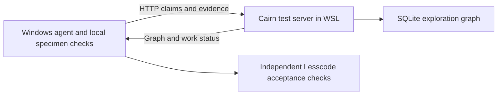

# Windows agents can use Cairn's API without a WSL worker runtime

Executed and recorded 2026-11-02. **Deployment check passed.** A native Windows
Python client communicated over HTTP with the unmodified pinned Cairn server in
WSL. WSL hosted only the test server; no model, dispatcher or specimen workload
ran there. This corrects the environment assumption in [R12](12-cairn-direct-prototype.md).

## Evidence and limits

The [client script](../../experiments/constraint-modeler/cairn/http_trial.py) ran
through Windows `uv.exe`, using Python 3.12.10. The server was Cairn 0.2.1 at the
same upstream revision as R12: `8e7e0ea67552383851dfcabfba0c4e9c8d007878`.
[Recorded results](../../experiments/constraint-modeler/cairn/http-run-01/result.json)
include the Windows platform, UTC timestamp, HTTP outcomes and API route inventory.

| Check over real HTTP | Observed |
| --- | --- |
| Windows accesses WSL server through localhost | HTTP 200 |
| Create project and intent | HTTP 201 |
| Claim, heartbeat and release reasoning work | HTTP 200 |
| Second worker claims already-held reasoning work | HTTP 409 |
| Claim, release and transfer an exploration intent | HTTP 200 |
| Second worker claims already-held exploration intent | HTTP 409 |
| Conclude intent and retrieve/export graph | Success |
| Claim reasoning work after stopping project | HTTP 403 |

The two worker names are scripted clients, not two model agents. Claims were
sequential: this does not establish simultaneous-race correctness. No candidate,
behavioral comparison, CodeQL extraction, SMT proof or compression measurement ran.
The [graph export](../../experiments/constraint-modeler/cairn/http-run-01/graph.yaml)
preserves that distinction in the recorded fact.

## What we can reuse directly

Cairn's HTTP server provides graph persistence, project state, work leases,
conflict responses, evidence descriptions and exports. A Windows agent can read
the graph, claim work, investigate locally, and submit a conclusion through these
existing endpoints. No Windows port of Cairn's Unix process launcher is required
for that interaction.

The server does **not** independently propose investigations, choose a model or
launch a worker. Inspection of `dispatcher/scheduler/loop.py` confirms those
decisions live in the dispatcher, outside the HTTP service. There is no remote
worker-execution endpoint in the captured OpenAPI inventory. Reusing the server
alone therefore does not mean we have exercised Cairn's autonomous search loop.
For the next bounded trial, a Windows agent can drive the API explicitly while
reusing the upstream reasoning/exploration prompts. Record manual scheduling as
such before deciding whether further dispatcher integration is necessary.



COBESY conclusion: remove the unnecessary environment migration, retain the useful
upstream coordination service, and test search efficacy separately. The next
compression trial retains R12's budget and acceptance boundary; only deployment
and worker placement change. The [Kiro gate](../../../.kiro/specs/constraint-guided-compression/prototype-gate.md)
remains `revise`.

## Reproduction

WSL deployment-test server, from the Lesscode checkout mounted in WSL:

```sh
.runs/cairn-upstream/cairn/.venv/bin/cairn serve --host 127.0.0.1 --port 18741 --db-path /mnt/d/Source/lesscode/.runs/cairn-http-trial.db --no-access-log
```

Windows client, from the Lesscode root, with a fresh output directory:

```powershell
uv.exe run --no-project --python 3.12.10 python docs/experiments/constraint-modeler/cairn/http_trial.py http://127.0.0.1:18741 .runs/cairn-http-replay
```

This was a loopback deployment test, not a production hosting or authentication
evaluation. No upstream specimen or Cairn source was modified.
