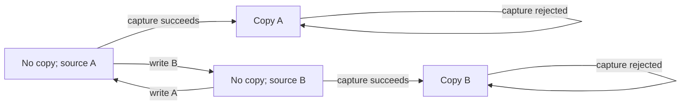

# Learned state depends on the observation boundary

Executed and recorded 2026-11-02. **Continue bounded model-learning research;
do not refactor the specimen from this result.** AALpy learned a four-state view
of Lesscode's original snapshot-copy lifecycle. All six pairwise state merges
were rejected by concrete executions. Adding source reads required six states.
This supports model learning, not production compression.

## Trial boundary

The [plan](../../experiments/constraint-modeler/aalpy/plan.md) was written before
learning. Selection was manual: snapshot capture offers resettable filesystem
state and a cross-function execution path. This is a model-fidelity control,
not an admitted compression candidate. No replacement was proposed or emitted.

Each query starts with a real source directory, one file containing A, and an
absent sibling destination. Actions are `write_A`, `write_B`, `capture` and
`read_copy`. Capture calls original production code; writes/reads are adapter
actions on real files. Observations are write acknowledgement, capture success,
failure code/message, and exact copy content or absence. The learner receives
observations, not source code or a hand-written transition model.

The expanded run adds `read_source`. Neither run observes every returned Snapshot
field or covers deletion, multiple files, arbitrary contents, links, permission
failures, concurrent writes, or disposable-workspace lifecycle. Those are excluded,
not assumed equivalent. This corrects any reading of the experiment as modeling
the complete production snapshot contract.

## Measurements

| Measure | Copy observations | Copy and source observations |
| --- | ---: | ---: |
| Operations | 4 | 5 |
| Learned states | 4 | 6 |
| Transitions | 16 | 30 |
| Learning rounds | 2 | 1 |
| Learning membership queries | 76 | 150 |
| Random equivalence-oracle queries | 105 | 100 |
| Post-learning sequences checked | 1,364 | 780 |
| Maximum checked sequence length | 5 | 4 |
| Output-sequence mismatches | 0 | 0 |
| Incorrect pair merges replayed and rejected | 6/6 | Not run |

AALpy's L* Mealy learner used a fixed seed, caching, and a random-word oracle
with up to 100 walks of lengths 1–8 per search. An early counterexample caused
refinement. Post-learning enumeration checks every nonempty word through the
stated length, but overlaps some training queries. It is not an independent
held-out population or proof over infinite sequences. Total elapsed time was
14.31 seconds, recorded for budget provenance, not as a performance metric.



This projection omits read and write self-loops. Full
[baseline transitions](../../experiments/constraint-modeler/aalpy/run-01/baseline-model.json)
and [expanded transitions](../../experiments/constraint-modeler/aalpy/run-01/expanded-model.json)
are retained. Once a copy exists, source writes cannot change observations in
the first alphabet. Adding source reads splits each copied state by current
source content. **Four versus six is observation sensitivity, not a compression ratio.**

| Incorrect merge | Concrete distinguishing sequence |
| --- | --- |
| Absent and existing destination | `capture → capture`: succeeds, then rejects |
| Source A and B before capture | `write_B → capture → read_copy`: returns B, not A |

Each control redirects one learned state into another. A finite graph-product
search finds a distinguishing sequence, which is replayed against original
filesystem behavior. All six controls have concrete witnesses. These are
graph-derived mutants, not source mutants or six independent discovery trials.

## Design consequence

The adapter exposed operations and observations; AALpy discovered their transition
relation. That avoids manually translating each participating function into SMT.
The useful proposed division is: CodeQL/LLM identify scope and observers; an
adapter exposes real execution; AALpy learns behavioral distinctions; the LLM
proposes a smaller implementation; independent checks challenge that replacement.
Only the adapter, learning and model checks ran here. No Cairn, DSPy, CodeQL or SMT
integration ran. The boundary was manually authored, not automatically discovered.

The next gate needs a real responsibility with an evidenced removal opportunity
and its full declared observers. Do not expand this into a general filesystem
model. In particular, the snapshot code's safeguards are not redundant merely
because this alphabet never triggers them. Numeric abstraction, aliasing,
concurrency, register automata and actual source reduction remain untested.

COBESY framing: a successful model is evidence to investigate, not permission to
erase unobserved behavior. Freeze observation contracts outside candidate control.
The [Kiro gate](../../../.kiro/specs/constraint-guided-compression/prototype-gate.md)
remains `revise`; production design/tasks are not approved by this result.

## Reproducibility and accounting

[Manifest](../../experiments/constraint-modeler/aalpy/run-01/manifest.json),
[results/witnesses](../../experiments/constraint-modeler/aalpy/run-01/result.json),
[script](../../experiments/constraint-modeler/aalpy/trial.py),
[hashed lock](../../experiments/constraint-modeler/aalpy/requirements.lock), and
[setup failure notes](../../experiments/constraint-modeler/aalpy/setup-notes.md)
are retained. The first launch had a root-path import error before any learning;
correcting one parent index resolved it. Optional upstream helpers emitted two
SyntaxWarnings; those helpers were not used.

AALpy 2.0.0, pydot 4.0.1, pyparsing 3.3.3, Python 3.12.10, native Windows.
AALpy package metadata reported MIT. Environment: `.runs/aalpy-venv`; no WSL used.
The manifest records Git HEAD, actual source hashes, and plan/script/lock hashes.
Source hashes were rechecked after execution. A Python profiler recorded entered
function-name labels in snapshot.py and contracts.py; this is not a full call
graph, unique-qualified-function count, or coverage report.

The complete source files contain 300/1,376 physical lines and 204/939 AST
statements respectively. These are context totals, not executed/removable scope.
The trial script is 188 physical lines / 139 AST statements, including adapter,
learning, mutation controls, validation and recording. This is research apparatus,
not a production addition or a proposed replacement. No production or
existing test file changed; no full regression suite was run. Production savings
are **not measured: no candidate**. All original code is retained.

```powershell
uv.exe venv --python 3.12.10 .runs/aalpy-venv
uv.exe pip sync --python .runs/aalpy-venv/Scripts/python.exe docs/experiments/constraint-modeler/aalpy/requirements.lock
uv.exe run --no-project --python .runs/aalpy-venv/Scripts/python.exe python docs/experiments/constraint-modeler/aalpy/trial.py .runs/aalpy-replay-01
```

Use a fresh output directory. Temporary cleanup is confined to verified trial-owned
roots. The 180-second limit is checked at resets; it is not a hard interrupt of a
stalled filesystem call. Learning is additionally capped at 20 rounds.

Foundations: [AALpy](https://github.com/DES-Lab/AALpy) and
[grey-box register-automata learning](https://arxiv.org/abs/2009.09975).
The latter motivates future work; register learning was not implemented here.
