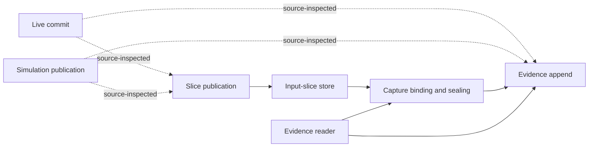

# CodeQL finds real cross-module compression hypotheses in Facdrone

Executed and recorded 2026-11-02. **Three real responsibility-level cases are
qualified for further investigation; none is yet a verified replacement.** The
strongest stateful case spans evidence capture, publication, transaction-owned
state and readback. We do not need synthetic examples to locate an opportunity.
Facdrone remains unchanged; all work ran against copied source in Lesscode.

## What changed from the earlier screen

[R11](11-real-case-admission-screen.md) selectively read files and admitted no
replacement. This pass extracts the available core and package source, queries
connections, then inspects connected responsibilities and their callers. Files
are measurement containers, not the optimization unit. [R14](14-aalpy-state-learning.md)
tested a model-learning mechanism; it did not establish target-selection efficacy.
This pass addresses selection, not another model-learning control.

Selection is hybrid: CodeQL produces call/state leads, a deterministic script
groups modules sharing callees, and this agent reads source to formulate mechanisms.
It is not autonomous semantic clustering or a proof that coupling is unnecessary.
The stateful publication case was also seeded by source search; it was not the
top result of the shared-callee ranking. Keep that intervention explicit.

## Population and evidence quality

| Population or observation | Measured result |
| --- | ---: |
| Extracted core/package source files | 781 |
| Physical lines in extracted source | 158,964 |
| Test-support files within that source layout | 60 / 6,072 lines |
| Remaining application/package source | 721 / 152,892 lines |
| Resolved call-target rows | 8,290 |
| Resolved cross-file call-target rows | 2,435 |
| Lines containing calls in syntax census | 34,333 |
| Lines with at least one resolved call target | 7,842 |
| Attribute read/write rows, excluding method reads | 33,150 / 589 |
| Keyword-argument / possible mutation rows | 15,707 / 1,294 |

The call query resolves only a subset of calls. Its 7,842/34,333 line-level ratio
is **not exact callsite coverage**: several calls can occupy one line. Unknown
calls include external dependencies and potentially internal dispatch. Do not
interpret missing edges as unreachable behavior. Keyword names and matching field
names are lexical evidence, not proof of identity or shared state. Mutation-like
method names are candidates; subscript mutations still require source inspection.

Counts come from the [coverage record](../../experiments/constraint-modeler/facdrone-discovery/run-02/coverage.json)
and [summary](../../experiments/constraint-modeler/facdrone-discovery/run-02/summary.json).
Support classification uses the `facdrone-testing` package and `testing` directories;
it is not a claim that every other line is a product feature. Tests/scripts outside
package source were not extracted. Application tests were inspected separately.

The first extraction wrongly assumed packages/*/src layout and omitted flat package
modules. It is retained as incomplete run-01. Run-02 is authoritative. An attempted
concurrent query hit the database cache lock; the sequential retry succeeded.
These corrections are in [setup notes](../../experiments/constraint-modeler/facdrone-discovery/setup-notes.md).

## The three cases

These are **investigation scopes**, not deletion estimates or closed rewrite scopes.
Bundles retain resolved incoming and outgoing frontiers so callers cannot disappear
from later accounting. Whole-file context includes necessary code and unrelated
operations. `AST statements` counts Python `ast.stmt`; `if` counts are not McCabe
complexity, LLOC or a universal convolution score. Cases are not summed as savings.

| Responsibility | Files | Physical lines | AST statements | Named functions | If statements | Resolved internal cross-file call rows |
| --- | ---: | ---: | ---: | ---: | ---: | ---: |
| Evidence publication and readback | 8 | 2,682 | 1,256 | 123 | 137 | 22 |
| Authenticated report request/snapshot boundaries | 6 | 1,938 | 925 | 103 | 145 | 112 |
| Index-provider orchestration | 5 | 1,865 | 693 | 65 | 72 | 35 |

### A. Evidence publication: the stateful compression candidate

[Case bundle](../../experiments/constraint-modeler/facdrone-discovery/run-02/case-evidence-publication.json)
contains the eight paths, metrics, 22 resolved internal cross-file edges and an
incoming frontier of 13 other files. The scope includes publication, evidence
store/reader, input-slice store/publisher, live state repository, simulation
run-evidence store and kernel evidence records.

Concrete code observations, relative to Facdrone:

- `src/facdrone/shells/decision_evidence_publication.py:191` encodes `_Captured`
  through JSON, compression and base64. `_captured_payload:263` decodes it;
  `compact_capture:374` has another decode/re-encode path.
- `seal_evidence:236` and `seal_evidence_with_run_slices:308` both bind identity
  and seal routes. The latter also converts input slices into references.
- `payload_batches:405` and `stored_evidence_payload:430` branch between a typed
  `_bound_evidence` envelope and older dictionary-shaped evidence.
- `cppi/state_repository.py:421` copies `_slice_ledger` before entering the database
  transaction and adopts it only after successful commit (`:478`). Its
  `_publish_evidence:502` validates identity, publishes slices, checks references,
  then appends batches, with a separate legacy route.
- `wiring/run_evidence_store.py:361` and `:394` perform corresponding simulation
  publication steps, but own different retry coverage checks and resolver lifetime.
- `decision_slice_publisher.py:124` updates ledger namespace/history;
  `decision_input_slice_store.py:214` owns resolver namespace, verified slices
  and chain lengths. These are distinct state lifetimes, not interchangeable caches.

Solid edges correspond to resolved call relationships between the represented
modules; dashed writer orchestration links required direct source confirmation.
The targeted API-graph query returned **zero rows**, despite source-visible calls;
it did not repair the generic resolver's gaps. This is retained, not hidden.
A separate global value-flow query found three payload-to-decoder paths inside
the publication module, including flows across binder/sealer functions. Those
three paths do not establish cross-module alias fidelity or transaction semantics.

**Compression hypothesis:** retain one typed evidence representation through
in-process capture/binding/publication, adapting old serialized forms only at real
compatibility boundaries; share the repeated publish/check/append sequence while
leaving transaction ownership and mode-specific checks with the callers. This
could remove repeated transformations and orchestration across the module family,
not merely shorten one helper. Existing dataclasses, Pydantic and SQLAlchemy are
already declared capabilities; no new framework is justified yet.

**Must preserve:** canonical digests, legacy records, schema versions, publication
order, conflict identities, reference validation, immutable knowledge times,
retry coverage, rollback isolation, resolver lifetime and restart behavior.
Base64/compression may cross a genuine serialization boundary; that must be
established before removing any encoding. The code already shares several core
operations, so more sharing is a hypothesis, not automatically an improvement.

**Next executable trial:** isolate the responsibility and drive capture → bind →
publish → retry/read sequences, plus injected rollback, namespace change and
conflict. Compare original and candidate with an isolated database fixture.
`tests/unit/test_decision_slice_publisher_db.py` already tests full/delta boundaries,
restart, stale ledger, namespace reset, retained representation, tampering,
receipts and rollback. These tests are useful boundary evidence; they were not run
here. Avoid any live broker/database environment. AALpy may explore bounded
operation sequences; data/digest correctness still requires concrete checks.

### B. Report request/snapshot validation: representation duplication

[Case bundle](../../experiments/constraint-modeler/facdrone-discovery/run-02/case-report-envelope.json)
retains six modules and an incoming frontier of 11 other files. Shared-callee
ranking connected `reporting_request.py`, `reporting_request_store.py` and
`snapshot_store.py` through repeated evidence parsing/validation operations.
Kernel `canonical.py` and reporting `evidence_validation.py`/`composition_errors.py`
are supporting contracts, not disposable boilerplate.

**Observed:** request fields, canonical payload construction, tagged-decimal JSON
encoding/decoding, document authentication and storage adapters form one lifecycle
across these modules. Snapshot manifests have another explicit field parser and
validation path. The source already uses Pydantic for reporting configuration,
but other envelopes use manual field mapping and primitive validators.

**Hypothesis:** use a single typed declaration per envelope/manifest to drive its
structural parsing and projection, with existing validators/serializers for the
canonical contract and boundary-specific error translation. Remove redundant field
inventories and mapping code across definitions, parsers and storage. Do not merge
different schemas into a generic untyped record or delete filesystem safeguards.

**Critical blockers to a naive framework substitution:** exact Decimal tagging,
forbidden binary floats, digest compatibility, optional historical fields, strict
extra-field rejection, exception reason/evidence IDs, safe paths and SQL first-write
semantics. `reporting_request.py:243` explicitly documents why omitting some null
fields changes historical digests. `:291–383` implements the authenticated document
and tagged decimals. Off-the-shelf serialization alone is insufficient.

This qualifies for a code-representation experiment, not automatic adoption of
Pydantic everywhere. Count custom serializers/error adapters against any saving.
Existing reporting composition/attestation tests are the starting boundary.

### C. Provider orchestration: repeated algorithms with retained differences

[Case bundle](../../experiments/constraint-modeler/facdrone-discovery/run-02/case-index-provider-orchestration.json)
contains ECB, FRED and S&P reporting adapters, timestamp helpers and the shared
index-source pipeline. The CodeQL ranking reports five shared resolved callees
for ECB/FRED and ECB/S&P; 35 resolved call rows connect the five-module scope.

**Observed:** the load operations repeat request admission, snapshot validation,
row parsing, window selection, series construction and evidence assembly.
They already reuse helpers, but retain similar outer sequencing.

**Hypothesis:** factor the common sequence into a plain function with explicit
provider data and genuinely distinct parser/series operations. Keep provider-specific
grammar, missing-value rules, timestamps, historical availability, status admission
and error messages. This changes implementation organization, not finance models.
Do not hide executable callbacks inside a supposedly data-only table.

This is the easiest differential-execution candidate: injected snapshot loaders
already avoid network access. It is less representative of scattered mutable state
than A. Useful reduction must exceed the added shared function, configuration and
remaining wrappers; existing helper reuse may limit the result. The extensive
`test_index_sources_and_alignment.py` boundary is available but was not run here.

## Qualification decision

A is the preferred test of the missing cross-function/state modeling capability;
C is a potentially cheaper whole-responsibility compression trial; B is a schema
representation trial with unusually strict compatibility obligations. All three
have concrete code that could be consolidated and real checks to start from.
None is fully qualified for a production rewrite until its observer/caller boundary,
isolated baseline and complete replacement accounting are frozen.

This differs from rejecting them for not having a guaranteed saving in advance.
The next action is a bounded original-versus-candidate trial on A, not synthetic
examples or another repository-wide framework. Reject a candidate if its support
structure cancels its deletion benefit; do not weaken the behavior boundary.

## Reproduction and retained artifacts

CodeQL 2.26.3; Python query pack 7.2.3 and its lock; native Windows; uv-managed
Python 3.12.10 for extraction/scripts. Facdrone declares Python >=3.13: no Facdrone
runtime was executed with 3.12. These are static extraction results, not runtime
compatibility results. Extractor log search found no ERROR/WARNING/SyntaxError/Failed
entries. All 781 source hashes matched again at completion.

[Source identity](../../experiments/constraint-modeler/facdrone-discovery/run-02/source-manifest.json),
[query/source verification and test anchors](../../experiments/constraint-modeler/facdrone-discovery/run-02/final-verification.json),
[dependency manifests](../../experiments/constraint-modeler/facdrone-discovery/run-02/dependency-manifests.json),
[query sources](../../experiments/constraint-modeler/facdrone-discovery/queries/),
[raw evidence directory](../../experiments/constraint-modeler/facdrone-discovery/run-02/).

The database and frozen source live in `.runs/facdrone-discovery-02/`. Query results
are serialized JSON/BQRS; no new graph database was introduced. Reproduce with fresh
directories using `extract.py`, then `query.py` (sequential queries), `summarize.py`,
`cases.py` and `finalize.py` in the experiment directory. Exact extraction/query
arguments are in the receipts; script CLI arguments are positional and shown in
the scripts. No Facdrone source, tests, configuration or Git state was changed.

COBESY framing: graph connectivity establishes where to investigate; source reads
explain a possible compression mechanism; only a replacement trial can establish
less code with the same behavior. This pass claims the first two, not the third.
[Kiro feasibility gate](../../../.kiro/specs/constraint-guided-compression/prototype-gate.md)
remains `revise`.
