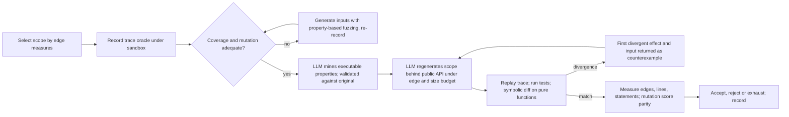

# R19: deconvolution needs a dynamic behaviour oracle and an edge metric before another rewrite

- Report date/time and timezone: 2026-11-03, Europe/Berlin
- Execution interval: not run; proposal only
- Status: planned
- Spec: [constraint-guided-compression](../../../.kiro/specs/constraint-guided-compression/brief.md),
  requirements 3, 5, 6 and 7; design and tasks remain unapproved
- Hypothesis ID and predecessor: H8, revising H7 after
  [R18](../2026-11-02/18-provider-representation-trial.md) and the
  [owner review of 2026-11-03](#owner-review-that-triggered-this-proposal)
- Type: preregistered protocol for E1 and E2; E3 to E5 are planned and must be
  individually preregistered before execution

## Decision

Stop treating a statically extracted or LLM-authored state model as the
equivalence authority. Register H8 and run E1 and E2 before any further
candidate rewrite. No production design or task generation follows from this
document. Nothing here is a measured result.

## Owner review that triggered this proposal

The owner's assessment on 2026-11-03, accepted by the reviewing agent:

1. Facdrone and the other specimens are convoluted. The small savings do not
   show otherwise; the method could not select and verify adequate sections.
2. Results on synthetic fixtures were partially positive. On real code with
   many functions and modules, scattered control flow and scattered state,
   the verification side never succeeded. G0c lost an alias on a 30-line
   fixture; R16 stopped before the database lifecycle; no stateful scope was
   ever verified end to end.
3. The early positive results (ATS01, NPU01) pre-seeded a model of convolution
   as repeated families. That model later failed to select adequate code
   sections in Facdrone, whose convolution is scattering and representation
   layering rather than duplication.
4. A skill or instructions do not solve this. A mechanism is required.

The reviewing agent's earlier statement that verification was never the
bottleneck is withdrawn for stateful scopes. It holds only for the functional
scopes where differential corpora were feasible.

## Hypothesis and falsification

**H8.** For a responsibility with scattered state and control flow:

- (a) its behaviour can be pinned by an executable, effect-complete trace
  oracle recorded from the original under a sandbox that intercepts every
  external effect, and the oracle's adequacy can be measured before any edit
  by branch coverage of the scope and by mutation score;
- (b) convolution can be measured as structural edges, independently of lines
  and statements, and that measure ranks scopes that humans recognise as
  convoluted above scopes they do not;
- (c) given the public API, the trace oracle, the existing tests and the edge
  diagnosis, an LLM can regenerate the responsibility with fewer edges and
  identical trace behaviour, where counterexamples are divergent traces and
  symbolic differential checks on pure functions, not solver verdicts on an
  authored model.

**What rejects H8:**

- (a) fails if the effect boundary of the chosen real scope cannot be
  intercepted within the E1 budget, or if trace replay plus tests leave the
  mutation kill rate on the scope below 85%.
- (b) fails if the edge measures do not separate the R15-A scope from the
  R17 provider scope, or if they rank no responsibility outside the three
  already known cases.
- (c) fails if three regeneration revisions cannot reach zero trace divergence,
  or if a candidate reaches zero divergence while its mutation score under the
  same oracle falls below the original's, which would show the oracle is too
  weak to be trusted.

## What changes from H1 to H7

| Earlier assumption | Evidence against it | H8 replacement |
| --- | --- | --- |
| Static dataflow can supply the state model | G0c/G0d: alias lost, stale flow kept | Observe state and effects at runtime; static facts only locate scope |
| An LLM-authored model, checked by SMT, establishes equivalence | Fidelity of the model to source was never independently measurable | The model is a recorded trace plus executable properties, validated against the original by mutation testing before any candidate exists |
| Convolution is duplicated families | ATS/NPU were duplication; Facdrone is scattering and layering (R15-A) | Edge-based scattering measures select the scope |
| Refactor in place and count the whole replacement | Six small-family factorings lost to their own support code | Regenerate the responsibility behind its public API under an edge and size budget; refactoring carries structure along |
| Orchestration (Cairn) or learning (AALpy) is the next missing piece | Neither produced or verified a candidate | Deferred until a manually operated loop produces one positive E3 result |

## Convolution measured as edges

Nodes: callables, state locations (object fields, module globals, database
tables and columns, files, environment), and external effect sinks. Edges are
recorded from execution where possible and from AST where not; each edge is
labelled `observed` or `static`, never merged.

| Measure | Definition | Why it captures what lines miss |
| --- | --- | --- |
| Call edges | distinct caller to callee pairs inside the scope | fragmentation across functions |
| Module hops per effect | distinct modules on the call path from entry to each external effect | scattering across modules |
| Write sites per state location | distinct callables that write the same location | scattered state ownership |
| Representation churn | serialise/deserialise transitions a datum undergoes between entry and effect, counted on the trace | layered encodings such as JSON, compress, base64 and back |
| Degree of scattering | Eaddy-style concentration of a responsibility over callables and modules | the concern is spread thin instead of owned |
| Effect ordering constraints | number of ordered effect pairs the trace requires | residual essential complexity; should not fall |

Compression success is a reduction in the first five while the sixth and the
trace stay equal. Lines, AST statements and LLOC are reported alongside and
must not increase, but they are no longer the acceptance measure.

## Safety from day one

1. The original is never edited; candidates live in isolated copies, as before.
2. The oracle is built and scored before a candidate exists. A scope without a
   coverage and mutation figure is not admitted to regeneration.
3. The sandbox fails closed: an effect during replay that is outside the
   intercepted boundary is a failure, not an unknown.
4. Effects are compared in order and content. Commutativity is an explicit
   per-sink declaration (for example log lines), defaulting to strict.
5. Every claim carries its label: trace-equivalent on corpus C with branch
   coverage c% and mutation score m%; symbolically equivalent for pure
   function set P within the stated bounds. No universal equivalence claim.
6. Adverse controls remain mandatory: at least one semantic mutant per trial
   must be rejected by the oracle, and the mutant catalogue is preregistered.

## The consolidation loop

The LLM has two roles and both are checked against the original before they
influence a candidate: property miner, whose properties must kill mutants of
the original, and regenerator, whose output must replay the trace. The
evaluator, sandbox and corpus are frozen and outside the LLM's reach.

## Amendment, 2026-11-03: guided input generation, not blind fuzzing

Owner observation: instrumentation plus fuzzing produced results only when
generation was constraint-guided; blind fuzzers did not. SAGE (Godefroid,
Microsoft Research) established this by symbolically executing a real seed
trace, negating one branch constraint at a time and ranking new inputs by
coverage gained. Consequences for E1 and E3:

- Seeds are the recorded traces of the existing tests and the R16 harness.
- Coverage of the scope is raised in this order: concolic search (CrossHair
  path exploration at the scope's entry points), then coverage-guided fuzzing
  (Atheris or HypoFuzz), then random Hypothesis strategies only as a smoke test.
- Initial state is part of the input. Database rows, ledger and namespace
  fixtures are exposed as seeds that the generator mutates; argument-only
  exploration stays on the corridor the seed state reaches and overstates
  oracle confidence.
- E1 reports coverage gained per generation method so the blind baseline is
  visible rather than assumed.

Reference, 2026-11-03: the owner asked whether KLEE is an adequate route to
SAGE-style symbolic execution here. The assessment and the per-language
instrument table are in
[docs/symbolic-execution-tooling.md](../../symbolic-execution-tooling.md):
KLEE is the right reference and the wrong tool for these targets; symbolic
execution belongs on the pure core of a scope, with CrossHair on Python and
Kani in CI on Rust, while the trace oracle covers effects.

## Tools, Python first

Facdrone requires Python 3.13 and uses SQLAlchemy 2, Pydantic 2 and pytest.
The following are candidates to evaluate in E1, not approved dependencies:

| Need | Candidate | Note |
| --- | --- | --- |
| Call and return edges at runtime | `sys.monitoring` (3.12+), fallback `sys.setprofile` | records observed call edges without source changes |
| Branch coverage of the scope | coverage.py | oracle adequacy figure |
| SQL effects | SQLAlchemy `before_cursor_execute` / `after_cursor_execute` events | statement, parameters, result shape |
| Filesystem effects | pyfakefs or an `open`/`os` interception layer | content and path, not only call |
| Time and randomness | time-machine or freezegun; seeded `random` | determinism for replay |
| Network | fail closed; existing injected snapshot loaders | none expected in the scope |
| Input generation to raise coverage | Hypothesis | drives entry points under the sandbox |
| Symbolic differential check on pure functions | CrossHair `diffbehavior` | Z3-backed, on real code, no authored model |
| Property mining baseline | Hypothesis ghostwriter `equivalent` | mechanical equivalence tests for pure pairs |
| Oracle strength | mutmut or cosmic-ray | mutation score on the scope only |

TypeScript and JavaScript share one mapping for later stages: c8 for coverage,
Jazzer.js (libFuzzer for Node) as the coverage-guided rung, fast-check as the
random rung, Stryker for mutation, memfs and msw for effects, and Node's
`--import` hooks or `async_hooks` for call and effect recording. There is no
mature concolic rung for JavaScript comparable to CrossHair or Kani; ExpoSE is
research-grade. This is an explicit gap: TS/JS scopes rely on coverage-guided
generation plus mutation-scored oracles, and their equivalence claims are
labelled accordingly. No TypeScript or JavaScript stage is scheduled before E3
passes on Python or Rust.

Owner decision, 2026-11-03: target languages are Python, TypeScript,
JavaScript and Rust. The loop is language-agnostic; the oracle, sandbox and
guided-input rungs are per language and are admitted per language only after
their own E1.

### Amendment, 2026-11-03: Rust mapping and specimen choice

Owner question: what if the codebase is Rust? The mapping below is a
candidate tool set, not an approved dependency list. mmhmem (about 4,400
production lines, baseline in [local-adoption](../../experiments/local-adoption/README.md))
is an eligible E1 host alongside Facdrone; the E1 preregistration must name
one and state why.

| Need | Rust candidate | Note |
| --- | --- | --- |
| Call edges | MIR/static call graph; runtime confirmation only for `dyn Trait`, fn pointers and closures | static dispatch makes the static graph reliable, unlike Python |
| State locations and write sites | writers of `Mutex`, `RwLock`, `RefCell`, `static`, channel senders | precise static count; generic code counted per definition |
| Effect sandbox | `[patch.crates-io]` recording shims; madsim or turmoil for deterministic async time, network and filesystem; `strace` or `LD_PRELOAD` interposer as the OS-level fail-closed boundary | no source edit of the original |
| Coverage | cargo-llvm-cov | region and branch coverage |
| Oracle strength | cargo-mutants | mature |
| Undefined behaviour in candidate | Miri on the candidate test run; `#![forbid(unsafe_code)]` on candidate | regeneration must not introduce UB |
| Guided inputs | cargo-fuzz or AFL.rs (coverage-guided), proptest (random rung) | stronger default rung than Python |
| Bounded equivalence proof | Kani harness: `kani::any()` inputs within declared bounds to original and candidate, assert equal results and effect logs | SMT on real source, no authored model; Verus, Creusot or Prusti if a scope justifies annotated proofs |
| Compiler as oracle | identical public API types, borrow checker, pinned build profile | overflow and panic behaviour differ between debug and release and are observable |

Runtime constraint, owner instruction 2026-11-03: WSL is CI-only and nothing
executes there; native Windows is the sole agent runtime. Consequences for the
Rust row set: Kani, `strace` and `LD_PRELOAD` are unavailable natively and
move to CI or are recorded as unavailable for E1; Miri and cargo-fuzz need a
nightly toolchain that is not installed, so proptest is the first input rung
and coverage-guided fuzzing is deferred until needed. The effect boundary is
therefore in-process: rusqlite's connection trace hook or a test-owned
connection for SQL, a full SQLite table dump after each call as the
persistent-state oracle, the audit file as the second effect log, and a local
fake for the single HTTP egress. cargo-mutants and cargo-llvm-cov run natively.

Host-privilege constraint, owner instruction 2026-11-03: the desired
implementation, like the research harnesses, must not assume symlink
privileges, elevated shells, Developer Mode or other POSIX-only host features.
Oracle, sandbox and replay run on a plain Windows user account. A specimen
test that needs such privileges is recorded as a gap in that specimen's
coverage, not worked around by the tooling. This generalises the WSL rule:
the tool is judged on an ordinary developer machine.

Rust-specific risks: async effect ordering is nondeterministic unless run
under a deterministic runtime, so commutativity per sink must be declared;
trait-object-heavy designs place convolution where static graphs are weakest,
so E2 calibration must include one such scope. LLM-authored harness pieces
(shims, Kani harnesses, proptest strategies, state-seed mutators) are admitted
only after killing preregistered mutants of the original, and are authored in
a context separate from the regenerator.

CodeQL is retained only as a static scope locator if the trace-derived graph
proves insufficient; it is not an equivalence authority. SMT enters through
CrossHair on real functions, not through hand-authored models.

## Staged experiments

Each stage is preregistered in its own plan before execution and reported in
its own dated entry. Budgets are research bounds.

### E1: oracle feasibility on one real stateful scope

- Scope: R15-A evidence publication, frozen at the R15 source manifest, or the
  Lesscode snapshot lifecycle from R14 if R15-A's database boundary cannot be
  sandboxed within budget. Record which was used and why.
- Driver: existing `tests/unit/test_decision_slice_publisher_db.py` and the
  R16 harness, under the sandbox, with SQLite or an isolated PostgreSQL.
- Measures: effect kinds captured; branch coverage of the scope; mutation
  score with tests alone versus tests plus trace replay; sandbox leaks.
- Prediction: trace replay raises the kill rate by at least 20 points over
  tests alone and reaches at least 85%.
- Budget: three working sessions; stop at the first unsandboxable effect that
  cannot be isolated with an existing library.
- Kill: prediction missed, or boundary not closable. Then H8(a) is rejected
  for this class of scope and the retrospective track stops.

### E2: edge census of Facdrone

- Input: full test-suite execution under the call recorder, plus AST edges
  for unexecuted code, labelled separately.
- Output: edge measures per responsibility, with R15-A, R15-B and R17 as
  calibration points.
- Prediction: R15-A ranks in the top decile on write sites per location and
  representation churn; R17 ranks below median; at least three responsibilities
  not previously examined rank in the top decile.
- Kill: calibration ordering fails. Then the edge measures are not a selector
  and H8(b) is rejected.

### E3: regeneration trial on one E2-selected scope

- Preconditions: E1 and E2 pass; oracle for the scope built and scored.
- Procedure: property mining validated against the original; regeneration
  behind the public API; at most three revisions driven by divergent traces
  and CrossHair counterexamples; final whole-scope measurement including all
  support, adapters and changed callers.
- Preregistered target, fixed per scope before generation: call edges and
  write sites per location each reduced by at least 30%; representation
  churn reduced; effect ordering constraints unchanged; zero trace divergence;
  mutation score not below the original; lines and statements not increased.
- Kill: three revisions without replay match, or mutation score regression.

### E4: comparison arms on a held-out scope

- Arms: refactor in place versus regenerate; with versus without the edge
  diagnosis in the prompt; same model, budget, oracle and scope.
- Measure: validated edge reduction per arm, revisions used, failure modes.

### E5: transfer

- Second repository (mvibe Python scope) and the Lesscode self-trial under the
  unchanged maturity gate. Only then is a design for a reusable tool justified.

## Deferred and dropped

- Dropped as equivalence authority: static dataflow state models; SMT over
  LLM-authored models; AST statement thresholds as the acceptance measure.
- Deferred until E3 succeeds once: Cairn orchestration, AALpy learning, DSPy,
  any TypeScript stage, any production design or task generation.
- Retained unchanged: isolated candidates, whole-replacement accounting,
  adverse controls, dated records, the prototype-first gate.

## Limits and interpretation

Trace equivalence is finite evidence over the recorded corpus. Behaviour no
trace exercises is not protected; coverage and mutation figures make that gap
visible rather than closing it. CrossHair applies to pure, annotated functions
and is bounded. Mutation score measures oracle sensitivity to syntactic
mutants, not to all semantic deviations. Regeneration can introduce behaviour
outside the trace that the oracle cannot see; the fail-closed sandbox catches
new effects but not new pure results on unexercised inputs. These limits are
accepted terms of H8 and must appear in every result.

## Tool/spec consequence and next gate

The constraint-guided-compression prototype gate stays `revise`. Its next
evidence is E1, not another candidate. If E1 or E2 is rejected, the
retrospective compression track is closed with a dated stop and effort moves
to prevention at generation time (agent-quality-rules, 9 of 25 tasks).

## COBESY check

Outcome first: no result, a revised mechanism with kill criteria. Replayable:
tools, scopes and predictions are named. Disproof explicit per stage. Negative
results close the track honestly. The owner's correction is recorded as the
reason for the revision, not as a contributor failure.
