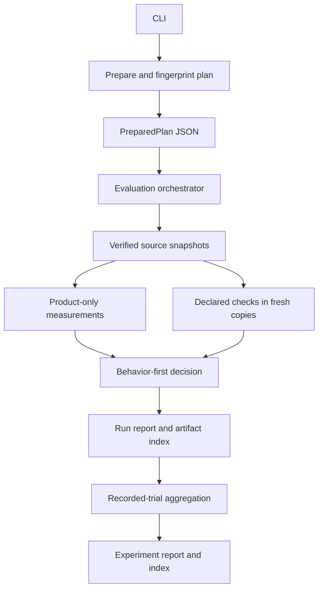

# How Lesscode evaluates a proposed simplification

Lesscode compares two supplied Python source trees under one recorded evaluation
profile. Its result answers a bounded question: did this candidate pass these
checks and acceptance rules, and what structural changes were measured?

The evaluator does not generate the candidate. A person, coding agent or external
workflow supplies it. Evaluation runs locally without a model request. This
separation lets the same evidence contract evaluate a hand-written change, a
prompt-guided simplification or a later deterministic rewrite.

## Contents

- [Architecture and execution](#architecture-and-execution)
- [Scope and source identity](#scope-and-source-identity)
- [Measurement definitions](#measurement-definitions)
- [Behavior evidence](#behavior-evidence)
- [Decision rules](#decision-rules)
- [Artifact storage and recovery](#artifact-storage-and-recovery)
- [Controlled experiments](#controlled-experiments)
- [Trust boundaries and limits](#trust-boundaries-and-limits)
- [Validation and extension points](#validation-and-extension-points)

## Architecture and execution

The implementation is a Python package with functional modules and strict typed
records. It has no server, database or plugin registry. Python's standard library
provides the CLI, process management, serialization and storage; analyzers run
through explicitly provisioned subprocesses.

| Module | Responsibility |
| --- | --- |
| [`contracts.py`](../src/lesscode_baseline/contracts.py) | Versioned records, strict JSON readers and serialization |
| [`config.py`](../src/lesscode_baseline/config.py) | Profile loading, command resolution, tool bindings and integrity checks |
| [`snapshot.py`](../src/lesscode_baseline/snapshot.py) | Source classification, byte identity and disposable workspaces |
| [`metrics.py`](../src/lesscode_baseline/metrics.py) | Product-only staging, analyzer normalization and size definitions |
| [`process.py`](../src/lesscode_baseline/process.py) | Bounded execution, logs and behavior-result readers |
| [`process_windows.py`](../src/lesscode_baseline/process_windows.py) | Native Windows child-process lifecycle |
| [`decision.py`](../src/lesscode_baseline/decision.py) | Metric compatibility, scalar thresholds and decision precedence |
| [`report.py`](../src/lesscode_baseline/report.py) | Human summaries, atomic persistence and verified recovery |
| [`evaluation.py`](../src/lesscode_baseline/evaluation.py) | Integration of the pair-evaluation lifecycle |
| [`experiments.py`](../src/lesscode_baseline/experiments.py) | Trial reconciliation, confounding checks and descriptive aggregation |
| [`cli.py`](../src/lesscode_baseline/cli.py) | Plan/run/summarize commands and exit mapping |

Preparation reads a profile, identifies both source trees, resolves declared
resources and commands, and probes fixed tool versions. It does not run project
checks. The serialized `PreparedPlan` retains the `Plan`, profile location,
resolved resource identities and tool bindings. Its canonical identity is
SHA-256 over the UTF-8 output of `contracts.dumps(prepared)`.

Execution prints the resolved workloads before launching them. The orchestrator
checks frozen identities around workloads, measures verified source snapshots
and runs each declared check against a fresh disposable copy. Check commands
cannot change the measurement snapshot through normal relative writes. The
decision service compares typed observations; storage retains the evidence and
publishes its completion index last.

Dependencies point from typed contracts to services, then orchestration and CLI.
The decision service and report renderer do not execute tools. Optional evidence
uses versioned records rather than importing an agent or analyzer framework.

## Scope and source identity

A Git commit is supplementary metadata. The source fingerprint identifies the
actual selected bytes, including uncommitted and untracked content. It hashes a
canonical manifest of sorted relative paths, byte lengths and file SHA-256s.
Concurrent changes detected during capture prevent a successful snapshot.

Classification precedence is `excluded > generated > vendor > tests > product
> support`. Only product files enter structural measurement staging. Tests and
supporting resources can remain in execution copies; test-file changes are
reported separately. Fixed rules include newly added and removed matching files.
Git ignore rules do not replace the profile's scope rules.

Matching uses case-sensitive POSIX-style globs on every supported OS. Paths in
reports are normalized relative paths. Case collisions, symlinks and reparse
points in selected input paths fail with diagnostics rather than silently
following another source tree. Internally owned temporary roots are canonicalized
to handle platform path aliases.

See [profile configuration](profiles.md#select-the-measured-source) for scope and
resource placement.

## Measurement definitions

The validated toolchain pins CPython 3.12.10, Node 24.22.1, Lizard 1.17.31 and
jscpd 4.0.5. Python and npm analyzer dependencies have transitive locks and
integrity hashes. Setup is explicit and network enabled; evaluation does not
download tools. Applicable notices are retained in
[`tools/licenses.json`](../tools/licenses.json) and `tools/notices/`.

| Measurement | Definition and useful interpretation |
| --- | --- |
| `complexity` | Lizard function locations and cyclomatic complexity, with count, min/max, median, nearest-rank p95 and hotspots. This is the pinned analyzer's definition, not interchangeable with another analyzer's complexity. |
| `duplication` | jscpd clone locations, aggregate duplicated tokens, total tokens and their ratio. The ratio counts vendor pair spans; it is not unique duplicated-source coverage. |
| `source_bytes` | Sum of original byte lengths for selected product files. |
| `physical_lines` | Product bytes split into physical lines, including a final unterminated line. This is not logical LOC. |
| `compressed_source_bytes` | Gzip size of a sorted, length-delimited stream of relative UTF-8 paths and original bytes, with level 9 and mtime 0. Python/zlib versions remain part of provenance. |

The adapters validate Python syntax separately. Lizard is not used as a syntax
validator. A valid source with no functions has count zero and null distribution
values. A failed measurement has an unavailable status and reason, not a
fabricated zero.

jscpd uses Python format, weak mode, minimum 5 lines and 50 tokens, with case
preserved. Weak mode omits comment tokens. Effective maximum input bounds are
derived from the selected manifest to avoid quietly dropping large files.
Unknown or incompatible profile options fail preparation. Adapter reconciliation
checks scanned paths and token inventories against the staged source. Suppression
markers that would hide measured source make the affected evidence unavailable.

The pinned vendor's per-clone `tokens` field is zero, so the adapter reads
`statistics.total.duplicatedTokens` and `statistics.total.tokens`. The known
duplicate fixture yields 118 duplicated pair-span tokens out of 236 total,
ratio 0.5. Clone spans remain available for inspection.

Every metric records its key, status, value, unit, definition, producer/version,
scope identity and raw-artifact reference. Compatibility and arithmetic are
separate: structured complexity and duplication records can be comparable
without exposing a scalar delta. The evaluator does not silently turn them into
a maximum, average or quality score. A threshold needing an undeclared scalar
projection is unavailable and cannot pass.

For comparable scalar measurements, absolute delta is `after - before` and
percentage delta is `100 * (after - before) / before`. Zero baseline makes the
percentage unavailable. Tool, definition, unit or scope mismatches are disclosed
and prevent the affected comparison. Compressed size is a secondary information
volume proxy; fewer compressed bytes do not establish readability or speed.

## Behavior evidence

Each check declares argv, cwd, environment, timeout, log budget, result format,
expected IDs, kind and required flag. Check runners must produce supported JUnit
XML or normalized evidence. A process exit of zero alone is insufficient. Missing
reports, duplicate IDs, required skipped checks and unsuccessful executions
cannot be converted into a passing inventory. XML DTD/entity declarations are
rejected.

Independent expected-output, API and invariant checks use the same contract.
Their resources live outside both source trees and are fingerprinted before
evaluation. Candidate-owned tests remain visible but cannot replace that frozen
inventory. The included boltons profile has native doctest and independent
golden/invariant checks; these checks are specific to that fixture.

Optional coverage, mutation, architecture, nesting and runtime evidence arrives
through typed envelopes bound to source, plan and scope identities. Coverage and
mutation records preserve populations and denominators. Changed populations need
a recorded candidate explanation before score comparisons become compatible.
Imported evidence remains a producer claim; import does not certify freshness or
run a coverage/mutation engine. The Python API separately supports generated
evidence with explicit freshness checks.

## Decision rules

The first applicable state determines the primary decision. Other reasons remain
in the report.

| Order | State | Trigger |
| --- | --- | --- |
| 1 | `invalid` | Integrity or evidence identity mismatch. |
| 2 | `baseline_ineligible` | Any declared baseline behavior check fails, is missing, skipped, errored or cannot finish. This includes baseline checks marked optional. |
| 3 | `rejected` | Observed candidate check failure or a measured threshold violation. |
| 4 | `incomplete` | Missing required evidence, unfinished required execution, unavailable threshold input or non-comparable required measurement. |
| 5 | `accepted` | Required evidence is complete and all declared rules pass under the frozen profile. |

Optional metrics differ from optional behavior checks. An unavailable optional
metric is a limitation unless required by the profile or a threshold. Failure
of a declared baseline behavior check always prevents a preservation-success
claim. A candidate's observed failure takes precedence over other incomplete
evidence, so diagnostics may show both.

There is no compensating aggregate score. Source reduction cannot buy a pass
after a behavior failure. Thresholds are explicit inclusive maximums over
supported scalar evidence; no global percentage-reduction target is built in.
Read [threshold configuration](profiles.md#choose-supported-thresholds) before
using structural rules as a gate.

## Artifact storage and recovery

Pair runs retain the following under a new user-selected output directory:

| Artifact | Purpose |
| --- | --- |
| `plan.json` | The prepared configuration and resolved identities used by this run. |
| `manifest.json` | Prepared/running/finalized storage state and diagnostic recovery information. |
| `baseline/`, `candidate/` | Referenced raw outputs, logs, effective configs, inventories and analyzer execution audits. |
| `report.json` | Schema-versioned typed result, observations, decision, reasons, deltas and environment. |
| `summary.md` | Human-readable evidence and limitations with producer text escaped. |
| `artifacts.json` | Artifact paths, byte lengths and hashes; published last. |

Final files use temporary-file rename before the index is written. Recovery
verifies indexed bytes and required artifacts. A missing or mismatched index is
incomplete even if the manifest claims finalization. Partial failures retain
available logs; persistence failures expose the surviving path and return exit
4. Repeating an evaluation requires a new output directory.

Analyzer `*.execution.json` sidecars retain actual argv, cwd, workspace identity,
status, exit code, timing and environment identity. They are separate from
declared behavior executions used for correctness accounting. Effective configs
and inventories remain indexed even after disposable workspaces are removed.

Experiment storage similarly retains `report.json`, `summary.md`,
`evaluations.json`, manifest and final index. Its report is an `ExperimentReport`,
not a pair `RunReport`. Strict serializers reject unknown fields and unsupported
versions; raw vendor JSON never serves as the public contract. Consumers should
use `report.recover` or `report.recover_experiment` for verified completed
artifacts rather than trusting a standalone JSON file.

See [CLI exit codes](cli.md#prepare-inspect-and-run) for pair outcomes. A
successful `summarize` means report production succeeded; baseline-ineligible
outcomes alone can still produce summary exit 0. It is not candidate acceptance.

## Controlled experiments

Experiments describe externally produced attempts. The CLI does not launch
coding agents, assign models or infer costs. Producers supply a manifest and
one trial record per attempt, referencing retained evaluation runs.

The manifest declares corpus source/license/provenance, task, arms, planned
repetitions, budgets, controls and allowed interventions. Trials record starting
source identity, model/settings, prompt identity, permissions, order and seed
where supplied. Pairing uses corpus/task/repetition, not input order. Differences
outside the intended intervention flag a pair as confounded; outcomes remain
visible while confounded pairs leave causal paired summaries.

Missing scheduled attempts become incomplete, and extra trials are listed
outside the planned denominator. Rejected, baseline-ineligible, invalid and
budget-exhausted attempts remain in the outcome accounting. An exhausted budget
stays recorded even when a complete valid evaluation exists.

Correctness counts required behavior passes among eligible attempts with verified
passing baselines. Acceptance also depends on structural rules. Their
denominators and counts are distinct. Structural distributions distinguish all
attempts from accepted-only results. Version 1 reports descriptive sample count,
mean, median, min/max and sample standard deviation; standard deviation is null
for fewer than two samples. It does not provide inferential confidence intervals.

Observed tokens, provider cost and agent elapsed time retain source, timestamp
and units. Missing telemetry stays unavailable; currencies are not pooled.
Evaluator elapsed time and supplied runtime workload/environment observations
remain separate. Matching metadata alone does not establish causal control.

## Trust boundaries and limits

Project checks are trusted-code execution. Disposable copies preserve originals
against normal relative writes, and frozen fingerprints detect changes. They
cannot prevent malicious absolute-path writes, network access or privilege abuse.
Untrusted workloads require externally controlled isolation.

Commands use argv rather than shell strings and a declared/minimal environment.
Time and log limits bound execution. POSIX process groups and native Windows Job
Objects handle descendants; Windows creates the child suspended, assigns its
job, then resumes it. These are lifecycle controls, not a hostile-code sandbox.

Local hashes also do not stop an agent with write access from replacing the
evaluator and its records. Effective enforcement requires an independently
controlled CI environment or OS permissions. An external isolation claim remains
an identified provider claim in the report.

The evaluator supports Python source in this slice. It does not detect AI
authorship, infer complete APIs/tests, automatically refactor code or prove
equivalence. JavaScript/TypeScript, Java, measured agent-policy workflows and MCP
are separate proposed features. No fixture result establishes a generally useful
skill or a universal complexity limit.

## Validation and extension points

The [final validation](../.kiro/specs/efficiency-baseline/validation.md) records
33 completed, independently reviewed tasks and coverage of 56 acceptance
criteria. Native Windows/Linux/macOS checks include genuine analyzers, clean
wheel startup, actual descendant timeouts, six evaluations per host and completed
read-only recovery. The [CI guide](ci-validation.md) links procedures and retained
receipts. Reproduce raw artifacts after their retention window expires.

The next proposed feature consumes this evidence to give coding agents
configurable limits, change budgets and regression violations. The measurement
definitions stay owned by this baseline. Changes to schemas, scope, tool
versions, canonical plan identity, check identity or decision semantics require
dependent workflows to be revalidated. Optional skills and an MCP facade can
consume the CLI later; neither is required for the current evaluator.
